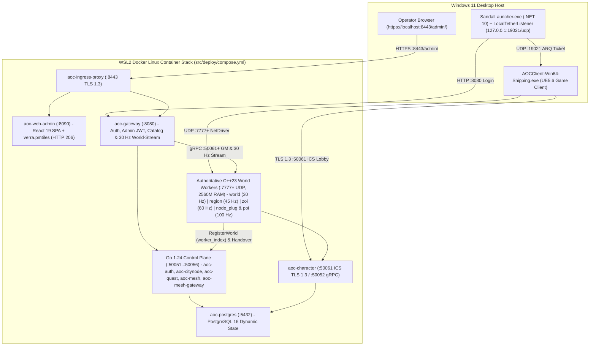

# SandalCore -- Ashes of Creation Clean-Room Server Emulator & GM Studio

**SandalCore** is a clean-room, multi-container server emulator, game-data extraction pipeline, desktop launcher, and real-time Web Admin & Game Master (GM) Studio for **Ashes of Creation** (Unreal Engine 5.6 `Verra_01`).

All server simulation workers (`src/server/world` in C++23) and control-plane microservices (`src/server/services` in Go 1.24) compile and execute inside hermetic Linux containers (`src/deploy/compose.yml`), while the cross-platform `.NET 10` Avalonia desktop launcher (`SandalLauncher`) and in-process UDP Tether responder (`127.0.0.1:19021/udp`) run natively on the Windows host.

---

## 1. Documentation Hub & Component Directory

SandalCore's documentation is organized by architectural concern. Use the tables below to navigate directly to any operational guide, subsystem specification, or component `README.md`:

### Core Architecture & Operational Guides (`docs/*.md`)

| Guide | Primary Focus & Scope |
|:---|:---|
| **[Configuration Reference (`docs/CONFIGURATION.md`)](docs/CONFIGURATION.md)** | Persistent root `.env` SSoT, default single-worker Riverlands fallback (`11` containers), tick rates (`30--120 Hz`), `.tsv` storage modes (`memory` vs. `disk`), startup passphrase & `HS256` JWT variables, `$HOME/.aoc/certs/*`, and `$HOME/.aoc/usmap/*`. |
| **[Operational Runbook & `.env` Partition Topologies (`docs/RUNBOOK.md`)](docs/RUNBOOK.md)** | First-time user out-of-the-box setup (`1` worker for Riverlands), copy-paste `.env` partition topology examples (`single_riverlands`, `single_world`, `per_region`, `per_zoi`, `per_zoi_nodes_and_pois`), optimal tick rates (`30--120 Hz`), `2560M` worker memory, `0` disk log churn, and full `worldctl` CLI playbooks. |
| **[Server Workers & Spatial Authority (`docs/SERVER_WORKERS.md`)](docs/SERVER_WORKERS.md)** | The 6 worker topology presets (`World | Region | ZOI | Node-Plug + ZOI | Dynamic Node-Plug + ZOI Stub | Dynamic ZOI Stub`), additive Convex Polygon / POI Cutout workers, Mix-and-Match composition, canonical naming (`aoc-world`, `aoc-<region>`, `aoc-<city>[-alpha..zulu]`, `aoc-<zoi>[-alpha..zulu]`), `worker_index` registration, multi-boundary player handover (`5,000 cm` buffer, `3`-sample dwell, `2,000 ms` cooldown), CityNode (`0..6`) scaling, and GM actor lifecycle RPCs. |
| **[Web Admin & GM Studio (`docs/WEB_ADMIN.md`)](docs/WEB_ADMIN.md)** & **[Web Admin Architecture (`docs/WEB_ADMIN_ARCHITECTURE.md`)](docs/WEB_ADMIN_ARCHITECTURE.md)** | Startup passphrase -> scoped `HS256` JWT authentication (`Username: Admin`, `END SESSION`, `boot_id` rotation), constant `30 Hz` (`33 ms`) viewport-bounded entity streaming, PostgreSQL (`world_simulation_state` + `city_node_state`) Control-Plane SSoT in `mesh-gateway` for continuous `9x` Time of Day + 360-day Verra Calendar (`Year >= 1 AE`, 4 seasons x 3 months x 30 days), per-worker tick-rate selector (`Dynamic (30-60 Hz)`, `0 Hz (Pause NPCs)`, manual `10..60 Hz`), `z=7` crisp base tiles (`zoom >= 3.0`), 3-pass unclipped ZOI borders, and the 4-zone **Observability** tab. |
| **[UI Style Guide & Design System (`docs/UI_STYLE_GUIDE.md`)](docs/UI_STYLE_GUIDE.md)** | Operational dark-slate C2 and glassmorphic design system, semantic color tokens, entity/map layer color coding, typography & spacing scale, `aoc-web-admin` 4-corner HUD & 4-zone analytics layout, `SandalLauncher` Avalonia 11 styling, and copy-paste React/XAML component blueprints. |
| **[Control-Plane Services & CLIs (`docs/SERVICES.md`)](docs/SERVICES.md)** | Go 1.24 control-plane microservices (`auth`, `character`, `citynode`, `quest`, `mesh`, `mesh-gateway`, `gateway`, `web-admin`), `aoc-ingress-proxy`, `aoc-postgres`, `30 Hz` service tick (`AOC_SERVICE_TICK_HZ=30`), `.tsv` `memory|disk` modes, and operator CLIs (`contentc`, `worldctl`, `nodectl`, `questctl`, `charimport`). |
| **[Wire Protocol Specifications (`docs/reference/wire-specs/README.md`)](docs/reference/wire-specs/README.md)** | Clean-room UE5.6 `IpNetDriver` UDP bit-stream framing (`StatelessConnect` 96B `Ext`, `NMT_*` control channel, `FNetBitWriter`), `127.0.0.1:19021/udp` ARQ Tether protocol, and `:50061` ICS TLS 1.3 lobby framing. |
| **[Patch Notes (`docs/PATCH_NOTES.md`)](docs/PATCH_NOTES.md)** | Chronological release notes (`v0.9.40` `content.db` `v41`, multi-tier worker authority, scoped JWT Web Admin, and `.tsv` storage modes). |
| **[Roadmap (`docs/ROADMAP.md`)](docs/ROADMAP.md)** & **[Known Issues (`docs/KNOWN_ISSUES.md`)](docs/KNOWN_ISSUES.md)** | Engineering milestone tracker, fidelity matrix, and documented edge cases. |
| **[Contributing (`docs/CONTRIBUTING.md`)](docs/CONTRIBUTING.md)** & **[Security Policy (`docs/SECURITY.md`)](docs/SECURITY.md)** | Clean-room engineering standards, verification gates (`public_check.ps1`, `test_functional_apis.ps1`), and zero-trust security invariants. |

### Source Component, Service, Library & Tool READMEs (`src/**/README.md`)

| Subsystem Category | Component README Links |
|:---|:---|
| **Authoritative C++23 Zone Server** | [`src/server/world/README.md`](src/server/world/README.md) (`world` binary, `30/45/60/100 Hz` simulation loop, `AreaFilter`, `NodePopulations`, `WorldControlService`) |
| **Go 1.24 Control-Plane Workspace** | [`src/server/services/README.md`](src/server/services/README.md) (module overview)<br/>- Daemons: [`cmd/auth`](src/server/services/cmd/auth/README.md) | [`cmd/character`](src/server/services/cmd/character/README.md) | [`cmd/citynode`](src/server/services/cmd/citynode/README.md) | [`cmd/quest`](src/server/services/cmd/quest/README.md) | [`cmd/mesh`](src/server/services/cmd/mesh/README.md) | [`cmd/mesh-gateway`](src/server/services/cmd/mesh-gateway/README.md) | [`cmd/gateway`](src/server/services/cmd/gateway/README.md) | [`cmd/admin-gateway`](src/server/services/cmd/admin-gateway/README.md) | [`cmd/web-admin`](src/server/services/cmd/web-admin/README.md)<br/>- Operator CLIs & Packages: [`cmd/contentc`](src/server/services/cmd/contentc/README.md) | [`cmd/worldctl`](src/server/services/cmd/worldctl/README.md) | [`cmd/nodectl`](src/server/services/cmd/nodectl/README.md) | [`cmd/questctl`](src/server/services/cmd/questctl/README.md) | [`cmd/charimport`](src/server/services/cmd/charimport/README.md) | [`internal/statprog`](src/server/services/internal/statprog/README.md) |
| **Client Applications** | [`src/clients/web-admin/README.md`](src/clients/web-admin/README.md) (React 19 + Deck.gl + MapLibre GL Web Admin & GM Studio SPA)<br/>[`src/clients/launcher/README.md`](src/clients/launcher/README.md) (`.NET 10` Avalonia `SandalLauncher`, root `SandalLauncher.lnk` shortcut, & `127.0.0.1:19021/udp` `LocalTetherListener`) |
| **C++23 Shared Libraries** | [`src/libs/aocnav/README.md`](src/libs/aocnav/README.md) (`libaocnav` Recast/Detour v1.6.0 tiled navmesh & `town_platforms.bin` height queries)<br/>[`src/libs/aocnet/README.md`](src/libs/aocnet/README.md) (`libaocnet` UE5.6 UDP bit-stream & bunch ARQ codec)<br/>[`src/libs/aocstats/README.md`](src/libs/aocstats/README.md) (`libaocstats` combat rating curves & mitigation math) |
| **Game-Data Extraction & Map Tools** | [`src/tools/aoc-extractor/README.md`](src/tools/aoc-extractor/README.md) (`.NET 10` UE5.6 IoStore `.utoc`/`.ucas` & `.usmap` extractor pipeline)<br/>[`src/tools/mapc/README.md`](src/tools/mapc/README.md) (`mapc` terrain, `town_platforms.bin`, & `.tsv` compiler) | [`src/tools/itemnames/README.md`](src/tools/itemnames/README.md) | [`src/tools/npcabilities/README.md`](src/tools/npcabilities/README.md) |
| **Deployment & PKI Certificates** | [`src/deploy/README.md`](src/deploy/README.md) (`compose.yml` container stack & Dockerfiles) | [`src/config/certs/README.md`](src/config/certs/README.md) (TLS 1.3 PKI & `$HOME/.aoc/certs/*` preservation) |

---

## 2. Quick Start & Prerequisites

### Host Prerequisites (Windows 11 + WSL2)

All C++23 and Go server binaries compile inside Linux containers. The Windows host requires only three tools:

1. **PowerShell 7.2+ (`pwsh`)**
2. **Docker Desktop (WSL2 backend)** (or native WSL2 `dockerd` managed automatically by `scripts/lib/wsl-docker.ps1`)
3. **.NET 10 SDK (`net10.0`)** (builds `SandalLauncher.exe` and `aoc-extractor`)
4. A local **Ashes of Creation** client installation (auto-discovered via Windows Registry or Steam `libraryfolders.vdf`, or set via `AOC_GAME_PATH` in `.env`)

### Three Root Entrypoints (`build.bat`, `start.bat`, `stop.bat`)

```powershell
# 1. Build Linux server containers, .NET 10 SandalLauncher, and extractor tools
.\build.bat

# 2. Extract game data (if needed), start the Linux container stack, print the
#    Web Admin startup passphrase, create root SandalLauncher.lnk, and launch SandalLauncher
.\start.bat

# 3. Gracefully stop all running SandalCore containers
.\stop.bat
```

Each `.bat` entrypoint forwards through `scripts/ensure_pwsh.bat` into the unified [`sandal.ps1`](sandal.ps1) orchestrator (`.\sandal.ps1 {build,extract,deploy,up,down,test,status,logs,clean}`). Running `.\start.bat` (`.\sandal.ps1 up`) also automatically creates a root `SandalLauncher.lnk` Windows shortcut pointing to `dist/launcher/SandalLauncher.exe` for one-click launch from the repository root.

---

## 3. 4-Tier Repository Layout (`src/`, `build/`, `dist/`, `deploy/`)

SandalCore enforces a strict 4-tier directory layout separating tracked source code from compiler intermediates, shippable artifacts, and active runtime state:

```mermaid
flowchart LR
    subgraph Tier1["1. src/ (Tracked Source Code)"]
        SrcWorld["src/server/world - C++23 Zone Server"]
        SrcServices["src/server/services - Go 1.24 Control Plane"]
        SrcClients["src/clients/{launcher,web-admin} - .NET 10 Launcher & React 19 SPA"]
        SrcLibsTools["src/libs/* & src/tools/* - C++23 Libs & Extractor Pipeline"]
    end

    subgraph Tier2["2. build/ (Out-of-Tree Build Intermediates)"]
        BuildDotnet["build/dotnet/{bin,obj}"]
        BuildDocker["Docker BuildKit Layer Cache"]
    end

    subgraph Tier3["3. dist/ (Compiled Artifacts & Extracted Data)"]
        DistLauncher["dist/launcher/SandalLauncher.exe"]
        DistContent["dist/content/content.db (v41) + 25 Runtime Artifacts & .tsv Tables"]
        DistCerts["dist/certs/{server.pem,server.key}"]
    end

    subgraph Tier4["4. deploy/ (Active Runtime State)"]
        DeployEnv["deploy/.env (Synced from Root .env) + deploy/.admin_passphrase"]
        DeployContent["deploy/content/* (Read-Only Mount)"]
        DeployPg["deploy/postgres/ (PostgreSQL 16 Volume)"]
    end

    Tier1 -->|"build.bat"| Tier2
    Tier2 -->|"Publish & Extract"| Tier3
    Tier3 -->|"Sync-SandalDeployStage"| Tier4
```



---

## 4. End-to-End System Architecture & `.env` Server Worker Partition Topologies

### First-Time User Out-of-the-Box Default (`1 Worker for Riverlands Only`)

Clicking `.\start.bat` out of the box (with no custom `.env` required) starts **1 authoritative zone worker for Riverlands only** (`AOC_WORLD_PARTITION_MODE=single_riverlands`, `AOC_WORLD_REGION=riverlands`, `AOC_WORLD_TOPOLOGY_MODE=single`), running **11 Linux containers total**: 10 control-plane/data containers (`aoc-postgres`, `aoc-auth`, `aoc-character`, `aoc-citynode`, `aoc-quest`, `aoc-mesh`, `aoc-mesh-gateway`, `aoc-gateway`, `aoc-web-admin`, `aoc-ingress-proxy`) and **1 C++23 Riverlands worker** (`aoc-riverlands` / `aoc-world`, `45 Hz` regional tick rate, `3600` NPC step cap, `2560M` memory limit, and `0` disk log churn via `read_only: true` + RAM `tmpfs`).

### Switching Server Worker Partition Topologies via Root `.env`

Switching from the default single-region Riverlands setup to multi-region, per-ZOI, or high-frequency Node-Plug/POI cut-out topologies is configured via root `.env` (synced to `deploy/.env` on `.\start.bat`). Copy-paste any of the 5 standard partition configurations below into `.env` (see [`docs/RUNBOOK.md`](docs/RUNBOOK.md) and [`docs/SERVER_WORKERS.md`](docs/SERVER_WORKERS.md) for full details):

```ini
# Setup 1: 1 Worker for 1 Region (Default out-of-the-box: Riverlands at 45 Hz / 3600 NPC step cap)
AOC_WORLD_PARTITION_MODE=single_riverlands
AOC_WORLD_REGION=riverlands
AOC_WORLD_TOPOLOGY_MODE=single

# Setup 2: 1 Worker for Whole World (All 5 Regions on 1 Worker at 30 Hz / 5200 NPC step cap)
AOC_WORLD_PARTITION_MODE=single_world
AOC_WORLD_REGION=all
AOC_WORLD_TOPOLOGY_MODE=world

# Setup 3: 1 Worker for Each Region (5 Regional Workers: riverlands, sandsquall, jundark, anvils, turquoise-sea at 45 Hz)
AOC_WORLD_PARTITION_MODE=per_region
AOC_WORLD_TOPOLOGY_MODE=region

# Setup 4: 1 Worker for Each ZOI (Zone of Influence Workers at 60 Hz / 2600 NPC step cap; e.g., sandsquall, riverlands, or random)
AOC_WORLD_PARTITION_MODE=per_zoi
AOC_WORLD_TOPOLOGY_MODE=zoi
AOC_WORLD_PARTITION_REGION=sandsquall

# Setup 5: 1 Worker for Each ZOI / POI / City Node Plug (High-Frequency 100 Hz / 1500 Cap Sub-Area Cut-Outs)
AOC_WORLD_PARTITION_MODE=per_zoi_nodes_and_pois
AOC_WORLD_TOPOLOGY_MODE=mixed
AOC_WORLD_PARTITION_REGION=sandsquall
AOC_WORLD_POI_CUTOUT=carphin
```

Every server worker receives a unique sequential **`worker_index`** (`1..N`) registered with [`aoc-mesh`](src/server/services/cmd/mesh/README.md) (`:50055`), operates within the **`30%--45%` green CPU band** under a **`2.5 GiB` (`AOC_WORLD_WORKER_MEM_LIMIT=2560M`)** container limit, and supports seamless multi-boundary player handovers (`5,000 cm` border buffer, `3`-sample consecutive dwell, `2,000 ms` cooldown, and `lease_epoch` fencing).



---

## 5. Web Admin & GM Studio Overview (`https://localhost:8443/admin/`)

When `.\start.bat` completes, it prints the **Web Admin Startup Banner** with `Username: Admin` and a fresh single-boot `Passphrase: <passphrase>` (also saved to `deploy/.admin_passphrase`). Opening `https://localhost:8443/admin/` (or `http://localhost:8090`) launches the [Web Admin & GM Studio](docs/WEB_ADMIN.md) (see also [Web Admin Architecture (`docs/WEB_ADMIN_ARCHITECTURE.md`)](docs/WEB_ADMIN_ARCHITECTURE.md)):

- **Startup Passphrase -> Scoped `HS256` JWT Authentication (`Username: Admin` & `END SESSION`)**: Exchanges the console passphrase (`Username: Admin`) at `POST /api/v1/admin/auth/login` for a scoped `HS256` Bearer JWT bound to the server's `boot_id` (`AOC_ADMIN_BOOT_ID`), with an explicit top-bar **`END SESSION`** button (`admin-logout-btn`). Restarting the server stack automatically invalidates prior browser tokens and prompts the Login Modal.
- **Constant `30 Hz` (`33 ms`) Entity Streaming & `z=7` Crisp Map Tiles**: Streams live players, NPCs, monsters, data-driven resource nodes (`pop.placements` + `pop.areas` with `Resource Type` & `Quality / Rarity`), and mounts within the visible camera AABB (`minX, minY, maxX, maxY`) at a constant **`30 Hz` (`33 ms` interval)** across all zoom levels without entity downsampling flicker, switching to `z=7` high-resolution minimap tiles at `zoom >= 3.0`.
- **PostgreSQL Control-Plane SSoT (`world_simulation_state` + `city_node_state`), Continuous `9x` Time of Day & 360-Day Verra Calendar**: `mesh-gateway` persists world simulation state (`world_simulation_state`) and settlement progression (`city_node_state`, with Tier 5/6 City Node population fallback to the last defined populated layout at Tier 4) in PostgreSQL. Tracks the continuous `kGameTimeFactor = 9.0` Verra clock (`2h 40m` real time per `24h` in-game day) and **360-day Verra Calendar** (`Year >= 1 AE`, `4` seasons x `3` months x `30` days) in the top-bar `Time HH:MM:SS` pill and interactive `VerraCalendarPopover` (`world-time-picker-popover`, `zIndex >= 100`).
- **3-Pass Unclipped ZOI Borders, Per-Worker Tick-Rate Selector (`0 Hz` NPC Pause) & Little's Law `<= 1.0 s` Backlog Floor**: Renders all 27 Settlement and Divine Gate ZOIs via a 3-pass unclipped border pipeline alongside rotated `1 km x 1 km` CityNode OBB plugs, a fixed-size `Visible Server Workers` panel (`450px x 208px`, scaling cleanly above `6` workers with vertical scrolling), and a per-worker tick-rate selector (`Dynamic (30-60 Hz)`, `0 Hz (Pause NPCs)` pausing NPC simulation on just that worker, and manual `10, 15, 20, 25, 30, 40, 50, 60 Hz`) backed by a Little's Law `<= 1.0 s` (`>= 1 Hz`) entity service-time backlog floor.
- **`Observability` Tab (4-Zone SRE Analytics, `<Service Name> (<Protocol>)` Health Cards & `Auto Tail` / `Auto Follow` Logs)**: The top-bar **`Observability`** tab displays Google SRE Four Golden Signals, Dynamic Server Worker Shards, consistent `<Service Name> (<Protocol>)` routing cards, the USE/RED Container Matrix, and a Structured Logs & GM Audit Trail viewer with `Auto Tail` and `Auto Follow` controls.

---

## 6. Verification & Quality Gates

Run the repository's automated static hygiene, unit test, and live end-to-end play-flow verification suites from PowerShell 7:

```powershell
# 1. Static architecture, public asset safety, and documentation reality check
pwsh -NoProfile -File scripts/checks/public_check.ps1

# 2. C++23 ctest, Go 1.24 unit tests, .NET 10 xUnit, and Web Admin Vitest suites
.\sandal.ps1 test

# 3. Mandatory live functional API & 10-stage UDP :7777 fake::Client play-flow gate
pwsh -NoProfile -File scripts/test_functional_apis.ps1
```
