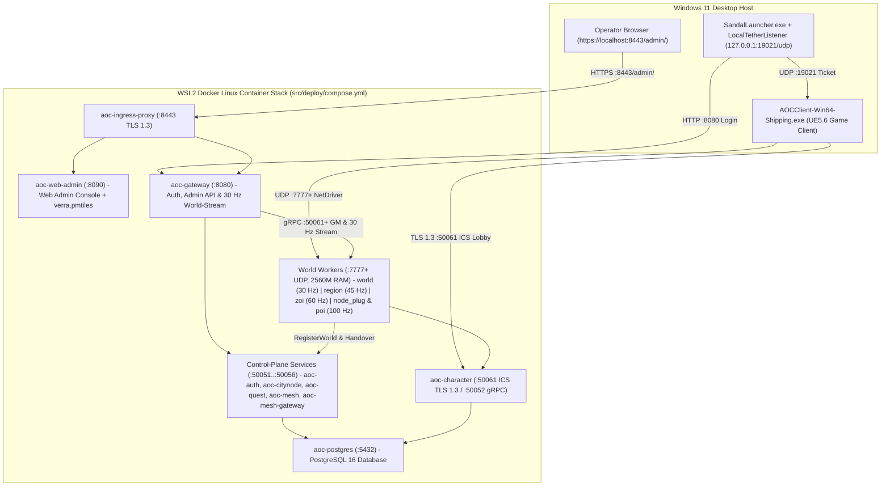

# SandalCore

**SandalCore** is a clean-room server emulator, game-data extraction pipeline, desktop launcher, and real-time Web Admin and Game Master (GM) console for **Ashes of Creation** (Unreal Engine 5.6 `Verra_01`).

All zone servers (`src/server/world`) and control-plane services (`src/server/services`) compile and run inside Linux containers (`src/deploy/compose.yml`). On Windows, the desktop launcher (`SandalLauncher`) handles account sign-in, runs the local UDP launcher tether on `127.0.0.1:19021`, and starts the game client.

---

## Documentation Directory

### Architecture and Operations Guides

| Guide | File | Description |
|:---|:---|:---|
| **[Configuration Reference](docs/CONFIGURATION.md)** | `docs/CONFIGURATION.md` | Environment variables, server settings, and TLS certificates. |
| **[Operational Runbook](docs/RUNBOOK.md)** | `docs/RUNBOOK.md` | Starting, stopping, updating, and operating the server stack. |
| **[Server Workers](docs/SERVER_WORKERS.md)** | `docs/SERVER_WORKERS.md` | How the world is divided across server workers and how players move between them. |
| **[Web Admin and GM Studio](docs/WEB_ADMIN.md)** | `docs/WEB_ADMIN.md` | Using the Web Admin console and Game Master tools. |
| **[Web Admin Architecture](docs/WEB_ADMIN_ARCHITECTURE.md)** | `docs/WEB_ADMIN_ARCHITECTURE.md` | How the Web Admin backend streams world state, persists data, and serves map tiles. |
| **[UI Style Guide](docs/UI_STYLE_GUIDE.md)** | `docs/UI_STYLE_GUIDE.md` | Colors, typography, and layout rules for the Web Admin console and desktop launcher. |
| **[Control-Plane Services](docs/SERVICES.md)** | `docs/SERVICES.md` | Control-plane services and command-line utilities. |
| **[Wire Protocol Specifications](docs/reference/wire-specs/README.md)** | `docs/reference/wire-specs/README.md` | Unreal Engine 5.6 UDP, launcher tether, and lobby network protocol specs. |
| **[Patch Notes](docs/PATCH_NOTES.md)** | `docs/PATCH_NOTES.md` | Release history and changelog. |
| **[Project Roadmap](docs/ROADMAP.md)** | `docs/ROADMAP.md` | Development milestones and feature status. |
| **[Known Issues](docs/KNOWN_ISSUES.md)** | `docs/KNOWN_ISSUES.md` | Known limitations and workarounds. |
| **[Contributing Guide](docs/CONTRIBUTING.md)** | `docs/CONTRIBUTING.md` | Coding standards and contribution workflow. |
| **[Security Policy](docs/SECURITY.md)** | `docs/SECURITY.md` | Security policy and vulnerability reporting. |

### Component Guides

| Area | Guides |
|:---|:---|
| **Zone Server** | [World Server](src/server/world/README.md) (`src/server/world`) |
| **Control Plane** | [Services Overview](src/server/services/README.md) (`src/server/services`)<br/>Services: [Auth](src/server/services/cmd/auth/README.md) \| [Character](src/server/services/cmd/character/README.md) \| [CityNode](src/server/services/cmd/citynode/README.md) \| [Quest](src/server/services/cmd/quest/README.md) \| [Mesh](src/server/services/cmd/mesh/README.md) \| [Mesh Gateway](src/server/services/cmd/mesh-gateway/README.md) \| [Gateway](src/server/services/cmd/gateway/README.md) \| [Admin Gateway](src/server/services/cmd/admin-gateway/README.md) \| [Web Admin Server](src/server/services/cmd/web-admin/README.md)<br/>CLIs & Packages: [Content Compiler](src/server/services/cmd/contentc/README.md) \| [World CLI](src/server/services/cmd/worldctl/README.md) \| [Node CLI](src/server/services/cmd/nodectl/README.md) \| [Quest CLI](src/server/services/cmd/questctl/README.md) \| [Character Import](src/server/services/cmd/charimport/README.md) \| [Stat Bytecode Engine](src/server/services/internal/statprog/README.md) |
| **Clients** | [Web Admin Frontend](src/clients/web-admin/README.md) (`src/clients/web-admin`) \| [SandalLauncher](src/clients/launcher/README.md) (`src/clients/launcher`) |
| **Shared Libraries** | [Navigation](src/libs/aocnav/README.md) (`src/libs/aocnav`) \| [Wire Protocol](src/libs/aocnet/README.md) (`src/libs/aocnet`) \| [Stat Evaluation](src/libs/aocstats/README.md) (`src/libs/aocstats`) |
| **Extraction Tools** | [Game-Data Extractor](src/tools/aoc-extractor/README.md) (`src/tools/aoc-extractor`) \| [Map Compiler](src/tools/mapc/README.md) (`src/tools/mapc`) \| [Item Names](src/tools/itemnames/README.md) \| [NPC Abilities](src/tools/npcabilities/README.md) |
| **Deployment** | [Container Stack](src/deploy/README.md) (`src/deploy`) \| [TLS Certificates](src/config/certs/README.md) (`src/config/certs`) |

---

## Quick Start

### Prerequisites

All server binaries compile inside Linux containers, so you do not need a C++ compiler on Windows. Your Windows 11 machine needs four things:

1. **PowerShell 7.2 or newer (`pwsh`)** to run the build and startup scripts.
2. **Docker Desktop with the WSL2 backend** (or native WSL2 `dockerd`).
3. **.NET 10 SDK (`net10.0`)** to build `SandalLauncher.exe` and the extraction utilities.
4. **An installed Ashes of Creation game client**, detected automatically from the Windows Registry, Steam (`libraryfolders.vdf`), or `AOC_GAME_PATH` in `.env`.

### Building, Starting, and Stopping

Run these three batch scripts from the repository root:

1. **Build the containers and desktop tools**:
   ```powershell
   .\build.bat
   ```
   Compiles the Linux server containers, builds `dist/launcher/SandalLauncher.exe`, and builds the game-data extractor tools.

2. **Start the server stack and open the launcher**:
   ```powershell
   .\start.bat
   ```
   Extracts game data into `dist/content/` if needed, starts the Linux container stack, prints the Web Admin passphrase in the terminal, creates a `SandalLauncher.lnk` shortcut in the repository root pointing to `dist/launcher/SandalLauncher.exe`, and opens `SandalLauncher`.

3. **Stop the server stack**:
   ```powershell
   .\stop.bat
   ```
   Stops all running SandalCore containers while keeping your database and `.env` settings intact.

You can also run [`sandal.ps1`](sandal.ps1) directly (`.\sandal.ps1 {build,extract,deploy,up,down,test,status,logs,clean}`).

---

## Repository Layout

SandalCore separates source code, compiler intermediates, packaged artifacts, and active container state into four root directories:

- **`src/`** holds all tracked source code: the zone server (`src/server/world`), control-plane services (`src/server/services`), desktop launcher and Web Admin frontend (`src/clients`), shared libraries (`src/libs`), extractor tools (`src/tools`), and deployment manifests (`src/deploy`).
- **`build/`** holds temporary compiler output (`build/dotnet/{bin,obj}`) and can be deleted at any time.
- **`dist/`** holds built binaries (`dist/launcher/SandalLauncher.exe`), TLS certificates (`dist/certs/`), and extracted game data (`dist/content/content.db` schema `v41`, navmeshes, map tiles, and `.tsv` tables).
- **`deploy/`** holds the active runtime state synced on startup, including `deploy/.env`, `deploy/.admin_passphrase`, read-only game data (`deploy/content/`), and PostgreSQL volume data (`deploy/postgres/`).

```mermaid
flowchart LR
    subgraph Tier1["1. src/ (Tracked Source Code)"]
        SrcWorld["src/server/world - Zone Server"]
        SrcServices["src/server/services - Control Plane"]
        SrcClients["src/clients/{launcher,web-admin} - Desktop & Web Clients"]
        SrcLibsTools["src/libs/* & src/tools/* - Libraries & Extractors"]
    end

    subgraph Tier2["2. build/ (Build Intermediates)"]
        BuildDotnet["build/dotnet/{bin,obj}"]
        BuildDocker["Docker BuildKit Cache"]
    end

    subgraph Tier3["3. dist/ (Compiled Artifacts & Game Data)"]
        DistLauncher["dist/launcher/SandalLauncher.exe"]
        DistContent["dist/content/content.db (v41) & 25 Runtime Artifacts"]
        DistCerts["dist/certs/{server.pem,server.key}"]
    end

    subgraph Tier4["4. deploy/ (Active Runtime State)"]
        DeployEnv["deploy/.env & deploy/.admin_passphrase"]
        DeployContent["deploy/content/* (Read-Only Mount)"]
        DeployPg["deploy/postgres/ (PostgreSQL Volume)"]
    end

    Tier1 -->|"build.bat"| Tier2
    Tier2 -->|"Publish & Extract"| Tier3
    Tier3 -->|"start.bat Sync"| Tier4
```



---

## Server Architecture and Worker Topologies

### Default Setup

Out of the box, `.\start.bat` starts **1 zone worker for the Riverlands region** (`AOC_WORLD_PARTITION_MODE=single_riverlands`, `AOC_WORLD_REGION=riverlands`, `AOC_WORLD_TOPOLOGY_MODE=single`).

This default stack runs **11 Linux containers**: 10 control-plane and database containers (`aoc-postgres`, `aoc-auth`, `aoc-character`, `aoc-citynode`, `aoc-quest`, `aoc-mesh`, `aoc-mesh-gateway`, `aoc-gateway`, `aoc-web-admin`, and `aoc-ingress-proxy`) plus 1 Riverlands worker (`aoc-riverlands` / `aoc-world` at `45 Hz` with a `2560M` RAM limit).

### Worker Partition Topologies

To divide the world across multiple server workers, copy one of the five configurations below into your root `.env` file and run `.\start.bat`. See the [Operational Runbook](docs/RUNBOOK.md) and [Server Workers](docs/SERVER_WORKERS.md) for details.

```ini
# Setup 1: 1 Worker for 1 Region (Default: Riverlands at 45 Hz)
AOC_WORLD_PARTITION_MODE=single_riverlands
AOC_WORLD_REGION=riverlands
AOC_WORLD_TOPOLOGY_MODE=single

# Setup 2: 1 Worker for the Whole World (All 5 Regions on 1 Worker at 30 Hz)
AOC_WORLD_PARTITION_MODE=single_world
AOC_WORLD_REGION=all
AOC_WORLD_TOPOLOGY_MODE=world

# Setup 3: 1 Worker per Region (5 Regional Workers at 45 Hz)
AOC_WORLD_PARTITION_MODE=per_region
AOC_WORLD_TOPOLOGY_MODE=region

# Setup 4: 1 Worker per ZOI (Zone of Influence Workers at 60 Hz)
AOC_WORLD_PARTITION_MODE=per_zoi
AOC_WORLD_TOPOLOGY_MODE=zoi
AOC_WORLD_PARTITION_REGION=sandsquall

# Setup 5: ZOI Workers with City Node and POI Cut-Outs (60 Hz ZOI + 100 Hz Sub-Areas)
AOC_WORLD_PARTITION_MODE=per_zoi_nodes_and_pois
AOC_WORLD_TOPOLOGY_MODE=mixed
AOC_WORLD_PARTITION_REGION=sandsquall
AOC_WORLD_POI_CUTOUT=carphin
```



---

## Web Admin Console

When `.\start.bat` finishes starting the stack, it prints `Username: Admin` and a single-boot passphrase in the terminal (also saved to `deploy/.admin_passphrase`). Open `https://localhost:8443/admin/` (or `http://localhost:8090`) in your browser to use the [Web Admin and GM Studio](docs/WEB_ADMIN.md):

- **World Map and Inspector**: View live world populations (`Players`, `NPCs`, `Monsters`, `Huntables`, `Trees`, `Rocks`, `Ore & Gems`, `Plants`, and `Mounts`) updated at `30 Hz`. Click any entity, Point of Interest, settlement, or ground position to inspect its state, teleport players, spawn NPCs, or change City Node stages (`0..6`).
- **World Clock and Worker Controls**: `aoc-mesh` and `aoc-mesh-gateway` maintain a single shared world clock and calendar across all workers, advancing at `9x` real-time speed through a `360`-day Verra year divided into four `90`-day seasons (`Spring`, `Summer`, `Autumn`, and `Winter`). From the `Visible Server Workers` panel or the **Observability** tab, you can set any worker's target tick mode (`Dynamic` `30-120 Hz` auto-scaling, `0 Hz` to pause ambient NPC AI, or a fixed `10..60 Hz` rate) while viewing its read-only actual `Current Hz`.
- **Observability Tab**: Switch to **Observability** to inspect plain-English cluster health, traffic, and logs:
  - **World Population and Traffic Summary**: Live counts for `Players`, `NPCs`, `Monsters`, `Huntables`, `Trees`, `Rocks`, `Ore & Gems`, `Plants`, and `Mounts`, `API Cache Hits / Misses` (how often catalog and state lookups are served directly from memory), and `UDP Frames Forwarded`.
  - **Service Routing and HTTP Status Breakdown**: Per-service request volume broken down by HTTP status class (`2xx` successful responses, `3xx` redirects, `4xx` client request errors, and `5xx` server errors), timeouts, and active connections.
  - **Container Health and Metrics Endpoints**: CPU, memory, network I/O, and live `Health` status (`Monitored Metrics` and response time) collected from cluster-internal `/metrics` endpoints (`http://mesh-gateway:8082/metrics`, `http://<worker>:8080/metrics`, and `http://<service>:18080/metrics`), paired with a searchable live container log viewer (`Auto Tail` and `Auto Follow`) and the Game Master audit trail.

---

## Testing and Verification

Run the automated checks, unit tests, and live integration suite from PowerShell 7:

```powershell
# 1. Verify repository layout, asset safety, and documentation links
pwsh -NoProfile -File scripts/checks/public_check.ps1

# 2. Run server, control-plane, launcher, and Web Admin unit test suites
.\sandal.ps1 test

# 3. Run the live functional API and fake::Client play-flow suite
pwsh -NoProfile -File scripts/test_functional_apis.ps1
```
