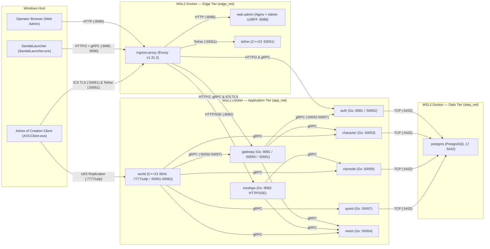

# SandalCore

An independent, open-source server emulator compatible with the Ashes of Creation client, developed by Cyb.

> [!IMPORTANT]
> **Not affiliated with Intrepid Studios.** SandalCore is an independent project. It is not affiliated with, sponsored by or endorsed by Intrepid Studios, Inc. *Ashes of Creation* is a trademark of Intrepid Studios, Inc., named here only to say which game client this server works with. The repository contains no game client, game files or Intrepid code: the data the servers need is built on your PC from your own installed copy of the game.

> [!WARNING]
> **Work in Progress**: SandalCore is **NOT** a final product. It is under active and consistent development; expect bugs, incomplete features, and ongoing protocol refinements. Please refer to [ROADMAP.md](docs/ROADMAP.md) for milestone progress, [KNOWN_ISSUES.md](docs/KNOWN_ISSUES.md) for current known limitations and workarounds, and [PATCH_NOTES.md](docs/PATCH_NOTES.md) for recent changes.

## Documentation

- [`docs/ROADMAP.md`](docs/ROADMAP.md): 16-phase milestone status, achieved features, and remaining work.
- [`docs/KNOWN_ISSUES.md`](docs/KNOWN_ISSUES.md): Current gameplay limitations, server constraints, and workarounds.
- [`docs/PATCH_NOTES.md`](docs/PATCH_NOTES.md): Dated changelog of features and fixes.
- [`docs/CONTRIBUTING.md`](docs/CONTRIBUTING.md): Branch conventions, clean-room guidelines, and test requirements.
- [`docs/SECURITY.md`](docs/SECURITY.md): Private vulnerability reporting policy.
- [`docs/reference/wire-specs/README.md`](docs/reference/wire-specs/README.md): Protocol and binary format wire specifications.

---

## Architecture & 12-Container Stack

SandalCore runs a 12-container Linux server stack inside WSL2 Docker ([`src/deploy/compose.yml`](src/deploy/compose.yml) and [`src/deploy/envoy/envoy.yaml`](src/deploy/envoy/envoy.yaml)) paired with the Windows desktop launcher **`SandalLauncher`** (`dist\launcher\SandalLauncher.exe` / `dist\launch_launcher.bat`). All C++ (`world`, `tether`) and Go (`gateway`, `auth`, `character`, `citynode`, `quest`, `mesh`, `meshgw`) server binaries compile inside multi-stage Linux Docker containers ([`src/deploy/docker/cpp.Dockerfile`](src/deploy/docker/cpp.Dockerfile) and [`src/deploy/docker/go.Dockerfile`](src/deploy/docker/go.Dockerfile)), while `world` serves authoritative 30 Hz UDP replication directly to the Ashes of Creation client.



| # | Container | Runtime | Ports (Host / Container) | Role |
|---:|---|---|---|---|
| 1 | `ingress-proxy` | Envoy v1.31.2 | `:8080` HTTP/2 & Web Admin UI, `:9090` gRPC ingress, `:50061` ICS TLS, `:50051` Tether, `:9901` Envoy admin | Edge reverse proxy routing browser, launcher, and client traffic across `edge_net` and `app_net` |
| 2 | `gateway` | Go | `:8081` HTTP, `:50050` gRPC, `:50061` ICS TLS | Client session & ICS TLS gateway, character screen, and world handoff tickets |
| 3 | `auth` | Go | `:8081` HTTP, `:50052` gRPC | Account registration, login, and session token validation |
| 4 | `character` | Go | `:50053` gRPC | Character creation, inventory, equipment, starting kits, and persistence |
| 5 | `citynode` | Go | `:50056` gRPC | Intrepid Node progression, citizenship, workshops, and tax/mayoral state |
| 6 | `quest` | Go | `:50057` gRPC | Quest state machine, objectives, and dialogue progression |
| 7 | `mesh` | Go | `:50054` gRPC | World zone registry, server boundary authority, and handover coordinator |
| 8 | `meshgw` | Go | `:8082` HTTP/SSE | Mesh HTTP/SSE gateway streaming live node, world, and GM state |
| 9 | `web-admin` | Nginx + Admin UI/BFF | `http://127.0.0.1:8080/` via Envoy (`:8088` internal) | Browser control plane for realm status, accounts, nodes, and world telemetry |
| 10 | `tether` | C++23 | `:50051` container (`:19021` standalone) | Fast UDP/TCP session tether handing client auth tokens to `AOCClient.exe` |
| 11 | `world` | C++23 | `127.0.0.1:7777/udp`, `:50061` / `:50062` gRPC | Authoritative 30 Hz world simulation, replication, combat, NPC AI, and navmesh runtime |
| 12 | `postgres` | PostgreSQL 17 | `127.0.0.1:5432` | Relational database isolated on `data_net` |

---

## What Works Today

SandalCore provides an independent server emulation stack for the Ashes of Creation client: the 12-container backend (`ingress-proxy`, the Go services `gateway`, `auth`, `character`, `citynode`, `quest`, `mesh`, `meshgw`, `web-admin`, `postgres`, `tether`, and the C++23 world server `world`) together with the Windows desktop launcher **`SandalLauncher`** (`dist\launcher\SandalLauncher.exe` / `dist\launch_launcher.bat`).

- **Protocol & Network Transport**: Full UE5 / IntrepidNetDriver handshake, stateless connect, packet framing, bunch replication, and dynamic NetGUID allocation.
- **Authentication & Character Management**: gRPC and REST-based authentication services, account profiles, character creation with full visual appearance customization serialization, and character select lobby transitions.
- **World Bootstrap & Replication**: Seamless map loading into `/Game/Levels/Verra_World_Master`, actor creation channels, possession handshakes, and player controller state replication.
- **Authoritative Stats Engine**: Core attribute formulas, expression evaluation graph, compiled stat program bytecode, and dynamic recalculation of stats upon equipment changes.
- **Progression, Items, and Talents**: Adventuring XP curves, level thresholds, skill tree talent acquisition, action bar persistence, inventory storage, and consumable item effects.
- **Complete Combat & Ability Runtime**: Authoritative ability pipeline supporting all retail classes, cast validation steps, cooldown ledgers, projectile trajectories, hit confirmation RPCs, floating combat numbers, shields, songs, buff/debuff effect stacks, weapon combos with their finishers, weapon swaps, and weapons that scale with the power they are meant for (Physical or Magical).
- **Living World & Navigation**: Chunked navmesh windows, Riverlands region partitioning, NPC actor spawning, creatures that notice players by hearing and sight and give up 140 m from where the fight began, wolves, bears, ravens, goblins and Grems that fight with their own attacks and animations, combat engagement, loot drops (rolled afresh on every server start), and respawn cycles.
- **Mounts & Traversal**: Ground, flying, and aquatic mount summoning, riding possession, mount combat mechanics, sprint/dash abilities, and road speed modifiers.
- **City Node Civilization**: Background `CityNodeService`, node experience accrual, level transitions, town layout replication, the real floor of the five towns with a safety net under it and their buildings in the walking map, the towns' people dressed and named from the game's own records, the walkers among them walking their routes, and the citizenship and mayor data the client reads (the citizenship and mayor rules are still to come).
- **Launcher (`SandalLauncher`)**: `dist\launcher\SandalLauncher.exe` (`dist\launch_launcher.bat`) finds your game, signs in (with "Keep me signed in" it signs in by itself at start), validates local TLS certificates via `X509ChainPolicy.CustomTrustStore`, and starts the game when you press LAUNCH GAME.
- **Gathering & Professions**: the 22 gathering professions, node harvesting (mining, lumberjacking and herbalism), the Riverlands' trees, plants and stones that grow back, huntable animals, resource bags and the pick-up popup.
- **Conversations & Quests**: the NPC talking window with the game's conversation data (lines a character does not qualify for are hidden), quest givers that offer their quests, accepting, the journal and the tracker, abandoning, quests kept across logins, objectives that count, the objects of the quests that you search and use (bodies, crates, roots, building sites), the hand-in with its rewards (items, experience and Glint), and the first quests of the starting area on both ways, with map pins for the objectives of active quests and a mark over the people who have a quest to take.
- **Merchants, Currency & Glint**: gold, silver and copper; buying, selling, repairing and destroying items at each town's general merchant; the Black Market, the caravan salesman and the sheriff's shops; Glint in its six kinds, paid for kills and rewards in kinds, and ten of a kind turned into one of the next with a right-click.
- **Crafting**: the crafting and processing stations of every Camp, Village and Town (they follow their node's level), processing jobs that are started, queued and collected with their items and experience, crafting at a station, the quick make, and recipes a game master can teach.
- **Item Rarities**: rarities for resources, weapons and armor, from creatures, harvests, shops and crafting; the game master's `give-item` can name a rarity.
- **Storage**: the Storage Clerk's free item storage and the town's materials storage, kept across logins.
- **Embersprings**: the 24 Embersprings of the Riverlands: discovering them, attuning to one, and choosing where to respawn.
- **Quiet Requests**: tutorials that stay done, the active and hover targets, the PvP flag, closed loot windows and the map marker.
- **Game Master & Admin Tools**: `worldctl` (teleport, speed, money and items, stations, crafting, tutorials, creature actions and a live watch of the world stream), `nodectl` (city node levels and experience), `questctl` (quests), and the `web-admin` browser UI at `http://127.0.0.1:8080/`.

---

## Build and run (Windows)

You need a Windows 10/11 x64 PC with your own installed copy of Ashes of Creation. SandalCore contains no game data: the first run reads your installed client (the files are only read, nothing in the game folder is changed) and extracts the data the servers need.

### 1. What to install

All C++ (`world`, `tether`) and Go (`auth`, `gateway`, `character`, `citynode`, `quest`, `mesh`, `meshgw`) server binaries compile inside multi-stage Linux Docker containers ([`src/deploy/docker/cpp.Dockerfile`](src/deploy/docker/cpp.Dockerfile) and [`src/deploy/docker/go.Dockerfile`](src/deploy/docker/go.Dockerfile)). **Visual Studio C++, CMake, `vcpkg`, Go, and Python are NOT required on Windows** to build and run the containerized server stack.

| What | Version | What it is for |
|---|---|---|
| **Ashes of Creation** (Steam) | the build of 2026-01-29 | the source of the game data; it has to be installed on this PC |
| **WSL2 + Docker Engine / Docker CLI** | current | builds and runs all 12 Linux server containers (`postgres`, `ingress-proxy` Envoy, 7 Go services, `web-admin`, `tether`, and `world`); installed automatically via `pwsh -File sandal.ps1 install-wsl-docker` (standalone WSL2 engine) |
| **.NET 8 SDK** | 8.0 (any 8.x; with the 8.0 runtime) | builds and runs `SandalLauncher.exe` and the game data extractor (`aoc-extractor`), restoring NuGet dependencies (including `CUE4Parse`) automatically via the `.NET SDK` |
| **Git** | any current version | clones and updates the repository (and provides OpenSSL for local certificate generation) |

> [!NOTE]
> **Optional: Native Windows Host Build (`dist/` without containers)**
> If you want to compile native Windows `.exe` server binaries directly on the host into `dist/` instead of running the Linux container stack (`scripts\install_dependencies.ps1` checks and installs these optional host tools via winget):
>
> | Optional Host Tool | Version | Purpose |
> |---|---|---|
> | **Visual Studio 2022 Build Tools** ("Desktop development with C++") | MSVC v143 | Compiles native Windows `world.exe`, `tether.exe`, and C++ tests |
> | **CMake** & **[vcpkg](https://github.com/microsoft/vcpkg)** | CMake 3.25+, current `vcpkg` | Configures the native Windows C++ build and Windows C++ libraries |
> | **Go** | 1.27+ (`src/server/services/go.mod`) | Compiles native Windows Go service `.exe` binaries and `contentc` on the host |
> | **Python** | 3.10+ | Runs offline header/schema generators on the host |

Disk: allow about 10 GB free for the extracted game data (`1.5 GB`) and container images (or about 20 GB if also building native Windows C++ binaries on the host). Memory: at least 6 GB free while the game data is extracted (the map reader peaks near 4 GB).

### 2. The commands, in this order

1. `pwsh -File sandal.ps1 install-wsl-docker` (one-time setup if WSL2 + Docker Engine are not yet installed).
2. `start.bat` (or `pwsh -File sandal.ps1 up` / `pwsh -File scripts\launch_all.ps1`): extracts the game data from your installed client if needed (about 10 minutes on the first run; seconds on later runs), generates your local ECDSA P-256 CA and SAN leaf certificates in `dist\certs\` and `deploy\certs\`, builds and starts the 12-container Linux server stack in WSL2 (`deploy/compose.yml` / `deploy/up.ps1`), and opens **`SandalLauncher`** (`dist\launcher\SandalLauncher.exe`). Sign in (or let "Keep me signed in" do it) and press **LAUNCH GAME**. Use `stop.bat` (or `pwsh -File sandal.ps1 down`) to stop the stack.

To extract only the game data on its own, run `pwsh -File scripts\extract_game_data.ps1`. To compile native Windows `.exe` binaries on the host into `dist\`, run `pwsh -File scripts\build.ps1 -Target all`.

### 3. The game data (`scripts\extract_game_data.ps1`)

**Where the game is found**, in this order: `scripts\extract_game_data.ps1 -GameRoot "D:\...\Ashes of Creation\Game"`, the environment variable `GAME_ROOT`, `game_executable` in `src\config\paths.json` (the launcher's Auto-Detect and Browse buttons save the path in `dist\Release\config\paths.json`, which is read too), Steam's libraries (found through the registry and `libraryfolders.vdf`), then the usual folders on every fixed drive. The game folder is the one that holds `AOCClient.exe` and the `AOC` folder; with Steam it is `...\steamapps\common\Ashes of Creation\Game`. `-GameRoot` counts for that one run only (`scripts\build.ps1 -Target all` does not pass it on). If your game is in an unusual place, set `GAME_ROOT` once, with `setx GAME_ROOT "D:\...\Ashes of Creation\Game"`, and open a new window: then `scripts\extract_game_data.ps1`, `scripts\build.ps1 -Target all` and the launchers all find it.

**What it makes** (all of it git-ignored; [`.gitignore`](.gitignore) lists the generated sources):
- `dist\content\content.db` (323 MB): the game numbers the servers use (`contentc`, from the client's `CacheDB.dbc`);
- `dist\content\*.tsv`: mount speeds and riders, profession curves, NPC motion, foliage and roads (`src\tools\mapc`, from the game's containers, and `contentc roads`);
- `dist\content\item_names.tsv`: the words the Glint kinds and some quest items are named with (`src\tools\itemnames`, from the game's containers);
- `dist\content\npc_abilities.tsv`, `npc_montages.tsv`, `npc_targeting.tsv`, `npc_senses.tsv` and `npc_aggro_curves.tsv`: what the creatures attack with, how their attack animations carry them, where each hit lands, and what each creature notices and how far it follows (`src\tools\npcabilities`, from the game's containers and `content.db`);
- `dist\content\npc_looks.tsv`, `npc_appearances.tsv`, `npc_names.tsv` and `npc_trees.tsv`: how the people (humanoid NPCs) look, what they are called, and whether they wander or patrol (`src\tools\npcabilities`, from the game's containers and `content.db`);
- `dist\content\town_platforms.bin` (4 MB): the floor of the five towns (`src\tools\mapc`, from two of the game's map packages);
- `dist\content\town_layout_items.tsv` (6 MB) and `town_layouts.bin` (13 MB): the buildings, walls and terraces of the five towns at the level each town starts at (a list made from the design data by `src\tools\schemagen\gen_town_layouts.py`, then their collision from the game's packages by `src\tools\mapc`);
- `dist\content\area_nav.bin` (974 MB) and `area_geom.bin` (232 MB): the navigation mesh, with the towns' buildings in it (`src\tools\mapc` and `aoc_navbuild`);
- `dist\content\client_config\` and `zoi_chunks\`: the game's config files and its zone grid, which the generators read;
- the generated sources and test fixtures the build includes (for example `zoi_surface_table.h`, `node_constants.h`, `region_data.h`).

**The towns' levels.** The navigation mesh holds each of the five towns with the buildings of the level the server starts that town at, the one `src\config\seeds\citynode_seed.json` gives it (Joeva 4, Town; Halcyon 3, Village; the other three 0, Wilderness). If a GM changes a town's level in the game (`nodectl set-level`), the town in the game changes with it, but the navigation mesh keeps the buildings of the level it was made for: people can then walk where a new house stands or stand on a floor that is gone, until the mesh is made again. To make it for other levels, change the levels in the seed file and run `scripts\extract_game_data.ps1` again (the buildings and navigation mesh steps run, about 10 minutes). A level change in the game that swaps the mesh by itself is a later update.

**How long:** about 10 minutes the first time on a fast PC (24 threads, 31 GB: 10.3 minutes in all, of which the map read and the navigation mesh take 8); a slower PC takes longer. Every step is skipped when what it reads has not changed, so running it again takes about a second. `scripts\extract_game_data.ps1 -CheckOnly` says what would run, `-Only <step>` runs one step (the steps are `tools`, `config`, `curves`, `names`, `database`, `region`, `headers`, `fixtures`, `navbuild`, `roads`, `townfloors`, `townlayouts`, `npcabilities`, `navmesh`), `-Skip <step>` leaves one out and `-Force` runs everything again. The output of every program is kept in `dist\content\.extract\`; `last_run.log` has all of it.

**Network:** the first build downloads NuGet packages for the .NET 8 tools (`aoc-extractor`, `SandalLauncher`, `mapc`) and container base layers / Go modules inside the Docker build. Nothing is downloaded at runtime after the initial build.

**After a game patch:** run `scripts\extract_game_data.ps1` (or `scripts\build.ps1 -Target all`) again. It sees that the game files changed and rebuilds everything that depends on them, about 10 minutes. The code is made for the client build of 2026-01-29 (`AOCClient-Win64-Shipping.exe` 235,606,624 bytes, `CacheDB.dbc` 144,085,052 bytes). With any other build the script prints a warning and goes on; the data can then be wrong or a step can fail.

**Navigation mesh (required for combat).** `world` starts its combat system only after `dist\content\area_nav.bin` loads; **without it every mob has 0 HP and damage does nothing** (see [KNOWN_ISSUES.md](docs/KNOWN_ISSUES.md)). The `navmesh` step builds it; `scripts\extract_game_data.ps1 -Skip navmesh` leaves it out.

**What is in the repository.** `src/config/layouts/aoc.usmap` holds the names, types and layouts of the game's classes, structs and enums, as `src\libs\aocnet\protocol\schema\generated\` and `src\server\services\internal\designdb\exe_gen.go` do for the network protocol and the design database; none of the three holds game content.

### 4. If something goes wrong

| You see | Why | What to do |
|---|---|---|
| `The Ashes of Creation client was not found` | the game is not installed on this PC, or it sits in an unusual folder | install it (Steam), or run `scripts\extract_game_data.ps1 -GameRoot "D:\...\Ashes of Creation\Game"` (that run only), or set `GAME_ROOT` to that folder for good (`setx GAME_ROOT "D:\...\Ashes of Creation\Game"`, then open a new window) |
| `-GameRoot '...' is not the game's folder` | the folder has no `AOC\Content\Paks` or no `CacheDB.dbc` | give the folder that holds `AOCClient.exe` and `AOC` (the `Game` folder of the install), not the launcher folder; if the install is incomplete, let Steam verify the game files |
| `WARNING: this client is not the build this code was made for` | the game was patched, or it is another build | the script goes on; the data may be wrong or a step may fail (see "After a game patch") |
| `Missing: ...` followed by `Python 3.10 or newer`, `the .NET 8 SDK` or `Go` | that tool is not installed or not on `PATH` | run `scripts\install_dependencies.ps1`, open a new window (so the new `PATH` applies), run again |
| CMake: `These files are made from your own Ashes of Creation install and are missing` | the C++ build ran before the game data was made | run `scripts\extract_game_data.ps1`, then build again |
| `ERROR in step '...'` | a step failed | read `dist\content\.extract\last_run.log` and fix the cause; run again: finished steps are kept and the run continues at the failed one |
| `waiting: ...` in the map step | the map read waits until at least 6 GB of memory are free and the game, a build and `aoc_navbuild` are not running | close them; it continues by itself and gives up after 40 minutes |
| the CUE4Parse fetch fails | no network or no Git | connect and run again, or copy the folder yourself: `powershell -File src\tools\mapc\fetch_cue4parse.ps1 -From <folder with CUE4Parse>` |
| every mob has 0 HP and damage does nothing | `dist\content\area_nav.bin` is missing | run `scripts\extract_game_data.ps1` (without `-Skip navmesh`) |

### 5. More build options

- **Everything:** `scripts\build.ps1 -Target all` (the game data, then `powershell -File scripts\build.ps1 -Target all`).
- **One program:** `powershell -File scripts\build.ps1 -Target world` (targets: `tether`, `launcher`, `world`). The game data has to be made first.
- **Options:** `-Config Debug`, `-Clean`, `-Configure` (re-run CMake), `-Test`, `-Jobs N` (build at most N projects and at most N compiler processes at a time; without it the compilers use as many processors as the free memory allows); `scripts\build.ps1 -Target all` passes them on.
- **Why it is fast:** the build compiles the files of one project in parallel, and it copies the libraries' DLLs into `dist\Release` once after the build instead of after every program. A `build\x64` folder made by an earlier version keeps working as it was; `build.ps1 -Configure` switches it over.
- **Plain CMake** (it works, but it is slower: one file at a time inside a project, and the DLLs are copied after every program):
  ```bat
  cmake -S src -B build\x64 -G "Visual Studio 17 2022" -A x64 -DCMAKE_TOOLCHAIN_FILE=%VCPKG_ROOT%\scripts\buildsystems\vcpkg.cmake -DVCPKG_TARGET_TRIPLET=x64-windows
  cmake --build build\x64 --config Release
  ```
- **Go services** (`src/server/services/`): `go build ./...`, `go vet ./...`, `go test ./...` (the launch scripts build and start them for you).
- **Tests:** `powershell -File scripts\run_tests.ps1` builds and runs every C++ test (add `-Jobs N` to limit the build); the Go tests are `go test ./...` in `src\server\services\`.

---

## Output Layout (`build/`, `dist/`, `deploy/`) & Root Entrypoints

SandalCore separates transient build intermediates from self-contained runtime bundles:

- **`build/`**: Transient compiler intermediates, CMake/MSBuild state (`build/x64/`), vcpkg artifacts, C# `obj/`, test binaries (`build/tests/`), and `.pdb` debug symbols (`build/x64/pdb/`). Safe to delete without losing extracted game data or certificates.
- **`dist/`**: Self-contained Windows runtime bundle (`dist/start_server.ps1`, `dist/stop_server.ps1`, `dist/launch_launcher.bat`, `dist/launcher/SandalLauncher.exe`, `dist/services/*.exe`, `dist/Release/*.exe`, `dist/content/`, `dist/nav/`, `dist/certs/`, `dist/config/`). Works standalone on Windows if copied anywhere.
- **`deploy/`**: Self-contained container stack (`deploy/compose.yml`, `deploy/up.ps1`, `deploy/down.ps1`, `deploy/.env`, `deploy/content/`, `deploy/nav/`, `deploy/certs/`, `deploy/config/`). Works standalone if copied anywhere.

Root entrypoints:
- `start.bat` and `stop.bat`: One-click Windows wrappers to start and stop the local stack.
- `sandal.ps1`: Unified CLI for building, staging, certificate generation, WSL2 Docker provisioning (`pwsh -File sandal.ps1 install-wsl-docker`), and stack lifecycle (`up`, `down`, `status`).
- `scripts\build.ps1`, `scripts\extract_game_data.ps1`, and `scripts\launch_all.ps1`: Build, game-data extraction, and full local launch scripts.

---

## Running the Server

### 1. Quickstart (`start.bat` / `stop.bat` or `pwsh -File sandal.ps1 up`)

```bat
start.bat
```
(Or run `pwsh -File sandal.ps1 up` / `pwsh -File scripts\launch_all.ps1`.) Extracts game data from your Ashes of Creation install if needed, generates local ECDSA P-256 TLS certificates, starts the 12-container Linux stack in WSL2 (`deploy/compose.yml` / `deploy/up.ps1`), and opens **`SandalLauncher`** (`dist\launcher\SandalLauncher.exe` / `dist\launch_launcher.bat`). Sign in there and press **LAUNCH GAME**, which starts the game client with `-UseEOS=false` (no game files are modified). With "Keep me signed in" ticked, the sign-in is saved in Windows Credential Manager (`SandalCore/LauncherSignIn`, for your Windows account only) and the launcher signs in by itself the next time; Logout forgets it.

To stop the stack:
```bat
stop.bat
```
(Or run `pwsh -File sandal.ps1 down`.)

### 2. Portable Deployment (`deploy/up.ps1` / `deploy/down.ps1`)

The staged `deploy/` directory is a self-contained 12-container stack (`deploy/compose.yml`, `deploy/up.ps1`, `deploy/down.ps1`, `deploy/.env`, `deploy/content/`, `deploy/nav/`, `deploy/certs/`, `deploy/config/`) that works standalone if copied to another folder or machine:

```powershell
pwsh -File deploy\up.ps1
pwsh -File deploy\down.ps1
```

### 3. Optional Standalone Windows Runtime (`dist/start_server.ps1` / `dist/stop_server.ps1`)

If you compiled the optional native Windows `.exe` server binaries (`pwsh -File scripts\build.ps1 -Target all`), `dist/` is a self-contained Windows runtime bundle (`dist/start_server.ps1`, `dist/stop_server.ps1`, `dist/launch_launcher.bat`, `dist/launcher/SandalLauncher.exe`, `dist/services/*.exe`, `dist/Release/*.exe`, `dist/content/`, `dist/nav/`, `dist/certs/`, `dist/config/`) that runs directly on Windows without containers (against a PostgreSQL 17 instance):

```powershell
pwsh -File dist\start_server.ps1
pwsh -File dist\stop_server.ps1
```

### 4. TLS Certificates

SandalCore ships no keys or certificates. On the first launch `scripts\sandal\certs.ps1` generates a local ECDSA P-256 CA (`dist\certs\ca.crt`, `ca.key`) and SAN leaf certificate (`server.crt`, `server.key`, `server.pem`) covering `localhost`, `127.0.0.1`, and any configured advertise IP or domain. `SandalLauncher` validates the server certificate directly against `ca.crt` via `X509ChainPolicy.CustomTrustStore` without modifying the Windows OS Root Certificate Store (no administrator prompt required).

Run `pwsh -File scripts\sandal\certs.ps1 -Force` to regenerate certificates. Details: [`src/config/certs/README.md`](src/config/certs/README.md).

### 5. Local Configuration Overrides, Environment Variables & Network Ports

Base tracked configuration files in `src/config/` (`server.json`, `realm.json`, `paths.json`, `launcher.json`, `sandal.env.example`, `profiles/*.env.example`) use safe loopback defaults (`127.0.0.1`, placeholder tokens) and are never committed with secrets. Personal settings and secrets belong in gitignored override files:
- `src/config/*.local.json` (`server.local.json`, `realm.local.json`, `paths.local.json`)
- `src/config/sandal.local.env` and `deploy/.env`

These local overrides are automatically merged into `dist/` and `deploy/` when staging or launching.

Key runtime environment variables and settings include:
- `GAME_ROOT`: The folder of your installed Ashes of Creation client that holds `AOCClient.exe` and `AOC\` (for example `C:\Program Files (x86)\Steam\steamapps\common\Ashes of Creation\Game`). `scripts\extract_game_data.ps1` and the launchers use it before they search for the game.
- `AOC_CLIENT_CONFIG`: The game's `AOC\Config` folder (default `dist\content\client_config`, written by `scripts\extract_game_data.ps1`).
- `AOC_ZOI_CHUNKS`: The zone-of-influence chunk folder (default `dist\content\zoi_chunks`, written by `scripts\extract_game_data.ps1`).
- `AOC_CONTENT_DB`: Path to game content database fixtures (defaults to `dist\content`).
- `AOC_MIRROR_LOGS_ROOT`: Log mirror destination (defaults to `dist\logs\mirror`).
- **Database Connection**: Configured via `deploy/compose.yml` (`deploy/.env`) or connection string (`postgres://aoc:<password>@127.0.0.1:5432/aoc?sslmode=disable`).
- **Launcher Path**: Configured in `src/config/paths.json` or `src/config/paths.local.json` (auto-detected from `GAME_ROOT`).
- **Network Ports**:
  - **Containerized Stack (`deploy/compose.yml` & `src/deploy/envoy/envoy.yaml`)**:
    - `http://127.0.0.1:8080`: Envoy HTTP/2 edge ingress & `web-admin` browser UI (`/` -> `web-admin:8088`, `/api/auth` & `/login` -> `auth:8081`, `/api/gateway` -> `gateway:8081`, `/api/mesh` -> `meshgw:8082`)
    - `127.0.0.1:9090`: Envoy gRPC ingress (`auth.v1`, `character.v1`, `citynode.v1`, `quest.v1`, `mesh.v1`, `gateway.v1`, `ics.v1`, `worldadmin.v1`)
    - `127.0.0.1:50061`: Envoy ICS TLS edge listener (forwarded to `gateway:50061`)
    - `127.0.0.1:50051`: Envoy Tether listener (forwarded to `tether:50051`)
    - `127.0.0.1:9901`: Envoy local admin interface
    - `127.0.0.1:7777/udp`: `world` authoritative UE5 replication listener (`world --bind`)
    - `127.0.0.1:5432`: PostgreSQL 17 (`postgres`)
  - **Standalone `local-dev` Mode (`dist/start_server.ps1` / `scripts\services.ps1`)**:
    - `127.0.0.1:8081` (auth HTTP), `127.0.0.1:8090` (gateway HTTP), `127.0.0.1:8443` / `:443` (gateway ICS TLS), `127.0.0.1:19021/udp` (`tether`), and `127.0.0.1:7777/udp` (`world`).

---

## Captures

SandalCore includes no packet captures. The community's own repository holds the plaintext captures of the live game that this project's protocol work started from: [AshesEmulatorTeam/PCAPRepo](https://github.com/AshesEmulatorTeam/PCAPRepo), captured by the Creation of Ashes (CoA) community. Thank you.

---

## Contributing

We welcome contributions from the community! Please read [`CONTRIBUTING.md`](docs/CONTRIBUTING.md) for our code of conduct, branch conventions, and testing requirements before opening a pull request.

---

## Reporting Bugs

- **Bug Reports**: Open a new issue using our [GitHub Bug Report Form](.github/ISSUE_TEMPLATE/bug_report.yml).
- **Security Vulnerabilities**: Do **not** open public issues for security concerns. Report them privately according to [`SECURITY.md`](docs/SECURITY.md).

---

## Credits

Developed by Cyb. Special thanks to Hatemost for building the foundation and CoA (Creation of Ashes) / the Ashes community who participated in capturing the PCAPs.

---

## License

This program is free software: you can redistribute it and/or modify it under the terms of the **GNU Affero General Public License version 3 (AGPL-3.0-only)** with additional terms under Section 7. See [`LICENSE`](LICENSE) and [`NOTICE`](NOTICE) for the full license text and terms.

---

## Disclaimer

Not affiliated with, sponsored by or endorsed by Intrepid Studios, Inc.; Ashes of Creation is their trademark, named only to identify the compatible client; no game client, game files or Intrepid code included; the game data is built on your PC from your own legally obtained client; for preservation and education.
