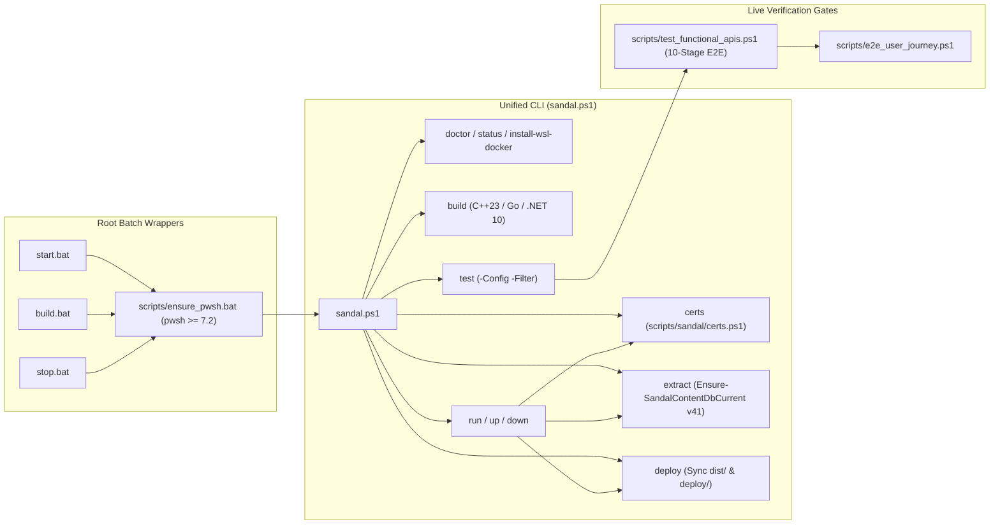
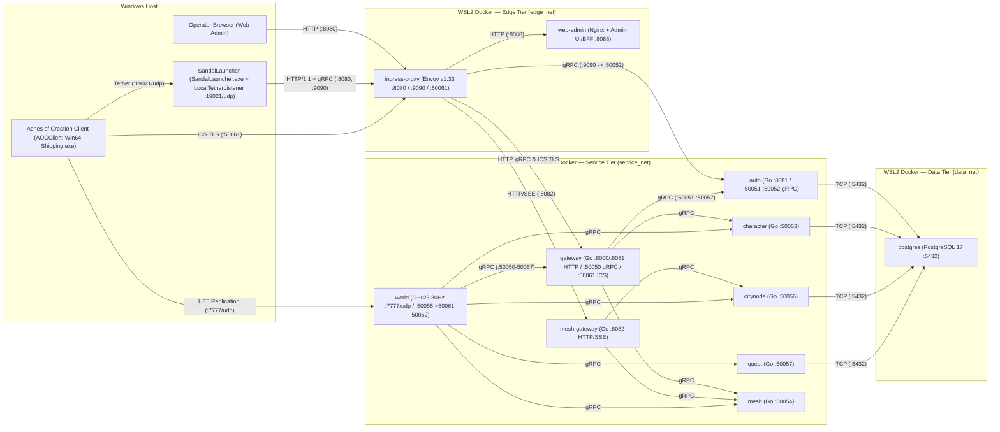
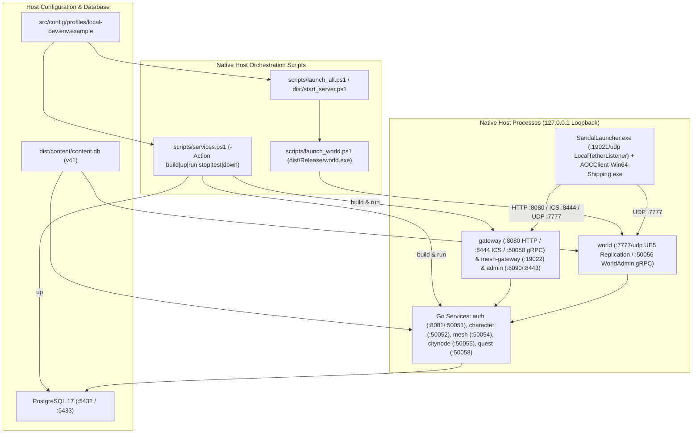
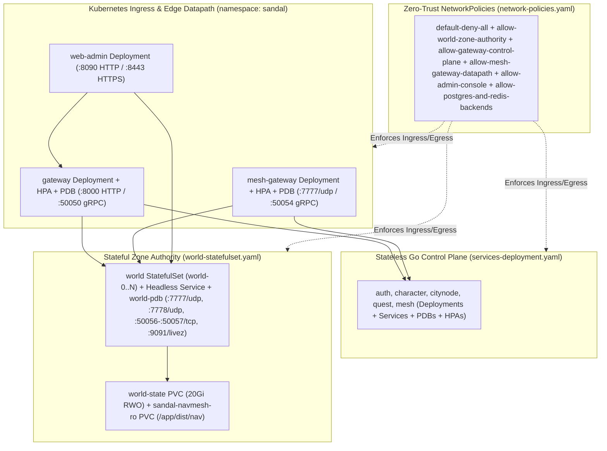

# SandalCore

An independent, open-source server emulator compatible with the Ashes of Creation client, developed by Cyb.

> [!IMPORTANT]
> **Not affiliated with Intrepid Studios.** SandalCore is an independent project. It is not affiliated with, sponsored by or endorsed by Intrepid Studios, Inc. *Ashes of Creation* is a trademark of Intrepid Studios, Inc., named here only to say which game client this server works with. The repository contains no game client, game files or Intrepid code: the data the servers need is built on your PC from your own installed copy of the game.

> [!WARNING]
> **Work in Progress**: SandalCore is **NOT** a final product. It is under active and consistent development; expect bugs, incomplete features, and ongoing protocol refinements. Please refer to [ROADMAP.md](docs/ROADMAP.md) for milestone progress, [KNOWN_ISSUES.md](docs/KNOWN_ISSUES.md) for current known limitations and workarounds, and [PATCH_NOTES.md](docs/PATCH_NOTES.md) for recent changes.

## Documentation

- [`docs/ROADMAP.md`](docs/ROADMAP.md): 16-phase milestone status, achieved features, and remaining work.
- [`docs/KNOWN_ISSUES.md`](docs/KNOWN_ISSUES.md): Current gameplay limitations, server constraints, and workarounds.
- [`docs/PATCH_NOTES.md`](docs/PATCH_NOTES.md): Dated changelog of features and fixes.
- [`docs/CONFIGURATION.md`](docs/CONFIGURATION.md): Configuration files, environment variables, and host overrides.
- [`docs/CONTRIBUTING.md`](docs/CONTRIBUTING.md): Branch conventions, clean-room guidelines, and test requirements.
- [`docs/SECURITY.md`](docs/SECURITY.md): Private vulnerability reporting policy.
- [`docs/reference/wire-specs/README.md`](docs/reference/wire-specs/README.md): Protocol and binary format wire specifications.

---

## Architecture: CLI Lifecycle & 3 Runtime Topologies

SandalCore separates its unified **CLI & Script Orchestration Pipeline** from its **3 Runtime Topologies**, staged into [`dist/`](src/config/) and [`deploy/`](src/deploy/):

- **CLI & Script Orchestration Pipeline (`start.bat`, `build.bat`, `stop.bat` -> [`sandal.ps1`](sandal.ps1))**: The root batch wrappers and `sandal.ps1` subcommands automate game-data extraction, TLS certificate provisioning, `dist/` & `deploy/` staging, and starting the default Docker Compose runtime together with `SandalLauncher.exe`.
- **The 3 Runtime Topologies**:
  1. **Runtime Topology 1 — WSL2 Docker Compose 11-Container Stack (Default Local Runtime in [`src/deploy/compose.yml`](src/deploy/compose.yml))**: Started automatically by `start.bat` (`pwsh -File sandal.ps1 run`) together with `SandalLauncher.exe` on Windows, or headless without the launcher via `pwsh -File sandal.ps1 up`.
  2. **Runtime Topology 2 — Windows / Linux Native Host-Process Runtime ([`src/config/profiles/local-dev.env.example`](src/config/profiles/local-dev.env.example), [`scripts/services.ps1`](scripts/services.ps1), [`scripts/launch_world.ps1`](scripts/launch_world.ps1), [`scripts/launch_all.ps1`](scripts/launch_all.ps1))**: Bare-metal Go and C++ host processes running directly on `127.0.0.1` loopback without application containers.
  3. **Runtime Topology 3 — Kubernetes Cluster Runtime ([`src/deploy/k8s/`](src/deploy/k8s/), [`src/config/profiles/prod-mesh.env.example`](src/config/profiles/prod-mesh.env.example))**: Multi-node Kubernetes cluster deployment (`StatefulSet`, `Deployment`, `HPA`, `PDB`, and zero-trust `NetworkPolicy`).

### CLI & Script Orchestration Pipeline (`start.bat`, `build.bat`, `stop.bat` -> `sandal.ps1`)

The root Windows wrappers (`start.bat`, `build.bat`, `stop.bat`) invoke [`scripts/ensure_pwsh.bat`](scripts/ensure_pwsh.bat) (which verifies PowerShell 7 `pwsh >= 7.2`) and dispatch into [`sandal.ps1`](sandal.ps1) subcommands under [`scripts/sandal/`](scripts/sandal/). `start.bat` (`pwsh -File sandal.ps1 run`) is the one-click desktop entry point that executes this pipeline and brings up **Runtime Topology 1 (WSL2 Docker Compose 11-Container Stack)** below together with `SandalLauncher.exe` (while `pwsh -File sandal.ps1 up` starts the same 11-container Docker Compose stack headless without opening the desktop launcher).



| `sandal.ps1` Subcommand | Script (`scripts/sandal/`) | Supported Options | Purpose |
|---|---|---|---|
| `run` (`start.bat`, alias `start`) | `run.ps1` | `-Profile <default\|dev\|admin\|full>`, `-SpawnLauncher`, `-NoLauncher`, `-AutomationPort <port>`, `-DryRun`, `-Json`, `-NoColor` | Verifies `content.db` v41, provisions TLS certs, stages `dist/` & `deploy/`, starts the 11-container stack, and opens `SandalLauncher.exe` |
| `build` (`build.bat`) | `build.ps1` | `-Config <Debug\|Release>`, `-DryRun`, `-Json`, `-NoColor` | Compiles C++23 `world`, Go services, `.NET 10` tools, and publishes `SandalLauncher` into `dist/` |
| `down` (`stop.bat`, alias `stop`) | `down.ps1` | `-Volumes`, `-DryRun`, `-Json`, `-NoColor` | Stops `SandalLauncher` / `AOCClient-Win64-Shipping` host processes and brings down the Docker Compose stack |
| `up` | `up.ps1` | `-Profile <default\|dev\|admin\|full>`, `-Detach`, `-DryRun`, `-Json`, `-NoColor` | Starts the 11-container Docker Compose stack and waits for healthchecks |
| `extract` | `extract.ps1` | `-PakDir <path>`, `-OutputDir <path>`, `-DataFree`, `-Force`, `-DryRun`, `-Json`, `-NoColor` | Acquires the extraction lock, runs `scripts/extract_game_data.ps1`, and verifies `content.db` v41 via `Ensure-SandalContentDbCurrent` |
| `certs` | `certs.ps1` | `-OutputDir <path>`, `-Force`, `-DryRun`, `-Json`, `-NoColor` | Reuses existing `dist/certs/server.pem` + `server.key` or generates a local Root CA + SAN leaf cert and trusts `ca.crt` in `Cert:\CurrentUser\Root` |
| `deploy` | `deploy.ps1` | `-Config <Debug\|Release>`, `-DryRun`, `-Json`, `-NoColor` | Merges local config overrides, verifies `content.db` v41, and stages self-contained `dist/` and `deploy/` bundles |
| `test` | `test.ps1` | `-Config <Debug\|Release>`, `-Filter <pattern>`, `-DryRun`, `-Json`, `-NoColor` | Runs C++, Go, .NET, and PowerShell test suites with optional filter matching |
| `doctor` / `status` | `doctor.ps1` / `sandal.ps1` | `-DryRun`, `-Json`, `-NoColor` | Audits host toolchain prerequisites (`pwsh`, `dotnet`, `docker`, `go`, `cmake`), local ports, and stage SHA-256 stamps |
| `install-wsl-docker` | `Install-WslDocker.ps1` | `-DryRun`, `-Json`, `-NoColor` | Provisions native WSL2 Docker Engine and non-destructively sets `.wslconfig` `instanceIdleTimeout=-1` / `vmIdleTimeout=-1` |

### Runtime Topology 1: WSL2 Docker Compose 11-Container Stack (Default Local Runtime)

This is the default runtime started by `start.bat` (`pwsh -File sandal.ps1 run`) or headless via `pwsh -File sandal.ps1 up`: an 11-container Linux server stack inside WSL2 Docker ([`src/deploy/compose.yml`](src/deploy/compose.yml) and [`src/deploy/envoy/envoy.yaml`](src/deploy/envoy/envoy.yaml)) paired with the Windows desktop launcher **`SandalLauncher`** (`dist\launcher\SandalLauncher.exe` / `dist\launch_launcher.bat`), which serves the client session token in-memory over UDP `19021` via `LocalTetherListener`. All C++ (`world`) and Go (`gateway`, `auth`, `character`, `citynode`, `quest`, `mesh`, `mesh-gateway`) server binaries compile inside multi-stage Linux Docker containers ([`src/deploy/docker/cpp.Dockerfile`](src/deploy/docker/cpp.Dockerfile) and [`src/deploy/docker/go.Dockerfile`](src/deploy/docker/go.Dockerfile)), while `world` serves authoritative 30 Hz UDP replication directly to the Ashes of Creation client.



| # | Service (`container_name`) | Runtime | Ports (Host Published / Internal Container) | Role |
|---:|---|---|---|---|
| 1 | `ingress-proxy` (`aoc-ingress-proxy`) | Envoy v1.33 (`envoyproxy/envoy:v1.33-latest`) | Host `127.0.0.1:8080` HTTP/1.1, `127.0.0.1:9090` gRPC HTTP/2, `127.0.0.1:50061` ICS TLS passthrough / Container `:8080`, `:9090`, `:50061`, `:9901` Envoy admin | Edge reverse proxy routing browser, launcher, and client traffic across `edge_net` and `service_net` |
| 2 | `gateway` (`aoc-gateway`) | Go | Internal `:8081` HTTP, `:50050` gRPC, `:50061` ICS TLS (exposed via Envoy `:8080`, `:9090`, `:50061`) | Client session & ICS TLS gateway, character screen, and world handoff tickets |
| 3 | `auth` (`aoc-auth`) | Go | Internal `:8081` HTTP, `:50052` gRPC | Account registration, login, and session token validation |
| 4 | `character` (`aoc-character`) | Go | Internal `:50053` gRPC | Character creation, inventory, equipment, starting kits, and persistence |
| 5 | `citynode` (`aoc-citynode`) | Go | Internal `:50056` gRPC | Intrepid Node progression, citizenship, workshops, and tax/mayoral state |
| 6 | `quest` (`aoc-quest`) | Go | Internal `:50057` gRPC | Quest state machine, objectives, and dialogue progression |
| 7 | `mesh` (`aoc-mesh`) | Go | Internal `:50054` gRPC | World zone registry, server boundary authority, and handover coordinator |
| 8 | `mesh-gateway` (`aoc-mesh-gateway`) | Go | Internal `:8082` HTTP/SSE (exposed via Envoy `/api/v1/gm`) | Mesh HTTP/SSE gateway streaming live node, world, and GM state |
| 9 | `web-admin` (`aoc-web-admin`) | Nginx + Admin UI/BFF | Host `http://127.0.0.1:8080/` via Envoy / Container `:8088` HTTP (`:3000` healthz) | Browser control plane for realm status, accounts, nodes, and world telemetry |
| 10 | `world` (`aoc-world`) | C++23 | Host `127.0.0.1:7777/udp` (and `:50055 -> :50061/tcp` WorldAdmin via Envoy `:9090`) / Container `:7777/udp`, `:50061` WorldAdmin gRPC, `:50062` WorldStream gRPC | Authoritative 30 Hz world simulation, replication, combat, NPC AI, and navmesh runtime |
| 11 | `postgres` (`aoc-postgres`) | PostgreSQL 17 | Host `127.0.0.1:5432` (when published) / Container `:5432` on `data_net` | Relational database isolated on `data_net` |

- **Commands (How to Run)**:
  - **Desktop (11 containers + `SandalLauncher.exe`)**:
    ```powershell
    .\start.bat                                    # One-click: verify/extract content.db, sync certs, start 11 containers, and open SandalLauncher.exe
    pwsh -File sandal.ps1 run                      # Equivalent via sandal.ps1 CLI
    .\stop.bat                                     # Stop launcher/client and bring down the 11-container stack (or: pwsh -File sandal.ps1 down)
    ```
  - **Headless Server (11 containers only, without opening `SandalLauncher.exe`)**:
    ```powershell
    pwsh -File sandal.ps1 run -NoLauncher          # Run full 6-step pipeline (extract/certs/stage/up) without opening the desktop launcher
    pwsh -File sandal.ps1 up -Detach               # Start the staged 11-container stack and wait for healthchecks
    docker compose -f deploy/compose.yml --env-file deploy/.env up -d --build --wait   # Direct Docker Compose execution against staged deploy/
    ```

### Runtime Topology 2: Windows / Linux Native Host-Process Runtime (`src/config/profiles/local-dev.env.example`, `scripts/services.ps1`, `scripts/launch_world.ps1`, `scripts/launch_all.ps1`)

For bare-metal debugging without running the Go and C++ services inside containers, SandalCore supports a native host-process workflow configured via [`src/config/profiles/local-dev.env.example`](src/config/profiles/local-dev.env.example) and orchestrated by [`scripts/services.ps1`](scripts/services.ps1), [`scripts/launch_world.ps1`](scripts/launch_world.ps1), [`scripts/launch_all.ps1`](scripts/launch_all.ps1), and the staged `dist/start_server.ps1` / `dist/stop_server.ps1` scripts.



- **Commands (How to Run)**:
  ```powershell
  pwsh -File scripts/services.ps1 -Action up      # Start PostgreSQL container and wait for healthy
  pwsh -File scripts/services.ps1 -Action build   # Build Go services & CLI tools into dist/services/
  pwsh -File scripts/services.ps1 -Action run     # Build & start Go services + world in background (logs in dist/services/logs/)
  pwsh -File scripts/launch_world.ps1             # Run native world executable directly in foreground
  pwsh -File scripts/launch_all.ps1               # Launch full local host-process stack + SandalLauncher
  pwsh -File scripts/services.ps1 -Action stop    # Stop all native Go service and world host processes
  ```
- **Native Loopback Ports (`src/config/profiles/local-dev.env.example`) vs. Container Ports**: On bare metal without Envoy port-multiplexing, each daemon binds a distinct loopback port (`gateway` HTTP `127.0.0.1:8080`, ICS `127.0.0.1:8444`, gRPC `127.0.0.1:50050`; `auth` HTTP `127.0.0.1:8081`, gRPC `127.0.0.1:50051`; `character` `127.0.0.1:50052`; `mesh` `127.0.0.1:50054`; `citynode` `127.0.0.1:50055`; `world` UDP `127.0.0.1:7777`, WorldAdmin gRPC `127.0.0.1:50056`; `quest` `127.0.0.1:50058`; `admin` HTTP `127.0.0.1:8090`, HTTPS `127.0.0.1:8443`).

### Runtime Topology 3: Kubernetes Cluster Runtime (`src/deploy/k8s/`, `src/config/profiles/prod-mesh.env.example`)

For multi-node production clusters, [`src/deploy/k8s/`](src/deploy/k8s/) and [`src/config/profiles/prod-mesh.env.example`](src/config/profiles/prod-mesh.env.example) provide hardened Kubernetes manifests in the `sandal` namespace with non-root security contexts (`65532:65532`), read-only root filesystems, topology spread constraints, and zero-trust `NetworkPolicy` isolation.



- **[`src/deploy/k8s/services-deployment.yaml`](src/deploy/k8s/services-deployment.yaml)**: Defines `Deployment`, `Service`, `PodDisruptionBudget`, and `HorizontalPodAutoscaler` resources for the stateless control-plane services (`gateway`, `auth`, `character`, `citynode`, `quest`, `mesh`, `mesh-gateway`, `web-admin`) consuming `sandal-prod-config` (`ConfigMap`) and `sandal-prod-secrets` (`Secret`).
- **[`src/deploy/k8s/world-statefulset.yaml`](src/deploy/k8s/world-statefulset.yaml)**: Defines the headless `world` `Service` (`clusterIP: None`), `world` `StatefulSet` (`udp-game :7777`, `udp-mesh :7778`, `grpc-admin :50056`, `grpc-zone :50057`, `http-probe :9091`), `world-pdb` `PodDisruptionBudget`, `sandal-navmesh-ro` read-only navmesh mount, and 20 Gi `world-state` `volumeClaimTemplates`.
- **[`src/deploy/k8s/network-policies.yaml`](src/deploy/k8s/network-policies.yaml)**: Establishes a namespace-wide `default-deny-all` policy (Ingress + Egress) and explicit least-privilege rules (`allow-world-zone-authority`, `allow-gateway-control-plane`, `allow-mesh-gateway-datapath`, `allow-admin-console`, `allow-postgres-and-redis-backends`).
- **Commands (How to Run)**:
  ```powershell
  kubectl create namespace sandal --dry-run=client -o yaml | kubectl apply -f -
  kubectl -n sandal create configmap sandal-prod-config --from-env-file=src/config/profiles/prod-mesh.env.example --dry-run=client -o yaml | kubectl apply -f -
  kubectl apply -f src/deploy/k8s/network-policies.yaml
  kubectl apply -f src/deploy/k8s/services-deployment.yaml
  kubectl apply -f src/deploy/k8s/world-statefulset.yaml
  kubectl -n sandal rollout status statefulset/world
  ```

---

## What Works Today

SandalCore provides an independent server emulation stack for the Ashes of Creation client: the 11-container backend (`ingress-proxy`, the Go services `gateway`, `auth`, `character`, `citynode`, `quest`, `mesh`, `mesh-gateway`, `web-admin`, `postgres`, and the C++23 world server `world`) together with the Windows desktop launcher **`SandalLauncher`** (`dist\launcher\SandalLauncher.exe` / `dist\launch_launcher.bat`, which serves the client session token in-memory via `LocalTetherListener` on UDP `19021`).

- **Protocol & Network Transport**: Full UE5 / IntrepidNetDriver handshake, stateless connect, packet framing, bunch replication, and dynamic NetGUID allocation.
- **Authentication & Character Management**: gRPC and REST-based authentication services, account profiles, character creation with full visual appearance customization serialization, and character select lobby transitions.
- **World Bootstrap & Replication**: Seamless map loading into `/Game/Levels/Verra_World_Master`, actor creation channels, possession handshakes, and player controller state replication.
- **Authoritative Stats Engine**: Core attribute formulas, expression evaluation graph, compiled stat program bytecode, and dynamic recalculation of stats upon equipment changes.
- **Progression, Items, and Talents**: Adventuring XP curves, level thresholds, skill tree talent acquisition, action bar persistence, inventory storage, and consumable item effects.
- **Complete Combat & Ability Runtime**: Authoritative ability pipeline supporting all retail classes, cast validation steps, cooldown ledgers, projectile trajectories, hit confirmation RPCs, floating combat numbers, shields, songs, buff/debuff effect stacks, weapon combos with their finishers, weapon swaps, and weapons that scale with the power they are meant for (Physical or Magical).
- **Living World & Navigation**: Chunked navmesh windows, Riverlands region partitioning, NPC actor spawning, creatures that notice players by hearing and sight and give up 140 m from where the fight began, wolves, bears, ravens, goblins and Grems that fight with their own attacks and animations, combat engagement, loot drops (rolled afresh on every server start), and respawn cycles.
- **Mounts & Traversal**: Ground, flying, and aquatic mount summoning, riding possession, mount combat mechanics, sprint/dash abilities, and road speed modifiers.
- **City Node Civilization**: Background `CityNodeService`, node experience accrual, level transitions, town layout replication, the real floor of the five towns with a safety net under it and their buildings in the walking map, the towns' people dressed and named from the game's own records, the walkers among them walking their routes, and the citizenship and mayor data the client reads (the citizenship and mayor rules are still to come).
- **Launcher (`SandalLauncher`)**: `dist\launcher\SandalLauncher.exe` (`dist\launch_launcher.bat`) presents a unified single semi-transparent card (`SERVER` selector, `SAVED LOGIN` selector + `Delete`, `USERNAME`, `EMAIL`, `PASSWORD`, `Remember login`, **`PLAY`**, **`Create Account`**, **`Temp Account`**, and **`Client Path...`**) over 3 randomized backgrounds (`launcher_background_0..2.jpg`). It discovers Steam libraries across all drives (`Registry` + fixed drives + `steamapps\libraryfolders.vdf`), auto-selects when a single installation is found or opens `Client Path...` when multiple installations (such as Retail + Playtest) or none are found, validates local TLS certificates via `X509ChainPolicy.CustomTrustStore`, and when you press **`PLAY`** authenticates first (halting with an error banner on invalid credentials) before launching `AOC\Binaries\Win64\AOCClient-Win64-Shipping.exe` with `-LauncherTetherPort=19021 -GatewayAddr=127.0.0.1:8080 -IcsAddr=127.0.0.1:50061 -UseEOS=false -NoEAC` (or wildcard SAN hostname when configured), serving `ActiveAccessToken` and the `127.0.0.1:50061` ICS TLS endpoint directly from memory over UDP `19021` via `LocalTetherListener` (never writing a token file to disk). Normal **`Create Account`** requires a valid email and checks username/email uniqueness (`409 Conflict`), while **`Temp Account`** creates an ephemeral account with an auto-generated email that is never saved to `LauncherProfiles.json` and is deleted immediately on logout or exit.
- **Gathering & Professions**: the 22 gathering professions, node harvesting (mining, lumberjacking and herbalism), the Riverlands' trees, plants and stones that grow back, huntable animals, resource bags and the pick-up popup.
- **Conversations & Quests**: the NPC talking window with the game's conversation data (lines a character does not qualify for are hidden), quest givers that offer their quests, accepting, the journal and the tracker, abandoning, quests kept across logins, objectives that count, the objects of the quests that you search and use (bodies, crates, roots, building sites), the hand-in with its rewards (items, experience and Glint), and the first quests of the starting area on both ways, with map pins for the objectives of active quests and a mark over the people who have a quest to take.
- **Merchants, Currency & Glint**: gold, silver and copper; buying, selling, repairing and destroying items at each town's general merchant; the Black Market, the caravan salesman and the sheriff's shops; Glint in its six kinds, paid for kills and rewards in kinds, and ten of a kind turned into one of the next with a right-click.
- **Crafting**: the crafting and processing stations of every Camp, Village and Town (they follow their node's level), processing jobs that are started, queued and collected with their items and experience, crafting at a station, the quick make, and recipes a game master can teach.
- **Item Rarities**: rarities for resources, weapons and armor, from creatures, harvests, shops and crafting; the game master's `give-item` can name a rarity.
- **Storage**: the Storage Clerk's free item storage and the town's materials storage, kept across logins.
- **Embersprings**: the 24 Embersprings of the Riverlands: discovering them, attuning to one, and choosing where to respawn.
- **Quiet Requests**: tutorials that stay done, the active and hover targets, the PvP flag, closed loot windows and the map marker.
- **Game Master & Admin Tools**: `worldctl` (teleport, speed, money and items, stations, crafting, tutorials, creature actions and a live watch of the world stream), `nodectl` (city node levels and experience), `questctl` (quests), and the `web-admin` browser UI at `http://127.0.0.1:8080/`.

---

## Build and run (Windows)

You need a Windows 10/11 x64 PC with your own installed copy of Ashes of Creation. SandalCore contains no game data: the first run reads your installed client (the files are only read, nothing in the game folder is changed) and extracts the data the servers need.

### 1. What to install

All C++ (`world`) and Go (`auth`, `gateway`, `character`, `citynode`, `quest`, `mesh`, `mesh-gateway`) server binaries compile inside multi-stage Linux Docker containers ([`src/deploy/docker/cpp.Dockerfile`](src/deploy/docker/cpp.Dockerfile) and [`src/deploy/docker/go.Dockerfile`](src/deploy/docker/go.Dockerfile)), while **`SandalLauncher`** and the game-data extractors compile on Windows through the `.NET 10 SDK`. No host C++ or Go compiler toolchain is required on Windows.

| What | Version | What it is for |
|---|---|---|
| **Ashes of Creation** (Steam) | the build of 2026-01-29 | the source of the game data; it has to be installed on this PC |
| **WSL2 + Docker Engine / Docker CLI** | current | builds and runs all 11 Linux server containers (`aoc-postgres`, `aoc-ingress-proxy`, 7 Go services, `aoc-web-admin`, and `aoc-world`); provisioned via `pwsh -File sandal.ps1 install-wsl-docker` (detects an existing Docker daemon or installs standalone WSL2 Docker Engine across Ubuntu, Debian, Fedora, RHEL/Alma/Rocky, Arch, openSUSE, and Alpine distros, and sets `.wslconfig` `instanceIdleTimeout=-1` and `vmIdleTimeout=-1` non-destructively) |
| **.NET 10 SDK** | 10.0 (any 10.x; with the 10.0 runtime) | builds and runs `SandalLauncher.exe` (`src/clients/launcher/SandalLauncher.csproj`, including in-memory `LocalTetherListener` on UDP `19021`) and the game data extractors (`src/tools/aoc-extractor`, `src/tools/mapc`, `src/tools/itemnames`, `src/tools/npcabilities`), restoring NuGet dependencies (including `CUE4Parse`) automatically |

Disk: allow about 10 GB free for the extracted game data (`1.5 GB`) and container images. Memory: at least 6 GB free while the game data is extracted (the map reader peaks near 4 GB).

### 2. The commands, in this order

1. `pwsh -File scripts\install_dependencies.ps1` (or `-CheckOnly` to audit host prerequisites; `pwsh -File sandal.ps1 install-wsl-docker` provisions WSL2 + Docker Engine if not yet configured).
2. `start.bat` (or `pwsh -File sandal.ps1 run` / `pwsh -File sandal.ps1 up -Detach`): checks `dist\content\content.db` against the current `contentc` v41 schema and automatically runs fast `contentc` rebuild or full game-data extraction from your installed client when needed (about 10 minutes on the first run; seconds on subsequent runs), reuses user-supplied TLS certificates in `dist\certs\` (`server.pem` + `server.key`) or generates local certificates and imports `ca.crt` into `Cert:\CurrentUser\Root`, builds and starts the 11-container Linux server stack in WSL2 (`deploy/compose.yml` / `deploy/up.ps1`), and opens **`SandalLauncher`** (`dist\launcher\SandalLauncher.exe`). Create an account (**`Create Account`** with a valid email, or **`Temp Account`** for an ephemeral session) or enter your credentials (tick **`Remember login`** to save to `LauncherProfiles.json` / Windows Credential Manager) and press **`PLAY`**, which authenticates first and launches `AOC\Binaries\Win64\AOCClient-Win64-Shipping.exe` with `-LauncherTetherPort=19021 -GatewayAddr=127.0.0.1:8080 -IcsAddr=127.0.0.1:50061 -UseEOS=false -NoEAC` (or wildcard SAN hostname when configured). Use `build.bat` (or `pwsh -File sandal.ps1 build`) to build the stack and Windows launcher without starting, and `stop.bat` (or `pwsh -File sandal.ps1 stop` / `pwsh -File sandal.ps1 down`) to stop the stack. (`start.bat`, `stop.bat`, and `build.bat` delegate through `scripts\ensure_pwsh.bat`, which checks for PowerShell 7 (`pwsh`) and prompts to install the latest PowerShell 7 via `winget` if not present.)

To extract or verify game data standalone without starting the stack, run `pwsh -File sandal.ps1 extract`.

### 3. Game Data Extraction (`pwsh -File sandal.ps1 extract`)

`pwsh -File sandal.ps1 extract` (`scripts\sandal\extract.ps1`, delegating to `scripts\extract_game_data.ps1`) extracts and compiles the runtime data and navigation mesh from your installed Ashes of Creation client. During normal startup, `start.bat` (`pwsh -File sandal.ps1 run`) invokes `Ensure-SandalContentDbCurrent` (`scripts\lib\Env.psm1`), which verifies `dist\content\content.db` against `contentc` schema version `41` (`contentc.version41` and `cast_ability_guid` markers plus `src\server\services\cmd\contentc\*.go` timestamps), runs a fast `contentc` rebuild or the full extraction pipeline automatically when out of date, syncs `deploy\content\content.db`, and restarts `content.db` consumer containers (`aoc-world`, `aoc-character`, `aoc-citynode`).

**Client discovery order**:
1. Explicit CLI flag (`pwsh -File sandal.ps1 extract -PakDir "D:\...\Ashes of Creation\Game"` or `pwsh -File scripts\extract_game_data.ps1 -GameRoot "D:\...\Ashes of Creation\Game"`).
2. The `GAME_ROOT` environment variable (`setx GAME_ROOT "D:\...\Ashes of Creation\Game"`).
3. `game_executable` in `src\config\paths.json` or `src\config\paths.local.json`, or `SANDAL_CLIENT_PAK_DIR` in `src\config\sandal.local.env` / `deploy\.env`.
4. Universal Steam library discovery across all drives (`Registry`, fixed drives, and `steamapps\libraryfolders.vdf`).

In `SandalLauncher`, if a single client installation is discovered it is selected automatically; if multiple installations (for example Retail + Playtest) exist or none are found automatically, the **`Client Path...`** modal opens so you can select or browse to the desired installation (persisted to `dist\config\paths.json`). The game root is the folder containing `AOCClient.exe` (`AOC\Binaries\Win64\AOCClient-Win64-Shipping.exe`) and the `AOC` directory (for Steam installs, `...\steamapps\common\Ashes of Creation\Game`).

**Generated artifacts** (all git-ignored via [`.gitignore`](.gitignore)):
- `dist\content\content.db` (`~323 MB`) and `dist\content\content.db.version` (`41`): compiled design database built by `contentc` from the client's `CacheDB.dbc`.
- `dist\content\*.tsv`: mount speeds and rider animation blueprints, profession curves, NPC motion tables, gatherable foliage, and road polylines (`src\tools\mapc` and `contentc roads`).
- `dist\content\item_names.tsv`: item and Glint localized display names (`src\tools\itemnames`).
- `dist\content\npc_abilities.tsv`, `npc_montages.tsv`, `npc_targeting.tsv`, `npc_senses.tsv`, and `npc_aggro_curves.tsv`: creature ability definitions, root-motion montage timelines, targeting profiles, sensory radii, and aggro curves (`src\tools\npcabilities`).
- `dist\content\npc_looks.tsv`, `npc_appearances.tsv`, `npc_names.tsv`, and `npc_trees.tsv`: humanoid NPC appearance, equipment, names, and behavior tree assignments (`src\tools\npcabilities`).
- `dist\content\town_platforms.bin` (`~4 MB`): city-node platform heightfields and visibility masks for the five towns (`src\tools\mapc`).
- `dist\content\town_layout_items.tsv` (`~6 MB`) and `dist\content\town_layouts.bin` (`~13 MB`): town buildings, walls, and terraces at each node's starting seed level (`scripts\generators.ps1` / `src\tools\schemagen\gen_*.ps1`, `aoc-extractor`, and `src\tools\mapc`).
- `dist\content\area_nav.bin` (`~974 MB`) and `dist\content\area_geom.bin` (`~232 MB`): chunked Detour navigation mesh and collision geometry with town buildings merged in (`src\tools\mapc` and `aoc_navbuild`).
- `dist\content\client_config\` and `zoi_chunks\`: extracted client configuration files and zone-of-influence grid chunks consumed by `src\tools\schemagen\gen_*.ps1` (`scripts\generators.ps1`).
- Generated C++/Go headers and test fixtures (`zoi_surface_table.h`, `node_constants.h`, `region_data.h`).

**City node seed levels and navigation mesh**: The navigation mesh bakes each of the five towns using the starting node level configured in `src\config\seeds\citynode_seed.json` (Joeva `4` Town, Halcyon `3` Village, Winstead/New Aela/Miraleth `0` Wilderness). If a GM changes a node's level at runtime via `nodectl set-level`, the visual town layout updates dynamically, while the static navigation mesh retains the collision geometry of the seeded level until rebuilt by updating `src\config\seeds\citynode_seed.json` and running `pwsh -File sandal.ps1 extract`.

**Execution time and stage controls**: Full initial extraction takes approximately 10 minutes on a 24-thread desktop (`~8 minutes` for map geometry and navmesh generation). Unchanged stages are skipped via SHA-256 input stamps in `dist\.stamps\` and `build\.extract\`, so subsequent checks complete in seconds.
- `pwsh -File sandal.ps1 extract [-PakDir <path>] [-OutputDir <path>] [-Force] [-DryRun] [-Json]`: Runs the locked extraction pipeline and verifies `content.db` v41 currency.
- `pwsh -File scripts\extract_game_data.ps1 [-CheckOnly] [-Only <step>] [-Skip <step>] [-Force] [-GameRoot <path>]`: Runs individual stages (`tools`, `config`, `curves`, `names`, `database`, `region`, `headers`, `fixtures`, `navbuild`, `roads`, `townfloors`, `townlayouts`, `npcabilities`, `navmesh`) and writes full execution logs to `build\.extract\last_run.log`.

**Network usage**: The initial build restores NuGet packages for the `.NET 10` tools (`aoc-extractor`, `SandalLauncher`, `mapc`) and pulls container base layers / Go modules inside the Docker build. Zero external network requests occur at runtime after the initial build.

**Client build compatibility**: After a game update, run `pwsh -File sandal.ps1 extract` to rebuild changed artifacts. The extraction pipeline targets client build `2026-01-29` (`AOCClient-Win64-Shipping.exe` `235,606,624` bytes, `CacheDB.dbc` `144,085,052` bytes); running against a different build emits a size-mismatch warning and continues.

**Navigation mesh prerequisite for combat**: `world` (`aoc-world`) initializes its combat runtime only after loading `dist\content\area_nav.bin`. Without `area_nav.bin`, creatures spawn with `0 HP` and damage is disabled (see [KNOWN_ISSUES.md](docs/KNOWN_ISSUES.md)).

**Repository schema mappings & `$HOME/.aoc/usmap/*` override**: `src/config/layouts/aoc.usmap`, `src/libs/aocnet/protocol/schema/generated/`, and `src/server/services/internal/designdb/exe_gen.go` define class/struct reflection mappings and wire/database schemas; they contain no proprietary game content. Placing an updated or full Blueprint-inclusive `aoc.usmap` (`*.usmap`) in `$HOME/.aoc/usmap/` (`%USERPROFILE%\.aoc\usmap\aoc.usmap` on Windows or `~/.aoc/usmap/aoc.usmap` on Linux/WSL2, or specifying `SANDAL_USMAP_PATH` / `AOC_USMAP` or `SANDAL_USMAP_OVERRIDE_DIR`) automatically overrides the repository fallback `src/config/layouts/aoc.usmap` during game-data extraction (`sandal.ps1 extract` / `scripts/extract_game_data.ps1` / `mapc`) and staging (`dist/content/aoc.usmap` & `deploy/content/aoc.usmap`), without modifying or committing to `src/config/layouts/aoc.usmap`. When neither `$HOME/.aoc/usmap/*` nor an environment override exists, `src/config/layouts/aoc.usmap` is used automatically.

### 4. If something goes wrong

| You see | Why | What to do |
|---|---|---|
| `The Ashes of Creation client was not found` | the game is not installed on this PC, or it sits in an unusual folder | install it (Steam), or run `pwsh -File sandal.ps1 extract -PakDir "D:\...\Ashes of Creation\Game"` (that run only), or set `GAME_ROOT` permanently (`setx GAME_ROOT "D:\...\Ashes of Creation\Game"`, then open a new window) |
| `-GameRoot '...' is not the game's folder` | the folder has no `AOC\Content\Paks` or no `CacheDB.dbc` | give the folder that holds `AOCClient.exe` and `AOC` (the `Game` folder of the install), not the launcher folder; if the install is incomplete, let Steam verify the game files |
| `WARNING: this client is not the build this code was made for` | the game was patched, or it is another build | the script goes on; the data may be wrong or a step may fail (see "Client build compatibility") |
| `.NET 10 SDK` not found (`dotnet` missing) | the .NET 10 SDK is not installed or not on `PATH` | run `pwsh -File scripts\install_dependencies.ps1` (or `pwsh -File scripts\install_dependencies.ps1 -CheckOnly` to audit; `winget install Microsoft.DotNet.SDK.10`), open a new terminal window, and run `pwsh -File sandal.ps1 doctor` |
| Docker / WSL2 daemon unreachable | WSL2 Docker Engine is stopped or not yet provisioned | run `pwsh -File sandal.ps1 install-wsl-docker` (configures WSL2 Docker Engine and `.wslconfig` `instanceIdleTimeout=-1` / `vmIdleTimeout=-1`), then `pwsh -File sandal.ps1 doctor` |
| `ERROR in step '...'` | a step failed during extraction | read `build\.extract\last_run.log` and fix the cause; run `pwsh -File sandal.ps1 extract` again: finished steps are kept and the run continues at the failed one |
| `waiting: ...` in the map step | the map read waits until at least 6 GB of memory are free and the game, a build and `aoc_navbuild` are not running | close them; it continues by itself and gives up after 40 minutes |
| the CUE4Parse fetch fails | no network or no Git | connect and run again, or copy the folder yourself: `pwsh -File src\tools\mapc\fetch_cue4parse.ps1 -From <folder with CUE4Parse>` |
| every mob has 0 HP and damage does nothing | `dist\content\area_nav.bin` is missing | run `pwsh -File sandal.ps1 extract` (without `-Skip navmesh`) |

### 5. Building from the command line

- **Full Stack + Launcher Build (`build.bat` / `sandal.ps1 build`)**:
  ```bat
  build.bat
  ```
  (Or run `pwsh -File sandal.ps1 build`.)
- **Containerized 11-container server stack (`deploy/compose.yml`)**:
  ```powershell
  pwsh -File sandal.ps1 up -Detach
  # or directly via Docker Compose:
  docker compose -f deploy/compose.yml --env-file deploy/.env up -d --build --wait
  ```
- **Desktop Launcher (`SandalLauncher`)**:
  ```powershell
  dotnet publish src/clients/launcher/SandalLauncher.csproj -c Release -o dist/launcher
  ```
- **Game Data Extractor & `.NET 10` Tools (`aoc-extractor`, `mapc`, `itemnames`, `npcabilities`)**:
  ```powershell
  dotnet build src/tools/aoc-extractor/AocExtractor.csproj -c Release
  dotnet build src/tools/mapc/mapc.csproj -c Release
  dotnet build src/tools/itemnames/itemnames.csproj -c Release
  dotnet build src/tools/npcabilities/npcabilities.csproj -c Release
  ```
- **Diagnostics & Test Suites**:
  ```powershell
  pwsh -File scripts\install_dependencies.ps1 -CheckOnly
  pwsh -File sandal.ps1 doctor
  pwsh -File sandal.ps1 status
  pwsh -File sandal.ps1 test
  pwsh -File scripts\test_functional_apis.ps1
  pwsh -File scripts\e2e_user_journey.ps1 -LiveDocker -IncludeDiagnostics
  ```

---

## Output Layout (`build/`, `dist/`, `deploy/`) & Root Entrypoints

SandalCore separates transient build intermediates from self-contained runtime bundles:

- **`build/`**: Transient build staging, extraction stamps (`build/.extract/`), C# `obj/` and `bin/` intermediates (`build/dotnet/`), generated fixtures (`build/gen/`), and test outputs (`build/tests/`). Safe to delete without losing extracted game data or certificates.
- **`dist/`**: Self-contained Windows runtime and launcher bundle (`dist/start_server.ps1`, `dist/stop_server.ps1`, `dist/launch_launcher.bat`, `dist/launcher/SandalLauncher.exe`, `dist/content/`, `dist/nav/`, `dist/certs/`, `dist/config/`). Works standalone on Windows if copied anywhere.
- **`deploy/`**: Self-contained 11-container stack (`deploy/compose.yml`, `deploy/up.ps1`, `deploy/down.ps1`, `deploy/.env`, `deploy/content/`, `deploy/nav/`, `deploy/certs/`, `deploy/config/`). Works standalone if copied anywhere.

Root entrypoints:
- `start.bat` (`pwsh -File sandal.ps1 run` / `pwsh -File sandal.ps1 start`), `build.bat` (`pwsh -File sandal.ps1 build`), and `stop.bat` (`pwsh -File sandal.ps1 down` / `pwsh -File sandal.ps1 stop`): One-click Windows wrappers that delegate through `scripts\ensure_pwsh.bat` (which checks for PowerShell 7 `pwsh` and prompts to install the latest PowerShell 7 via `winget` if not present).
- `sandal.ps1`: Unified CLI (`doctor`, `status`, `up`, `down` / `stop`, `extract`, `certs`, `build`, `deploy`, `test`, `run` / `start`, `install-wsl-docker`, `help`).
- `scripts\extract_game_data.ps1` and `scripts\generators.ps1` (`src\tools\schemagen\gen_*.ps1`): Game-data extraction pipeline and PowerShell 7 schema/table generation scripts.

---

## Running the Server

### 1. Quickstart (`start.bat` / `stop.bat` / `build.bat`, `sandal.ps1`, or `SandalLauncher.exe`)

```bat
start.bat
```
(Or run `pwsh -File sandal.ps1 run` / `pwsh -File sandal.ps1 up -Detach`, or launch `dist\launcher\SandalLauncher.exe` via `dist\launch_launcher.bat`.) Verifies `dist\content\content.db` v41 and extracts game data from your Ashes of Creation install if needed, reuses user-supplied TLS certificates or generates local certificates and imports `ca.crt` into `Cert:\CurrentUser\Root`, starts the 11-container Linux stack in WSL2 (`deploy/compose.yml` / `deploy/up.ps1`), and opens **`SandalLauncher`** (`dist\launcher\SandalLauncher.exe`).

Inside **`SandalLauncher`** (single semi-transparent card with `SERVER` selector, `SAVED LOGIN` selector + `Delete`, `USERNAME`, `EMAIL`, `PASSWORD`, `Remember login`, **`PLAY`**, **`Create Account`**, **`Temp Account`**, and **`Client Path...`** over 3 randomized backgrounds `launcher_background_0..2.jpg`):
- **Client Discovery**: Scans Steam libraries across all drives (`Registry`, fixed drives, and `steamapps\libraryfolders.vdf`). Automatically selects the client if 1 installation is found, or opens the **`Client Path...`** modal if multiple installations (for example Retail + Playtest) exist or if no installation is found automatically.
- **Account Creation & Ephemeral Sessions**: Normal **`Create Account`** requires a valid email and checks that the username and email are not already in use (`409 Conflict`). **`Temp Account`** creates an ephemeral account with an auto-generated email that is never saved to `LauncherProfiles.json` and is deleted immediately on logout or exit. With **`Remember login`** ticked on normal accounts, saved logins are persisted to `LauncherProfiles.json` / Windows Credential Manager (`SandalCore/LauncherSignIn`) and can be managed or removed via the `SAVED LOGIN` selector + `Delete`.
- **Authenticated Launch & In-Memory Tether**: Pressing **`PLAY`** authenticates first (halting with an error banner if credentials are invalid) and launches `AOC\Binaries\Win64\AOCClient-Win64-Shipping.exe` with `-LauncherTetherPort=19021 -GatewayAddr=127.0.0.1:8080 -IcsAddr=127.0.0.1:50061 -UseEOS=false -NoEAC` (or your configured wildcard SAN hostname; no game files are modified), serving the session token (`ActiveAccessToken`) and `127.0.0.1:50061` ICS TLS endpoint directly from memory over UDP `19021` via `LocalTetherListener` (never writing a token file to disk).
- **`SandalLauncher.exe` Command-Line Interface & Headless Automation (`src/clients/launcher/Program.cs` & `Config/LauncherCliOptions.cs`)**:
  - `--gateway <url>`: Override gateway base URL (for example `http://127.0.0.1:8080`).
  - `--automation-port <port>`: Bind localhost JSON-RPC UI automation server on `127.0.0.1:<port>`.
  - `--keep-alive`: Keep automation server running until closed.
  - `--timeout-sec <sec>`: Timeout in seconds for automated flows (default `60`).
  - `--auto-register-temp` / `--register-temp`: Automatically create and sign in with an ephemeral temp account.
  - `--auto-login`: Automatically sign in using the active saved profile in `LauncherProfiles.json`.
  - `--auto-char-select <name>` / `--select-character <name>`: Automatically select the specified character over ICS TLS `:50061`.
  - `--create-character-if-missing`: Create the character over ICS TLS `:50061` if it does not already exist.
  - `--verify-char-select`: Verify character list retrieval and character selection over ICS TLS `:50061`.
  - `--spawn-client`: Launch `AOCClient-Win64-Shipping.exe` after authentication.
  - `--terminate-after-char-select`: Exit cleanly after character selection completes.
  - `--kill-existing-client`: Terminate any existing `AOCClient-Win64-Shipping` process before launching.
  - `--delete-temp-account-on-exit`: Delete the ephemeral temp account when the launcher exits.
  - `--smoke-test`: Run self-contained Avalonia UI and tether smoke verification.
  - `--verify-view <login|register|authenticated|settings|servers>`: Assert the specified UI view state renders cleanly.
  - `--headless`: Run under the Avalonia headless platform without opening a desktop window.
  - `--mock-game-client [sec]`: Simulate an Unreal client UDP `:19021` tether handshake for `[sec]` seconds without requiring `AOCClient-Win64-Shipping.exe`.
  - `--json`, `--dry-run`, `--help` (`-h`), `--version` (`-v`): Structured JSON output, dry-run validation, CLI help, and version reporting.

To build the server containers and Windows launcher without starting them:
```bat
build.bat
```
(Or run `pwsh -File sandal.ps1 build`.)

To stop the stack:
```bat
stop.bat
```
(Or run `pwsh -File sandal.ps1 stop` / `pwsh -File sandal.ps1 down`.)

### 2. WSL2 Docker Engine & Non-Destructive `.wslconfig` Management

`pwsh -File sandal.ps1 install-wsl-docker` (`scripts\lib\wsl-docker.ps1` and `scripts\lib\wsl-config.ps1`) manages your container runtime without requiring a commercial desktop GUI:
- **Automatic Daemon Detection & Multi-Distro Provisioning**: Automatically detects whether an existing Docker daemon/context is already active on the host, or provisions native WSL2 Docker Engine inside your chosen Linux distribution across **Ubuntu**, **Debian**, **Fedora**, **RHEL / AlmaLinux / Rocky Linux**, **Arch Linux**, **openSUSE**, and **Alpine Linux**.
- **Non-Destructive `%USERPROFILE%\.wslconfig` Persistence**: Ensures `[general] instanceIdleTimeout=-1` and `[wsl2] vmIdleTimeout=-1` are set so the WSL2 VM and 11-container stack never terminate when Windows terminal windows close, while preserving your existing `.wslconfig` section ordering, custom keys, inline comments, and whitespace.

### 3. Portable Deployment (`deploy/up.ps1` / `deploy/down.ps1`)

The staged `deploy/` directory is a self-contained 11-container stack (`deploy/compose.yml`, `deploy/up.ps1`, `deploy/down.ps1`, `deploy/.env`, `deploy/content/`, `deploy/nav/`, `deploy/certs/`, `deploy/config/`) that works standalone if copied to another folder or machine:

```powershell
pwsh -File deploy\up.ps1
pwsh -File deploy\down.ps1
```

### 4. Windows Client Launcher & Staged Assets (`dist/`)

The staged `dist/` directory holds the compiled Windows desktop launcher (`dist/launcher/SandalLauncher.exe`, `dist/launch_launcher.bat`), extracted game data (`dist/content/`, `dist/nav/`), TLS certificates (`dist/certs/`), and merged runtime configuration (`dist/config/`):

```bat
dist\launch_launcher.bat
```

### 5. TLS Certificates

SandalCore ships no private keys or certificates. On launch, `scripts\sandal\certs.ps1` (`pwsh -File sandal.ps1 certs`) manages TLS material in `dist\certs\` and `deploy\certs\`:
- **User-Supplied Certificate Reuse & `$HOME/.aoc/certs/*` Override/Backup**: When `dist\certs\server.pem` (or `server.crt`) and `dist\certs\server.key` are already present—or supplied in `$HOME/.aoc/certs/` (`server.pem` + `server.key` or `fullchain.pem` + `privkey.pem`, or via `SANDAL_CERTS_OVERRIDE_DIR` / `SANDAL_TLS_CERT_PATH` + `SANDAL_TLS_KEY_PATH`)—`scripts\sandal\certs.ps1` reuses and restores them untouched across clean rebuilds, tightens key ACLs (`0600`), and purges stale `ca.*` / `client.*` files if `ca.crt` does not match the server certificate's issuer.
- **Local Development CA & `CurrentUser\Root` Trust**: When generating local certificates, `scripts\sandal\certs.ps1` creates a local Root CA (`dist\certs\ca.crt`, `ca.key`) and SAN leaf certificate (`server.crt`, `server.key`, `server.pem` covering `127.0.0.1`, `::1`, `localhost`, `gateway`, and `aoc-gateway`), and imports `ca.crt` into `Cert:\CurrentUser\Root` (user-scoped, zero administrator privileges required) so both `SandalLauncher` (`X509ChainPolicy.CustomTrustStore`) and `AOCClient-Win64-Shipping.exe` validate TLS 1.3 `:50061` with strict X.509 verification.

Run `pwsh -File sandal.ps1 certs -Force` (`pwsh -File scripts\sandal\certs.ps1 -Force`) to regenerate local certificates. Details: [`src/config/certs/README.md`](src/config/certs/README.md).

### 6. Local Configuration Overrides, Environment Variables & Network Ports

Base tracked configuration files in `src/config/` (`server.json`, `realm.json`, `paths.json`, `launcher.json`, `sandal.env.example`, and `src/config/profiles/{docker-single,local-dev,prod-mesh}.env.example`) use safe loopback defaults (`127.0.0.1`, placeholder tokens) and are never committed with secrets. Personal settings, certificates, Unreal mappings, and secrets belong in optional gitignored user-override locations that are automatically merged into `dist/` and `deploy/` when staging or launching (see [`docs/CONFIGURATION.md`](docs/CONFIGURATION.md)):
- `src/config/*.local.json` (`server.local.json`, `realm.local.json`, `paths.local.json`)
- `src/config/sandal.local.env` and `deploy/.env`
- **`$HOME/.aoc/certs/*` & TLS Certificate Overrides (`SANDAL_CERTS_OVERRIDE_DIR`, `SANDAL_TLS_CERT_PATH` + `SANDAL_TLS_KEY_PATH`)**: User-provisioned TLS certificate override and backup directory (`%USERPROFILE%\.aoc\certs\*` on Windows / `~/.aoc/certs/*` on Linux/WSL2 by default, supporting `server.pem` + `server.key` or `fullchain.pem` + `privkey.pem`). Setting `SANDAL_CERTS_OVERRIDE_DIR` (or explicit `SANDAL_TLS_CERT_PATH` + `SANDAL_TLS_KEY_PATH`) takes precedence over `$HOME/.aoc/certs/*`; when neither exists, `src/config/certs/` / `scripts/sandal/certs.ps1` local certificate provisioning is used (see [`docs/CONFIGURATION.md`](docs/CONFIGURATION.md#22-host-tls-certificate--unreal-mappings-usmap-overrides)).
- **`$HOME/.aoc/usmap/*` & Unreal Mappings (`.usmap`) Overrides (`SANDAL_USMAP_PATH` / `AOC_USMAP`, `SANDAL_USMAP_OVERRIDE_DIR`)**: Optional local Unreal Engine reflection mappings override directory (`%USERPROFILE%\.aoc\usmap\*` on Windows / `~/.aoc/usmap/*` on Linux/WSL2 by default, supporting `aoc.usmap` / `*.usmap`). Setting `SANDAL_USMAP_PATH` / `AOC_USMAP` (or `SANDAL_USMAP_OVERRIDE_DIR`) takes precedence over `$HOME/.aoc/usmap/*`; placing an updated or full Blueprint-inclusive `aoc.usmap` in `$HOME/.aoc/usmap/` or the env override path automatically overrides the repository fallback `src/config/layouts/aoc.usmap` during game-data extraction (`sandal.ps1 extract` / `scripts/extract_game_data.ps1` / `mapc`) and staging (`dist/content/aoc.usmap` & `deploy/content/aoc.usmap`), without modifying or committing to `src/config/layouts/aoc.usmap`. When neither `$HOME/.aoc/usmap/*` nor an environment override exists, `src/config/layouts/aoc.usmap` is used (see [`docs/CONFIGURATION.md`](docs/CONFIGURATION.md#22-host-tls-certificate--unreal-mappings-usmap-overrides)).

Key runtime environment variables and settings include:
- `GAME_ROOT`: The folder of your installed Ashes of Creation client that holds `AOCClient.exe` and `AOC\` (for example `C:\Program Files (x86)\Steam\steamapps\common\Ashes of Creation\Game`). `pwsh -File sandal.ps1 extract` and `SandalLauncher` check `GAME_ROOT` before scanning Steam libraries.
- `WORLD_UDP_PORT` (`7777`), `WORLD_ADMIN_PORT` (`50061`), `WORLD_PUBLIC_HOST` (`127.0.0.1`), `WORLD_HOST` (`127.0.0.1`), and `WORLD_PORT` (`7777`): Authoritative `world` (`aoc-world`) UDP replication port, gRPC admin port, and advertised host/port endpoints (`src/config/sandal.env.example` / `deploy/.env`).
- **In-Memory Content & Navmesh File Caching (`AOC_WORLD_CACHE_*`, enabled by default)**: `world` preloads `dist/content/content.db` (`~314 MB`) and `dist/content/area_nav.bin` (`~1.0 GB`) into RAM at startup (`AOC_WORLD_CACHE_ALL_CONTENT_IN_MEMORY=true`, `AOC_WORLD_CACHE_CONTENT_DB_IN_MEMORY=true`, `AOC_WORLD_CACHE_AREA_NAV_IN_MEMORY=true`, `AOC_WORLD_CACHE_FILES=content.db,area_nav.bin`) so zero disk or WSL2 9P reads occur during gameplay. Hosts with `< 4 GB` free RAM can set `AOC_WORLD_CACHE_AREA_NAV_IN_MEMORY=false` (or `AOC_WORLD_CACHE_ALL_CONTENT_IN_MEMORY=false`) in `deploy/.env` (see [`docs/CONFIGURATION.md`](docs/CONFIGURATION.md#23-world-server-in-memory-file-caching-aoc_world_cache_)).
- **Configurable Per-Tick Entity & Spatial Streaming Budgets (`AOC_WORLD_*`)**: Per-tick work in `world` is bounded by `AOC_WORLD_NAV_PUMP_BUDGET_MS` (`4.0` ms), `AOC_WORLD_NPC_GROUND_PER_TICK` (`32`), `AOC_WORLD_NPC_GROUND_BUDGET_MS` (`2.0` ms), `AOC_WORLD_NPC_STATS_PER_TICK` (`24`), `AOC_WORLD_NPC_PATHFINDS_PER_STEP` (`24`), `AOC_WORLD_ACTOR_OPEN_PER_TICK` (`24`), `AOC_WORLD_ACTOR_WAKE_PER_TICK` (`24`), `AOC_WORLD_ACTOR_UPDATE_PER_TICK` (`64`), `AOC_WORLD_NODE_SUMMARIES_PER_TICK` (`4`), and `AOC_WORLD_FOLIAGE_CELLS_PER_TICK` (`2`) (see [`docs/CONFIGURATION.md`](docs/CONFIGURATION.md#24-world-server-per-tick-entity--spatial-streaming-budgets-aoc_world_)).
- `AOC_CLIENT_CONFIG`: The game's `AOC\Config` folder (default `dist\content\client_config`, written by `pwsh -File sandal.ps1 extract`).
- `AOC_ZOI_CHUNKS`: The zone-of-influence chunk folder (default `dist\content\zoi_chunks`, written by `pwsh -File sandal.ps1 extract`).
- `AOC_CONTENT_DB` / `AOC_CONTENT_DB_PATH`: Path to the compiled SQLite game content database file (`dist/content/content.db` on host, `/app/content/content.db` inside containers), whereas `AOC_CONTENT_DIR` points to the `dist/content` directory.
- `AOC_MIRROR_LOGS_ROOT`: Log mirror destination (defaults to `dist\logs\mirror`).
- **Database Connection**: Configured via `deploy/compose.yml` (`deploy/.env`) or connection string (`postgres://aoc:<password>@127.0.0.1:5432/aoc?sslmode=disable`).
- **Launcher Path**: Configured in `src/config/paths.json` or optional `src/config/paths.local.json` (auto-detected from `GAME_ROOT`).
- **Network Ports (`deploy/compose.yml` & `src/deploy/envoy/envoy.yaml`)**:
  - `http://127.0.0.1:8080`: Envoy v1.33 (`envoyproxy/envoy:v1.33-latest`) HTTP/1.1 & WebSocket/SSE edge ingress & `web-admin` browser UI (`src/deploy/envoy/envoy.yaml:46-116,208-284`):
    - `/api/v1/auth`, `/api/v1/characters`, `/api/v1/world`, `/api/v1/sessions` (plus `/api/v1/catalog` and `/v1/account`) -> `gateway_http` (`gateway:8000` / `gateway:8081` in Compose, which forwards `/api/v1/auth` requests to `auth:50051` / `auth:50052` over gRPC; `127.0.0.1:8080` / `127.0.0.1:8081` on bare-metal)
    - `/api/v1/gm` -> `mesh_gateway_http` (`mesh-gateway:8082` in Compose / `127.0.0.1:8082` on bare-metal)
    - `/` -> `web_admin_http` (`web-admin:8088` in Compose / `127.0.0.1:8088` on bare-metal)
  - `127.0.0.1:9090`: Envoy gRPC HTTP/2 ingress (`auth.v1` -> `auth_grpc`, `character.v1` -> `character_grpc`, `citynode.v1` -> `citynode_grpc`, `quest.v1` -> `quest_grpc`, `mesh.v1` -> `mesh_grpc`, `gateway.v1` -> `gateway_grpc`, `worldadmin.v1` -> `world_admin_grpc`)
  - `127.0.0.1:50061`: Envoy ICS TLS 1.3 passthrough edge listener (forwarded to `gateway_tls` `gateway:50061`)
  - `127.0.0.1:50055 -> :50061/tcp`: Host-published `aoc-world` `WorldAdmin` gRPC (`worldctl` -> `aoc-world:50061`)
  - `127.0.0.1:19021/udp`: `SandalLauncher` in-memory `LocalTetherListener` (serves `ActiveAccessToken` and `127.0.0.1:50061` ICS TLS endpoint directly from memory to `AOC\Binaries\Win64\AOCClient-Win64-Shipping.exe`, never writing a token file to disk)
  - `:9901`: Envoy container-internal admin interface (`http://127.0.0.1:9901/ready`)
  - `127.0.0.1:7777/udp`: `world` (`aoc-world`) authoritative UE5 replication listener (`world --bind`, configured via `WORLD_UDP_PORT` / `WORLD_PORT`)
  - `127.0.0.1:5432`: PostgreSQL 17 (`postgres` / `aoc-postgres`)

---

## Captures

SandalCore includes no packet captures. The community's own repository holds the plaintext captures of the live game that this project's protocol work started from: [AshesEmulatorTeam/PCAPRepo](https://github.com/AshesEmulatorTeam/PCAPRepo), captured by the Creation of Ashes (CoA) community. Thank you.

---

## Contributing

We welcome contributions from the community! Please read [`CONTRIBUTING.md`](docs/CONTRIBUTING.md) for our code of conduct, branch conventions, and testing requirements before opening a pull request.

---

## Reporting Bugs

- **Bug Reports**: Open a new issue using our [GitHub Bug Report Form](.github/ISSUE_TEMPLATE/bug_report.yml).
- **Security Vulnerabilities**: Do **not** open public issues for security concerns. Report them privately according to [`SECURITY.md`](docs/SECURITY.md).

---

## Credits

Developed by Cyb. Special thanks to Hatemost for building the foundation and CoA (Creation of Ashes) / the Ashes community who participated in capturing the PCAPs.

---

## License

This program is free software: you can redistribute it and/or modify it under the terms of the **GNU Affero General Public License version 3 (AGPL-3.0-only)** with additional terms under Section 7. See [`LICENSE`](LICENSE) and [`NOTICE`](NOTICE) for the full license text and terms.

---

## Disclaimer

Not affiliated with, sponsored by or endorsed by Intrepid Studios, Inc.; Ashes of Creation is their trademark, named only to identify the compatible client; no game client, game files or Intrepid code included; the game data is built on your PC from your own legally obtained client; for preservation and education.
