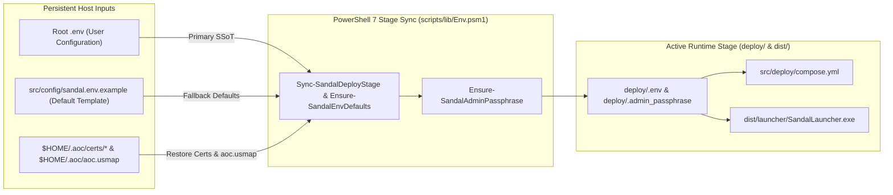

# Configuration Reference

**Related Guides**: [Root Overview](../README.md) | [Operational Runbook](RUNBOOK.md) | [Server Workers](SERVER_WORKERS.md) | [Control-Plane Services](SERVICES.md) | [Web Admin Studio](WEB_ADMIN.md) | [Security Policy](SECURITY.md)

This guide explains how SandalCore manages configuration through your root `.env` file, what happens when no `.env` file is present, and how to configure server worker topologies, simulation tick rates, `.tsv` data storage modes, Web Admin authentication, TLS certificates, and network ports.

---

## Environment Variables

### Persistent Root Configuration

SandalCore keeps your personal configuration separate from generated build files and temporary container state:

1. **Permanent Root `.env`**: The `.env` file in the repository root (`D:\GitHub\SandalCore\.env`, ignored by Git) is your single source of truth. It is never deleted when you clean `build/`, `dist/`, or `deploy/` via `.\sandal.ps1 clean`.
2. **Automatic Stage Sync**: Every time you run `.\start.bat`, `.\build.bat`, or `.\sandal.ps1 {up,deploy,run}`, `scripts/lib/Env.psm1` copies your root `.env` to `deploy/.env`, fills in any omitted settings from [`src/config/sandal.env.example`](../src/config/sandal.env.example), and passes the resolved variables to Docker Compose (`src/deploy/compose.yml`) and `SandalLauncher`.



### Default Configuration

If you clone the repository or delete `<repo-root>/.env`, SandalCore automatically generates a fresh `.env` from `src/config/sandal.env.example` using the single-worker Riverlands configuration:

```ini
AOC_WORLD_PARTITION_MODE=single_riverlands
AOC_WORLD_SHARD_MODE=single
AOC_WORLD_TOPOLOGY_MODE=single
AOC_WORLD_REGION=riverlands
AOC_WORLD_TICK_HZ_WORLD=30
AOC_WORLD_TICK_HZ_REGION=45
AOC_WORLD_TICK_HZ_ZOI=60
AOC_WORLD_TICK_HZ_NODE=100
AOC_WORLD_TICK_HZ_POI=100
AOC_SERVICE_TICK_HZ=30
AOC_DATA_MODE_DEFAULT=memory
```

With these default settings:

- Only **1 server worker container** (`aoc-riverlands` / `aoc-world`) starts alongside the 10 control-plane, PostgreSQL, and ingress proxy containers (**11 containers total**).
- The worker loads only Riverlands terrain tiles, navigation chunks, City Nodes, NPCs, and gatherables (`AOC_WORLD_REGION=riverlands`), keeping startup fast and host memory usage low.

---

## Server Worker Topologies

You can partition the world of Verra across one or more authoritative `world` workers by setting the partition and topology variables in your root `.env`. See [Server Workers and Spatial Authority](SERVER_WORKERS.md) and the [Operational Runbook](RUNBOOK.md) for copy-paste topology recipes.

| Variable | Default | Supported Values and Behavior |
|:---|:---|:---|
| `AOC_WORLD_PARTITION_MODE` | `single_riverlands` | - `single_riverlands`: 1 regional worker for Riverlands only (`45 Hz`).<br/>- `single_world`: 1 worker for the entire Verra continent (`30 Hz`).<br/>- `per_region`: 5 regional workers (`aoc-riverlands`, `aoc-sandsquall`, `aoc-jundark`, `aoc-anvils`, `aoc-turquoise-sea` at `45 Hz`).<br/>- `per_zoi`: 1 worker per Zone of Influence (`aoc-<zoi-name>` at `60 Hz`) within `AOC_WORLD_PARTITION_REGION`.<br/>- `per_zoi_nodes_and_pois`: Combines `60 Hz` ZOI workers with dedicated `100 Hz` `1 km x 1 km` City Node OBB Plug workers and POI polygon cut-out workers. |
| `AOC_WORLD_SHARD_MODE` / `AOC_WORLD_TOPOLOGY_MODE` | `single` | `single` (`world`), `region` (`per_region`), `zoi` (`per_zoi`), `node_plug_and_zoi`, `dynamic_node_plug_zoi` (NATO `-alpha..zulu` scaling stub), `dynamic_zoi` (NATO `-alpha..zulu` scaling stub), or `mixed`. |
| `AOC_WORLD_REGION` | `riverlands` | Region filter (`riverlands`, `sandsquall`, `jundark`, `anvils`, `turquoise_sea`, or `all`) when running a single worker. |
| `AOC_WORLD_PARTITION_REGION` | `sandsquall` | Target region (`sandsquall`, `riverlands`, or `random`) to split into ZOI or Node-Plug workers when `AOC_WORLD_PARTITION_MODE` is `per_zoi` or `per_zoi_nodes_and_pois`. |
| `AOC_WORLD_POI_CUTOUT` | *(empty)* | Named Point of Interest cut-out (such as `carphin`) or semicolon-delimited convex polygon (`AOC_WORLD_POLYGON_CUTOUT="x1,y1;x2,y2;..."`) to run on a dedicated `100 Hz` worker. |
| `AOC_WORLD_WORKER_MEM_LIMIT` | `2560M` | Container RAM limit (`2.5 GiB`) applied to each `world` worker container. |

> [!NOTE]
> **No Artificial Entity Count Caps**: `AOC_WORLD_MAX_*` and `max_gatherables` caps do not exist in SandalCore. Every worker spawns the complete set of authentic NPCs, monsters, and gatherable resource nodes belonging to its assigned spatial boundary, bounded only by in-memory container structures.

---

## Tick Rate Settings

Each server worker adjusts its default simulation tick rate (`Hz`) and per-tick NPC AI step slice according to its spatial scope so CPU utilization stays within the `30%--45%` green operating band:

| Variable | Default | Target Scope and Behavior |
|:---|:---:|:---|
| `AOC_WORLD_TICK_HZ_WORLD` | `30` | Simulation tick rate (`30 Hz`, `33.33 ms` frame budget) for a whole-world (`world`) worker. |
| `AOC_WORLD_TICK_HZ_REGION` | `45` | Simulation tick rate (`45 Hz`, `22.22 ms` frame budget) for regional (`region`) workers. |
| `AOC_WORLD_TICK_HZ_ZOI` | `60` | Simulation tick rate (`60 Hz`, `16.67 ms` frame budget) for Zone of Influence (`zoi`) workers. |
| `AOC_WORLD_TICK_HZ_NODE` | `100` | Simulation tick rate (`100 Hz`, `10.00 ms` frame budget) for `1 km x 1 km` City Node OBB Plug (`node_plug`) workers. |
| `AOC_WORLD_TICK_HZ_POI` | `100` | Simulation tick rate (`100 Hz`, `10.00 ms` frame budget) for POI / convex polygon cut-out (`poi`) workers. |
| `AOC_WORLD_TICK_HZ` | *(scope default)* | Optional per-worker startup override (`1..120 Hz`). At runtime, operators can set each worker's target tick mode in the Web Admin Studio to `Dynamic (30-60 Hz)` (`kMaxDynamicHz = 60` automatic scaling based on worker load, paired with a read-only actual `Current Hz` display), `0 Hz (Pause NPCs)`, or a fixed manual `10, 15, 20, 25, 30, 40, 50, 60 Hz` (`1..120 Hz` CLI/API) rate. |
| `AOC_WORLD_NPC_SIM_STEP_CAP_{WORLD,REGION,ZOI,NODE,POI}` | `5200` / `3600` / `2600` / `1500` / `1500` | Per-tick ambient NPC slice cap for each scope, paired with a Little's Law `<= 1.0 s` (`>= 1 Hz`) entity backlog floor so every spawned NPC is stepped at least once per second. |
| `AOC_SERVICE_TICK_HZ` | `30` | Tick rate (`30 Hz`, `33.33 ms`) for control-plane background loops, the Web Admin `world-stream` coalescer, and the single-source-of-truth mesh clock (`9x` clock speed across a `360`-day Verra year with four `90`-day seasons: `Spring`, `Summer`, `Autumn`, and `Winter`). |

---

## Data Storage Modes

Static `.tsv` catalog tables in `deploy/content/*.tsv` can be preloaded into RAM at startup (`memory`) for zero-disk-I/O lookups, or queried on demand from disk (`disk`) to reduce container memory usage:

| Variable | Default | Backed `.tsv` Table | Description |
|:---|:---:|:---|:---|
| `AOC_DATA_MODE_DEFAULT` | `memory` | All `.tsv` tables | Default mode (`memory` or `disk`) used by any table without a specific override below. |
| `AOC_DATA_MODE_ZOIS` | `${AOC_DATA_MODE_DEFAULT}` | `zoi_polygons.tsv` | Storage mode for the 27 Settlement and Divine Gate Zone of Influence polygons. |
| `AOC_DATA_MODE_CITY_NODES` | `${AOC_DATA_MODE_DEFAULT}` | `city_nodes.tsv`, `node_plug_bounds.tsv` | Storage mode for the 85 settlement records and rotated `1 km x 1 km` City Node OBB bounds. |
| `AOC_DATA_MODE_POIS` | `${AOC_DATA_MODE_DEFAULT}` | `pois.tsv` | Storage mode for Points of Interest markers and spawner region tags. |
| `AOC_DATA_MODE_NPCS` | `${AOC_DATA_MODE_DEFAULT}` | `npcs.tsv` | Storage mode for NPC and monster catalog definitions. |
| `AOC_DATA_MODE_ITEMS` | `${AOC_DATA_MODE_DEFAULT}` | `items.tsv` | Storage mode for item templates and equipment definitions. |

---

## Web Admin Authentication

When `.\start.bat` brings up the stack, it generates a fresh single-boot passphrase and prints it in the console banner for signing in at `https://localhost:8443/admin/` (or `http://localhost:8090`).

| Variable | Default / Generation | Description |
|:---|:---|:---|
| `AOC_ADMIN_USERNAME` | `Admin` | Administrative username required by `POST /api/v1/admin/auth/login` in the [Web Admin Studio](WEB_ADMIN.md). |
| `AOC_ADMIN_PASSPHRASE` | Ephemeral per boot (`verra-xxxx-xxxx-xxxx`) | Minted automatically on every `start.bat` / `.\sandal.ps1 up`, saved to `deploy/.admin_passphrase`, and printed in the startup banner. |
| `AOC_ADMIN_JWT_SECRET` | Random 256-bit hex secret | HMAC-SHA256 (`HS256`) signing key used to sign and verify scoped Web Admin Bearer JWTs. |
| `AOC_ADMIN_BOOT_ID` | Fresh UUID per boot | Embedded in issued JWTs and returned by `GET /api/v1/admin/auth/status`. When the server stack restarts, `AOC_ADMIN_BOOT_ID` changes, invalidating old browser tokens and prompting the Login Modal. |
| `AOC_ADMIN_TOKEN_TTL_SECONDS` | `43200` (`12 hours`) | Lifetime in seconds for issued Web Admin JWTs during the current server boot. |

---

## TLS Certificates and Unreal Mappings

SandalCore automatically preserves custom TLS certificates and Unreal `.usmap` files across clean rebuilds so you never have to copy them back into `dist/` manually:

| Path or Variable | Default | Preservation Behavior |
|:---|:---|:---|
| `AOC_GAME_PATH` | Auto-discovered via Registry or Steam | Path to your local Ashes of Creation installation containing `AOC/Binaries/Win64/AOCClient-Win64-Shipping.exe` and `AOC/Content/Paks`. |
| `$HOME/.aoc/certs/*` (`server.pem`, `server.key`) | Auto-backed up and restored | Existing certificates in `dist/certs/` (including Let's Encrypt or custom wildcard certificates `*.<domain>`) are never overwritten. They are backed up to `$HOME/.aoc/certs/` and restored automatically if `dist/` is cleaned. When a wildcard SAN (`*.<domain>`) is present, `localhost` and `127.0.0.1` map automatically to `localhost.<domain>`. See [TLS Certificates](../src/config/certs/README.md). |
| `$HOME/.aoc/aoc.usmap` (`~/.aoc/aoc.usmap`) | Auto-synced to `dist/content/aoc.usmap` and `deploy/content/aoc.usmap` | If you place an updated `.usmap` file at `$HOME/.aoc/aoc.usmap` (or set `SANDAL_USMAP_PATH`), the extractor pipeline automatically uses it instead of `src/config/layouts/aoc.usmap` and normalizes `.usmap` v4 headers in memory. |

---

## Network Ports and Budgets

### Exposed Container and Host Ports

| Variable | Default | Protocol | Service and Purpose |
|:---|:---:|:---:|:---|
| `AOC_INGRESS_HTTPS_PORT` | `8443` | TCP (TLS 1.3) | `aoc-ingress-proxy` HTTPS entrypoint for `/admin/` and `/api/v1/*`. |
| `AOC_INGRESS_HTTP_PORT` | `8088` | TCP (HTTP) | `aoc-ingress-proxy` local HTTP entrypoint. |
| `AOC_GATEWAY_PORT` | `8080` | TCP (HTTP/WS) | `aoc-gateway` launcher authentication, tether tickets, and `/api/v1/*` routes. |
| `AOC_WEB_ADMIN_PORT` | `8090` | TCP (HTTP) | `aoc-web-admin` SPA asset server and HTTP `206` `verra.pmtiles` tile server. |
| `AOC_ICS_PORT` | `50061` | TCP (TLS 1.3) | `aoc-character` / `aoc-gateway` external UE5 `IntrepidLobbyService` (character list, creation, and world entry). |
| `AOC_WORLD_UDP_PORT` | `7777` | UDP | Primary `world` worker UE5 `IpNetDriver` game port (additional workers bind `:7778+`). |
| `AOC_TETHER_PORT` | `19021` | UDP (`127.0.0.1`) | Host-only `LocalTetherListener` running inside `SandalLauncher.exe`. |
| `POSTGRES_PORT` | `5432` | TCP | `aoc-postgres` PostgreSQL database (`POSTGRES_USER=aoc`, `POSTGRES_DB=aoc`). |

### World Worker Runtime Budgets

| Variable | Default | Description |
|:---|:---:|:---|
| `AOC_WORLD_CACHE_ALL_CONTENT_IN_MEMORY` | `true` | Preloads `content.db` (`:memory:` SQLite backup) and `area_nav.bin` into RAM at worker startup so simulation ticks never block on disk reads. |
| `AOC_WORLD_CACHE_RECORDS_MAX` | `65536` | Maximum DesignData JSON records held in the worker's LRU memory cache when in-memory preloading is disabled. |
| `AOC_WORLD_NAV_PUMP_BUDGET_MS` | `2` | Maximum milliseconds per simulation tick spent splicing streamed Detour navmesh chunks into `AreaNav`. |
| `AOC_WORLD_SPAWN_BUDGET_PER_TICK` | `64` | Maximum deferred NPC or station spawns materialized per tick during startup or City Node stage changes. |
| `AOC_WORLD_PERSIST_INTERVAL_SEC` | `15` | Interval in seconds for flushing dirty player character state to `aoc-character`. |

### Cluster-Internal Metrics Endpoints and Observability Telemetry

Inside the Docker network, `aoc-gateway` and `aoc-mesh-gateway` poll internal `/metrics` endpoints (`Metrics Endpoint`) to populate the plain-English **Observability** workspace (`Health`, `Monitored Metrics`, `Traffic & Cache`, and `World Population`):

| Internal Metrics Endpoint | Source Service | Plain-English Telemetry Provided |
|:---|:---|:---|
| `http://mesh-gateway:8082/metrics` | `aoc-mesh-gateway` & `aoc-web-admin` | Tracks `Gateway Requests`, `API Cache Hits / Misses` (requests served from memory vs. backend queries), `Gateway Errors / Retries`, `UDP Frames Forwarded`, and per-route HTTP status classes (`2xx` successful responses, `3xx` redirects, `4xx` client request errors, and `5xx` server errors). |
| `http://<worker>:8080/metrics` | `aoc-world` & regional/ZOI workers | Reports each worker's read-only actual `Current Hz` alongside its `Target Tick Mode` (`Dynamic (30-60 Hz)` with `kMaxDynamicHz = 60`, `0 Hz` NPC pause, or fixed `10, 15, 20, 25, 30, 40, 50, 60 Hz` / `1..120 Hz` CLI/API manual rates), tick duration (`p50 / p99 ms`), and mutually exclusive counts for `Players`, `NPCs`, `Monsters`, `Huntables`, `Trees`, `Rocks`, `Ore & Gems`, `Plants`, and `Mounts`. |
| `http://<service>:18080/metrics` | Control-plane services (`auth`, `character`, `citynode`, `quest`, `mesh`, `gateway`) | Reports service `Health` (`UP` / `DOWN`), `Monitored Metrics` count, response latency (`ms`), and active RPC connections. |
