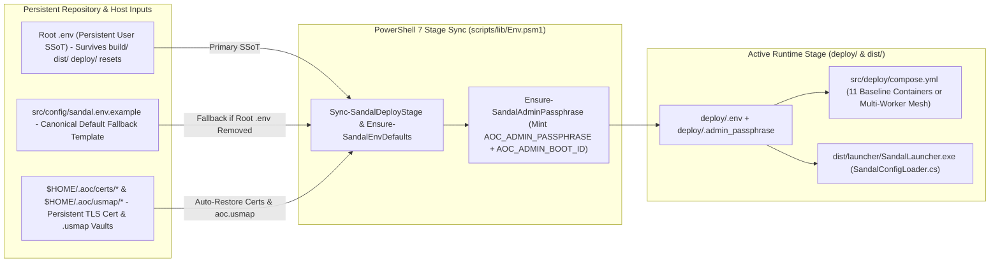

# SandalCore Configuration Reference (`docs/CONFIGURATION.md`)

**Primary Diataxis Quadrant**: `Technical Reference` (`DOC-01`)
**Related Guides**: [Root Architecture Overview](../README.md) | [Server Workers & Spatial Authority](SERVER_WORKERS.md) | [Control-Plane Services Reference](SERVICES.md) | [Web Admin & GM Studio Reference](WEB_ADMIN.md) | [Security Policy](SECURITY.md) | [C++23 `world` Worker Reference](../src/server/world/README.md) | [Go Control-Plane Services Reference](../src/server/services/README.md) | [Container & Compose Topology Reference](../src/deploy/README.md) | [PKI & TLS Certificates Reference](../src/config/certs/README.md) | [Desktop Launcher Reference](../src/clients/launcher/README.md) | [Game-Data Extractor Reference](../src/tools/aoc-extractor/README.md)

This document is the authoritative configuration reference for **SandalCore**. It specifies how the root `.env` Single Source of Truth (SSoT) persists across `build/`, `dist/`, and `deploy/` resets, what happens when root `.env` is absent, and how to configure server worker topologies, tick rates (`10 Hz` / `20 Hz` / `30 Hz`), per-data-type `.tsv` storage modes (`memory` vs. `disk`), Web Admin startup passphrases and `HS256` JWT secrets, TLS certificates (`$HOME/.aoc/certs/*`), and Unreal `.usmap` overrides (`$HOME/.aoc/usmap/*`).

---

## 1. Root `.env` Single Source of Truth (SSoT) & Default Fallback Behavior

### Persistent Root `.env` Across Stage Resets

SandalCore separates persistent operator configuration from ephemeral runtime state:

- **Persistent Operator SSoT (`<repo-root>/.env`)**: Your user-authored `.env` at the repository root (`D:\GitHub\SandalCore\.env`, gitignored) is the permanent configuration Single Source of Truth. It **survives full deletions of `build/`, `dist/`, and `deploy/`** (`.\sandal.ps1 clean`).
- **Stage Synchronization (`Sync-SandalDeployStage`)**: Whenever `start.bat`, `build.bat`, or `.\sandal.ps1 {up,deploy,run}` executes, `scripts/lib/Env.psm1` copies root `.env` into `deploy/.env` (`Sync-SandalDeployStage`), merges any missing defaults from [`src/config/sandal.env.example`](../src/config/sandal.env.example) (`Ensure-SandalEnvDefaults`), and injects the resolved environment into [`src/deploy/compose.yml`](../src/deploy/compose.yml) and [`SandalLauncher`](../src/clients/launcher/README.md).



### Default Fallback When Root `.env` Is Removed (`1` Riverlands Worker, `11` Containers Total)

If `<repo-root>/.env` is deleted or absent on a fresh clone, `Ensure-SandalEnvFile` seeds configuration from [`src/config/sandal.env.example`](../src/config/sandal.env.example) with the following baseline defaults:

```ini
AOC_WORLD_SHARD_MODE=single
AOC_WORLD_REGION=riverlands
AOC_WORLD_TICK_HZ_ZOI=30
AOC_WORLD_TICK_HZ_REGION=20
AOC_WORLD_TICK_HZ_WORLD=10
AOC_SERVICE_TICK_HZ=30
AOC_DATA_MODE_DEFAULT=memory
```

Under this default fallback:

1. **Single Authoritative Worker (`aoc-riverlands` / `aoc-world-riverlands` / `aoc-world`)**: Only **1 server worker container** starts alongside the 10 control-plane and infrastructure containers (**`11` containers total**).
2. **Riverlands-Only Entity Spawning**: The single worker sets `AOC_WORLD_REGION=riverlands`, loading only Riverlands terrain tiles, Detour navmesh chunks, CityNodes, and NPC spawners for fast startup and minimal host memory usage.

---

## 2. Server Worker Topologies, Naming & Tick Rate Configuration (`Hz`)

### Server Worker Topology Presets (`AOC_WORLD_SHARD_MODE`)

Configure how Verra is partitioned across C++23 `world` workers (see [`docs/SERVER_WORKERS.md`](SERVER_WORKERS.md) for full spatial authority and handover details):

| Variable | Default | Supported Values & Behavior |
|:---|:---|:---|
| `AOC_WORLD_SHARD_MODE` | `single` | - `single` / `world_only`: `1` server worker (`aoc-world`, or `aoc-riverlands` when `AOC_WORLD_REGION=riverlands`).<br/>- `per_region` / `regional`: `1` worker per biome region (`aoc-<region-name>`: `aoc-riverlands`, `aoc-sandsquall`, `aoc-jundark`, `aoc-anvils`, `aoc-turquoise-sea`).<br/>- `per_zoi`: `1` worker per Zone of Influence (`aoc-<zoi-name>`, e.g., `aoc-sunhaven`, `aoc-azmaran`, `aoc-winstead`, `aoc-joeva`).<br/>- `node_plug_and_zoi`: `1` worker per rotated `1 km x 1 km` CityNode OBB (`aoc-<city-name>`) + `1` worker per surrounding ZOI (`aoc-<zoi-name>` with `--area-exclude-node-plug`).<br/>- `dynamic_node_plug_zoi`: Dynamic scaling stub (`1..26` per city `aoc-<city-name>-alpha..zulu` + `1..26` per ZOI `aoc-<zoi-name>-alpha..zulu`, never `0`; currently runs the static `-alpha` baseline without spawning extra dynamic workers).<br/>- `dynamic_zoi`: Dynamic scaling stub (`1..26` per ZOI `aoc-<zoi-name>-alpha..zulu`, never `0`; currently runs the static `-alpha` baseline without spawning extra dynamic workers).<br/>- `mixed`: Mix and match regional workers with ZOI, Node-Plug, and Convex Polygon Cutout workers. |
| `AOC_WORLD_REGION` | `riverlands` | Active region filter (`riverlands`, `sandsquall`, `jundark`, `anvils`, `turquoise_sea`, or `all`) when running in `single` mode. |
| `AOC_WORLD_ZOI_REGIONS` | *(empty)* | Comma-separated list of regions to split into `30 Hz` ZOI workers in `mixed` mode (for example, `AOC_WORLD_ZOI_REGIONS=sandsquall` runs `aoc-sunhaven` and `aoc-azmaran` at `30 Hz` while keeping the other 4 regions on `20 Hz` regional workers). |
| `AOC_WORLD_POLYGON_CUTOUT` | *(empty)* | Semicolon-delimited counter-clockwise convex polygon vertices (`x1,y1;x2,y2;x3,y3;...` in world cm) for an additive `polygon_cutout` worker (`--area-polygon`). |

### Configurable Simulation & Control-Plane Tick Rates (`Hz`)

| Variable | Default | Scope & Description |
|:---|:---:|:---|
| `AOC_WORLD_TICK_HZ_ZOI` | `30` | Authoritative simulation tick rate (`30 Hz`, `33.33 ms` frame budget) for **ZOI** (`aoc-<zoi-name>`), **Node-Plug** (`aoc-<city-name>`), and **Convex Polygon Cutout** workers. |
| `AOC_WORLD_TICK_HZ_REGION` | `20` | Authoritative simulation tick rate (`20 Hz`, `50.00 ms` frame budget) for **Region** (`aoc-<region-name>`) workers. |
| `AOC_WORLD_TICK_HZ_WORLD` | `10` | Authoritative simulation tick rate (`10 Hz`, `100.00 ms` frame budget) for **Whole-World** (`aoc-world`) single-worker mode. |
| `AOC_WORLD_TICK_HZ` | *(tier default)* | Optional explicit per-worker override (`1..120` Hz). When unset, the worker selects `AOC_WORLD_TICK_HZ_{ZOI,REGION,WORLD}` matching its `--area-tier`. |
| `AOC_SERVICE_TICK_HZ` | `30` | Background tick rate (`30 Hz`, `33.33 ms`) for Go control-plane services (`world-stream` entity delta coalescer, mesh heartbeat monitor, and telemetry collectors). |

---

## 3. Per-Data-Type `.tsv` Storage Modes (`memory` vs. `disk`)

Extracted static game tables in `dist/content/*.tsv` (synced to `deploy/content/*.tsv`) can be loaded wholly into RAM at startup (`memory`) for zero-I/O lookups, or streamed on demand from disk (`disk`) to minimize container memory footprint:

| Variable | Default | Backed `.tsv` Artifact | Description |
|:---|:---:|:---|:---|
| `AOC_DATA_MODE_DEFAULT` | `memory` | All `.tsv` tables | Default storage mode (`memory` or `disk`) applied to any data category that does not specify an explicit override below. |
| `AOC_DATA_MODE_ZOIS` | `${AOC_DATA_MODE_DEFAULT}` | `zoi_polygons.tsv` | Storage mode (`memory` or `disk`) for the 27 Settlement & Divine Gate Voronoi ZOI polygon definitions. |
| `AOC_DATA_MODE_CITY_NODES` | `${AOC_DATA_MODE_DEFAULT}` | `city_nodes.tsv`, `node_plug_bounds.tsv` | Storage mode (`memory` or `disk`) for the 85 settlement records and rotated `1 km x 1 km` CityNode OBB bounds. |
| `AOC_DATA_MODE_POIS` | `${AOC_DATA_MODE_DEFAULT}` | `pois.tsv` | Storage mode (`memory` or `disk`) for Points of Interest markers and spawner region tags. |
| `AOC_DATA_MODE_NPCS` | `${AOC_DATA_MODE_DEFAULT}` | `npcs.tsv` | Storage mode (`memory` or `disk`) for the `4,200+` NPC and monster catalog definitions. |
| `AOC_DATA_MODE_ITEMS` | `${AOC_DATA_MODE_DEFAULT}` | `items.tsv` | Storage mode (`memory` or `disk`) for the `9,300+` item templates and equipment stats. |

---

## 4. Web Admin Startup Passphrase & Scoped `HS256` JWT Authentication

| Variable | Default / Generation | Description |
|:---|:---|:---|
| `AOC_ADMIN_USERNAME` | `Admin` | Administrative username required by `POST /api/v1/admin/auth/login` (`DEFAULT_ADMIN_USERNAME = "Admin"`, paired with the top-bar `END SESSION` button) in the [Web Admin & GM Studio](WEB_ADMIN.md). |
| `AOC_ADMIN_PASSPHRASE` | Ephemeral per-boot (`verra-xxxx-xxxx-xxxx`) | Generated automatically by `Ensure-SandalAdminPassphrase` (`scripts/lib/Env.psm1`) on every `start.bat` / `.\sandal.ps1 up`, written to `deploy/.admin_passphrase`, and printed in the console startup banner. |
| `AOC_ADMIN_JWT_SECRET` | Random 256-bit hex secret | HMAC-SHA256 (`HS256`) signing secret used by `aoc-gateway` (`internal/admin-gateway`) to sign and verify scoped Bearer JWTs. |
| `AOC_ADMIN_BOOT_ID` | Fresh UUID per stack startup | Unique boot identifier embedded into issued JWTs and returned by `GET /api/v1/admin/auth/status`. Rotating `AOC_ADMIN_BOOT_ID` on server restart forces open Web Admin browser tabs to discard prior tokens (`401`/`403`) and display the Login Modal. |
| `AOC_ADMIN_TOKEN_TTL_SECONDS` | `43200` (`12 hours`) | Lifetime in seconds for issued `HS256` admin JWTs (while `AOC_ADMIN_BOOT_ID` remains unchanged). |

---

## 5. Host Paths, TLS Certificate Preservation & `.usmap` Overrides

| Path / Variable | Default | Contract & Preservation Behavior |
|:---|:---|:---|
| `AOC_GAME_PATH` | Auto-discovered via Registry / Steam `libraryfolders.vdf` | Path to the local *Ashes of Creation* installation containing `AOC/Binaries/Win64/AOCClient-Win64-Shipping.exe` and `AOC/Content/Paks`. |
| `$HOME/.aoc/certs/*` (`server.pem`, `server.key`) | Auto-backed up & restored | **Never Overwrite Existing Certs**: `scripts/sandal/certs.ps1` and `scripts/sandal/deploy.ps1` preserve existing `dist/certs/server.pem` + `server.key` (including Let's Encrypt wildcard certs `*.<domain>`), automatically back them up to `$HOME/.aoc/certs/`, and restore them after `dist/` cleanups. When a wildcard SAN (`*.<domain>`) is detected, `SandalConfigLoader.cs` and `scripts/lib/Env.psm1` automatically map `localhost` / `127.0.0.1` to `local.<domain>`. See [`src/config/certs/README.md`](../src/config/certs/README.md). |
| `$HOME/.aoc/usmap/*` (`aoc.usmap`) | Auto-copied to `dist/content/aoc.usmap` | Placing a custom `.usmap` inside `$HOME/.aoc/usmap/` (or setting `SANDAL_USMAP_PATH`) automatically syncs it into `dist/content/aoc.usmap` and performs in-memory `.usmap` v4 -> v3 compatibility normalization during extraction. |

---

## 6. Network Ports, Database Credentials & `world` Runtime Budgets

### Exposed Container & Host Ports

| Variable | Default | Protocol | Service & Purpose |
|:---|:---:|:---:|:---|
| `AOC_INGRESS_HTTPS_PORT` | `8443` | TCP (TLS 1.3) | `aoc-ingress-proxy` unified HTTPS entrypoint (`/admin/` Web Admin SPA, `/api/v1/admin/*` Admin Gateway). |
| `AOC_INGRESS_HTTP_PORT` | `8088` | TCP (HTTP) | `aoc-ingress-proxy` HTTP redirect / local diagnostics port. |
| `AOC_GATEWAY_PORT` | `8080` | TCP (HTTP/WS) | `aoc-gateway` launcher auth (`/v1/auth/*`), tether tickets (`/v1/tether/*`), and `/api/v1/admin/*`. |
| `AOC_WEB_ADMIN_PORT` | `8090` | TCP (HTTP) | `aoc-web-admin` direct SPA & HTTP `206` `verra.pmtiles` byte-range server. |
| `AOC_ICS_PORT` | `50061` | TCP (TLS 1.3) | `aoc-character` external UE5 `IntrepidLobbyService` (ICS character list, native character creation, world entry). |
| `AOC_WORLD_UDP_PORT` | `7777` | UDP | Primary C++23 `world` worker (`aoc-world` / `aoc-riverlands`) UE5 `IpNetDriver` game port (additional workers bind `:7778..:7783+`). |
| `AOC_TETHER_PORT` | `19021` | UDP (`127.0.0.1`) | Host-only `LocalTetherListener` inside `SandalLauncher.exe` (never inside Docker). |
| `POSTGRES_PORT` | `5432` | TCP | `aoc-postgres` PostgreSQL 16 database (`POSTGRES_USER=aoc`, `POSTGRES_DB=aoc`, `POSTGRES_PASSWORD`). |

### C++23 `world` SQLite Cache & Per-Tick Work Budgets (`src/server/world`)

| Variable | Default | Description |
|:---|:---:|:---|
| `AOC_WORLD_CACHE_RECORDS_MAX` | `65536` | Maximum DesignData JSON records cached in the `world` worker's LRU memory cache (`content.db` `v41`). |
| `AOC_WORLD_NAV_PUMP_BUDGET_MS` | `2` | Maximum milliseconds per simulation tick allocated to `AreaNav::pump(budget_ms)` for splicing streamed Detour navmesh chunks. |
| `AOC_WORLD_SPAWN_BUDGET_PER_TICK` | `64` | Maximum deferred NPC/station spawns materialized per simulation tick during startup or CityNode tier changes (`0..6`). |
| `AOC_WORLD_PERSIST_INTERVAL_SEC` | `15` | Periodic dirty character state flush interval from `world` workers to `aoc-character` (`:50052`). |
