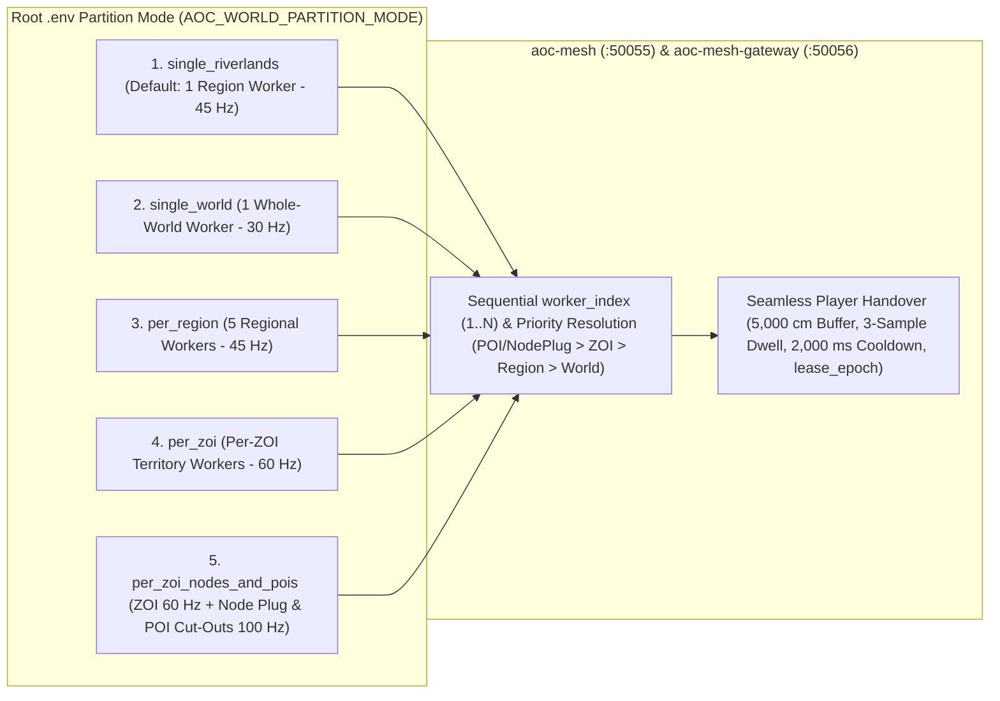

# SandalCore Operational Runbook, `.env` Partition Topologies & `worldctl` Guide (`docs/RUNBOOK.md`)

**Primary Diataxis Quadrant**: `How-To Guide` & `Operational Runbook` (`DOC-01`, `DOC-05`)
**Related Guides**: [Root Architecture Overview](../README.md) | [Configuration Reference](CONFIGURATION.md) | [Server Workers & Spatial Authority](SERVER_WORKERS.md) | [Web Admin Architecture](WEB_ADMIN_ARCHITECTURE.md) | [Web Admin & GM Studio Reference](WEB_ADMIN.md) | [UI Style Guide & Design System](UI_STYLE_GUIDE.md) | [`worldctl` CLI Reference](../src/server/services/cmd/worldctl/README.md)

This operational runbook provides copy-paste-safe `.env` partition topology setups, per-scope worker tick-rate and memory tuning contracts (`30--120 Hz`, `30%--45%` green CPU band, `2560M` RAM, `0` disk log churn), the complete `worldctl` operator CLI reference, and 4-phase incident/remediation playbooks (`DOC-05`).

---

## 1. First-Time User Default Setup (`1 Worker for Riverlands Only`) & `.env` Partition Topologies

### Out-of-the-Box Default (`start.bat` -> `1 Worker for Riverlands Only`)

Clicking `.\start.bat` (`.\sandal.ps1 up`) on a fresh checkout starts **1 authoritative C++23 zone worker for Riverlands only** without requiring any manual `.env` edits:

- **Default Partition Variables**:
  - `AOC_WORLD_PARTITION_MODE=single_riverlands`
  - `AOC_WORLD_REGION=riverlands`
  - `AOC_WORLD_TOPOLOGY_MODE=single`
- **Container & Host Actions**:
  1. Verifies `dist/content/content.db` (`v41`) and all 25 runtime game-data artifacts (auto-extracting from the local *Ashes of Creation* installation if absent).
  2. Starts the 10 Go/PostgreSQL/Envoy control-plane containers plus `1` Riverlands worker container (`aoc-riverlands` / `aoc-world` at `45 Hz` regional tick rate, `3600` NPC step cap, and `2560M` memory limit).
  3. Prints the single-boot Web Admin passphrase (`deploy/.admin_passphrase`) with default username **`"Admin"`** (and top-bar **`"END SESSION"`** button), creates the root `SandalLauncher.lnk` shortcut pointing to `dist/launcher/SandalLauncher.exe`, and launches `SandalLauncher`.

### Copy-Paste `.env` Partition Topology Examples (`5` Standard Setups)

Switching partition topologies is controlled entirely through root `.env` (which `.\start.bat` syncs to `deploy/.env`). Copy-paste one of the five blocks below into root `.env` and run `.\start.bat`:

#### Setup 1: `1` Worker for `1` Region (Default: Riverlands)

Spawns only Riverlands entities on a single regional worker (`45 Hz` default tick rate, `3600` NPC step cap):

```ini
AOC_WORLD_PARTITION_MODE=single_riverlands
AOC_WORLD_REGION=riverlands
AOC_WORLD_TOPOLOGY_MODE=single
```

#### Setup 2: `1` Worker for Whole World (All `5` Regions on `1` Worker)

Spawns all 5 Verra regions (`riverlands`, `sandsquall`, `jundark`, `anvils`, `turquoise-sea`) inside a single whole-world worker (`30 Hz` default tick rate, `5200` NPC step cap):

```ini
AOC_WORLD_PARTITION_MODE=single_world
AOC_WORLD_REGION=all
AOC_WORLD_TOPOLOGY_MODE=world
```

#### Setup 3: `1` Worker for Each Region (`5` Regional Workers)

Runs 5 dedicated regional workers (`aoc-riverlands`, `aoc-sandsquall`, `aoc-jundark`, `aoc-anvils`, `aoc-turquoise-sea`) in parallel (`45 Hz` default tick rate, `3600` NPC step cap per worker) with automatic cross-border player handovers:

```ini
AOC_WORLD_PARTITION_MODE=per_region
AOC_WORLD_TOPOLOGY_MODE=region
```

#### Setup 4: `1` Worker for Each ZOI (Zone of Influence Workers)

Partitions a target region (`sandsquall`, `riverlands`, or `random`) into dedicated per-ZOI workers (`60 Hz` default tick rate, `2600` NPC step cap per ZOI worker):

```ini
AOC_WORLD_PARTITION_MODE=per_zoi
AOC_WORLD_TOPOLOGY_MODE=zoi
AOC_WORLD_PARTITION_REGION=sandsquall
```

*(Set `AOC_WORLD_PARTITION_REGION=riverlands` or `AOC_WORLD_PARTITION_REGION=random` to partition Riverlands or a randomly selected region by ZOI.)*

#### Setup 5: `1` Worker for Each ZOI / POI / City Node Plug (High-Frequency Sub-Area Cut-Outs)

Combines `60 Hz` ZOI workers (`--area-exclude-node-plug=Verra_SAN_Node_Sunhaven,Verra_SAN_Node_Azmaran`) with dedicated `100 Hz` (`1500` NPC step cap) rotated `1 km x 1 km` CityNode OBB Plug workers and high-density POI cut-out workers (such as `carphin`):

```ini
AOC_WORLD_PARTITION_MODE=per_zoi_nodes_and_pois
AOC_WORLD_TOPOLOGY_MODE=mixed
AOC_WORLD_PARTITION_REGION=sandsquall
AOC_WORLD_POI_CUTOUT=carphin
```



---

## 2. Optimal Tick Rates (`30--120 Hz`), Green CPU Band (`30%--45%`), `2.5 GiB` (`2560M`) Worker Memory & Zero Disk Log Churn

### Per-Scope Tick Rate & NPC Step Cap Defaults

To maintain simulation frame times inside the **green CPU utilization band (`30%--45%`)** across both single-worker and multi-worker deployments, `aoc-world` scales its default simulation tick rate (`30--120 Hz`) and per-step NPC AI budget cap according to each worker's spatial authority scope:

| Spatial Scope (`scope_kind`) | Partition Mode(s) | Default Tick Rate (`Hz`) | Frame Budget (`ms`) | Default NPC Step Cap | `.env` Override Variables |
|:---|:---|:---:|:---:|:---:|:---|
| **`world`** | `single_world` (`world`) | **`30 Hz`** | `33.33 ms` | **`5200`** | `AOC_WORLD_TICK_HZ_WORLD=30`, `AOC_WORLD_NPC_SIM_STEP_CAP_WORLD=5200` |
| **`region`** | `single_riverlands`, `per_region` (`region`) | **`45 Hz`** | `22.22 ms` | **`3600`** | `AOC_WORLD_TICK_HZ_REGION=45`, `AOC_WORLD_NPC_SIM_STEP_CAP_REGION=3600` |
| **`zoi`** | `per_zoi`, `per_zoi_nodes_and_pois` (`zoi`) | **`60 Hz`** | `16.67 ms` | **`2600`** | `AOC_WORLD_TICK_HZ_ZOI=60`, `AOC_WORLD_NPC_SIM_STEP_CAP_ZOI=2600` |
| **`node_plug`** | `per_zoi_nodes_and_pois` (`mixed` CityNode OBB) | **`100 Hz`** (`..120 Hz`) | `10.00 ms` | **`1500`** | `AOC_WORLD_TICK_HZ_NODE=100`, `AOC_WORLD_NPC_SIM_STEP_CAP_NODE=1500` |
| **`poi`** (`polygon_cutout`) | `per_zoi_nodes_and_pois` (`AOC_WORLD_POI_CUTOUT`) | **`100 Hz`** (`..120 Hz`) | `10.00 ms` | **`1500`** | `AOC_WORLD_TICK_HZ_POI=100`, `AOC_WORLD_NPC_SIM_STEP_CAP_POI=1500` |

### Per-Worker Tick-Rate Selector (`Dynamic (30-60 Hz)`, `0 Hz (Pause NPCs)`, Manual `10..60 Hz`) & Little's Law `<= 1.0 s` (`>= 1 Hz`) Entity Backlog Floor

1. **Per-Worker Tick-Rate Selector (`WORKER_TICK_HZ_OPTIONS`)**:
   - In the Web Admin `Visible Server Workers` panel (`worker-tick-rate-select-<id>`) and via `POST/PUT /api/v1/gm/workers/{id}/tick-rate` (`/api/v1/world/workers/{id}/tick-rate`), each worker exposes an independent tick-rate selector persisted in PostgreSQL `world_simulation_state.worker_tick_hz`:
     - **`Dynamic (30-60 Hz)` (`-1`)**: Auto-scales the worker's simulation frequency between `30 Hz` and `60 Hz` in `5 Hz` steps after `15` consecutive ticks of EWMA CPU work utilization above `45%` or below `30%`.
     - **`0 Hz (Pause NPCs)` (`0` / `0 Hz (Off)`)**: Pauses ambient NPC simulation (`simulate_all_npcs = false` / `0 Hz` override) **on just that target worker** while keeping player UDP sockets, handovers, and GM RPCs responsive.
     - **Manual Discrete Rates (`10, 15, 20, 25, 30, 40, 50, 60 Hz`)**: Locks the target worker to a fixed manual tick rate (`TickMode::Manual`).
2. **Little's Law `<= 1.0 s` (`>= 1 Hz`) Entity Backlog Floor (`NpcWorld::step_all_ambient`)**:
   - To guarantee that every ambient NPC across a worker's population $N$ (`total = npcs_.size()`) is stepped at least once per second (`>= 1 Hz` per-entity service rate, `<= 1.0 s` cycle time), `src/server/world/npc/npc_world.cpp` enforces the Little's Law floor `min_for_1s_backlog = (total + eff_hz - 1) / eff_hz` (`max_slice = min(total, max(sim_step_cap, min_for_1s_backlog))`), stepping at least `min_for_1s_backlog` entities per tick before checking the sub-tick time budget.
3. **PostgreSQL (`world_simulation_state` + `city_node_state`) Control-Plane SSoT in `mesh-gateway`**:
   - `aoc-mesh-gateway` (`src/server/services/internal/admin-gateway/sim_persistence.go` and `0025_world_simulation_state.sql`) persists the authoritative `9x` Time of Day anchor, the **360-day Verra Calendar** (`Year >= 1 AE`, `4` seasons x `3` months x `30` days = `360` days/year), `simulate_all_npcs`, and per-worker tick-rate overrides in `world_simulation_state`, and persists settlement stage (`0..6`), mayor, and governance state in `city_node_state` (with Tier 5/6 City Node population fallback to the last defined populated layout at Tier 4).

### `2.5 GiB` (`2560M`) Worker Memory Ceiling & Zero Disk Log Churn

1. **`AOC_WORLD_WORKER_MEM_LIMIT=2560M` (`2.5 GiB` Per Worker)**:
   - Each `aoc-world` / regional / ZOI / cut-out worker container is provisioned with `AOC_WORLD_WORKER_MEM_LIMIT=2560M` (`2.5 GiB`).
   - On startup, each worker preloads `content.db` (`v41`) into an in-memory SQLite database (`:memory:`) and maps `area_nav.bin` into RAM (`AOC_WORLD_CACHE_ALL_CONTENT_IN_MEMORY=true`), keeping steady-state RSS well within `2560M` with zero runtime disk reads.
2. **Zero On-Disk File Logging (`read_only: true` + RAM `tmpfs`)**:
   - Every container in `src/deploy/compose.yml` enforces `read_only: true` on its root filesystem and mounts `/tmp:rw,noexec,nosuid,nodev` and `/app/logs:rw,noexec,nosuid,nodev` as in-memory `tmpfs` volumes.
   - Structured JSON telemetry is emitted exclusively to `stdout`/`stderr` (scraped in memory by the Web Admin log tailer), guaranteeing **`0` on-disk log file churn** on the host SSD.

---

## 3. Complete `worldctl` Operator CLI Reference

`worldctl` (`src/server/services/cmd/worldctl`) is the operator CLI for inspecting and mutating live `aoc-world` state over gRPC (`:50055` host / `:50061` container) and HTTP admin probes (`:18081`).

| Subcommand | Syntax & Arguments | Description |
|:---|:---|:---|
| **`time`** | `worldctl time [<HH:MM\|hours>]` | Queries the current authoritative `9x` Verra server time of day (`HH:MM:SS`, `kGameTimeFactor = 9.0`), or sets the server clock to `<HH:MM>` (`06:00`, `18:30`) or decimal hours (`0.0..24.0`). |
| **`workers`** | `worldctl workers` | Lists all registered spatial authority workers (`worker_index`, `worker_id`, `scope_kind`, `scope_key`, `tick_hz`, `players`, `npcs`, `monsters`, `resources`, `mounts`, and AABB/OBB bounds). |
| **`tick-rate`** | `worldctl tick-rate [<hz>] [--metrics-url URL]` | Queries (when `<hz>` is omitted) or updates (`1..120 Hz`, `30..120 Hz` operational band) the live simulation tick rate of the target worker. |
| **`simulate-npcs`** | `worldctl simulate-npcs [on\|off] [--metrics-url URL]` | Queries or toggles full-world NPC AI simulation (`on`) vs. player-proximity bubble culling (`off`). |
| **`players`** | `worldctl players` | Lists all online players on the worker (`name`, `guid`, `(x, y, z)` cm, `level`, `mounted`). |
| **`places`** | `worldctl places` | Prints all named Verra teleport landmarks and settlement nodes (`lionhold`, `crossroads`, `samias-hope`, `winstead`, `joeva`, `sunhaven`, `azmaran`, etc.). |
| **`tp`** | `worldctl tp <character> <place> \| <x> <y> [<z>]` | Teleports an online player by character name or GUID to a named place or explicit `(x, y[, z])` world coordinates in centimeters (auto-snapping `z` to terrain/platform height when omitted). |
| **`speed`** | `worldctl speed <character> <multiplier>` | Sets a character's movement speed multiplier in `[0.5, 10.0]` (`1.0` resets to baseline). |
| **`give-money`** | `worldctl give-money <character> <copper>` | Adds or deducts copper currency (`100` copper = `1` silver, `10,000` copper = `1` gold). |
| **`give-item`** | `worldctl give-item <character> <item> [<count>] [<rarity>\|q<NN>]` | Grants an item by GUID, `Item_...` record name, or display name with optional count (`1..100000`), rarity (`Common..Artifact`), or exact quality (`q1..q200`). |
| **`npc spawn`** | `worldctl npc spawn <def_or_name> <x> <y> [<z>] [--level N]` | Spawns a dynamic NPC or monster by record name, display name, or GUID at `(x, y[, z])` with optional level `1..100`. |
| **`npc kill\|respawn\|reset\|heal\|despawn`** | `worldctl npc <action> <id>` | Executes an immediate lifecycle action on a live NPC or monster instance by actor ID (`decimal` or `0x...` hex). |
| **`npc move`** | `worldctl npc move <id> <x> <y> [<z>]` | Moves a live NPC to `(x, y[, z])` cm and re-centers its leash anchor. |
| **`place-station` / `remove-station`** | `worldctl place-station <node> <plot> <station>` | Places or removes an artisan station (`forge`, `carpentry`, `arcane`, `cooking`, `loom`, `smelter`, etc.) on settlement plot `0..15`. |
| **`craft`** | `worldctl craft finish\|teach\|forget\|taught <character> [<arg>]` | Completes active processing jobs (`finish`) or manages learned crafting recipes (`teach`, `forget`, `taught`). |
| **`weapon-xp`** | `worldctl weapon-xp <character> <line> <level\|xp=N>` | Sets weapon skill-tree mastery level (`1..25`) or exact XP (`xp=0..5718160`). |
| **`tutorials reset`** | `worldctl tutorials reset <character>` | Resets completed FTUE tutorial flags for a character. |
| **`watch`** | `worldctl watch [--area minx,miny,maxx,maxy] [--density] [--seconds N]` | Streams live `30 Hz` world state snapshots or spatial density grids over `WorldStreamService`. |

### Copy-Paste `worldctl` Examples

```powershell
# 1. Query or set the authoritative 9x Verra server time of day
docker exec aoc-world worldctl --addr 127.0.0.1:50061 time
docker exec aoc-world worldctl --addr 127.0.0.1:50061 time 14:30

# 2. List all active spatial workers and inspect or tune worker tick rate (30..120 Hz)
docker exec aoc-world worldctl --addr 127.0.0.1:50061 workers
docker exec aoc-world worldctl tick-rate --metrics-url http://127.0.0.1:18081
docker exec aoc-world worldctl tick-rate 60 --metrics-url http://127.0.0.1:18081

# 3. Toggle full-world NPC simulation and spawn a Lv 50 monster at world coordinates
docker exec aoc-world worldctl simulate-npcs on --metrics-url http://127.0.0.1:18081
docker exec aoc-world worldctl --addr 127.0.0.1:50061 npc spawn "Goblin Scout" -452100 -548900 --level 50
```

---

## 4. Operational Remediation & Verification Playbooks (`DOC-05`)

### Playbook 1: Switching `.env` Partition Topologies & Verifying Worker Registration

1. **Trigger & Symptom Identification**:
   - Operator wants to switch from the default single-worker Riverlands setup (`single_riverlands`) to a multi-region (`per_region`), per-ZOI (`per_zoi`), or high-frequency Node-Plug/POI cut-out (`per_zoi_nodes_and_pois`) topology.
2. **Read-Only Pre-Flight Diagnostics**:
   ```powershell
   # Inspect current root .env partition settings and running worker containers
   Get-Content .env -ErrorAction SilentlyContinue | Select-String "AOC_WORLD_"
   docker ps --filter "name=aoc-" --format "table {{.Names}}\t{{.Status}}\t{{.Ports}}"
   ```
3. **Idempotent Remediation Procedure**:
   ```powershell
   # Set the desired partition topology in root .env (e.g., per_zoi_nodes_and_pois) and apply via start.bat
   Set-Content -Path .env -Value @(
     "AOC_WORLD_PARTITION_MODE=per_zoi_nodes_and_pois",
     "AOC_WORLD_TOPOLOGY_MODE=mixed",
     "AOC_WORLD_PARTITION_REGION=sandsquall",
     "AOC_WORLD_POI_CUTOUT=carphin",
     "AOC_WORLD_WORKER_MEM_LIMIT=2560M"
   ) -Encoding utf8
   .\start.bat
   ```
4. **Post-Condition Verification & Rollback**:
   ```powershell
   # Verify all workers registered with aoc-mesh and report healthy status
   Invoke-RestMethod -Uri "http://127.0.0.1:8080/api/v1/world/state" | Select-Object -ExpandProperty workers
   # Rollback to out-of-the-box single Riverlands worker if needed:
   Set-Content -Path .env -Value @(
     "AOC_WORLD_PARTITION_MODE=single_riverlands",
     "AOC_WORLD_REGION=riverlands",
     "AOC_WORLD_TOPOLOGY_MODE=single"
   ) -Encoding utf8
   .\start.bat
   ```

### Playbook 2: Running the Mandatory Live Functional & Max-Level (`Lv 50`) 8-Class Bot Gate

1. **Trigger & Symptom Identification**:
   - Validating end-to-end server health after code changes, `content.db` (`v41`) updates, or topology reconfiguration.
2. **Read-Only Pre-Flight Diagnostics**:
   ```powershell
   pwsh -NoProfile -File scripts/checks/public_check.ps1
   ```
3. **Idempotent Execution Procedure**:
   ```powershell
   # Runs the full live API gate + Max-Level (Lv 50) 8-Class fake::Client bot suite
   pwsh -NoProfile -File scripts/test_functional_apis.ps1
   ```
4. **Post-Condition Verification & Rollback**:
   - Confirm exit code `0` across all stages: HTTP Auth (`:8080`), UDP Tether (`:19021`), ICS TLS 1.3 (`:50061`), `30 Hz` Web Admin `/api/v1/world/state` & `9x` server time, data-driven Resource Nodes (`Resource Type` & `Quality / Rarity`), and the `Lv 50` 8-class (`Fighter`, `Tank`, `Rogue`, `Ranger`, `Mage`, `Summoner`, `Cleric`, `Bard`) cross-boundary `fake::Client` bot play-flow (NavMesh pathing, class skills, mounts, combat, loot piles, and Ember Spring resurrection).
