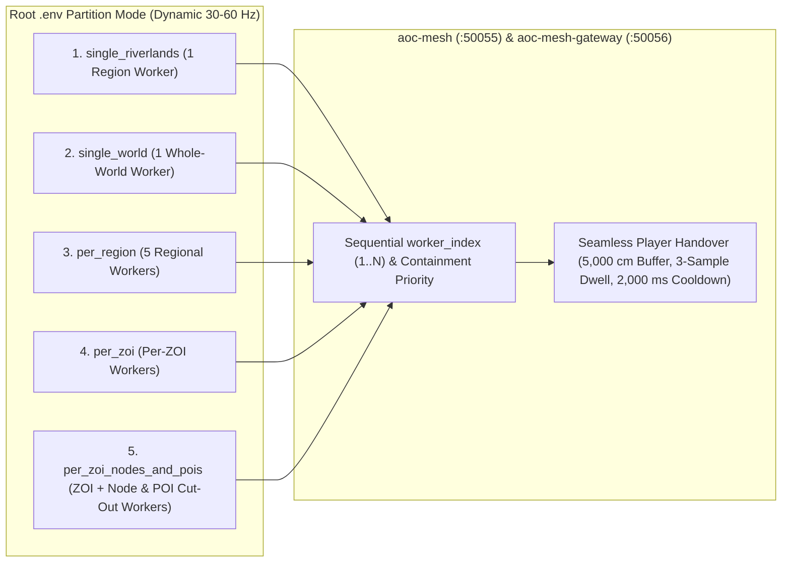

# Operational Runbook

**Related Guides**: [Root Overview](../README.md) | [Configuration Reference](CONFIGURATION.md) | [Server Workers](SERVER_WORKERS.md) | [Web Admin Architecture](WEB_ADMIN_ARCHITECTURE.md) | [Web Admin Studio](WEB_ADMIN.md) | [World CLI Reference](../src/server/services/cmd/worldctl/README.md)

This runbook explains in plain English how to start and stop SandalCore, switch between single-worker and multi-worker server topologies using your root `.env` file, adjust live simulation tick rates, and run operator commands with `worldctl`.

---

## Default Setup and Partition Topologies

### Starting the Default Riverlands Stack

When you run `.\start.bat` (`.\sandal.ps1 up`) on a fresh checkout, SandalCore starts **1 authoritative zone worker for the Riverlands region** with no manual `.env` configuration required:

1. **Verifies Game Data and Local `.usmap` Override**: Checks that `dist/content/content.db` (schema `v41`) and all 25 extracted game-data files exist, running the extractor pipeline automatically if any file is missing or out of date. When `$HOME/.aoc/aoc.usmap` (`~/.aoc/aoc.usmap`) exists on the host, it is preferred and synced to `dist/content/aoc.usmap` and `deploy/content/aoc.usmap` without modifying `src/config/layouts/aoc.usmap`.
2. **Starts 11 Linux Containers and Purges Temporary Accounts**: Launches the 10 control-plane, PostgreSQL, and ingress proxy containers plus 1 Riverlands worker container (`aoc-riverlands` / `aoc-world` in `Dynamic (30-60 Hz)` tick mode with a `2560M` RAM limit). On startup, `aoc-auth` automatically purges stale `TMP_*` and `TST_*` temporary accounts and characters from PostgreSQL.
3. **Opens the Launcher and Prints Web Admin Credentials**: Prints the single-boot Web Admin passphrase (`Username: Admin`) in the console, creates the `SandalLauncher.lnk` shortcut in the repository root, and launches `SandalLauncher.exe`.

### Switching Server Worker Topologies

To change how Verra is partitioned across server workers, open the `.env` file in the repository root, paste one of the five configurations below, and run `.\start.bat`. Your root `.env` is copied automatically to `deploy/.env` on startup. All worker topologies run in **`Dynamic (30-60 Hz)`** adaptive tick mode by default with cursor-resumed scheduling across the full authoritative entity population.

#### Setup 1: One Worker for One Region (Default: Riverlands)

Runs a single regional worker for Riverlands in `Dynamic (30-60 Hz)` tick mode. This is the fastest configuration for everyday development and single-region testing:

```ini
AOC_WORLD_PARTITION_MODE=single_riverlands
AOC_WORLD_REGION=riverlands
AOC_WORLD_TOPOLOGY_MODE=single
```

#### Setup 2: One Worker for the Whole World

Loads all five Verra regions (`riverlands`, `sandsquall`, `jundark`, `anvils`, and `turquoise-sea`) onto a single whole-world worker running in `Dynamic (30-60 Hz)` tick mode:

```ini
AOC_WORLD_PARTITION_MODE=single_world
AOC_WORLD_REGION=all
AOC_WORLD_TOPOLOGY_MODE=world
```

#### Setup 3: One Worker per Region

Runs five parallel regional workers (`aoc-riverlands`, `aoc-sandsquall`, `aoc-jundark`, `aoc-anvils`, and `aoc-turquoise-sea`) in `Dynamic (30-60 Hz)` tick mode. Players walking or riding across regional borders are handed over seamlessly between workers:

```ini
AOC_WORLD_PARTITION_MODE=per_region
AOC_WORLD_TOPOLOGY_MODE=region
```

#### Setup 4: One Worker per Zone of Influence

Splits a target region (`sandsquall`, `riverlands`, or `random`) into dedicated Zone of Influence (ZOI) workers running in `Dynamic (30-60 Hz)` tick mode:

```ini
AOC_WORLD_PARTITION_MODE=per_zoi
AOC_WORLD_TOPOLOGY_MODE=zoi
AOC_WORLD_PARTITION_REGION=sandsquall
```

#### Setup 5: ZOI Workers with City Node and POI Cut-Outs

Combines ZOI workers (`--area-exclude-node-plug=Verra_SAN_Node_Sunhaven,Verra_SAN_Node_Azmaran`) with dedicated workers for `1 km x 1 km` City Node OBB plugs and high-density Points of Interest such as `carphin`, all running in `Dynamic (30-60 Hz)` tick mode. Each parent worker enforces hole-punching (`has_carve_out` at the top of `contains_with_halo`, strict `area.contains` for static spawns, and area-filtered `NodeScenery` and `FoliageCells`) so carved-out City Nodes and POIs never double-spawn actors:

```ini
AOC_WORLD_PARTITION_MODE=per_zoi_nodes_and_pois
AOC_WORLD_TOPOLOGY_MODE=mixed
AOC_WORLD_PARTITION_REGION=sandsquall
AOC_WORLD_POI_CUTOUT=carphin
```



---

## Worker Tick Rates, Memory Limits, and Simulation Persistence

### Default Tick Mode by Worker Scope

Every worker scope runs in **`Dynamic (30-60 Hz)`** adaptive tick mode by default (`target_tick_hz: -1`, `tick_mode: "dynamic"`, `kMaxDynamicHz = 60`, `>= 30 Hz` dynamic floor) to keep container CPU usage in the `30%--45%` green operating band. Entity counts and per-tick slices are never restricted by `AOC_WORLD_MAX_*`, `max_gatherables`, or `sim_step_cap` truncation caps; every worker loads the full authentic population inside its territory and steps entities via fair cursor-resumed scheduling.

| Spatial Scope | Partition Mode | Default Tick Mode | Adaptive Range & Floor | Entity Scheduling |
|:---|:---|:---:|:---:|:---|
| **`world`** | `single_world` | **`Dynamic (30-60 Hz)`** | `30--60 Hz` (`kMaxDynamicHz = 60`, `>= 30 Hz` floor) | Cursor-resumed across full population (`0` truncation caps) |
| **`region`** | `single_riverlands`, `per_region` | **`Dynamic (30-60 Hz)`** | `30--60 Hz` (`kMaxDynamicHz = 60`, `>= 30 Hz` floor) | Cursor-resumed across full population (`0` truncation caps) |
| **`zoi`** | `per_zoi`, `per_zoi_nodes_and_pois` | **`Dynamic (30-60 Hz)`** | `30--60 Hz` (`kMaxDynamicHz = 60`, `>= 30 Hz` floor) | Cursor-resumed across full population (`0` truncation caps) |
| **`node_plug`** | `per_zoi_nodes_and_pois` (City Node OBB) | **`Dynamic (30-60 Hz)`** | `30--60 Hz` (`kMaxDynamicHz = 60`, `>= 30 Hz` floor) | Cursor-resumed across full population (`0` truncation caps) |
| **`poi`** | `per_zoi_nodes_and_pois` (`AOC_WORLD_POI_CUTOUT`) | **`Dynamic (30-60 Hz)`** | `30--60 Hz` (`kMaxDynamicHz = 60`, `>= 30 Hz` floor) | Cursor-resumed across full population (`0` truncation caps) |

### Runtime Tick Rate Selector and `0 Hz` NPC Pause

You can adjust any worker's simulation frequency live from the Web Admin Main Page (`Visible Server Workers` panel) or the Observability Page (`World Workers` table) without restarting containers:

- **`Dynamic` (`target_tick_hz: -1`, `tick_mode: "dynamic"`, `30-60 Hz` (`kMaxDynamicHz = 60`, `>= 30 Hz` floor) adaptive range)**: The default mode on both the Main Page Server List and the Observability Page. Automatically scales the worker's tick rate between `30 Hz` and `60 Hz` in `5 Hz` steps whenever CPU utilization stays above `45%` or below `30%` for 15 consecutive ticks, paired with a read-only **`Actual Hz` / `Current Hz`** badge (`aria-readonly="true"`) fed by live `aoc_world_tick_hz` telemetry.
- **`0 Hz (Pause NPCs)` (`0 Hz (Off)`)**: Pauses ambient NPC AI movement and evaluation on **just that worker** while keeping player movement, combat, handovers, and GM commands active.
- **Manual Rates (`10, 15, 20, 25, 30, 40, 50, 60 Hz`)**: Locks that worker to a fixed simulation frequency (`tick_mode: "manual"`).
- **Cursor-Resumed Scheduling and One-Second NPC Service Guarantee**: Regardless of how many thousands of NPCs are spawned on a worker, the simulation loop steps entities via fair cursor-resumed scheduling and guarantees that every ambient NPC is stepped at least once per second (`<= 1.0 s` service floor).

### PostgreSQL Simulation State, `WorldClock`, and Authentic 4-Season Verra Calendar

`aoc-mesh-gateway` persists global world simulation settings in PostgreSQL (`world_simulation_state` and `city_node_state`) and synchronizes them to every `world` worker:

- **`WorldClock` (`--world-hour` / `AOC_WORLD_HOUR`) and Mesh-Wide `9x` Calendar Sync**: Each worker initializes its local `WorldClock` from `--world-hour` / `AOC_WORLD_HOUR` (`0.0..24.0`, default `12.0` noon; `--spawn-hour` / `AOC_SPAWN_HOUR` is supported as an alias) and synchronizes `time_of_day_hours`, `calendar_year`, and `calendar_day_of_year` from `mesh-gateway`. The server clock advances at `9x` real time (`2 hours 40 minutes` real time per `24-hour` in-game day) across a **360-day Verra Calendar** (`Year >= 1 AE`) with **`4 x 90`-day seasons** (**`Spring`**, **`Summer`**, **`Autumn`**, and **`Winter`**), controlled solely from the top-bar `VerraCalendarPopover` (`0` `Set Time / Date` card on the Observability tab).
- **Painted Foliage (`AIntrepidStateIFA`) vs. Dynamic Circle Spawners (`AGatherableActor`)**: Workers serve static painted `UIntrepidGatherableFISMC` foliage (`588,362` in `region_foliage.tsv`) via per-cell `AIntrepidStateIFA` state actors modeled by the 2D convex hull polygon or brush circle of the exact definition (`+ kAreaEpsilonCm`), and spawn dynamic `RandomGatherableSpawnersDefRecordBase` nodes (`97` in `content.db`, `2,500 cm` to `50,000 cm` circle radius) as `AGatherableActor` actors relocating across candidate ground slots on respawn (`pcap_resource_spawners.tsv` is used strictly as a last-resort fallback).
- **City Node Stage Persistence and Tier 5/6 Fallback**: Settlement progression stages (`0..6`), mayors, and tax rates are stored in `city_node_state`. When a settlement is promoted to Tier `5` (`City`) or Tier `6` (`Metropolis`), the worker automatically uses the highest authored population layout in `content.db` (Tier `4` `Town`) so high-tier cities remain fully populated.

### Worker Memory Limits and Zero Disk Log Churn

Each worker container is capped at `2560M` (`2.5 GiB`, `AOC_WORLD_WORKER_MEM_LIMIT=2560M`) and preloads `content.db` (`:memory:`) and `area_nav.bin` into RAM at startup. All containers run with `read_only: true` root filesystems and write temporary logs only to RAM (`tmpfs` at `/tmp` and `/app/logs`), producing zero log file writes on your host SSD.

---

## Using the `worldctl` CLI

`worldctl` (`src/server/services/cmd/worldctl`) lets you inspect and control live `aoc-world` workers from the command line.

| Subcommand | Syntax | Description |
|:---|:---|:---|
| **`time`** | `worldctl time [<HH:MM\|hours>]` | Prints the current `9x` Verra time of day, or sets the clock to `<HH:MM>` (`06:00`, `18:30`) or decimal hours (`0.0..24.0`). |
| **`workers`** | `worldctl workers` | Lists all active spatial workers with their `worker_index`, scope, tick rate, and entity counts. |
| **`tick-rate`** | `worldctl tick-rate [<hz>] [--metrics-url URL]` | Prints or updates (`1..120 Hz`) the target worker's simulation tick rate. |
| **`simulate-npcs`** | `worldctl simulate-npcs [on\|off] [--metrics-url URL]` | Queries or toggles ambient NPC AI simulation on the target worker. |
| **`players`** | `worldctl players` | Lists online players on the worker with their character GUID, level, and `(X, Y, Z)` coordinates. |
| **`places`** | `worldctl places` | Lists named teleport landmarks (`lionhold`, `crossroads`, `samias-hope`, `winstead`, `joeva`, `sunhaven`, `azmaran`). |
| **`tp`** | `worldctl tp <character> <place> \| <x> <y> [<z>]` | Teleports an online player to a named landmark or `(x, y[, z])` coordinates in centimeters. |
| **`speed`** | `worldctl speed <character> <multiplier>` | Sets a character's movement speed multiplier between `0.5` and `10.0` (`1.0` is normal speed). |
| **`give-money`** | `worldctl give-money <character> <copper>` | Adds or removes copper currency (`100` copper = `1` silver, `10,000` copper = `1` gold). |
| **`give-item`** | `worldctl give-item <character> <item> [<count>] [<rarity>\|q<NN>]` | Grants an item by name or GUID with optional count (`1..100000`), rarity (`Common..Artifact`), or quality (`q1..q200`). |
| **`npc spawn`** | `worldctl npc spawn <def_or_name> <x> <y> [<z>] [--level N]` | Spawns an NPC or monster at `(x, y[, z])` with optional level `1..100`. |
| **`npc kill\|respawn\|reset\|heal\|despawn`** | `worldctl npc <action> <id>` | Runs a lifecycle command on a live NPC or monster by actor ID. |
| **`npc move`** | `worldctl npc move <id> <x> <y> [<z>]` | Moves a live NPC to `(x, y[, z])` cm and updates its home anchor. |
| **`place-station` / `remove-station`** | `worldctl place-station <node> <plot> <station>` | Places or removes an artisan station (`forge`, `carpentry`, `arcane`, `cooking`, `loom`, `smelter`) on settlement plot `0..15`. |
| **`craft`** | `worldctl craft finish\|teach\|forget\|taught <character> [<arg>]` | Finishes active crafting jobs or manages learned recipes for a character. |
| **`weapon-xp`** | `worldctl weapon-xp <character> <line> <level\|xp=N>` | Sets weapon skill-tree mastery level (`1..25`) or exact XP (`xp=0..5718160`). |
| **`tutorials reset`** | `worldctl tutorials reset <character>` | Resets completed tutorial flags for a character. |
| **`watch`** | `worldctl watch [--area minx,miny,maxx,maxy] [--density] [--seconds N]` | Streams live `30 Hz` world state updates or density grids to the terminal. |

### Common `worldctl` Examples

```powershell
# Check or change the in-game time of day
docker exec aoc-world worldctl --addr 127.0.0.1:50061 time
docker exec aoc-world worldctl --addr 127.0.0.1:50061 time 14:30

# List active workers and change a worker's tick rate to 60 Hz
docker exec aoc-world worldctl --addr 127.0.0.1:50061 workers
docker exec aoc-world worldctl tick-rate 60 --metrics-url http://127.0.0.1:18081

# Spawn a level 50 Goblin Scout at world coordinates
docker exec aoc-world worldctl --addr 127.0.0.1:50061 npc spawn "Goblin Scout" -452100 -548900 --level 50
```

---

## Operational Playbooks

### Switching Partition Topologies Safely

1. **Check the current topology and running containers**:
   ```powershell
   Get-Content .env -ErrorAction SilentlyContinue | Select-String "AOC_WORLD_"
   docker ps --filter "name=aoc-" --format "table {{.Names}}\t{{.Status}}\t{{.Ports}}"
   ```
2. **Write the new partition settings to `.env` and apply via `start.bat`**:
   ```powershell
   Set-Content -Path .env -Value @(
     "AOC_WORLD_PARTITION_MODE=per_zoi_nodes_and_pois",
     "AOC_WORLD_TOPOLOGY_MODE=mixed",
     "AOC_WORLD_PARTITION_REGION=sandsquall",
     "AOC_WORLD_POI_CUTOUT=carphin",
     "AOC_WORLD_WORKER_MEM_LIMIT=2560M"
   ) -Encoding utf8
   .\start.bat
   ```
3. **Verify that all workers registered with `aoc-mesh`**:
   ```powershell
   Invoke-RestMethod -Uri "http://127.0.0.1:8080/api/v1/world/state" | Select-Object -ExpandProperty workers
   ```
4. **Roll back to the single Riverlands worker if needed**:
   ```powershell
   Set-Content -Path .env -Value @(
     "AOC_WORLD_PARTITION_MODE=single_riverlands",
     "AOC_WORLD_REGION=riverlands",
     "AOC_WORLD_TOPOLOGY_MODE=single"
   ) -Encoding utf8
   .\start.bat
   ```

### Running the Full End-to-End Verification Suite

1. **Run static repository and asset safety checks**:
   ```powershell
   pwsh -NoProfile -File scripts/checks/public_check.ps1
   ```
2. **Run the live API, 10-stage `fake::Client` session, and 26 modular bot plans (`/app/test_world_live_e2e`)**:
   ```powershell
   pwsh -NoProfile -File scripts/test_functional_apis.ps1
   ```
3. **Verify completion**: Confirm that `test_functional_apis.ps1` exits with code `0` after validating HTTP authentication (`:8080`), UDP launcher tether (`:19021`), ICS TLS 1.3 character creation (`:50061`), `30 Hz` Web Admin state streaming, authentic resource node metadata, and the live UDP `:7777` 10-stage `fake::Client` session plus 26 modular bot plans (`/app/test_world_live_e2e`).
