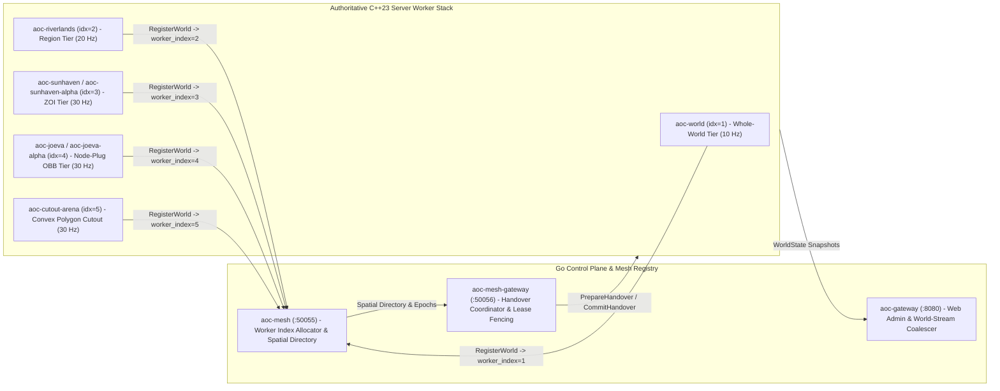
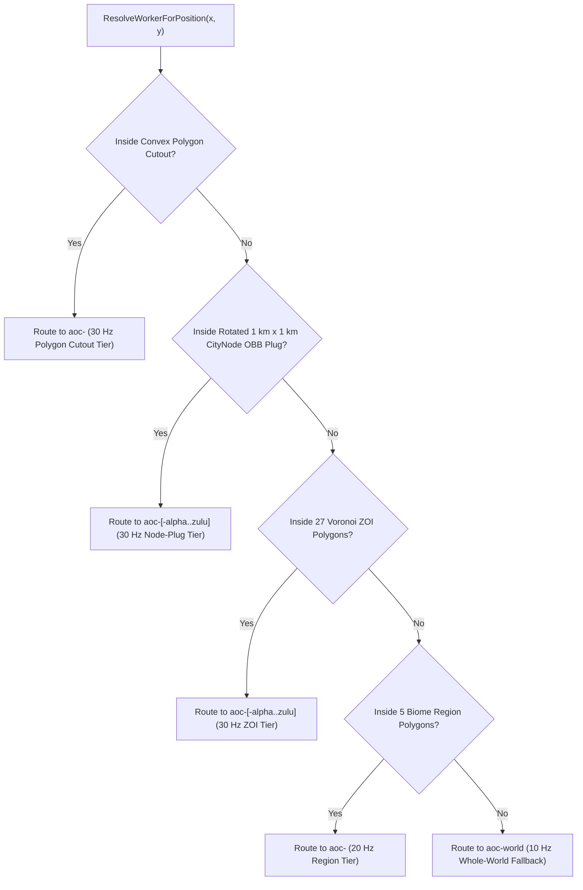

# SandalCore Server Workers & Spatial Authority Reference (`docs/SERVER_WORKERS.md`)

**Primary Diataxis Quadrant**: `Technical Reference` & `Explanation` (`DOC-01`)
**Related Guides**: [Root Architecture Overview](../README.md) | [Configuration Reference](CONFIGURATION.md) | [Control-Plane Services Reference](SERVICES.md) | [Web Admin & GM Studio Reference](WEB_ADMIN.md) | [C++23 `world` Worker Component Reference](../src/server/world/README.md) | [`cmd/mesh` Registry Reference](../src/server/services/cmd/mesh/README.md) | [`cmd/mesh-gateway` Handover Reference](../src/server/services/cmd/mesh-gateway/README.md) | [`libaocnav` Navigation Reference](../src/libs/aocnav/README.md) | [`libaocnet` Wire Protocol Reference](../src/libs/aocnet/README.md) | [`libaocstats` Combat & Stat Reference](../src/libs/aocstats/README.md)

This document specifies the authoritative server worker topologies, canonical static and NATO-alphabet dynamic worker naming conventions (`aoc-world`, `aoc-<region-name>`, `aoc-<city-name>`, `aoc-<zoi-name>`, `aoc-<zoi-name>-alpha..zulu`, `aoc-<city-name>-alpha..zulu`), mesh worker index registration (`worker_index`), configurable simulation tick rates (`10 Hz` / `20 Hz` / `30 Hz`), multi-boundary player handover and anti-hysteresis rules, dynamic CityNode population scaling (`0..6`), and Game Master (GM) actor lifecycle commands implemented by [`src/server/world`](../src/server/world/README.md) and coordinated by [`aoc-mesh`](../src/server/services/cmd/mesh/README.md) (`src/server/services/cmd/mesh`).

---

## 1. Supported Server Worker Topologies & Mix-and-Match Composition

SandalCore partitions the world of Verra (`Verra_01`, `[-1,433,600 .. +716,800]` cm X, `[-1,331,200 .. +819,200]` cm Y) across one or more authoritative C++23 `world` server workers. Operators can deploy any of the **6 primary worker topology setups**, attach **Convex Polygon Cutout** workers, or **mix and match** tiers across regions, Zones of Influence (ZOIs), and CityNode plugs:

| Topology Setup | `AOC_WORLD_SHARD_MODE` | Canonical Worker Naming | Capacity / Scaling Bounds | Default Tick Rate | Description & Operational Scope |
|:---|:---|:---|:---:|:---:|:---|
| **1. Whole-World Worker (`1` Worker for Whole World)** | `world_only` (or `single`) | `aoc-world` (or single regional fallback `aoc-riverlands` / `aoc-world-riverlands`) | `1` worker | `10 Hz` (`AOC_WORLD_TICK_HZ_WORLD=10`) | Runs a single C++23 `world` worker process holding spatial authority over the entire continent (or a single selected region when `AOC_WORLD_REGION=riverlands` is set in default fallback mode, running `11` total containers). |
| **2. Per-Region Workers (`1` per Region)** | `per_region` (or `regional`) | `aoc-<region-name>` (e.g., `aoc-riverlands`, `aoc-sandsquall`, `aoc-jundark`, `aoc-anvils`, `aoc-turquoise-sea`) | `1` per region (`5` regions) | `20 Hz` (`AOC_WORLD_TICK_HZ_REGION=20`) | Runs one dedicated worker per biome region across Verra. Each worker loads only the heightfield tiles, Detour navmesh chunks, and NPC populations inside its regional polygon. |
| **3. Per-ZOI Workers (`1` per ZOI)** | `per_zoi` | `aoc-<zoi-name>` (e.g., `aoc-sunhaven`, `aoc-azmaran`, `aoc-winstead`, `aoc-joeva`, `aoc-halcyon`, `aoc-new-aela`, `aoc-miraleth`) | `1` per ZOI (`27` ZOIs) | `30 Hz` (`AOC_WORLD_TICK_HZ_ZOI=30`) | Partitions authority along exact Voronoi Zone of Influence (`zoi_polygons.tsv`, `27` settlement/Divine Gate ZOIs) polygons so each ZOI runs at high-frequency `30 Hz` simulation fidelity. |
| **4. Per-Node-Plug + Per-ZOI Workers (`1` per Node Plug + `1` per ZOI)** | `node_plug_and_zoi` | Node Plug: `aoc-<city-name>` Surrounding ZOI: `aoc-<zoi-name>` | `1` per city plug + `1` per ZOI | `30 Hz` (`AOC_WORLD_TICK_HZ_ZOI=30`) | Carves out the rotated `1 km x 1 km` (`100,000 cm x 100,000 cm`) CityNode Oriented Bounding Box (OBB) into a dedicated `aoc-<city-name>` worker while the surrounding `aoc-<zoi-name>` worker sets `--area-exclude-node-plug=true`. |
| **5. Dynamic Node-Plug + Dynamic ZOI Stub (`1..26` per Node Plug + `1..26` per ZOI)** | `dynamic_node_plug_zoi` | Node Plug: `aoc-<city-name>-alpha` .. `aoc-<city-name>-zulu` ZOI: `aoc-<zoi-name>-alpha` .. `aoc-<zoi-name>-zulu` | `min = 1` (`-alpha`, never `0`), `max = 26` (`-zulu` NATO alphabet) per city & per ZOI | `30 Hz` (`AOC_WORLD_TICK_HZ_ZOI=30`) | Scales worker instances `+/-` in startup order per city node plug and per ZOI using NATO phonetic suffixes (`-alpha`, `-beta`, `-charlie`, ..., `-zulu`), never dropping to `0`. **Current Implementation Status**: Implemented as a **deterministic stub** (`min = 1` `-alpha` instance active per configured plug/ZOI, `0` extra dynamic workers spawned yet). |
| **6. Dynamic ZOI Stub (`1..26` per ZOI)** | `dynamic_zoi` | `aoc-<zoi-name>-alpha` .. `aoc-<zoi-name>-zulu` | `min = 1` (`-alpha`, never `0`), `max = 26` (`-zulu` NATO alphabet) per ZOI | `30 Hz` (`AOC_WORLD_TICK_HZ_ZOI=30`) | Scales ZOI workers `+/-` in startup order per ZOI using NATO phonetic suffixes (`-alpha`, `-beta`, ..., `-zulu`), never dropping to `0`. **Current Implementation Status**: Implemented as a **deterministic stub** (`min = 1` `-alpha` instance active per configured ZOI, `0` extra dynamic workers spawned yet). |
| **7. Convex Polygon Cutout Workers** | `polygon_cutout` (additive) | `aoc-<cutout-name>` | `1+` additive workers | `30 Hz` (`AOC_WORLD_TICK_HZ_ZOI=30`) | Adds one or more extra workers to the stack bounded by an arbitrary counter-clockwise convex polygon (`--area-polygon="x1,y1;x2,y2;..."` / `AOC_WORLD_POLYGON_CUTOUT`) for siege arenas, boss encounters, or event hubs. |
| **8. Mix-and-Match Composition** | `mixed` (or custom worker list) | Any combination of `aoc-<region-name>`, `aoc-<zoi-name>[-<nato>]`, `aoc-<city-name>[-<nato>]`, and `aoc-<cutout-name>` | Per-tier | Per-tier (`20 Hz` Region / `30 Hz` ZOI & Node-Plug) | Combines regional workers with fine-grained ZOI, Node-Plug, Dynamic Stub, or Polygon Cutout workers in the same live mesh. |

### Mix-and-Match Operational Examples

Operators can combine worker granularity levels without restarting unaffected shards:

- **Example A -- Sandsquall in ZOI Mode (`30 Hz`) + Remaining 4 Regions in Regional Mode (`20 Hz`)**:
  - Sandsquall Desert is split into two `30 Hz` ZOI workers: `aoc-sunhaven` (`aoc-world-sandsquall-sunhaven`, UDP `:7782`, gRPC `:50067`) and `aoc-azmaran` (`aoc-world-sandsquall-azmaran`, UDP `:7783`, gRPC `:50068`).
  - The remaining four regions run as `20 Hz` regional workers: `aoc-riverlands` (`aoc-world-riverlands`, UDP `:7777`), `aoc-jundark` (`aoc-world-jundark`, UDP `:7779`), `aoc-anvils` (`aoc-world-anvils`, UDP `:7780`), and `aoc-turquoise-sea` (`aoc-world-turquoise-sea`, UDP `:7781`).
- **Example B -- Riverlands Single-Worker Default Fallback (`11` Containers Total)**:
  - When root `.env` is absent, SandalCore falls back to `AOC_WORLD_SHARD_MODE=single` and `AOC_WORLD_REGION=riverlands`, launching `10` control-plane/data containers plus `1` authoritative Riverlands worker (`aoc-riverlands` / `aoc-world-riverlands` / `aoc-world`) and spawning only Riverlands entities.
- **Example C -- High-Density CityNode Plug + Convex Polygon Cutout**:
  - Within `aoc-riverlands`, an operator can attach `aoc-winstead` (`--area-tier=node_plug --area-id=winstead`) at `30 Hz` for the `1 km x 1 km` Winstead town square and a convex polygon cutout worker for an adjacent world-boss amphitheater.

---

## 2. Canonical Worker Naming, NATO Dynamic Suffixes (`-alpha` .. `-zulu`) & Mesh Worker Index (`worker_index`)

### Static & Dynamic Worker Naming Scheme

Every authoritative server worker follows a strict, deterministic naming convention across container hostnames, structured JSON logs, Prometheus labels, and Web Admin shard tables:

1. **World-Only Worker**: `aoc-world`
2. **Region Worker**: `aoc-<region-name>` (e.g., `aoc-riverlands`, `aoc-sandsquall`, `aoc-jundark`, `aoc-anvils`, `aoc-turquoise-sea`; Docker Compose profiles also expose `aoc-world-<region-name>` / `world-<region-name>` service aliases for container DNS compatibility)
3. **Static Node Plug Worker**: `aoc-<city-name>` (e.g., `aoc-joeva`, `aoc-winstead`, `aoc-halcyon`, `aoc-new-aela`, `aoc-miraleth`)
4. **Static ZOI Worker**: `aoc-<zoi-name>` (e.g., `aoc-sunhaven`, `aoc-azmaran`, `aoc-lionhold`, `aoc-samias-hope`)
5. **Dynamic ZOI Workers (`1..26` per ZOI, NATO Phonetic Startup Order)**:
   - Named sequentially in the order they are started for the ZOI they serve: `aoc-<zoi-name>-alpha`, `aoc-<zoi-name>-beta`, `aoc-<zoi-name>-charlie`, `aoc-<zoi-name>-delta`, ..., up to `aoc-<zoi-name>-zulu`.
   - Each ZOI supports up to $N = 26$ dynamic workers (the full 26-word NATO phonetic alphabet: `alpha`, `beta`, `charlie`, `delta`, `echo`, `foxtrot`, `golf`, `hotel`, `india`, `juliett`, `kilo`, `lima`, `mike`, `november`, `oscar`, `papa`, `quebec`, `romeo`, `sierra`, `tango`, `uniform`, `victor`, `whiskey`, `xray`, `yankee`, `zulu`) and never scales down to `0` (`aoc-<zoi-name>-alpha` is always present).
6. **Dynamic Node Plug Workers (`1..26` per City, NATO Phonetic Startup Order)**:
   - Named sequentially in the order they are started for the city node plug they serve: `aoc-<city-name>-alpha`, `aoc-<city-name>-beta`, `aoc-<city-name>-charlie`, ..., up to `aoc-<city-name>-zulu` ($N \in [1, 26]$, never `0`).

> [!IMPORTANT]
> **Dynamic Scaling Stub Contract**: Dynamic auto-scaling modes (`dynamic_node_plug_zoi` and `dynamic_zoi`) are intentionally implemented as **configuration and naming stubs** in the current release. They maintain the baseline `-alpha` worker (`min_workers = 1`, never `0`) and behave identically to static `1 per node plug + 1 per zoi` or `1 per zoi` topologies without dynamically spawning `-beta..zulu` replica containers yet.

### Mesh Worker Index (`worker_index`) Assignment & GUID Partitioning

When a C++23 `world` worker boots, it connects to [`aoc-mesh`](../src/server/services/cmd/mesh/README.md) (`:50055`) and executes the `RegisterWorld` gRPC handshake followed by periodic `Heartbeat` RPCs (`WorldNodeInfo`):

1. **Sequential Worker Index Allocation (`worker_index`)**: `aoc-mesh` assigns and registers a unique monotonic `worker_index` (`uint16_t` `server_id`, `1..N`) for every active worker in the topology.
2. **Collision-Free 128-Bit `FGuid` Generation**: The worker seeds `ServerGuidAllocator(worker_index, randomizer)` (`src/server/world/session.h`) with its registered `worker_index`. All dynamic actor GUIDs (`A_0x60100001` NPCs, loot drops, projectiles, and temporary props) embed `worker_index` in the high bits of `FGuid.D`, guaranteeing zero GUID collisions when actors or players cross between workers.
3. **Mesh Spatial Directory Publication**: The worker registers its `area_tier` (`world | region | zoi | node_plug | polygon_cutout`), `area_id`, bounding polygon vertices (`zoi_polygons.tsv` / `--area-polygon`), UDP game endpoint (`host:port`), internal gRPC control endpoint (`host:grpc_port`), target tick rate (`Hz`), and active `lease_epoch` in `aoc-mesh`.

---

## 3. Configurable Tick Rates (`Hz`) by Worker Tier

Each server worker runs a deterministic fixed-timestep simulation loop (`src/server/world/world_loop.cpp`) whose frequency defaults to the assigned spatial tier and can be overridden globally or per tier in root `.env`:

| Environment Variable | Default | Target Tier | Tick Budget (`dt`) | Rationale |
|:---|:---:|:---|:---:|:---|
| `AOC_WORLD_TICK_HZ_ZOI` | `30` (`30 Hz`) | `zoi`, `node_plug`, `polygon_cutout` | `33.33 ms` | High-density settlements, CityNode OBBs, and combat arenas require `30 Hz` movement, ability hit-registration, and replication sub-stepping. |
| `AOC_WORLD_TICK_HZ_REGION` | `20` (`20 Hz`) | `region` | `50.00 ms` | Regional open-world biomes (`aoc-riverlands`, `aoc-jundark`, etc.) balance CPU/network bandwidth with responsive open-world PvE traversal. |
| `AOC_WORLD_TICK_HZ_WORLD` | `10` (`10 Hz`) | `world` | `100.00 ms` | Whole-world single-worker mode (`aoc-world`) conserves host CPU when simulating the entire continent inside a single container. |
| `AOC_SERVICE_TICK_HZ` | `30` (`30 Hz`) | Go Control-Plane Services | `33.33 ms` | Governs `world-stream` entity delta coalescing, mesh health heartbeats, and background control-plane loops. |

An explicit per-container `AOC_WORLD_TICK_HZ` (or CLI `--tick-hz=<1..120>`) overrides the tier default for that specific worker.

---

## 4. Spatial Authority Precedence & Convex Polygon Cutouts

When multiple workers cover overlapping geographic areas (for example, a CityNode plug inside a ZOI, which itself sits inside a Region or Whole-World worker), [`aoc-mesh`](../src/server/services/cmd/mesh/README.md) and `AreaFilter` (`src/server/world/main.cpp`) resolve spatial ownership using strict containment precedence (from most specific to least specific):

1. **Convex Polygon Cutout (`polygon_cutout`)**: Highest priority. Any point `(x, y)` passing the counter-clockwise half-plane cross-product test for a registered convex polygon cutout belongs to `aoc-<cutout-name>`.
2. **CityNode OBB Plug (`node_plug`)**: Second priority. Points inside the rotated `100,000 cm x 100,000 cm` (`half_extent = 50,000 cm`) CityNode Oriented Bounding Box belong to `aoc-<city-name>` (or `aoc-<city-name>-alpha..zulu`). The parent ZOI worker sets `exclude_node_plug = true` so NPCs and stations inside the OBB are never double-spawned.
3. **Zone of Influence (`zoi`)**: Third priority. Points inside the 2D Voronoi polygon (`zoi_polygons.tsv`) belong to `aoc-<zoi-name>` (or `aoc-<zoi-name>-alpha..zulu`).
4. **Biome Region (`region`)**: Fourth priority. Points inside the regional boundary (`riverlands`, `sandsquall`, `jundark`, `anvils`, `turquoise_sea`) belong to `aoc-<region-name>`.
5. **Whole World (`world`)**: Fallback continent-wide authority (`aoc-world`).

---

## 5. Seamless Multi-Boundary Player Handover & Spatial Anti-Hysteresis

Players walking, riding mounts, or teleporting across any boundary (`region <-> region`, `region <-> zoi`, `zoi <-> zoi`, `zoi <-> node_plug`, or `any <-> polygon_cutout`) transition seamlessly between authoritative workers without returning to character select, coordinated by [`aoc-mesh-gateway`](../src/server/services/cmd/mesh-gateway/README.md).

### Spatial Anti-Hysteresis Constants (`src/server/world/world_loop.h`)

To prevent boundary oscillation ("ping-ponging") when a player strafes or fights along a polygon edge, `world_loop.cpp` enforces three anti-hysteresis invariants before initiating a handover:

| Invariant / Parameter | Constant / Value | Enforcement Mechanism |
|:---|:---:|:---|
| **Inward Border Penetration Buffer** | `kBoundaryBufferCm = 5000.0f` (`5,000 cm` / `50 m`) | A player leaving source worker $A$ into target worker $B$ must penetrate at least `5,000 cm` (`50 m`) past the shared polygon/OBB boundary into worker $B$'s interior before handover eligibility triggers. |
| **Consecutive Dwell Samples** | `kHandoverDwellSamples = 3` (`3` ticks) | The player's authoritative position must remain beyond the `5,000 cm` inward buffer inside the same target worker $B$ for `3` consecutive boundary evaluation samples (`check_zone_boundaries`). |
| **Post-Handover Cooldown** | `kHandoverCooldownMs = 2000` (`2,000 ms`) | After completing a handover (`CompleteHandover`), the session records `last_handover_ms` and suppresses outbound boundary re-evaluations for `2,000 ms` (except for explicit GM/admin teleports, which bypass spatial dwell checks). |
| **Monotonic Lease Epoch Fencing** | `lease_epoch` (`uint64_t`) | `aoc-mesh-gateway` (`:50056`) increments the character's authoritative `lease_epoch` inside `PrepareHandover` -> `CommitHandover`. Any stale state write or delayed packet from an older worker carrying `epoch < active_lease_epoch` is rejected at the persistence and mesh boundaries. |

### 4-Step Handover Execution Sequence

1. **Detection & Dwell Verification**: Source worker $A$ detects that player $P$ has crossed $> 5,000\text{ cm}$ into target worker $B$'s polygon for `3` consecutive samples with `(now_ms - last_handover_ms) >= 2000`.
2. **State Freeze & `InitiateHandover` RPC**: Source worker $A$ serializes the player's authoritative coordinates, velocity, rotation, health/mana, active buffs, inventory delta, and `lease_epoch`, then calls `MeshGateway.InitiateHandover` (`:50056`).
3. **Target Worker Pre-Warming (`PrepareHandover`)**: `aoc-mesh-gateway` mints a one-time handover ticket, increments `lease_epoch`, and invokes `PrepareHandover` on target worker $B$ (`aoc-<target>`), which pre-allocates the session slot and pre-loads surrounding navmesh tiles.
4. **Client Redirect & `CompleteHandover`**: Source worker $A$ sends the UE5 travel/redirect notification pointing the client to target worker $B$'s UDP `:7777+` endpoint. Target worker $B$ validates the handover ticket, calls `CompleteHandover`, stamps `last_handover_ms = now_ms`, and resumes `30 Hz` / `20 Hz` replication.

---

## 6. Live CityNode Tier-Change (`0..6`) NPC & Station Population Scaling

Each of the 85 settlements in `content.db` (`v41`) is governed by a `NodeRecord` whose progression level spans **Tier `0` (Wilderness)** through **Tier `6` (Metropolis)**:

- **Tier Progression Ladder**: `0 = Wilderness`, `1 = Expedition`, `2 = Encampment`, `3 = Village`, `4 = Town`, `5 = City`, `6 = Metropolis`.
- **Dynamic Population Scaling (`NodePopulations`)**: When a CityNode's tier changes via gameplay progression, [`nodectl`](../src/server/services/cmd/nodectl/README.md), or the Web Admin `SetNodeStage` (`POST /api/v1/admin/gm/node-stage`) RPC:
  1. [`aoc-citynode`](../src/server/services/cmd/citynode/README.md) (`:50053`) persists the new `node_stage` (`0..6`) and broadcasts the update to the authoritative `world` worker(s).
  2. The `world` worker evaluates `NodePopulations` (`src/server/world/node_populations.cpp`), despawning NPCs and crafting/service stations belonging exclusively to obsolete tiers (`reap_placed_stations`) and spawning the new tier's guards, vendors, citizens, and stations.
  3. **Town Platform Z-Floor Rescue (`town_platforms.bin`)**: Before finalizing each spawned NPC or station's vertical $Z$ coordinate inside multi-story settlements (`winstead`, `joeva`, `new_aela`, `halcyon`, `miraleth`), the worker queries `TownPlatforms::query_height(x, y, ref_z)` (`AOCTPF01`, [`src/libs/aocnav/README.md`](../src/libs/aocnav/README.md)) so actors land cleanly on elevated stone plazas and wooden decks rather than falling through terrain cutouts.

---

## 7. End-to-End Game Master (GM) Actor Lifecycle Commands

Authoritative `world` workers expose a synchronous gRPC GM manipulation surface (`WorldControlService` on `:50062+`, proxied via [`aoc-gateway`](../src/server/services/cmd/gateway/README.md) / [`admin-gateway`](../src/server/services/cmd/admin-gateway/README.md) `/api/v1/admin/gm/*` and accessible via [`worldctl`](../src/server/services/cmd/worldctl/README.md)) supporting full actor lifecycle control with immediate replication to nearby UE5 clients and the Web Admin map:

| GM Action | REST Endpoint (`aoc-gateway`) | Worker Effect (`src/server/world`) |
|:---|:---|:---|
| **`SpawnNpc`** | `POST /api/v1/admin/gm/npc/spawn` | Allocates a new server-scoped `FGuid` via `ServerGuidAllocator(worker_index)`, resolves `ground_height` / `town_platforms.bin` $Z$, registers the NPC in the spatial grid, and broadcasts `NMT_ActorChannelOpen` to nearby players. |
| **`KillNpc`** | `POST /api/v1/admin/gm/npc/kill` | Sets current HP to `0`, transitions actor state to `Dead`, triggers loot/XP table evaluation if applicable, and replicates death state. |
| **`DespawnNpc`** | `POST /api/v1/admin/gm/npc/despawn` | Immediately removes the NPC from the authoritative spatial grid and closes active UE5 actor channels (`bTearOff`). |
| **`HealNpc`** | `POST /api/v1/admin/gm/npc/heal` | Restores the target NPC's HP and mana/spirit pools to `100%` of `max_hp` and clears negative combat conditions. |
| **`ResetNpc`** | `POST /api/v1/admin/gm/npc/reset` | Clears the NPC's threat/aggro table, evades combat, restores full health, and leashes the actor back to its home spawn coordinates `(home_x, home_y, home_z)`. |
| **`RespawnNpc`** | `POST /api/v1/admin/gm/npc/respawn` | Despawns the dead or stuck NPC instance and immediately spawns a fresh full-health instance at its home spawn transform. |
| **`MoveNpc`** | `POST /api/v1/admin/gm/npc/move` | Repositions the NPC to `(target_x, target_y, target_z)` (snapping $Z$ via `AreaNav::ground_height` when `target_z == 0`), updates spatial hash buckets, and replicates the updated movement sample. |
| **`TeleportPlayer`** | `POST /api/v1/admin/gm/player/teleport` | Teleports an online or offline character to `(x, y, z)`. If `(x, y)` resides in a different worker's spatial authority, triggers an immediate cross-worker handover bypassing dwell delay. |
