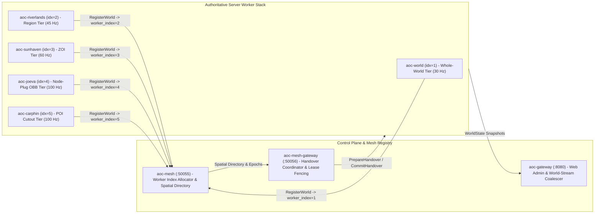
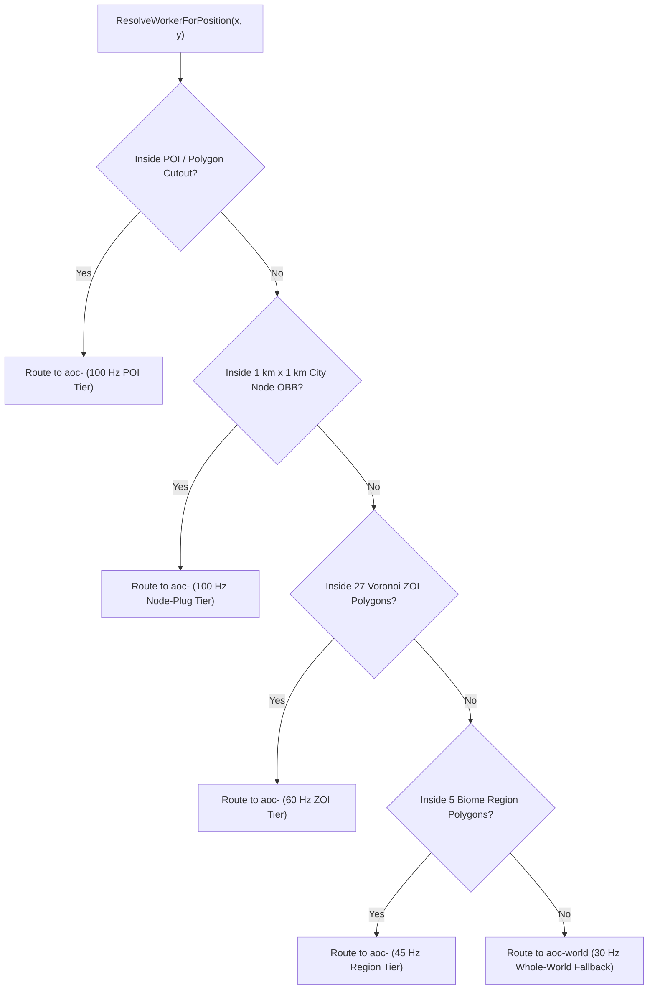

# Server Workers and Spatial Authority

**Related Guides**: [Root Overview](../README.md) | [Configuration Reference](CONFIGURATION.md) | [Operational Runbook](RUNBOOK.md) | [Control-Plane Services](SERVICES.md) | [Web Admin Studio](WEB_ADMIN.md) | [World Server Source](../src/server/world/README.md) | [Mesh Registry](../src/server/services/cmd/mesh/README.md) | [Mesh Gateway](../src/server/services/cmd/mesh-gateway/README.md)

This guide explains how SandalCore partitions the continent of Verra across one or more `world` server workers, how workers are named and indexed in the mesh, how players cross seamlessly between workers without disconnecting, and how City Node progression and Game Master commands work at runtime.

---

## Worker Topologies

SandalCore partitions Verra (`[-1,433,600 .. +716,800]` cm X, `[-1,331,200 .. +819,200]` cm Y) across one or more authoritative `world` processes. You can run a single worker for one region or the whole world, split the map by region or Zone of Influence (ZOI), or carve out high-frequency City Node and Point of Interest (POI) sub-areas:

| Topology Setup | `.env` Partition Mode | Worker Naming Pattern | Worker Count | Default Tick Rate | How It Works |
|:---|:---|:---|:---:|:---:|:---|
| **1. Single Regional or Whole-World Worker** | `single_riverlands` (default) or `single_world` | `aoc-riverlands` / `aoc-world` | `1` worker | `45 Hz` (`single_riverlands`) or `30 Hz` (`single_world`) | Out of the box, `single_riverlands` runs 1 worker for Riverlands at `45 Hz` (`11` containers total). Setting `single_world` loads all 5 regions onto 1 worker at `30 Hz`. |
| **2. Per-Region Workers** | `per_region` | `aoc-<region-name>` (`aoc-riverlands`, `aoc-sandsquall`, `aoc-jundark`, `aoc-anvils`, `aoc-turquoise-sea`) | `5` workers | `45 Hz` | Dedicates one worker to each biome region. Each worker loads only the terrain, navmesh tiles, NPCs, and gatherables inside its regional polygon. |
| **3. Per-ZOI Workers** | `per_zoi` | `aoc-<zoi-name>` (`aoc-sunhaven`, `aoc-azmaran`, `aoc-winstead`, `aoc-joeva`, etc.) | `1` per ZOI (`27` ZOIs) | `60 Hz` | Splits authority along the 27 Voronoi Zone of Influence polygons (`zoi_polygons.tsv`) so each territory runs at `60 Hz`. |
| **4. Node-Plug and ZOI Workers** | `per_zoi_nodes_and_pois` (`node_plug_and_zoi`) | Node Plug: `aoc-<city-name>` Surrounding ZOI: `aoc-<zoi-name>` | `1` per city plug + `1` per ZOI | `100 Hz` Node Plug / `60 Hz` ZOI | Carves the rotated `1 km x 1 km` City Node Oriented Bounding Box (OBB) into a `100 Hz` `aoc-<city-name>` worker while the surrounding `60 Hz` ZOI worker excludes that OBB (`--area-exclude-node-plug=Verra_SAN_Node_Sunhaven,Verra_SAN_Node_Azmaran`). |
| **5. Dynamic Node-Plug and ZOI Scaling Stub** | `dynamic_node_plug_zoi` | `aoc-<city-name>-alpha..zulu` `aoc-<zoi-name>-alpha..zulu` | `1..26` per city & per ZOI (`min = 1` `-alpha`) | `100 Hz` Node Plug / `60 Hz` ZOI | Reserves NATO phonetic worker names (`-alpha` through `-zulu`, never `0`). Currently runs the baseline `-alpha` worker as a deterministic scaling stub. |
| **6. Dynamic ZOI Scaling Stub** | `dynamic_zoi` | `aoc-<zoi-name>-alpha..zulu` | `1..26` per ZOI (`min = 1` `-alpha`) | `60 Hz` | Reserves NATO phonetic ZOI worker names (`-alpha` through `-zulu`, never `0`). Currently runs the baseline `-alpha` worker as a deterministic scaling stub. |
| **7. Convex Polygon and POI Cutout Workers** | `per_zoi_nodes_and_pois` (`AOC_WORLD_POI_CUTOUT`) | `aoc-<cutout-name>` (e.g., `aoc-carphin`) | `1+` additive workers | `100 Hz` | Carves out a counter-clockwise convex polygon (`--area-polygon="x1,y1;x2,y2;..."`) for a high-density dungeon, siege arena, or POI at `100 Hz`. |
| **8. Mix-and-Match Composition** | `mixed` | Any combination of the above | Per tier | `30 / 45 / 60 / 100 Hz` | Combines regional workers (`45 Hz`) with ZOI (`60 Hz`), City Node Plug (`100 Hz`), and POI Cutout (`100 Hz`) workers in the same live mesh. |

> [!NOTE]
> **Unbounded Authentic Entity Populations**: SandalCore does not use `AOC_WORLD_MAX_*` or `max_gatherables` caps. Every worker spawns the complete set of authentic NPCs, monsters, and gatherable resource nodes located inside its spatial boundary, bounded only by in-memory container structures.

---

## Worker Naming and Mesh Registration

### Naming Rules

Every server worker uses a consistent name across Docker containers, structured logs, Prometheus metrics, and the Web Admin Studio:

- **Whole-World Worker**: `aoc-world`
- **Regional Worker**: `aoc-<region-name>` (`aoc-riverlands`, `aoc-sandsquall`, `aoc-jundark`, `aoc-anvils`, `aoc-turquoise-sea`)
- **Static City Node Plug Worker**: `aoc-<city-name>` (`aoc-joeva`, `aoc-winstead`, `aoc-halcyon`, `aoc-new-aela`, `aoc-miraleth`)
- **Static ZOI Worker**: `aoc-<zoi-name>` (`aoc-sunhaven`, `aoc-azmaran`, `aoc-lionhold`, `aoc-samias-hope`)
- **Dynamic ZOI or City Node Workers**: `aoc-<zoi-name>-alpha` .. `aoc-<zoi-name>-zulu` and `aoc-<city-name>-alpha` .. `aoc-<city-name>-zulu` (`1..26` instances named in startup order using the NATO phonetic alphabet, never scaling down to `0`).

### Mesh Worker Index and Collision-Free GUIDs

When a `world` worker starts, it registers with [`aoc-mesh`](../src/server/services/cmd/mesh/README.md) (`:50055`) via `RegisterWorld`:

1. **Sequential `worker_index` Assignment**: `aoc-mesh` assigns each worker a unique sequential `worker_index` (`1..N`) and records its polygon boundary, UDP game port (`:7777+`), gRPC control port (`:50061+`), and tick rate.
2. **Collision-Free Actor GUIDs**: The worker seeds `ServerGuidAllocator(worker_index, randomizer)` (`src/server/world/session.h`) with its `worker_index`, embedding that index into the upper bits of every dynamically spawned 128-bit `FGuid` so NPC, loot, and projectile IDs never collide across workers.

---

## Simulation Tick Rates and Runtime Controls

Each worker runs a fixed-timestep simulation loop (`src/server/world/world_loop.cpp`) whose default rate matches its spatial tier:

| Environment Variable | Default | Target Tier | Frame Budget and NPC Slice | Purpose |
|:---|:---:|:---|:---:|:---|
| `AOC_WORLD_TICK_HZ_NODE` / `AOC_WORLD_TICK_HZ_POI` | `100` (`100 Hz`) | `node_plug`, `poi` | `10.00 ms` (`1500` NPC slice) | High-density City Node OBB plugs and POI cutouts run at `100 Hz` for responsive town and dungeon combat. |
| `AOC_WORLD_TICK_HZ_ZOI` | `60` (`60 Hz`) | `zoi` | `16.67 ms` (`2600` NPC slice) | Zone of Influence territories run at `60 Hz` within the `30%--45%` CPU target band. |
| `AOC_WORLD_TICK_HZ_REGION` | `45` (`45 Hz`) | `region` | `22.22 ms` (`3600` NPC slice) | Regional biomes (`aoc-riverlands`, `aoc-sandsquall`, etc.) run at `45 Hz`. |
| `AOC_WORLD_TICK_HZ_WORLD` | `30` (`30 Hz`) | `world` | `33.33 ms` (`5200` NPC slice) | Whole-world single-worker mode (`aoc-world`) simulates all 5 regions in one `2560M` container at `30 Hz`. |
| `AOC_SERVICE_TICK_HZ` | `30` (`30 Hz`) | Control Plane | `33.33 ms` | Drives the `world-stream` entity coalescer (`/api/v1/world/state` at `30 Hz`) and mesh health checks. |

At runtime, operators can adjust any individual worker's tick mode from the Web Admin Main Page (`Visible Server Workers` panel) or Observability Page (`World Workers` table), persisted in PostgreSQL `world_simulation_state`:

- **`Dynamic` (`target_tick_hz: -1`, `tick_mode: "dynamic"`, `30..120 Hz` adaptive range)**: The default mode for every worker (`TickLoop`). Scales the worker's simulation frequency between `30 Hz` and `120 Hz` in `5 Hz` steps around its scope baseline (`30 / 45 / 60 / 100 Hz`) based on a 15-tick EWMA CPU utilization window (`30%--45%` target band). Both the Main Page Server List and the Observability Page pair this selector with a read-only **`Actual Hz` / `Current Hz`** badge (`aria-readonly="true"`) fed by live `aoc_world_tick_hz` telemetry.
- **`0 Hz (Pause NPCs)` (`0 Hz (Off)`)**: Pauses ambient NPC AI simulation on **just that worker** without affecting other workers or connected players.
- **Manual Rates (`10, 15, 20, 25, 30, 40, 50, 60 Hz`)**: Locks that worker to a specific manual tick rate (`tick_mode: "manual"`).
- **One-Second NPC Service Guarantee**: Every active worker dynamically raises its per-tick NPC slice floor when needed so its entire spawned NPC population is stepped at least once per second (`<= 1.0 s` service floor).
- **`WorldClock` (`--world-hour` / `AOC_WORLD_HOUR`) and Mesh-Wide Calendar Sync**: Each worker initializes its `WorldClock` from `--world-hour` / `AOC_WORLD_HOUR` (`0.0..24.0`, default `12.0` noon; `--spawn-hour` / `AOC_SPAWN_HOUR` is supported as an alias) to evaluate time-of-day spawn filters, and continuously synchronizes mesh-wide time and calendar date (`time_of_day_hours`, `calendar_year`, `calendar_day_of_year`) from `aoc-mesh-gateway` across the `360`-day, `4 x 90`-day season (`Spring`, `Summer`, `Autumn`, `Winter`) Verra Calendar at `9x` clock speed.

---

## Spatial Ownership Priority and Worker Hole-Punching

When multiple workers cover nested geographic areas, such as a City Node plug inside a ZOI that sits inside a Region, `aoc-mesh` and the worker area filter (`AreaConfig`) assign authority to the most specific boundary containing `(x, y)`:

1. **Convex Polygon / POI Cutout (`poi`)**: Highest priority (`100 Hz`, e.g., `aoc-carphin`).
2. **City Node OBB Plug (`node_plug`)**: Second priority (`100 Hz`, rotated `1 km x 1 km` box around a settlement center). The parent ZOI worker passes `--area-exclude-node-plug=<NodeNames>` so NPCs and stations inside the city box are never spawned twice.
3. **Zone of Influence (`zoi`)**: Third priority (`60 Hz`, 27 Voronoi ZOI polygons from `zoi_polygons.tsv`).
4. **Biome Region (`region`)**: Fourth priority (`45 Hz`, 5 regional polygons).
5. **Whole World (`world`)**: Continent-wide fallback worker (`30 Hz`).

### Worker Hole-Punching, Spawn Filtering, and Foliage Provenance

To guarantee zero duplicate actors across nested workers:

- **`has_carve_out` Guard on Both `contains` and `contains_with_halo`**: `AreaConfig::has_carve_out(x, y)` runs at the top of both `AreaConfig::contains(x, y)` and `AreaConfig::contains_with_halo(x, y)` (`src/server/world/spawns/area.h`), immediately rejecting points inside `--area-exclude-polygon`, `--area-exclude-node-plug`, or `--area-exclude-zoi` before evaluating any border halo.
- **Strict `area.contains` for Static Spawns and Area-Filtered `NodeScenery` & `FoliageCells`**: Static world spawns (`place_captured_spawns`), settlement layout replicators (`NodeScenery::start()`), and foliage cell state actors (`FoliageCells::make_all()`) enforce strict `area.contains(x, y)` checks (`+ kAreaEpsilonCm`) so a parent region or ZOI worker never spawns NPCs, town scenery, or foliage cells inside a carved-out child worker.
- **Painted Foliage (`AIntrepidStateIFA`) vs. Dynamic Circle Spawners (`AGatherableActor`)**: Static painted `UIntrepidGatherableFISMC` instances (`588,362` in `region_foliage.tsv`) are served via per-cell `AIntrepidStateIFA` state actors modeled by the 2D convex hull polygon or brush circle of the exact definition (`+ kAreaEpsilonCm`), whereas dynamic `RandomGatherableSpawnersDefRecordBase` definitions (`97` in `content.db`, `2,500 cm` to `50,000 cm` circle radius) spawn as `AGatherableActor` actors that rotate across candidate ground coordinates on respawn (using `pcap_resource_spawners.tsv` strictly as a last-resort fallback).
- **Local Unreal Mappings Override (`$HOME/.aoc/aoc.usmap`)**: When `$HOME/.aoc/aoc.usmap` (`~/.aoc/aoc.usmap`) exists on the host, the extraction pipeline automatically syncs it to `dist/content/aoc.usmap` and `deploy/content/aoc.usmap` without modifying `src/config/layouts/aoc.usmap`.

---

## Seamless Cross-Border Player Handover

When a player walks, rides, or teleports across a boundary between two workers, [`aoc-mesh-gateway`](../src/server/services/cmd/mesh-gateway/README.md) transfers their session automatically without returning to character select.

### Anti-Hysteresis Rules

To prevent rapid back-and-forth handovers when a player moves along a border line, `world_loop.cpp` enforces four safeguards:

| Safeguard | Value | How It Works |
|:---|:---:|:---|
| **Inward Border Buffer** | `5,000 cm` (`50 m`) | A player must cross at least `50 m` past the shared boundary into the new worker's territory before a handover can begin. |
| **Consecutive Dwell Samples** | `3` samples | The player must remain past the `50 m` buffer inside the same target worker for `3` consecutive boundary checks. |
| **Post-Handover Cooldown** | `2,000 ms` | After a handover finishes, boundary checks pause for `2 seconds` (explicit GM teleports bypass this cooldown). |
| **Monotonic Lease Epoch** | `lease_epoch` (`uint64`) | `aoc-mesh-gateway` increments the character's `lease_epoch` on every handover so delayed saves from an older worker are rejected by PostgreSQL. |

### Handover Steps

1. **Boundary Detection**: Source worker $A$ confirms that player $P$ has stayed more than `5,000 cm` inside target worker $B$ for `3` consecutive samples after the `2,000 ms` cooldown.
2. **State Snapshot (`InitiateHandover`)**: Worker $A$ packages the player's position, velocity, health, mana, active buffs, inventory delta, and `lease_epoch`, then calls `MeshGateway.InitiateHandover` (`:50056`).
3. **Target Pre-Warming (`PrepareHandover`)**: `aoc-mesh-gateway` increments `lease_epoch`, issues a one-time handover ticket, and calls `PrepareHandover` on worker $B$ so its session slot and surrounding navmesh chunks are ready.
4. **Client Redirect (`CompleteHandover`)**: Worker $A$ directs the UE5 client to worker $B$'s UDP `:7777+` port. Worker $B$ verifies the ticket, calls `CompleteHandover`, and continues replication seamlessly.

---

## City Node Stage Scaling and Town Platforms

Each of the 85 settlements in `content.db` (`v41`) progresses from **Tier `0` (Wilderness)** through **Tier `6` (Metropolis)**:

- **Progression Stages**: `0 = Wilderness`, `1 = Crossroads / Expedition`, `2 = Encampment`, `3 = Village`, `4 = Town`, `5 = City`, `6 = Metropolis`.
- **PostgreSQL Persistence and Tier 5/6 Population Fallback**: `mesh-gateway` stores each settlement's stage (`0..6`), XP, mayor, tax rate, and buildings in PostgreSQL (`city_node_state`). Because authored settlement population tables in `content.db` define building layouts up to Tier `4` (`Town`), promoting a settlement to **Tier `5` (`City`)** or **Tier `6` (`Metropolis`)** automatically uses the Tier `4` populated layout so high-tier cities remain populated with guards, vendors, citizens, and crafting stations.
- **Live Population Swapping and Town Platforms**: When a node's stage changes via [`nodectl`](../src/server/services/cmd/nodectl/README.md) or the Web Admin Studio, the `world` worker removes obsolete stations, spawns the new tier's NPCs and buildings, and snaps actor heights to `town_platforms.bin` so NPCs and stations stand cleanly on elevated town plazas and decks.

---

## Game Master Actor Commands

Every `world` worker exposes synchronous gRPC Game Master actions (`WorldControlService` on `:50061+`, proxied through `aoc-gateway` `/api/v1/admin/gm/*` and [`worldctl`](../src/server/services/cmd/worldctl/README.md)):

| GM Action | REST Endpoint | Effect on the Worker |
|:---|:---|:---|
| **`SpawnNpc`** | `POST /api/v1/admin/gm/npc/spawn` | Allocates a server-scoped `FGuid`, snaps $Z$ to the navmesh or town platform, and spawns the NPC or monster for nearby players. |
| **`KillNpc`** | `POST /api/v1/admin/gm/npc/kill` | Sets HP to `0`, transitions the actor to `Dead`, rolls loot and XP if applicable, and replicates the death state. |
| **`DespawnNpc`** | `POST /api/v1/admin/gm/npc/despawn` | Removes the NPC from the spatial grid and closes active UE5 actor channels. |
| **`HealNpc`** | `POST /api/v1/admin/gm/npc/heal` | Restores the NPC's health and mana to `100%` and clears negative combat effects. |
| **`ResetNpc`** | `POST /api/v1/admin/gm/npc/reset` | Clears aggro, exits combat, restores full health, and returns the NPC to its home spawn coordinates. |
| **`RespawnNpc`** | `POST /api/v1/admin/gm/npc/respawn` | Despawns a dead or stuck NPC and spawns a fresh full-health instance at its home coordinates. |
| **`MoveNpc`** | `POST /api/v1/admin/gm/npc/move` | Moves the NPC to `(target_x, target_y, target_z)`, snaps $Z$ to ground height if `target_z == 0`, and updates its home leash point. |
| **`TeleportPlayer`** | `POST /api/v1/admin/gm/player/teleport` | Teleports an online or offline character to `(x, y, z)`, triggering an immediate cross-worker handover if the destination belongs to another worker. |
