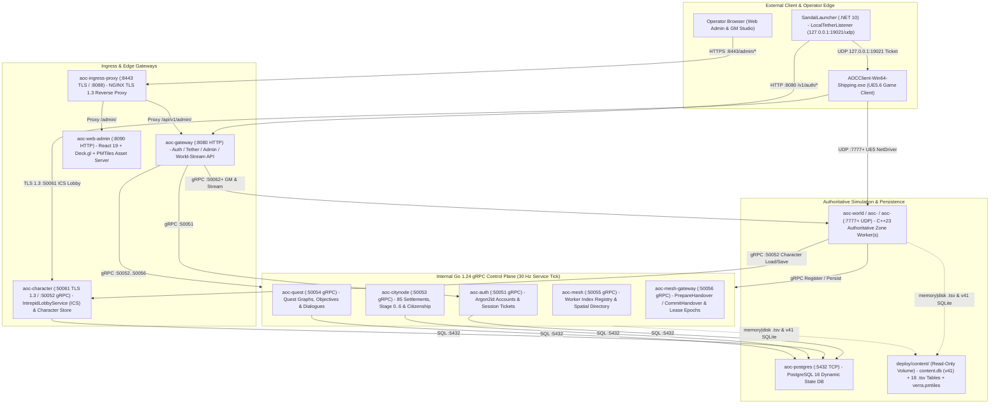
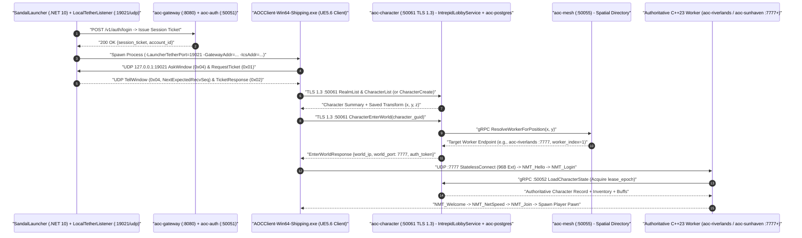

# SandalCore Control-Plane Services, Ingress Proxy, Persistence & Operator CLIs (`docs/SERVICES.md`)

**Primary Diataxis Quadrant**: `Technical Reference` & `Explanation` (`DOC-01`)
**Related Guides**: [Root Architecture Overview](../README.md) | [Configuration Reference](CONFIGURATION.md) | [Server Workers & Spatial Authority](SERVER_WORKERS.md) | [Web Admin & GM Studio Reference](WEB_ADMIN.md) | [Go Services Workspace Reference](../src/server/services/README.md) | [Container & Compose Topology Reference](../src/deploy/README.md) | [PKI & TLS Certificates Reference](../src/config/certs/README.md)

This document provides the architectural and operational reference for SandalCore's Go 1.24 control-plane microservices (`src/server/services`), NGINX edge TLS ingress proxy (`aoc-ingress-proxy`), PostgreSQL 16 state database (`aoc-postgres`), SQLite 3 static content database (`content.db` `v41` + `.tsv` catalog tables), and operator command-line utilities (`contentc`, `worldctl`, `nodectl`, `questctl`, `charimport`).

---

## 1. Control-Plane Service & Container Topology (`11` Baseline Containers)

In default single-worker mode (`AOC_WORLD_SHARD_MODE=single`, `AOC_WORLD_REGION=riverlands`), SandalCore runs **11 Linux containers** orchestrated by [`src/deploy/compose.yml`](../src/deploy/compose.yml): **8 Go control-plane services**, **1 NGINX TLS edge proxy**, **1 PostgreSQL 16 database**, and **1 C++23 `world` server worker** (`aoc-riverlands` / `aoc-world-riverlands` / `aoc-world`). When multi-worker topologies (`per_region`, `per_zoi`, `node_plug_and_zoi`, or `polygon_cutout`) are enabled, additional C++23 `world` worker containers join the same control-plane mesh dynamically.

---

## 2. Directory of Service & CLI Component READMEs

Every service binary, internal subsystem, and operator CLI in `src/server/services` and `src/deploy` maintains a dedicated component `README.md`:

### Containerized Control-Plane & Edge Daemons

| Container Name | Binary / Package | Listening Ports | Component Documentation | Primary Responsibility |
|:---|:---|:---:|:---|:---|
| **`aoc-auth`** | `cmd/auth` | `:50051` (gRPC), `:9091` (Metrics) | [`src/server/services/cmd/auth/README.md`](../src/server/services/cmd/auth/README.md) | Argon2id password hashing, account registration/login, ephemeral `Temp Account` lifecycle, and `127.0.0.1:19021` tether ticket verification. |
| **`aoc-character`** | `cmd/character` | `:50052` (gRPC), `:50061` (ICS TLS 1.3), `:9092` (Metrics) | [`src/server/services/cmd/character/README.md`](../src/server/services/cmd/character/README.md) | Dual-listener service exposing the external UE5 `IntrepidLobbyService` (ICS TLS 1.3 `:50061` for `RealmList`, native `CharacterCreate`, `CharacterList`, and `CharacterEnterWorld`) and internal gRPC `:50052` persistence (appearance blobs, inventory, equipment, skill trees, and `lease_epoch`-fenced saves). |
| **`aoc-citynode`** | `cmd/citynode` | `:50053` (gRPC), `:9093` (Metrics) | [`src/server/services/cmd/citynode/README.md`](../src/server/services/cmd/citynode/README.md) | Manages all 85 Verra settlements, `Stage 0..6` (`Wilderness` -> `Metropolis`) progression XP, mayoral governance, tax rates, building slots, and citizenship rosters. |
| **`aoc-quest`** | `cmd/quest` | `:50054` (gRPC), `:9094` (Metrics) | [`src/server/services/cmd/quest/README.md`](../src/server/services/cmd/quest/README.md) | Evaluates quest prerequisite graphs, tracks multi-step objective counters (`Kill`, `Collect`, `TalkTo`, `ReachArea`), and distributes XP/item rewards. |
| **`aoc-mesh`** | `cmd/mesh` | `:50055` (gRPC), `:9095` (Metrics) | [`src/server/services/cmd/mesh/README.md`](../src/server/services/cmd/mesh/README.md) | Assigns sequential `worker_index` (`1..N`) IDs to booting `world` workers (`RegisterWorld`), tracks `Heartbeat` health, and resolves spatial coordinates `(x, y)` across overlapping `world | region | zoi | node_plug | polygon_cutout` tiers. |
| **`aoc-mesh-gateway`** | `cmd/mesh-gateway` | `:50056` (gRPC), `:9096` (Metrics) | [`src/server/services/cmd/mesh-gateway/README.md`](../src/server/services/cmd/mesh-gateway/README.md) | Coordinates cross-worker player handovers (`InitiateHandover` -> `PrepareHandover` -> `CompleteHandover`), increments monotonic `lease_epoch` fences, and routes inter-worker broadcasts. |
| **`aoc-gateway`** | `cmd/gateway` | `:8080` (HTTP), `:9090` (Metrics) | [`src/server/services/cmd/gateway/README.md`](../src/server/services/cmd/gateway/README.md) [`src/server/services/cmd/admin-gateway/README.md`](../src/server/services/cmd/admin-gateway/README.md) | Public HTTP/JSON & WebSocket gateway hosting `/v1/auth/*`, `/v1/tether/*`, `/api/v1/admin/*` (scoped `HS256` JWT auth, GM manipulation commands, SQL hotfixes), `admin-catalog` queries, and the `30 Hz` `world-stream` entity delta coalescer. |
| **`aoc-web-admin`** | `cmd/web-admin` | `:8090` (HTTP) | [`src/server/services/cmd/web-admin/README.md`](../src/server/services/cmd/web-admin/README.md) [`src/clients/web-admin/README.md`](../src/clients/web-admin/README.md) | Serves the compiled React 19 + Deck.gl + MapLibre GL Web Admin SPA bundle and handles HTTP Range (`206 Partial Content`) requests for `verra.pmtiles`. |
| **`aoc-ingress-proxy`** | NGINX (`compose.yml`) | `:8443` (HTTPS TLS 1.3), `:8088` (HTTP) | [`src/deploy/README.md`](../src/deploy/README.md) [`src/config/certs/README.md`](../src/config/certs/README.md) | Terminates TLS 1.3 using `dist/certs/server.pem` + `server.key` and reverse-proxies `/admin/` to `aoc-web-admin:8090` and `/api/` + `/v1/` to `aoc-gateway:8080`. |
| **`aoc-postgres`** | PostgreSQL 16 (`compose.yml`) | `:5432` (TCP) | [`src/deploy/README.md`](../src/deploy/README.md) | Stores mutable player accounts, characters, inventories, quests, CityNode progression stages (`0..6`), and the `gm_audit_log` trail. |

### Shared Internal Go Subsystems & Operator CLI Utilities

| Package / Binary | Location | Component Documentation | Primary Responsibility |
|:---|:---|:---|:---|
| **`admin-gateway` / `admin-catalog` / `world-stream`** | `internal/admin-gateway` `internal/admin-catalog` `internal/world-stream` | [`src/server/services/cmd/admin-gateway/README.md`](../src/server/services/cmd/admin-gateway/README.md) [`src/server/services/README.md`](../src/server/services/README.md) | Implements startup passphrase -> `HS256` JWT issuance (`boot_id` session validation), `.tsv` `memory|disk` catalog indexing, `30 Hz` viewport-bounded entity delta coalescing (`minX, minY, maxX, maxY`), and GM RPC dispatch. |
| **`statprog`** | `internal/statprog` | [`src/server/services/internal/statprog/README.md`](../src/server/services/internal/statprog/README.md) | Archetype base stat curves, diminishing-returns rating conversions, and level `1..50` progression formulas shared with `libaocstats`. |
| **`contentc`** | `cmd/contentc` | [`src/server/services/cmd/contentc/README.md`](../src/server/services/cmd/contentc/README.md) | Compiles extracted UE5 DesignData JSON into SQLite `content.db` (**Schema Version `v41`**), builds all 13 covering indexes, runs `ANALYZE`, and exports `roads.bin`. |
| **`worldctl`** | `cmd/worldctl` | [`src/server/services/cmd/worldctl/README.md`](../src/server/services/cmd/worldctl/README.md) | Operator CLI for inspecting active `world` workers, triggering manual player teleports, spawning/moving/killing/despawning NPCs (`npc spawn\|move\|kill\|respawn\|reset\|heal\|despawn`), tuning live worker tick rates (`tick-rate [<hz>]`), toggling full-world NPC simulation (`simulate-npcs [on\|off]`), and streaming live entity snapshots (`watch`). |
| **`nodectl`** | `cmd/nodectl` | [`src/server/services/cmd/nodectl/README.md`](../src/server/services/cmd/nodectl/README.md) | Operator CLI for inspecting and mutating CityNode stages (`0..6`), progression XP, tax rates, and settlement buildings against `aoc-citynode`. |
| **`questctl`** | `cmd/questctl` | [`src/server/services/cmd/questctl/README.md`](../src/server/services/cmd/questctl/README.md) | Operator CLI for inspecting character quest states, advancing/resetting quest steps, and testing dialogue trees against `aoc-quest`. |
| **`charimport`** | `cmd/charimport` | [`src/server/services/cmd/charimport/README.md`](../src/server/services/cmd/charimport/README.md) | Administrative utility for importing, exporting, and migrating character appearance, inventory, and coordinate snapshots in `aoc-postgres`. |

---

## 3. Service Tick Rate (`AOC_SERVICE_TICK_HZ=30`) & `.tsv` Storage Modes (`memory` vs. `disk`)

### Configurable Control-Plane Tick Rate (`AOC_SERVICE_TICK_HZ`)

All periodic background loops inside Go control-plane services -- specifically the `world-stream` entity snapshot coalescer (`internal/world-stream/coalescer.go`), mesh worker liveness sweeps (`cmd/mesh`), and metric aggregators -- run at a configurable tick rate controlled by `AOC_SERVICE_TICK_HZ` in root `.env`:

- **Default**: `AOC_SERVICE_TICK_HZ=30` (`30 Hz`, `33.33 ms` interval).
- Matching `AOC_SERVICE_TICK_HZ=30` with `AOC_WORLD_TICK_HZ_ZOI=30` ensures that operators viewing the Web Admin map at street-level zoom (`z7`, `30 Hz`) observe every single simulation tick without intermediate aliasing or stale frames.

### Per-Data-Type `.tsv` Storage Modes (`memory` vs. `disk`)

To allow operators to tune the trade-off between lookup latency and container RAM footprint, `admin-catalog` (`internal/admin-catalog/store.go`) and the C++23 `world` worker support configurable storage modes for each extracted `.tsv` dataset in `deploy/content/*.tsv`:

| Environment Variable | Backed Artifact (`deploy/content/`) | `memory` Mode Behavior (Default) | `disk` Mode Behavior |
|:---|:---|:---|:---|
| `AOC_DATA_MODE_DEFAULT` | Fallback for any unset `AOC_DATA_MODE_*` | Loads all `.tsv` rows into RAM slices/maps at startup (`0` runtime disk reads). | Keeps a compact byte-offset index in RAM and reads records on demand from disk. |
| `AOC_DATA_MODE_ZOIS` | `zoi_polygons.tsv` (`27` ZOIs) | In-memory polygon vertex arrays for point-in-polygon queries. | Streams polygon vertices from `zoi_polygons.tsv` on query. |
| `AOC_DATA_MODE_CITY_NODES` | `city_nodes.tsv` (`85` settlements) & `node_plug_bounds.tsv` | In-memory settlement metadata & rotated `1 km x 1 km` OBB bounds. | On-demand disk lookup by node ID or coordinate. |
| `AOC_DATA_MODE_POIS` | `pois.tsv` (Points of Interest) | In-memory spatial & text search slice. | On-demand disk scan for POI inspector and map layer queries. |
| `AOC_DATA_MODE_NPCS` | `npcs.tsv` (`4,200+` NPC definitions) | In-memory fuzzy-search index for `Spawn NPC / Monster Here...` modal. | Streams matching rows from `npcs.tsv` during catalog search. |
| `AOC_DATA_MODE_ITEMS` | `items.tsv` (`9,300+` item templates) | In-memory item catalog for GM item grant and inventory inspection. | Streams matching item records from `items.tsv` on demand. |

---

## 4. Client Login, ICS TLS 1.3 & World Entry Request Flow

The sequence diagram below traces a player's journey from clicking **Play** in `SandalLauncher` to spawning inside an authoritative C++23 `world` worker:

---

## 5. Resilience, Health Probes & Database Integrity

1. **gRPC Channel Resilience**: All inter-service gRPC connections between `world` workers, `aoc-gateway`, and the Go control-plane microservices configure `wait_for_ready(true)`, a `1,000 ms` DNS re-resolution cooldown, HTTP/2 keepalive pings, and automatic transient `UNAVAILABLE` retry backoff.
2. **PostgreSQL 16 Migrations & Lease Fencing (`aoc-postgres`)**: Schema migrations in `src/server/services/migrations/` initialize tables for accounts, characters, inventory slots, active quests, CityNode progression stages (`0..6`), and `gm_audit_log`. Every character state mutation checks `WHERE lease_epoch <= $new_epoch` to prevent split-brain writes during cross-worker handovers.
3. **Prometheus Metrics & Health Endpoints**: Each Go microservice exports Prometheus metrics on `:9090..:9096/metrics` and health probes consumed by Docker Compose `healthcheck` directives and the Web Admin **4-Zone Analytics & Structured Logs Explorer**.
