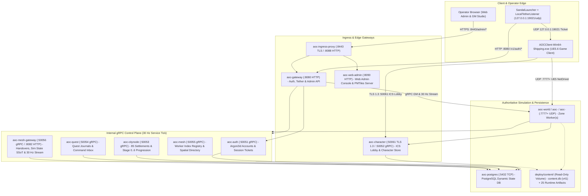
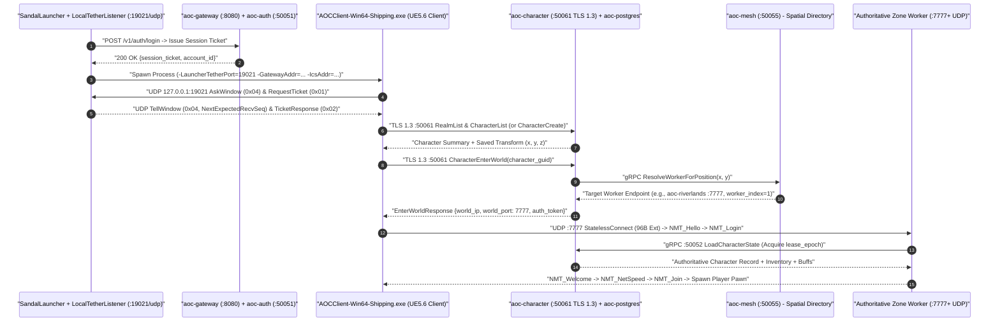

# Control-Plane Services and Operator CLIs

**Related Guides**: [Root Overview](../README.md) | [Configuration Reference](CONFIGURATION.md) | [Operational Runbook](RUNBOOK.md) | [Server Workers](SERVER_WORKERS.md) | [Web Admin Studio](WEB_ADMIN.md) | [Control-Plane Services Source](../src/server/services/README.md) | [Container Deployment](../src/deploy/README.md)

This guide explains how SandalCore's control-plane services, edge TLS proxy, PostgreSQL database, and operator command-line tools work together to handle account login, character creation, settlement progression, quest state, and live Web Admin telemetry.

---

## Container Topology

In the default Riverlands configuration (`AOC_WORLD_PARTITION_MODE=single_riverlands`), SandalCore runs **11 Linux containers** defined in [`src/deploy/compose.yml`](../src/deploy/compose.yml): **8 control-plane services**, **1 TLS edge proxy**, **1 PostgreSQL database**, and **1 `world` worker** (`aoc-riverlands` / `aoc-world`). When multi-worker topologies (`per_region`, `per_zoi`, or `per_zoi_nodes_and_pois`) are enabled in `.env`, additional `world` worker containers join the same control-plane mesh automatically.

---

## Service and CLI Directory

### Control-Plane Containers

| Container Name | Binary | Ports | Component Guide | Primary Role |
|:---|:---|:---:|:---|:---|
| **`aoc-auth`** | `cmd/auth` | `:50051` (gRPC), `:8081` / `:18080` (HTTP/Metrics) | [Auth Service](../src/server/services/cmd/auth/README.md) | Hashes passwords with Argon2id, registers and authenticates accounts, manages disposable `Temp Account` sessions, purges stale `TMP_*` and `TST_*` temporary accounts and characters on startup (`PurgeStaleTemporaryAccounts`), and validates `:19021` launcher tether tickets. |
| **`aoc-character`** | `cmd/character` | `:50052` (gRPC), `:50061` (ICS TLS 1.3) | [Character Service](../src/server/services/cmd/character/README.md) | Serves the UE5 `IntrepidLobbyService` (ICS TLS 1.3 `:50061` for `RealmList`, native `CharacterCreate`, `CharacterList`, and `CharacterEnterWorld`) and persists character inventories, equipment, skill trees, and `lease_epoch`-fenced state in PostgreSQL. |
| **`aoc-citynode`** | `cmd/citynode` | `:50053` (gRPC), `:18080` (Metrics) | [CityNode Service](../src/server/services/cmd/citynode/README.md) | Tracks all 85 Verra settlements across stages `0..6` (`Wilderness` to `Metropolis`), node XP, mayoral elections, tax rates, and building plots. |
| **`aoc-quest`** | `cmd/quest` | `:50054` (gRPC), `:18080` (Metrics) | [Quest Service](../src/server/services/cmd/quest/README.md) | Persists per-character active and completed quest logs, objective counters, narrative variables, and queued GM quest commands. |
| **`aoc-mesh`** | `cmd/mesh` | `:50055` (gRPC), `:18080` (Metrics) | [Mesh Service](../src/server/services/cmd/mesh/README.md) | Assigns sequential `worker_index` (`1..N`) IDs to booting `world` workers, monitors worker heartbeats, and resolves `(x, y)` coordinates to the owning worker. |
| **`aoc-mesh-gateway`** | `cmd/mesh-gateway` | `:50056` (gRPC), `:8082` (HTTP/Metrics) | [Mesh Gateway](../src/server/services/cmd/mesh-gateway/README.md) | Coordinates cross-worker player handovers (`lease_epoch` fencing), persists and synchronizes mesh-wide simulation state (`time_of_day_hours`, `calendar_year`, `calendar_day_of_year` across the `360`-day, `4 x 90`-day season Verra Calendar at `9x` speed, plus per-worker `Dynamic` `30..120 Hz` tick modes in PostgreSQL `world_simulation_state`), and coalesces the `30 Hz` Web Admin entity stream. |
| **`aoc-gateway`** | `cmd/gateway` | `:8080` (HTTP), `:18080` (Metrics) | [Gateway Service](../src/server/services/cmd/gateway/README.md) [Admin Gateway](../src/server/services/cmd/admin-gateway/README.md) | Public HTTP and WebSocket gateway serving `/v1/auth/*`, `/v1/tether/*`, and `/api/v1/admin/*` (passphrase-to-JWT login, GM commands, catalog search, and SQL hotfixes). |
| **`aoc-web-admin`** | `cmd/web-admin` | `:8090` (HTTP) | [Web Admin Container](../src/server/services/cmd/web-admin/README.md) [Web Admin Frontend](../src/clients/web-admin/README.md) | Serves the Web Admin frontend bundle and handles HTTP `206 Partial Content` range requests for `verra.pmtiles`. |
| **`aoc-ingress-proxy`** | Envoy / NGINX | `:8443` (HTTPS), `:8088` (HTTP) | [Deployment Stack](../src/deploy/README.md) [TLS Certificates](../src/config/certs/README.md) | Terminates TLS 1.3 using `dist/certs/server.pem` + `server.key` and routes `/admin/` to `aoc-web-admin` and `/api/` + `/v1/` to `aoc-gateway` and `aoc-mesh-gateway`. |
| **`aoc-postgres`** | PostgreSQL | `:5432` (TCP) | [Deployment Stack](../src/deploy/README.md) | Relational database storing accounts, characters, inventories, quests, `world_simulation_state`, `city_node_state`, and `gm_audit_log`. |

### Shared Packages and Operator CLIs

| Tool or Package | Location | Guide | Purpose |
|:---|:---|:---|:---|
| **`admin-gateway` / `admin-catalog` / `world-stream`** | `internal/admin-gateway` `internal/admin-catalog` `internal/world-stream` | [Admin Gateway](../src/server/services/cmd/admin-gateway/README.md) | Implements startup passphrase exchange for scoped `HS256` JWTs (`boot_id` validation), `.tsv` `memory|disk` catalog indexing, `30 Hz` viewport-bounded entity streaming, and GM RPC dispatch. |
| **`statprog`** | `internal/statprog` | [Stat Bytecode Engine](../src/server/services/internal/statprog/README.md) | Compiles character and NPC stat curves and ability formulas into verified `AOSP` bytecode executed identically by control-plane services and `world` workers (`libaocstats`). |
| **`contentc`** | `cmd/contentc` | [Content Compiler](../src/server/services/cmd/contentc/README.md) | Compiles extracted client DesignData into `dist/content/content.db` (schema `v41`), builds all 13 covering SQLite indexes, runs `ANALYZE`, and generates `roads.tsv` / `roads_levels.tsv`. |
| **`worldctl`** | `cmd/worldctl` | [World CLI](../src/server/services/cmd/worldctl/README.md) | Operator CLI for listing workers and players, changing server time (`time`), tuning worker tick rates (`tick-rate`), toggling NPC simulation (`simulate-npcs`), teleporting players (`tp`), and managing NPCs (`npc spawn|move|kill|respawn|reset|heal|despawn`). |
| **`nodectl`** | `cmd/nodectl` | [Node CLI](../src/server/services/cmd/nodectl/README.md) | Operator CLI for inspecting and updating City Node progression stages (`0..6`), node XP, and simulation clocks. |
| **`questctl`** | `cmd/questctl` | [Quest CLI](../src/server/services/cmd/questctl/README.md) | Operator CLI for inspecting character quest logs and queueing quest mutations (`give`, `finish`, `fail`, `abandon`, `clear`, `set-var`). |
| **`charimport`** | `cmd/charimport` | [Character Import](../src/server/services/cmd/charimport/README.md) | Idempotent CLI for validating and importing `characters.json` snapshots into PostgreSQL. |

---

## Service Tick Rate and `.tsv` Storage Modes

### Control-Plane Tick Rate and Mesh Clock Synchronization

Background loops across the control plane, including the `world-stream` entity snapshot coalescer, mesh worker heartbeat sweeps, and metric collectors, run at the frequency set by `AOC_SERVICE_TICK_HZ` in `.env` (default **`30 Hz`**, or one tick every `33.33 ms`). Matching this `30 Hz` rate with the Web Admin polling interval ensures smooth real-time entity movement on the map canvas.

`aoc-mesh-gateway` also maintains the authoritative `9x` Verra clock and `360`-day calendar (`4 x 90`-day seasons `Spring`, `Summer`, `Autumn`, `Winter`, controlled solely from the top-bar `VerraCalendarPopover`) and synchronizes `time_of_day_hours`, `calendar_year`, and `calendar_day_of_year` across all `world` workers (which seed their local `WorldClock` at startup via `--world-hour` / `AOC_WORLD_HOUR`, or `--spawn-hour` / `AOC_SPAWN_HOUR`). Each `world` worker runs in **`Dynamic`** tick mode by default (`target_tick_hz: -1`, `tick_mode: "dynamic"`, `30..120 Hz` adaptive range) while reporting its read-only **`Actual Hz` / `Current Hz`** via `aoc_world_tick_hz`, enforces worker hole-punching (`has_carve_out` at the top of `contains_with_halo`, strict `area.contains` for static spawns, and area-filtered `NodeScenery` and `FoliageCells`), and serves painted foliage as `AIntrepidStateIFA` (2D convex hull or brush circle) alongside dynamic `RandomGatherableSpawnersDefRecordBase` circle spawners as `AGatherableActor`. When `$HOME/.aoc/aoc.usmap` (`~/.aoc/aoc.usmap`) is present on the host, the extraction pipeline automatically syncs it to `dist/content/aoc.usmap` and `deploy/content/aoc.usmap` without modifying `src/config/layouts/aoc.usmap`.

### `.tsv` Storage Modes

Both `admin-catalog` and the `world` worker can load extracted `.tsv` tables in `deploy/content/*.tsv` into RAM at startup (`memory`, the default) or stream records from disk on demand (`disk`):

| Environment Variable | Backed Artifact | `memory` Mode (Default) | `disk` Mode |
|:---|:---|:---|:---|
| `AOC_DATA_MODE_DEFAULT` | All `.tsv` tables without an override | Loads all `.tsv` rows into RAM at startup for zero runtime disk reads. | Keeps a compact byte-offset index in RAM and reads rows from disk on demand. |
| `AOC_DATA_MODE_ZOIS` | `zoi_polygons.tsv` (`27` ZOIs) | In-memory polygon vertex arrays for point-in-polygon checks. | Streams polygon vertices from disk when queried. |
| `AOC_DATA_MODE_CITY_NODES` | `city_nodes.tsv` & `node_plug_bounds.tsv` | In-memory settlement metadata and rotated `1 km x 1 km` OBB bounds. | On-demand disk lookup by node ID or coordinate. |
| `AOC_DATA_MODE_POIS` | `pois.tsv` | In-memory spatial and text search slice. | On-demand disk scan for POI queries. |
| `AOC_DATA_MODE_NPCS` | `npcs.tsv` | In-memory search index for the `Spawn NPC / Monster Here...` modal. | Streams matching rows from `npcs.tsv` during catalog search. |
| `AOC_DATA_MODE_ITEMS` | `items.tsv` | In-memory item catalog for GM item grants and inventory inspection. | Streams matching item records from `items.tsv` on demand. |

---

## Player Login and World Entry Flow

When a player signs in through `SandalLauncher` and clicks **Play**, the request flows through the control plane into the authoritative `world` worker in ten steps:

---

## Reliability and Database Integrity

1. **Resilient gRPC Channels**: All internal gRPC connections between `world` workers and the control-plane services enable `wait_for_ready(true)`, a `1,000 ms` DNS re-resolution cooldown, HTTP/2 keepalive pings, and automatic `UNAVAILABLE` retries so container restarts never drop active sessions.
2. **PostgreSQL Migrations, Lease Fencing, and Startup Temp-Account Purge**: Forward-only SQL migrations (`0001..0025` in `src/server/services/internal/db/migrations/`) initialize all relational tables and covering indexes. On startup, `aoc-auth` automatically purges stale `TMP_*` and `TST_*` temporary accounts and characters (`PurgeStaleTemporaryAccounts`). Every character state save checks `lease_epoch` (`fencing_token`) so stale packets from an old worker cannot overwrite newer state after a cross-border handover.
3. **Health Probes and Cluster-Internal `/metrics` Endpoints**: Each service exposes `/livez`, `/readyz`, `/healthz`, and cluster-internal `/metrics` endpoints (`http://mesh-gateway:8082/metrics`, `http://<worker>:8080/metrics`, `http://<service>:18080/metrics`, with `0` `127.0.0.1` or `localhost` loopback addresses) consumed by Docker Compose health checks and the plain-English Web Admin **Observability** tab (`Health (Status / Metrics / Latency)`, `Monitored Metrics`, `Processes`, `API Cache Hits / Misses`, per-route `2xx` / `3xx` / `4xx` / `5xx` HTTP status classes, and the 9 mutually-exclusive World Population categories).
