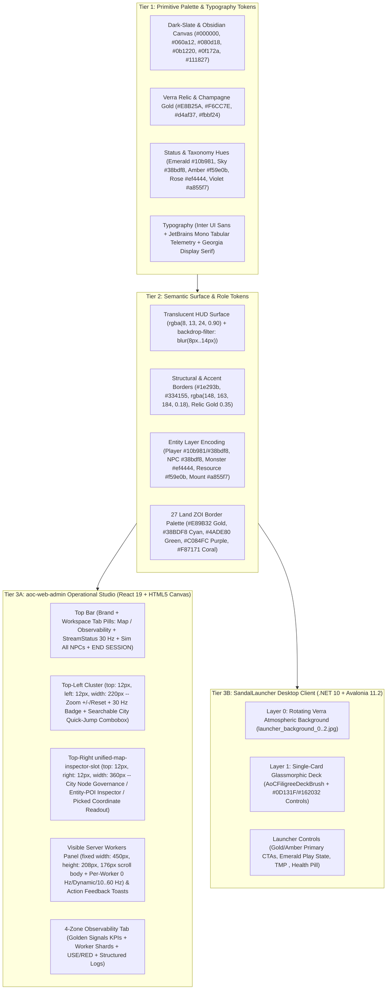
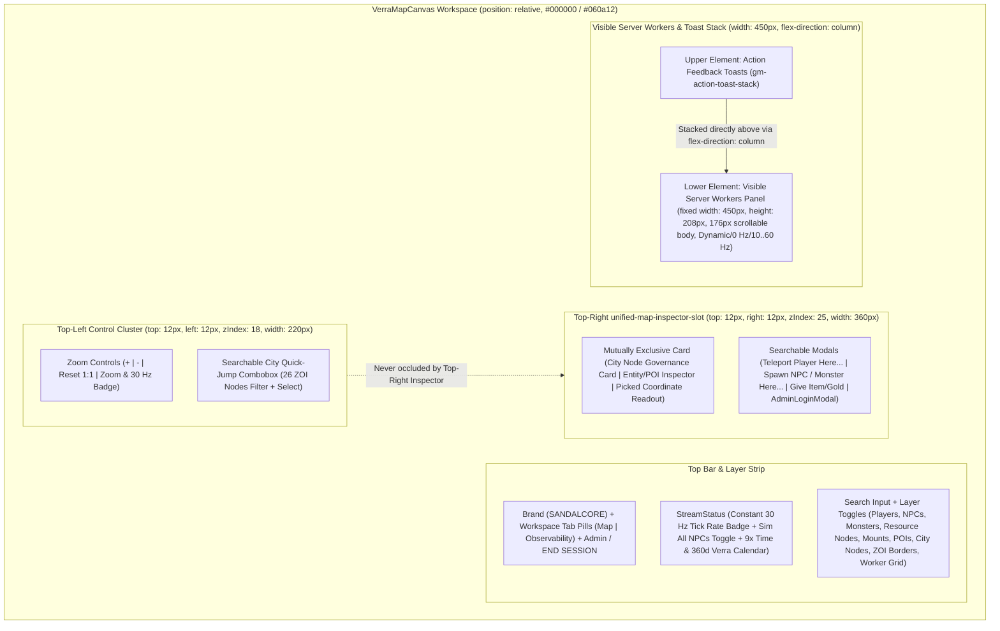

# SandalCore UI Style Guide & Design System Reference (`docs/UI_STYLE_GUIDE.md`)

**Primary Diataxis Quadrant**: `Technical Reference` (`DOC-01`)
**Related Guides**: [Root Architecture Overview](../README.md) | [Web Admin & GM Studio Reference](WEB_ADMIN.md) | [Web Admin SPA Component Reference](../src/clients/web-admin/README.md) | [SandalLauncher Desktop Reference](../src/clients/launcher/README.md) | [Server Workers & Spatial Authority](SERVER_WORKERS.md) | [Configuration Reference](CONFIGURATION.md)

This document is the authoritative UI Style Guide and Design System specification for SandalCore's two operator and player user interfaces:

1. **`aoc-web-admin` (`src/clients/web-admin`)**: The React 19, TypeScript 5, and HTML5 Canvas / WebGL2 Real-Time Operational Command & Control (C2) Studio (`https://localhost:8443/admin/` or `http://localhost:8090`).
2. **`SandalLauncher` (`src/clients/launcher`)**: The `.NET 10` (`net10.0`) and Avalonia 11.2 Glassmorphic Desktop Client (`dist/launcher/SandalLauncher.exe` and root `SandalLauncher.lnk`).

Any engineer or agent building a new tab, HUD overlay, inspector drawer, searchable modal, telemetry table, or desktop view MUST adhere to the semantic tokens, spatial anchoring rules, and blueprint templates defined below so every surface looks and behaves 100% natively within SandalCore.

---

## 1. Design Philosophy & Core Ergonomic Laws (`UX-01`--`UX-08`)

### Operational Dark-Slate C2 & Translucent Glassmorphic Surfaces

SandalCore pairs a high-contrast dark-slate operational Command-and-Control (C2) aesthetic (`#060a12` / `#080d18` / `#0b1220` deep space canvas) with translucent glassmorphic HUD cards (`rgba(8, 13, 24, 0.90)` and `backdrop-filter: blur(8px..14px)`):

- **Zero Unloaded-Tile Glare (`PURE_BLACK_TILE_BG = #000000`)**: The interactive Verra map canvas (`src/clients/web-admin/src/map/verraTilePyramidRenderer.ts`) clears unloaded or out-of-bounds background regions to pure black (`#000000`) surrounded by a `#060a12` / `#080d18` deep-space frame so bright UI panels never wash out terrain contrast.
- **Layered Translucent Glassmorphism**: Floating HUD controls, the right-dock Inspector, and the `SandalLauncher` sign-in deck use semi-transparent dark-slate surfaces (`rgba(8, 13, 24, 0.90)` in Web Admin; `AoCFiligreeDeckBrush` `#960B0E17 -> #A3101724` in Avalonia) with `backdrop-filter: blur(8px..14px)` and `1px solid` semantic borders (`#1e293b` / `#334155` or relic gold `rgba(232, 178, 90, 0.35)`).
- **W3C DTCG Three-Tier Token Discipline (`UX-05`)**: Raw hex/RGBA palette primitives (`Tier 1`) map to semantic role tokens (`Tier 2`: canvas, surface, border, status, entity taxonomy) and component-scoped slots (`Tier 3`: HUD pill, modal card, KPI strip, log row).

### Principle of Least Surprise & Strict Information Ergonomics (`UX-01`--`UX-04`)

1. **Strict Entity Taxonomy Separation**:
   - Every population counter, worker shard row, and map filter strictly enforces the additive identity:
     `Total Entities = Players + NPCs + Monsters + Resource Nodes + Mounts`
   - Friendly/service NPCs (`npc`), hostile monsters (`monster`), gatherable resource nodes (`resource` / `resource_node`), mounts (`mount`), and online players (`player`) are never conflated into a single undifferentiated counter (`normalizeSingleWorker` in `src/clients/web-admin/src/components/LogsAndContainersTab.tsx`).
2. **Strictly Mutually Exclusive Selection States**:
   - Clicking an item on the Verra map (`src/clients/web-admin/src/state/worldStreamStore.ts` and `resolveMutuallyExclusiveInspectorTarget` in `src/clients/web-admin/src/components/EntityInspector.tsx`) enforces a mutually exclusive 4-state union (`Entity | Map Position | CityNode | POI`):
     - Selecting an `Entity` (`selectEntity`) clears `selectedCityNodeId`, `selectedPoiId`, and `pickedCoord`.
     - Selecting a `CityNode` (`selectCityNode`) clears `selectedEntityId`, `selectedPoiId`, and `pickedCoord`.
     - Selecting a `POI` (`selectPoi`) clears `selectedEntityId`, `selectedCityNodeId`, and `pickedCoord`.
     - Clicking open terrain (`Map Position` / `pickedCoord`) clears `selectedEntityId`, `selectedCityNodeId`, and `selectedPoiId`.
3. **Zero Raw `[object Object]` or Unformatted JSON Dumps**:
   - All inspector tables, toast notifications, GM audit rows, and structured log streams sanitize values through deterministic formatters (`formatSafeValue` in `EntityInspector.tsx`, `safeFormatAttrValue` and `parseSingleDockerLogRow` in `LogsAndContainersTab.tsx`, `formatLogEntryToString` in `GmCommandPalette.tsx`). Nested objects and arrays are flattened into readable `key=value` pills or formatted scalars; `[object Object]` is forbidden across all UI surfaces.
4. **Triple-Redundant Status Encoding (`WCAG 2.2 AA` / `MIL-STD-1472H`, `UX-06`)**:
   - Operational states never rely on color alone. Every status indicator pairs **Color + Geometric Shape/Glyph + Uppercase Text Label** (for example: `[OK]` emerald `#10b981` + circle dot, `[WARN]` amber `#f59e0b` + triangle, `[ERR]` rose `#ef4444` + square/alert badge).

### Design Token Hierarchy & Component Surface Architecture



---

## 2. Complete Color Palette & Semantic Token Reference Table

### 2.1 Core Backgrounds, Borders, Typography & Status Badges

| Category | Semantic Token / Role | Hex / RGBA Value | Primary Usage Across `aoc-web-admin` & `SandalLauncher` |
|:---|:---|:---|:---|
| **Backgrounds** | `canvas.void` (`PURE_BLACK_TILE_BG`) | `#000000` | Unloaded or out-of-bounds minimap tile canvas fill (`verraTilePyramidRenderer.ts`). |
| **Backgrounds** | `canvas.deep-space` (`bg.950`) | `#060a12` / `rgba(6, 10, 18, 0.94)` | Root deep-space viewport frame, Docker log terminal surface, and modal backdrop tint. |
| **Backgrounds** | `surface.hud-glass` (`bg.900`) | `#080d18` / `rgba(8, 13, 24, 0.90)` | Primary floating HUD overlays (`Top-Left Cluster`, `Visible Server Workers`, `Action Toasts`, `EntityInspector`) with `backdrop-filter: blur(8px..14px)`. |
| **Backgrounds** | `surface.panel` (`bg.850`) | `#0b1220` / `rgba(11, 18, 32, 0.92)` | Top-level application shell, tab containers, and searchable modal dialog bodies. |
| **Backgrounds** | `surface.card` (`bg.800`) | `#0f172a` / `rgba(15, 23, 42, 0.78)` | Analytics KPI cards, data table wrappers, combobox dropdown lists, and input wells. |
| **Backgrounds** | `surface.elevated` (`bg.750`) | `#111827` / `rgba(17, 24, 39, 0.92)` | Secondary control groups, button backgrounds, and table header strips. |
| **Backgrounds** | `launcher.card` (`VerraObsidian`) | `#0B0E17` / `#0D131F` / `#162032` | `SandalLauncher` glassmorphic login card (`AoCFiligreeDeckBrush`), input wells (`#EB121926`), and secondary buttons (`#EB161E2E`). |
| **Borders** | `border.subtle` | `#1e293b` / `rgba(148, 163, 184, 0.14)` | Table row dividers, KPI sub-panels, and recessed metric cells. |
| **Borders** | `border.default` | `#334155` / `rgba(148, 163, 184, 0.22)` | Standard HUD panel outlines, text inputs, comboboxes, and inactive toggle buttons. |
| **Borders** | `border.accent-sky` | `#38bdf8` / `rgba(56, 189, 248, 0.45)` | Active/focused inputs, selected map coordinates, `WORLD`/`REGION` badges, and GM action borders. |
| **Borders** | `border.accent-violet` | `#a855f7` / `rgba(168, 85, 247, 0.45)` | Node Governance modal accent, `NODE_PLUG` worker tier badges, and Mount inspector frames. |
| **Borders** | `border.accent-emerald` | `#10b981` / `rgba(16, 185, 129, 0.45)` | Online status pills, `ZOI 30Hz` worker badges, Spawn NPC actions, and positive toast borders. |
| **Borders** | `border.accent-amber` | `#f59e0b` / `rgba(245, 158, 11, 0.45)` | Warning callouts, `boot_id` rotation notices, and Resource Node inspector borders. |
| **Borders** | `border.accent-rose` | `#ef4444` / `rgba(239, 68, 68, 0.45)` | Hostile monster frames, error banners, `Kill`/`Despawn` destructive buttons, and `STOP GAME` CTAs. |
| **Borders** | `border.relic-gold` (`AoCCardBorderBrush`) | `#E8B25A` / `rgba(140, 108, 66, 0.47)` | Top-bar branding, CityNode sovereignty rings, `AdminLoginModal` gold trim, and `SandalLauncher` filigree borders. |
| **Typography** | `text.primary` | `#f8fafc` (`#F4F1EA` in Launcher) | Primary headings, KPI metric values, entity names, and active button labels. |
| **Typography** | `text.body` | `#e2e8f0` | Standard body copy, table cell values, log messages, and modal descriptions. |
| **Typography** | `text.secondary` | `#94a3b8` (`#B8C4D4` in Launcher) | Column headers, field labels, secondary coordinates, and inactive tab titles. |
| **Typography** | `text.muted` | `#64748b` | Disabled controls, placeholder text, subtle hints, and empty-state captions. |
| **Typography** | `text.relic-gold` | `#E8B25A` / `#F6CC7E` / `#fbbf24` | Brand titles, CityNode stage headers, picked coordinate headers, and Mayor/Tax callouts. |
| **Status Badges** | `status.ok` / `online` | `#10b981` (text `#6ee7b7` / `#34d399`, bg `rgba(16, 185, 129, 0.14)`) | Healthy workers, connected WebSocket/HTTP streams, running containers, and `PLAY` ready state (`#20D8CE` in Launcher). |
| **Status Badges** | `status.warning` / `degraded` | `#f59e0b` (text `#fcd34d` / `#fbbf24`, bg `rgba(245, 158, 11, 0.14)`) | Degraded tick budget (`> 80%`), fallback polling mode, or non-fatal validation warnings. |
| **Status Badges** | `status.error` / `hostile` | `#ef4444` (text `#fca5a5` / `#f87171`, bg `rgba(239, 68, 68, 0.14)`) | Offline workers, HTTP `401`/`500` errors, dead entities, hostile monsters, and `ERROR` log lines. |
| **Status Badges** | `status.info` / `gm` | `#38bdf8` (text `#7dd3fc`, bg `rgba(56, 189, 248, 0.14)`) | GM command execution pills, teleport actions, `INFO` log badges, and active filter pills. |
| **Status Badges** | `status.zoi` / `governance` | `#a855f7` / `#fbbf24` (bg `rgba(168, 85, 247, 0.14)`) | CityNode stage transitions (`Stage 0..6`), Node XP awards, and ZOI territory badges. |

### 2.2 Entity Taxonomy & Map Layer Color Coding (`verraTilePyramidRenderer.ts` & `verraZoiPolygons.ts`)

Every spatial layer rendered on the Verra HTML5 canvas and referenced in HUD badges uses a deterministic visual signature:

| Spatial Layer / Entity Kind | Canonical Kind Key | Primary Hex / RGBA Tokens | Canvas & HUD Rendering Geometry |
|:---|:---|:---|:---|
| **Players** | `player` | Emerald `#10b981` / `#22c55e` & Cyan `#38bdf8` (`#ef4444` when `alive === false`) | `6.5px` radius filled circle with `2px` `#ffffff` white stroke (`#facc15` `3px` stroke when selected) and `600 12px Inter` `#ffffff` name label (`+10px` X offset). |
| **Friendly / Service NPCs** | `npc` (`vendor`, `guard`, `quest_giver`, `service`) | Sky Blue `#38bdf8` / `#60a5fa` | `3.5px` radius filled dot (`7px` + `1.5px` `#ffffff` stroke when selected). Subkind `emberspring` renders `/api/v1/world/icons/TUI_Icon_Map_ReviveShrine_Active.png` (`18x18px`) or a `#22d3ee` cyan diamond fallback. |
| **Hostile Monsters** | `monster` (`hostile`, `boss`, `creature`) | Crimson / Rose `#ef4444` / `#f87171` | `3.5px` radius filled circle (`7px` + `1.5px` `#ffffff` stroke when selected); inspector header and badges use rose `#ef4444` / `#fca5a5`. |
| **Resource Nodes (Gatherables)** | `resource` / `resource_node` (`Gatherable`) | Amber / Gold `#f59e0b` / `#fbbf24` (HUD/inspector) & `#22c55e` (canvas scatter dot) | `3.5px` radius scatter dot on canvas; amber `#f59e0b` / `#fbbf24` badges in the `Players & Spawner` and `Analytics` breakdown tables. |
| **Mounts** | `mount` | Violet `#a855f7` (text `#c084fc`, bg `rgba(168, 85, 247, 0.15)`) | `3.5px` radius violet marker and dedicated `Mounts` count column in the Worker Shards and Population summary tables. |
| **Loot Piles / Corpses** | `loot` | Gold `#eab308` | `3.5px` radius gold marker (`showLoot` layer toggle, off by default to reduce clutter). |
| **Points of Interest (POIs)** | `poi` | Relic Gold `#d4af37` | Authentic UE5 map icon `/api/v1/world/icons/<icon_name>.png` scaled `18px..28px` by zoom (`#d4af37` `4.5px` dot fallback), plus `600 11px` `#f8fafc` label at `zoom >= 3.2`. |
| **City Nodes (`85` Nodes / `26` ZOI Centers)** | `city_nodes` (`cityNodes`) | Gold `#d4af37` / Cyan `#38bdf8` ring highlights over `rgba(8, 11, 17, 0.78)` `14px` dark disc | Authentic `/api/v1/world/icons/TUI_Icon_Node_LVL0..4.png`, `TUI_Icon_Node_Sovereignty.png` (`Lv 6`), or `TUI_Icon_NodeSummary_NodeEmblem_*.png` (`26x26px`, `32x32px` with `#ffffff` `2.5px` ring when selected). Rotated `1024x1024` `nodePlugs` OBBs render in biome color (`0.12` fill, `2px` `0.85` stroke). |
| **27 Land ZOI Borders** | `zoiBorders` (`VERRA_ZOI_POLYGONS`) | Authentic `ZOIBorderImage` palette: Gold `#E89B32` / `#E8B25A`, Cyan `#38BDF8` / `#4CBDC0`, Green `#4ADE80` / `#609C50`, Purple `#C084FC` / `#7559F8`, Coral `#F87171` / `#BF5858` | Clipped inward via `ctx.clip()` against `VALID_MINIMAP_TILE_CONTOUR` (`1,713` valid non-black `TUI_s50000` land tiles). Rendered with `0.05` interior fill, `4.0px` (`0.22` alpha) outer glow, `1.6px` (`0.68` alpha) crisp inner stroke, and `700 11px` `#F6CC7E` uppercase centroid labels at `zoom >= 1.8`. |
| **Server Worker Authority Grid** | `workerGrid` | Active emerald `#22c55e` (`rgba(34, 197, 94, 0.08)` fill, `0.65` stroke) / Idle amber `#eab308` | Dashed `[6, 4]` world-cm bounding box (`min_x..max_x`, `min_y..max_y`) with a `rgba(11, 14, 23, 0.85)` pill label (`<worker_id> (<player_count>p)`). |

---

## 3. Typography, Monospace Telemetry & Spacing Scale

### 3.1 Font Stacks & Numeric Discipline

| Font Role | CSS / XAML Font Stack | Required Numeric & Rendering Properties | Target Surfaces |
|:---|:---|:---|:---|
| **Primary UI Sans-Serif** | `Inter, "Segoe UI", system-ui, -apple-system, sans-serif` | `font-weight: 400..800`, `-webkit-font-smoothing: antialiased` | Navigation tabs, buttons, layer toggles, modal titles, table headers, and form inputs. |
| **Monospace Telemetry & Logs** | `'JetBrains Mono', 'Fira Code', ui-monospace, SFMono-Regular, Consolas, monospace` | `font-variant-numeric: tabular-nums` (mandatory so rapidly updating numbers never jitter horizontally) | World `(X, Y, Z)` cm coordinates, `UV` coordinates, 64/128-bit `FGuid`s, `worker_id`s, tick latency (`ms`), `Hz` badges, and Docker log rows. |
| **Brand / Display Serif (`SandalLauncher`)** | `Georgia, "Times New Roman", serif` | `FontWeight="Bold"`, `LetterSpacing="3.0"` to `"3.5"` | `SandalLauncher` hero headlines (`ASHES OF CREATION`, `RETURN TO VERRA`) and realm headers. |

### 3.2 Typographic Scale & Spacing Grid (`4px / 6px / 8px / 12px / 16px`)

| Scale Token | Font Size | Line Height | Weight & Letter-Spacing | Canonical Usage |
|:---|:---:|:---:|:---|:---|
| **`text-xs-micro`** | `10px` (`9.5px..10px`) | `1.2` (`12px`) | `600..700`, `letter-spacing: 0.05em..0.08em` uppercase | Micro-badges (`WORLD 10Hz`, `ZOI 30Hz`), keyboard shortcuts (`Ctrl+K`), form field labels, and axis captions. |
| **`text-sm-compact`** | `11px` | `1.35` (`15px`) | `500..600` (sans or mono) | Compact HUD readouts, Visible Server Workers rows, data table cells, and structured log rows. |
| **`text-base-control`** | `12px` | `1.4` (`17px`) | `500..600` | Standard buttons, layer toggle pills, search inputs, comboboxes, and toast notifications. |
| **`text-md-header`** | `13px--14px` | `1.4` (`18px--20px`) | `700`, `letter-spacing: 0.04em..0.06em` | Card headers, modal titles, inspector target titles, and navigation tab labels. |
| **`text-lg-kpi`** | `18px--22px` | `1.15` (`22px--26px`) | `700..800`, `font-variant-numeric: tabular-nums` | Zone 1 Golden Signals KPI metric callouts (`30.0 Hz`, `2.41 ms`, `100%`) and `SandalLauncher` card headers. |

- **Spatial Rhythm (`4px / 6px / 8px / 12px / 16px`)**:
  - `4px`: Micro-gap inside inline badge groups, label-to-input vertical stack gap, and compact button padding (`4px 8px`).
  - `6px`: Gap between layer toggle pills, HUD cluster sub-rows, and compact card padding (`6px 8px`).
  - `8px`: Standard gap between buttons, form controls, and HUD cards (`border-radius: 6px..8px`).
  - `12px`: Outer viewport inset (`top: 12px`, `left: 12px`, `right: 12px`, `bottom: 12px`), KPI grid gap, and standard card padding (`12px 14px`).
  - `16px` (`20px..24px` in modals): Section separation gap between analytics zones and modal interior padding (`border-radius: 10px..12px`).

---

## 4. `aoc-web-admin` Spatial Map & HUD Layout Architecture

The **World Map & GM Studio** viewport (`src/clients/web-admin/src/map/VerraMapCanvas.tsx` and `src/main.tsx`) anchors floating glassmorphic HUD clusters across the canvas (`position: relative; width: 100%; height: calc(100vh - 52px); overflow: hidden`) so that map controls, telemetry readouts, and the top-right `unified-map-inspector-slot` never collide or occlude one another.

### 4.1 ASCII Wireframe & Spatial HUD Component Table

```text
+----------------------------------------------------------------------------------------------------------+
| SANDALCORE   [ Map ] [ Observability ]                            [Admin] [30 Hz] [Sim All] [END SESSION]|
+----------------------------------------------------------------------------------------------------------+
| [Search online players on map...]     [Players] [NPCs] [Monsters] [Resources] [Mounts] [POIs] [ZOI] [Grid]|
+----------------------------------------------------------------------------------------------------------+
| +-------------------------------+                                    +---------------------------------+ |
| | Top-Left Control Cluster      |                                    | unified-map-inspector-slot      | |
| | (top: 12px, left: 12px, 220px)|                                    | (top: 12px, right: 12px, 360px) | |
| | [+] [-] [Reset] [Zoom | 30 Hz]|                                    | Mutually Exclusive Target:      | |
| | [Search city / node...       ]|                                    | - City Node Governance Card     | |
| | [26 City Nodes...          v ]|                                    |   (Stage 0..6, +XP, Teleport    | |
| +-------------------------------+                                    |    Player Here..., Spawn NPC...)| |
|                                                                      | - Entity / POI Inspector Card   | |
|                                                                      | - Picked Coordinate Readout Card| |
|                                                                      +---------------------------------+ |
|                                                                                                          |
| +--------------------------------------------+                       +---------------------------------+ |
| | Visible Server Workers (fixed 450px x 208px)|                      | Action Feedback Toasts          | |
| | (176px scrollable body, stable gutter)     |                       | (gm-action-toast-stack)         | |
| | [aoc-riverlands   Riverlands [Dynamic v]]  |                       | [Duunhold -> Lv 6: executed  x] | |
| | [aoc-winstead    Winstead [0 Hz (Off) v]]  |                       +---------------------------------+ |
| +--------------------------------------------+                                                           |
+----------------------------------------------------------------------------------------------------------+
```

| HUD Surface / Slot | DOM `data-testid` & Position | Fixed Dimensions & Layout Contract | Primary Controls & Behavior |
|:---|:---|:---|:---|
| **Top Navigation & Stream Bar** | `web-admin-tab-bar` + `verra-stream-status` | Full-width top header (`padding: 8px 18px`, `backdropFilter: blur(16px)`) | Contains **Brand** (`SANDALCORE`) + **Workspace tab pills** (`Map`, **`Observability`**) + `AdminAuthSessionBadge` (default username **`Admin`** + **`END SESSION`** button) + **`StreamStatus`** (`30 Hz` constant tick rate badge + `Sim All NPCs` toggle). |
| **Map Filter & Layer Strip** | `verra-map-search-input` + `layer-toggle-*` | Full-width sub-header (`padding: 8px 14px`) | Online player search box + independent layer toggle pills (`Players`, `NPCs`, `Monsters`, `Resource Nodes`, `Mounts`, `Loot Piles`, `POIs`, `City Nodes`, `ZOI Borders`, `Worker Grid`) with live count badges + `ServerTimeOfDayControl` (`VerraCalendarPopover`). |
| **Top-Left Control Cluster** | `map-zoom-*` + `city-quick-jump-combobox` (`top: 12px, left: 12px, zIndex: 18`) | `width: 220px` | Zoom controls (`+`, `-`, `Reset` / `1:1`, `Zoom / 30 Hz` badge) + Searchable City Quick-Jump filtering combobox (`city-quick-jump-search` + `city-node-quick-select` for 26 City Nodes). Never occluded by the right-side inspector or modals. |
| **Top-Right Unified Inspector Slot** | `unified-map-inspector-slot` (`top: 12px, right: 12px, zIndex: 25`) | `width: 360px` (`display: flex; flexDirection: column; gap: 8px`) | Hosts the mutually exclusive **City Node Governance card** (with `Stage 0..6`, `+1,000`/`+10,000 XP`, `Teleport Player Here...`, and `Spawn NPC / Monster Here...` buttons), **Entity/POI Inspector** (`EntityInspector` + `selected-entity-quick-actions`), or **`Picked Coordinate Readout` card** (`picked-coordinate-readout`). |
| **Visible Server Workers Panel** | `visible-server-workers-panel` + `visible-server-workers-scroll` | Fixed `width: 450px`, `height: 208px` (`176px` scrollable body, `overflowY: "auto"`, `scrollbarGutter: "stable"`) | Bottom-right / lower-dock viewport worker list. Fixed `450px x 208px` outer card and `176px` scrollable body ensure worker count changes never resize the card. Clicking a row zooms to that worker's spatial area; per-row `<select>` adjusts worker tick rate (`Dynamic (30-60 Hz)`, `0 Hz (Pause NPCs)`, and manual `10, 15, 20, 25, 30, 40, 50, 60 Hz`). |
| **Action Feedback Toasts** | `gm-action-toast-stack` (`flex-direction: column`) | `width: 450px` (stacked directly above the worker list) | Displays recent GM action confirmations (`Duunhold -> Lv 6: executed`, `Duunhold +10000 XP: add_node_xp executed`) with emerald (`#20D8CE` / `#10b981`) or crimson (`#E05258` / `#ef4444`) borders and auto-dismisses after `4,500 ms`. |



### 4.2 Top Bar, Constant `30 Hz` Stream Status & Layer Filter Strip

- **Top Navigation Bar (`web-admin-tab-bar`)**:
  - Contains the relic-gold **`SANDALCORE`** brand title (`web-admin-brand-title`), the workspace tab pills (**`Map`** and **`Observability`**), `AdminAuthSessionBadge` (default username **`Admin`** and **`END SESSION`** button), and **`StreamStatus`** (`verra-stream-status`).
  - `StreamStatus` displays the connection health indicator, the **constant `30 Hz` (`33 ms` interval) tick rate badge** across all zoom levels, the **`Sim All NPCs`** toggle (`toggle-simulate-all-npcs`), and the **`END SESSION`** button (`END_SESSION_BUTTON_LABEL = "END SESSION"`).
- **Layer Toggle Pills with Live Count Badges**:
  - Horizontal flex toolbar providing independent visibility toggles for **`Players`**, **`NPCs`**, **`Monsters`**, **`Resource Nodes`**, **`Mounts`**, **`Loot Piles`**, **`POIs`**, **`City Nodes`**, **`ZOI Borders`**, and **`Worker Grid`**.

### 4.3 Top-Left Control Cluster (`top: 12px, left: 12px`, `zIndex: 18`, `width: 220px`)

Anchored permanently to the top-left corner so it is **never occluded** by `unified-map-inspector-slot` or modal overlays:

1. **Zoom Control Row (`+`, `-`, `Reset` / `1:1`, `Zoom / 30 Hz` Badge)**:
   - Compact `32px x 32px` buttons (`map-zoom-in`, `map-zoom-out`, `map-zoom-reset`) paired with `map-zoom-hz-badge` displaying `Zoom <z> / 30 Hz`.
2. **Searchable City Quick-Jump Filtering Combobox (`city-quick-jump-combobox`)**:
   - Contains a real-time filter input (`city-quick-jump-search`, `placeholder="Search city / node..."`) stacked `4px` above the `<select>` dropdown (`city-node-quick-select`). Selecting any of the 26 settlement nodes centers the camera (`zoom: 5.5`) and opens its City Node Governance card in `unified-map-inspector-slot`.

### 4.4 Top-Right `unified-map-inspector-slot` (`top: 12px, right: 12px`, `zIndex: 25`, `width: 360px`)

Renders at `top: 12px, right: 12px, width: 360px` and hosts exactly one mutually exclusive target card at a time:

1. **City Node Governance Card (`NodeGovernanceModalCard` in `NodeGovernanceAndSpawnModals.tsx`)**:
   - Displayed when a CityNode is selected (`selectedCityNodeName`). Provides `Stage 0..6` (`Wilderness` -> `Metropolis`) progression buttons, `+1,000 XP` / `+10,000 XP` buttons, Mayor/Tax controls, and direct **`Teleport Player Here...`** and **`Spawn NPC / Monster Here...`** modal trigger buttons scoped to that CityNode.
2. **Entity / POI Inspector Card (`EntityInspector.tsx` + `selected-entity-quick-actions`)**:
   - Displayed when a live `Entity` (`player`, `npc`, `monster`, `resource`, `mount`) or `POI` is selected. Shows tabular monospace coordinates `(X, Y, Z)` cm, `FGuid`, health/level, NPC lifecycle actions (`Kill`, `Despawn`, `Heal`, `Reset`, `Respawn`, `Nudge +5m X`), and **`Teleport Player Here...`** / **`Spawn NPC / Monster Here...`** triggers.
3. **Picked Coordinate Readout Card (`picked-coordinate-readout`)**:
   - Displayed when the operator clicks open terrain on the map canvas. Shows `Selected Position`, world coordinates `(X, Y, Z) cm`, the authoritative server worker (`aoc-<region>`, `aoc-<zoi>`, or `aoc-<city>`), and one-click buttons for **`Teleport Player Here...`** (`pin-teleport-here-btn`) and **`Spawn NPC / Monster Here...`** (`pin-spawn-here-btn`).
4. **Searchable Action & Authentication Modals**:
   - Triggering **`Teleport Player Here...`** (`TeleportCard`) or **`Spawn NPC / Monster Here...`** (`SpawnNpcCard`) opens a searchable catalog modal over the workspace. **`AdminLoginModal`** (`zIndex: 9999`) handles `HS256` JWT passphrase exchange when unauthenticated or when `boot_id` rotates.

### 4.5 Fixed-Size `Visible Server Workers` Panel (`450px x 208px`) & Action Feedback Toasts

- **Visible Server Workers Panel (`visible-server-workers-panel`)**:
  - Enforces a strict fixed outer geometry of **`width: 450px` (`minWidth: 450px, maxWidth: 450px`)** and **`height: 208px` (`minHeight: 208px, maxHeight: 208px`)**, with a fixed **`176px` scrollable body (`visible-server-workers-scroll`, `height: 176px, minHeight: 176px, maxHeight: 176px, overflowY: "auto", scrollbarGutter: "stable"`)**.
  - Because both the outer card (`450px x 208px`) and inner scroll viewport (`176px`) are locked to fixed pixel heights with `scrollbarGutter: "stable"`, changes in visible worker count as the operator pans or zooms **never resize or shift the card**.
  - Clicking any `30px`-tall worker row zooms the map camera to that worker's spatial authority bounds (`zoomToWorkerArea`), while the inline `<select>` (`worker-tick-rate-select-<id>`) adjusts that worker's live tick rate (`Dynamic (30-60 Hz)`, `0 Hz (Pause NPCs)` pausing NPC simulation on just that worker, and manual `10, 15, 20, 25, 30, 40, 50, 60 Hz`).
- **Action Feedback Toasts (`gm-action-toast-stack`)**:
  - Stacked directly above `visible-server-workers-panel` via `flex-direction: column` (`width: 450px`), rendering non-blocking execution receipts (`Duunhold -> Lv 6: executed`, `Duunhold +10000 XP: add_node_xp executed`) that auto-dismiss after `4,500 ms`.

---

## 5. `Observability` Tab Four-Zone Layout (Golden Signals, USE, RED & Canonical Logs)

The **Observability** workspace (`src/clients/web-admin/src/components/LogsAndContainersTab.tsx`) eliminates duplicate metric widgets by organizing all cluster telemetry into **four strictly partitioned vertical zones** (`display: flex; flex-direction: column; gap: 16px`):

| Zone | DOM Test ID & Container Card | Visual Anatomy & Styling Contract |
|:---:|:---|:---|
| **Zone 1** | **Google SRE Four Golden Signals Grid** (`telemetry-summary-grid`) | `4`-column CSS Grid (`grid-template-columns: repeat(auto-fit, minmax(220px, 1fr)); gap: 12px`). Each card uses `#0f172a` background, `1px solid #1e293b` border, `10px` uppercase `#94a3b8` header, a primary `18px` bold metric readout (`#10b981` / `#38bdf8` / `#e2e8f0`), and a `2x2` `#111827` sub-grid for secondary counters:<br/>1. **Simulation Tick & Stream Latency**: Target/Actual `Hz`, `p50 / p95 / p99` tick `ms`, and stream status.<br/>2. **World Population & Spatial Authority**: `Total Entities = Players + NPCs + Monsters + Resource Nodes + Mounts` across active workers.<br/>3. **Gateway Traffic & Cache Efficiency**: Inbound/outbound `pkt/s`, SQLite cache hit ratio (`%`), and catalog query latency.<br/>4. **Error Budget & Stack Saturation**: Running/healthy containers (`11/11`), total restarts, error log count, and CPU/RAM headroom. |
| **Zone 2** | **Per-Worker Spatial Authority & Saturation Table** (`world-authority-workers-card`) | Full-width table (`border-collapse: collapse`, `11px` font) listing every registered `aoc-*` worker in `worker_index` order (`#1..#N`). Columns: `#`, `Worker ID` (`#38bdf8` mono), `Scope / Tier` pill (`WORLD 10Hz` sky, `REGION 20Hz` indigo, `ZOI 30Hz` emerald, `NODE_PLUG 30Hz` violet, `POLYGON_CUTOUT 30Hz` amber, plus `Dynamic Scale Stub (min=1)` badge when `dynamic_stub === true`), `Area / ZOI / CityNode`, `Status` (`ONLINE` `#10b981` / `OFFLINE` `#ef4444`), `Tick Hz`, `Tick p50 / p95 / p99`, `Players`, `NPCs`, `Monsters`, `Resources`, `Mounts`, and `Total Entities`. |
| **Zone 3** | **Container Saturation (USE) & Envoy/OTel RED Matrix** (`containers-scrape-card` + `prometheus-scrape-card`) | Two side-by-side `repeat(auto-fit, minmax(420px, 1fr))` cards:<br/>- **Container USE Matrix**: Lists all 11+ Linux containers with state pill (`running` `#10b981`), CPU `%`, Memory RSS/Limit (`MB`), Network RX/TX, Block I/O, PIDs, and restart counters.<br/>- **Envoy / gRPC / HTTP RED Strip** (`envoy-cluster-red-strip`): Displays per-upstream cluster status (`HEALTHY`), active connections, request rate (`RPS`), `5xx` error count, and `p50 / p99` latency (`ms`) alongside a filterable Prometheus metric table. |
| **Zone 4** | **Structured Docker Log Explorer & GM Audit Trail** (`docker-log-tailer-card` + `gm-audit-trail-strip`) | Terminal-grade log viewer (`background: #060a12`, `maxHeight: 420px`, `overflowY: auto`, `11px` `JetBrains Mono`):<br/>- **Filter Toolbar**: Service selector (`gateway`, `world`, `auth`, `character`, `citynode`, `quest`, `mesh`, `mesh-gateway`, `web-admin`, `ingress-proxy`, `postgres`), severity filter (`ALL | INFO | WARN | ERROR | DEBUG`), and substring search.<br/>- **Canonical Structured Log Row (`[ts] [stream] [container] message`)**: Each row parses JSON or raw container lines via `parseSingleDockerLogRow` into 6 aligned columns: `timestamp` (`#64748b`), `level` badge (`ERROR` `#ef4444`, `WARN` `#f59e0b`, `INFO` `#38bdf8`, `DEBUG` `#94a3b8`), `stream` (`stdout`/`stderr`), `[component]` (`#a78bfa`), `message` (`#e2e8f0`), and flattened `key=value` pills (`#94a3b8` on `#0f172a` with `#1e293b` border).<br/>- **GM Command Audit Trail Strip**: Displays recent audited GM mutations (`timestamp`, `action` in `#38bdf8`, `actor`, `target`, `status` in `#10b981`/`#ef4444`). |

---

## 6. `SandalLauncher` (`.NET 10` Avalonia 11) Glassmorphic Desktop Style Guide

`SandalLauncher` (`src/clients/launcher/Views/MainWindow.axaml` and `src/clients/launcher/App.axaml`) implements the **Verra Obsidian & Relic Gold** desktop aesthetic in a responsive `1067x600` (`MinWidth="960" MinHeight="560"`) window using a 2-column 50/50 grid (`ColumnDefinitions="1*,1*"`):

### 6.1 Layered Surface & Atmospheric Background Architecture

1. **Layer 0 -- Rotating Atmospheric Verra Key Art (`HeroBackdropImage`)**:
   - On launch, `MainWindowViewModel` randomly selects one of three authentic environmental backgrounds (`launcher_background_0.jpg`, `launcher_background_1.jpg`, `launcher_background_2.jpg`) rendered full-bleed (`Stretch="UniformToFill"`) across both columns, backed by `AoCHeroFallbackBrush` (`RadialGradientBrush` `#1A2338 -> #0E1320 -> #070910`) and a bottom vignette (`#000B0E17 -> #B80B0E17`).
   - The left column displays the brand lockup (`ASHES OF CREATION` in `22px` bold `Georgia` `#F4F1EA` with `LetterSpacing="3.5"`, `SANDAL REALM LAUNCHER` in `11px` `#E8B25A`), and a bottom glass strip (`#990B0E17`, `CornerRadius="8"`) containing the **Server Health Indicator Pill** (`RealmStatusPill`: `7x7` `#20D8CE` emerald ellipse + `RealmStatusText`) and the compact `SettingsToggleButton` (`Server`).
2. **Layer 1 -- Single-Card Glassmorphic Deck (`SignInPanel`, `MaxWidth="420"`)**:
   - Centered in the right column (`Padding="28,24"`), wrapped in `Border.aoc-filigree-card` (`Background="{StaticResource AoCFiligreeDeckBrush}"` `linear-gradient(135deg, #960B0E17 0%, #A3101724 100%)` ~60% opacity, `BorderBrush="#778C6C42"`, `BorderThickness="1"`, `CornerRadius="12"`, `BoxShadow="0 20 48 0 #CC000000"`).
   - Interior sub-cards (`CreateAccountModalCard`, `SettingsDrawerCard`, and `AuthActionCard` when authenticated) use high-contrast obsidian fills (`#0D131F` / `#F20E1420` at ~95% opacity and `#121926` / `#162032` at 92% opacity) so text inputs and action buttons remain crisp over bright background art.

### 6.2 Control Classes, Primary CTAs & Temp Account Ergonomics

| Avalonia Style Class | Background & Border Tokens | Typography & States | Primary Buttons & Usage |
|:---|:---|:---|:---|
| **`Button.aoc-jewel-cta`** | `AoCPrimaryCtaBrush` (`#2B2114 -> #1B140C`), `BorderBrush="#E8B25A"`, `CornerRadius="6"` | `#F6CC7E` `13px..15px` Bold (`#FFF6E0` on `:pointerover` with `#3D2F1C -> #261C10` fill; `0.42` opacity when `:disabled`) | **`PLAY`** (`LaunchGameButton`, `Height="46"`, `LetterSpacing="2.5"`), **`Sign In`** (`LoginSubmitButton`), **`Confirm & Save`**, and **`Save`**. |
| **`Button.aoc-filigree-btn`** | `AoCSecondaryBtnBrush` (`#EB161E2E`), `BorderBrush="#AA8C6C42"`, `CornerRadius="6"` | `#F4F1EA` `12px` SemiBold (`#243048` fill and `#E8B25A` border on `:pointerover`) | **`Create Account`**, **`Temp Account`** (`TempAccountButton`), **`Client Path...`**, and **`Sign Out`**. |
| **`Button.aoc-danger-cta`** | `Background="#3A1419"`, `BorderBrush="#E05258"`, `CornerRadius="6"` | `#FFD6D8` `12px..15px` Bold (`#521C23` fill and `#FF7A80` border on `:pointerover`) | **`STOP GAME`** (`StopGameButton`, shown while `IsGameRunning == true`) and **`Delete`** (`DeleteTempAccountButton` for temp accounts). |
| **`TextBox.aoc-input`** | `AoCInputFillBrush` (`#EB121926`), `BorderBrush="#888C6C42"`, `CornerRadius="6"`, `MinHeight="38"` | `#F4F1EA` `13px`, `#E8B25A` caret (`#F2172030` fill and `#E8B25A` border on `:focus`) | `EmailInput`, `PasswordInput`, `ServerHostInput`, `GatewayPortInput`, `IcsPortInput`, and `GameClientPathInput`. |

- **One-Click `Temp Account` Lifecycle (`TMP <Word1><Word2><Word3>`)**:
  - Clicking **`Temp Account`** (`TempAccountButton`) provisions an ephemeral test account (`temp_<random>@sandal.local`) with a readable 3-word display badge (`TMP <Word1><Word2><Word3>`), signs in immediately, and reveals the crimson **`Delete`** button alongside **`Sign Out`**. On the next launcher start or exit, `GatewayAuthService` calls `/v1/auth/temp-cleanup` to purge expired temporary accounts.
- **Root `SandalLauncher.lnk` One-Click Shortcut**:
  - Running `start.bat` (`.\sandal.ps1 up`) automatically creates a root `SandalLauncher.lnk` Windows shortcut pointing to `dist/launcher/SandalLauncher.exe` for one-click launch directly from the repository root.

---

## 7. Copy-Paste Blueprint Templates for New UI Surfaces

### 7.1 React 19 / TypeScript Design Token Object & Reusable Surface Skeletons (`aoc-web-admin`)

Copy and import these exact inline style tokens and component skeletons when adding a new HUD panel, searchable modal, action toast, KPI card, or data table to `src/clients/web-admin/src/`:

```tsx
import React, { useMemo, useState } from "react";

/** Canonical SandalCore Web Admin Design Tokens (Tier 2 Semantic Roles) */
export const SANDAL_UI_TOKENS = {
  fontUi: 'Inter, "Segoe UI", system-ui, -apple-system, sans-serif',
  fontMono: "'JetBrains Mono', 'Fira Code', ui-monospace, SFMono-Regular, Consolas, monospace",
  bgCanvasVoid: "#000000",
  bgDeepSpace: "#060a12",
  bgHudGlass: "rgba(8, 13, 24, 0.90)",
  bgPanel: "#0b1220",
  bgCard: "#0f172a",
  bgElevated: "#111827",
  borderSubtle: "#1e293b",
  borderDefault: "#334155",
  accentSky: "#38bdf8",
  accentEmerald: "#10b981",
  accentAmber: "#f59e0b",
  accentRose: "#ef4444",
  accentViolet: "#a855f7",
  accentRelicGold: "#E8B25A",
  textPrimary: "#f8fafc",
  textBody: "#e2e8f0",
  textSecondary: "#94a3b8",
  textMuted: "#64748b",
} as const;

/** 1. Translucent Glassmorphic HUD Card Skeleton */
export const SandalHudCardStyle: React.CSSProperties = {
  background: SANDAL_UI_TOKENS.bgHudGlass,
  backdropFilter: "blur(10px)",
  border: `1px solid ${SANDAL_UI_TOKENS.borderDefault}`,
  borderRadius: 8,
  padding: "8px 10px",
  color: SANDAL_UI_TOKENS.textBody,
  fontFamily: SANDAL_UI_TOKENS.fontUi,
  fontSize: 11,
  boxShadow: "0 8px 24px rgba(0, 0, 0, 0.55)",
};

/** 2. Golden Signals Metric KPI Card Skeleton */
export function SandalMetricKpiCard(props: {
  title: string;
  primaryValue: string;
  primaryColor?: string;
  subMetrics: ReadonlyArray<{ label: string; value: string; color?: string }>;
}): React.ReactElement {
  return (
    <div style={{ background: "#0f172a", border: "1px solid #1e293b", borderRadius: 8, padding: 12 }}>
      <div style={{ display: "flex", justifyContent: "space-between", alignItems: "center", marginBottom: 8 }}>
        <span style={{ fontSize: 10, fontWeight: 700, color: "#94a3b8", textTransform: "uppercase", letterSpacing: "0.06em" }}>
          {props.title}
        </span>
        <span style={{ fontSize: 16, fontWeight: 700, color: props.primaryColor ?? "#10b981", fontFamily: SANDAL_UI_TOKENS.fontMono, fontVariantNumeric: "tabular-nums" }}>
          {props.primaryValue}
        </span>
      </div>
      <div style={{ display: "grid", gridTemplateColumns: "1fr 1fr", gap: 6, fontSize: 11 }}>
        {props.subMetrics.map((m) => (
          <div key={m.label} style={{ background: "#111827", padding: "6px 8px", borderRadius: 6, border: "1px solid #1e293b" }}>
            <div style={{ color: "#64748b", fontSize: 10 }}>{m.label}</div>
            <div style={{ color: m.color ?? "#e2e8f0", fontWeight: 700, fontFamily: SANDAL_UI_TOKENS.fontMono, fontVariantNumeric: "tabular-nums" }}>
              {m.value}
            </div>
          </div>
        ))}
      </div>
    </div>
  );
}

/** 3. Searchable Modal Card & Stable-Gutter Data Table Skeleton */
export function SandalSearchableModal<T extends { id: string; label: string; detail: string }>(props: {
  title: string;
  accentColor?: string;
  items: ReadonlyArray<T>;
  onSelect: (item: T) => void;
  onClose: () => void;
}): React.ReactElement {
  const [query, setQuery] = useState("");
  const accent = props.accentColor ?? SANDAL_UI_TOKENS.accentSky;
  const filtered = useMemo(() => {
    const q = query.trim().toLowerCase();
    return q ? props.items.filter((i) => i.label.toLowerCase().includes(q) || i.id.toLowerCase().includes(q)) : props.items;
  }, [props.items, query]);

  return (
    <div style={{ background: "rgba(11, 18, 32, 0.96)", border: `1px solid ${accent}`, borderRadius: 10, padding: 14, width: 360, color: "#e2e8f0", boxShadow: "0 16px 40px rgba(0,0,0,0.65)" }}>
      <div style={{ display: "flex", justifyContent: "space-between", alignItems: "center", marginBottom: 10 }}>
        <span style={{ fontSize: 13, fontWeight: 700, color: accent }}>{props.title}</span>
        <button type="button" onClick={props.onClose} style={{ background: "transparent", border: "1px solid #334155", color: "#94a3b8", borderRadius: 4, padding: "2px 8px", fontSize: 11, cursor: "pointer" }}>
          Close
        </button>
      </div>
      <input
        type="text"
        value={query}
        onChange={(e) => setQuery(e.target.value)}
        placeholder="Filter items by name or ID..."
        style={{ width: "100%", boxSizing: "border-box", padding: "6px 8px", borderRadius: 6, border: "1px solid #334155", background: "#0f172a", color: "#f8fafc", fontSize: 11, marginBottom: 8 }}
      />
      <div style={{ maxHeight: 196, overflowY: "scroll", scrollbarGutter: "stable", border: "1px solid #1e293b", borderRadius: 6, background: "#060a12" }}>
        {filtered.map((item) => (
          <button
            key={item.id}
            type="button"
            onClick={() => props.onSelect(item)}
            style={{ width: "100%", display: "flex", justifyContent: "space-between", padding: "6px 8px", background: "transparent", border: "none", borderBottom: "1px solid #0f172a", color: "#e2e8f0", fontSize: 11, cursor: "pointer", textAlign: "left" }}
          >
            <span style={{ fontWeight: 600 }}>{item.label}</span>
            <span style={{ color: "#94a3b8", fontFamily: SANDAL_UI_TOKENS.fontMono, fontVariantNumeric: "tabular-nums" }}>{item.detail}</span>
          </button>
        ))}
      </div>
    </div>
  );
}
```

### 7.2 Avalonia 11 XAML Glassmorphic Card & Control Snippet (`SandalLauncher`)

Use the existing `App.axaml` static resources (`AoCFiligreeDeckBrush`, `aoc-filigree-card`, `aoc-input`, `aoc-jewel-cta`, `aoc-filigree-btn`, `aoc-danger-cta`) when adding any new dialog or view in `src/clients/launcher/Views/`:

```xml
<Border Classes="aoc-filigree-card" MaxWidth="420" Padding="24,20">
  <StackPanel Spacing="12">
    <!-- Section Title -->
    <StackPanel Spacing="2">
      <TextBlock Text="REALM CONFIGURATION"
                 FontFamily="Georgia, Times New Roman, serif"
                 FontSize="16" FontWeight="Bold"
                 Foreground="#F6CC7E" LetterSpacing="2.0" />
      <TextBlock Text="Configure gateway and local tether parameters."
                 FontSize="11.5" Foreground="#B8C4D4" />
    </StackPanel>

    <!-- Input Field -->
    <StackPanel Spacing="4">
      <TextBlock Classes="aoc-field-label" Text="GATEWAY HOST" />
      <TextBox Classes="aoc-input" Text="{Binding ServerHost}" Watermark="127.0.0.1" />
    </StackPanel>

    <!-- Primary Jewel CTA & Secondary Filigree Actions -->
    <Grid ColumnDefinitions="*,10,*">
      <Button Grid.Column="0" Classes="aoc-jewel-cta" Content="Save"
              HorizontalAlignment="Stretch" Padding="14,10" />
      <Button Grid.Column="2" Classes="aoc-filigree-btn" Content="Cancel"
              HorizontalAlignment="Stretch" Padding="14,10" />
    </Grid>
  </StackPanel>
</Border>
```
