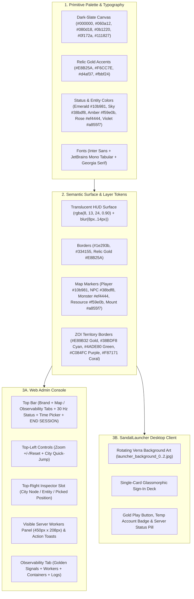

# UI Style Guide and Design System

**Related Guides**: [Root Overview](../README.md) | [Web Admin Studio](WEB_ADMIN.md) | [Web Admin Architecture](WEB_ADMIN_ARCHITECTURE.md) | [Web Admin Frontend](../src/clients/web-admin/README.md) | [SandalLauncher](../src/clients/launcher/README.md)

This guide defines the colors, typography, spacing, layout rules, and reusable component templates for SandalCore's two user interfaces:

1. **Web Admin and GM Studio (`src/clients/web-admin`)**: The browser-based operator console served at `https://localhost:8443/admin/` (or `http://localhost:8090`).
2. **`SandalLauncher` (`src/clients/launcher`)**: The desktop game launcher built to `dist/launcher/SandalLauncher.exe` (and linked at repo root via `SandalLauncher.lnk`).

---

## Design Principles

### Dark-Slate Canvas and Translucent HUD Cards

Both interfaces pair a dark background canvas with translucent floating cards:

- **Pure-Black Unloaded Map Regions**: The Verra map canvas clears unloaded or out-of-bounds areas to pure black (`#000000`) inside a dark-slate frame (`#060a12` / `#080d18`) so UI controls remain easy to read over terrain tiles.
- **Glassmorphic Cards**: Floating HUD panels, the right-hand inspector, and the `SandalLauncher` sign-in card use translucent dark-slate fills (`rgba(8, 13, 24, 0.90)` with `backdrop-filter: blur(8px..14px)` in Web Admin; `#960B0E17 -> #A3101724` in `SandalLauncher`) framed by `1px solid` borders (`#1e293b`, `#334155`, or relic gold `#E8B25A`).
- **Semantic Color Tokens**: Primitive colors map to consistent roles across backgrounds, borders, status pills, and map entity layers.

### Interaction and Information Clarity

1. **Separate Entity Counts**:
   Every population readout, worker row, and map filter tracks the 9 mutually-exclusive population categories separately:
   `Total Entities = Players + NPCs + Monsters + Huntables + Trees + Rocks + Ore & Gems + Plants + Mounts`
2. **One Map Selection at a Time**:
   Clicking an item on the map selects a single target (`Entity`, `Map Position`, `CityNode`, or `POI`) in the top-right inspector slot and clears any previous selection.
3. **Formatted Scalar and Key-Value Display**:
   Inspector fields, toast notifications, GM audit rows, and log lines format nested values as clean scalar strings or `key=value` pills rather than raw JSON dumps.
4. **Accessible Status Indicators**:
   Status badges combine color, a geometric icon or dot, and an uppercase text label (`ONLINE`, `WARN`, `ERROR`) so state is never communicated by color alone.



---

## Color Palette

### Core Backgrounds, Borders, Text, and Status Badges

| Category | Token Name | Hex / RGBA Value | Usage |
|:---|:---|:---|:---|
| **Backgrounds** | `canvas.void` | `#000000` | Unloaded or out-of-bounds map tile background. |
| **Backgrounds** | `canvas.deep-space` | `#060a12` / `rgba(6, 10, 18, 0.94)` | Root viewport frame, log viewer background, and modal backdrop. |
| **Backgrounds** | `surface.hud-glass` | `#080d18` / `rgba(8, 13, 24, 0.90)` | Floating map HUD panels, inspector cards, and toast notifications. |
| **Backgrounds** | `surface.panel` | `#0b1220` / `rgba(11, 18, 32, 0.92)` | Top-level application shell, tab views, and modal dialog bodies. |
| **Backgrounds** | `surface.card` | `#0f172a` / `rgba(15, 23, 42, 0.78)` | KPI cards, table containers, dropdown lists, and text inputs. |
| **Backgrounds** | `surface.elevated` | `#111827` / `rgba(17, 24, 39, 0.92)` | Secondary control groups, button fills, and table headers. |
| **Backgrounds** | `launcher.card` | `#0B0E17` / `#0D131F` / `#162032` | `SandalLauncher` login card, input fields, and secondary buttons. |
| **Borders** | `border.subtle` | `#1e293b` / `rgba(148, 163, 184, 0.14)` | Table row dividers and recessed metric cells. |
| **Borders** | `border.default` | `#334155` / `rgba(148, 163, 184, 0.22)` | Standard HUD panel outlines, inputs, and inactive toggle buttons. |
| **Borders** | `border.accent-sky` | `#38bdf8` / `rgba(56, 189, 248, 0.45)` | Focused inputs, selected map coordinates, and GM action buttons. |
| **Borders** | `border.accent-violet` | `#a855f7` / `rgba(168, 85, 247, 0.45)` | City Node governance cards, `NODE_PLUG` badges, and mount inspector frames. |
| **Borders** | `border.accent-emerald` | `#10b981` / `rgba(16, 185, 129, 0.45)` | Online status pills, spawn buttons, and success toasts. |
| **Borders** | `border.accent-amber` | `#f59e0b` / `rgba(245, 158, 11, 0.45)` | Warning callouts and resource node inspector borders. |
| **Borders** | `border.accent-rose` | `#ef4444` / `rgba(239, 68, 68, 0.45)` | Hostile monster frames, error banners, and destructive buttons. |
| **Borders** | `border.relic-gold` | `#E8B25A` / `rgba(140, 108, 66, 0.47)` | Top-bar branding, City Node rings, login modal trim, and launcher borders. |
| **Typography** | `text.primary` | `#f8fafc` (`#F4F1EA` in Launcher) | Headings, primary metric values, entity names, and active button labels. |
| **Typography** | `text.body` | `#e2e8f0` | Body text, table cells, and log messages. |
| **Typography** | `text.secondary` | `#94a3b8` (`#B8C4D4` in Launcher) | Column headers, field labels, and inactive tab titles. |
| **Typography** | `text.muted` | `#64748b` | Disabled controls, placeholders, and empty-state hints. |
| **Typography** | `text.relic-gold` | `#E8B25A` / `#F6CC7E` / `#fbbf24` | Brand titles, settlement headers, and coordinate callouts. |
| **Status Badges** | `status.ok` | `#10b981` (text `#6ee7b7`, bg `rgba(16, 185, 129, 0.14)`) | Healthy workers, connected streams, running containers, and `PLAY` ready state. |
| **Status Badges** | `status.warning` | `#f59e0b` (text `#fcd34d`, bg `rgba(245, 158, 11, 0.14)`) | High tick utilization or non-fatal warnings. |
| **Status Badges** | `status.error` | `#ef4444` (text `#fca5a5`, bg `rgba(239, 68, 68, 0.14)`) | Offline workers, failed requests, dead entities, and `ERROR` log rows. |
| **Status Badges** | `status.info` | `#38bdf8` (text `#7dd3fc`, bg `rgba(56, 189, 248, 0.14)`) | GM command badges, teleport actions, and `INFO` log rows. |

### Map Layer and Entity Color Coding

| Layer / Entity Kind | Kind Key | Color Tokens | Map Marker Appearance |
|:---|:---|:---|:---|
| **Players** | `player` | Emerald `#10b981` / `#22c55e` & Cyan `#38bdf8` (`#ef4444` when dead) | `6.5px` filled circle with `2px` `#ffffff` stroke (`#facc15` `3px` stroke when selected) and `12px` white name label. |
| **Friendly / Service NPCs** | `npc` | Sky Blue `#38bdf8` / `#60a5fa` | `3.5px` filled dot (`7px` with white stroke when selected). Embersprings render `TUI_Icon_Map_ReviveShrine_Active.png` (`18x18px`). |
| **Hostile Monsters** | `monster` | Crimson / Rose `#ef4444` / `#f87171` | `3.5px` filled circle (`7px` with white stroke when selected) and rose inspector badges. |
| **Resource Nodes** | `resource` / `resource_node` | Amber / Gold `#f59e0b` / `#fbbf24` (HUD) & `#22c55e` (map dot) | `3.5px` map dot and amber resource badges showing `Resource Type` and `Quality / Rarity`. |
| **Mounts** | `mount` | Violet `#a855f7` (`#c084fc` text) | `3.5px` violet marker and dedicated `Mounts` column in worker tables. |
| **Loot Piles** | `loot` | Gold `#eab308` | `3.5px` gold marker (hidden by default until toggled on). |
| **Points of Interest** | `poi` | Relic Gold `#d4af37` | Rendered in Tier 2 of `VerraMapCanvas` (`1`: base tiles, ZOI borders, map overlays, and all world entities first -> `2`: standard POIs second -> `3`: Node Plug / City Node POIs last) with map icon `/api/v1/world/icons/<icon_name>.png` (`18px..28px`), click-to-select (`cursor: pointer`, `#d4af37` ring), and `11px` label at `zoom >= 3.2`. |
| **City Nodes** | `city_nodes` | Gold `#d4af37` / Cyan `#38bdf8` ring over dark disc | Rendered last in Tier 3 of `VerraMapCanvas` on top of all other POI types and entities using real `verra.pmtiles` `z=9` icon texture names (`TUI_Icon_Map_Node_Dock`, `TUI_Icon_Map_Siege`, `TUI_Icon_Map_HomeShrine`, `TUI_Icon_NodeSummary_NodeEmblem_*`, `TUI_Icon_Node_LVL3`, `TUI_Icon_Node_LVL0..4.png`, or `TUI_Icon_Node_Sovereignty.png`) plus rotated `1 km x 1 km` OBB boundary box. |
| **ZOI Borders** | `zoiBorders` | Gold `#E89B32`, Cyan `#38BDF8`, Green `#4ADE80`, Purple `#C084FC`, Coral `#F87171` | 3-pass polygon border (`0.05` fill, `4.0px` outer glow, `1.6px` inner line) with `#F6CC7E` uppercase labels at `zoom >= 1.8`. |
| **Worker Authority Grid** | `workerGrid` | Active emerald `#22c55e` / Idle amber `#eab308` | Dashed `[6, 4]` boundary box with `<worker_id> (<player_count>p)` label pill. |
| **Map Entity Legend & Stream Status** | `map-entity-legend` / `StreamStatus` | Dark-slate HUD glass (`rgba(8, 13, 24, 0.90)`) | Bottom-left vertical legend (`data-testid="map-entity-legend"`, `flexDirection: "column"`) and uniform `Players Online: 0` typography (`fontFamily: "inherit"`) in `StreamStatus`. |

---

## Typography and Spacing

### Font Families

| Role | Font Stack | Required Properties | Where Used |
|:---|:---|:---|:---|
| **UI Sans-Serif** | `Inter, "Segoe UI", system-ui, -apple-system, sans-serif` | `font-weight: 400..800`, `-webkit-font-smoothing: antialiased` | Tabs, buttons, layer toggles, modal headers, table headers, and inputs. |
| **Monospace Telemetry** | `'JetBrains Mono', 'Fira Code', ui-monospace, SFMono-Regular, Consolas, monospace` | `font-variant-numeric: tabular-nums` | Coordinates `(X, Y, Z)`, GUIDs, worker IDs, tick rates (`Hz`), latencies (`ms`), and log lines. |
| **Display Serif (`SandalLauncher`)** | `Georgia, "Times New Roman", serif` | `FontWeight="Bold"`, `LetterSpacing="3.0"` to `"3.5"` | `SandalLauncher` headlines (`ASHES OF CREATION`, `RETURN TO VERRA`). |

### Type Scale and Spacing Rhythm

| Token | Size | Line Height | Weight | Usage |
|:---|:---:|:---:|:---|:---|
| **`text-xs-micro`** | `10px` | `1.2` (`12px`) | `600..700` uppercase | Scope pills, keyboard shortcut hints, and small field captions. |
| **`text-sm-compact`** | `11px` | `1.35` (`15px`) | `500..600` | HUD rows, worker list entries, table cells, and log lines. |
| **`text-base-control`** | `12px` | `1.4` (`17px`) | `500..600` | Buttons, layer toggle pills, search inputs, and toast notifications. |
| **`text-md-header`** | `13px--14px` | `1.4` (`18px--20px`) | `700` | Card titles, modal headers, inspector titles, and tab labels. |
| **`text-lg-kpi`** | `18px--22px` | `1.15` (`22px--26px`) | `700..800` tabular | Golden Signals KPI values (`30.0 Hz`, `2.41 ms`) and launcher headers. |

Spacing follows a `4px / 6px / 8px / 12px / 16px` scale, with a `12px` inset from the viewport edges (`top: 12px`, `left: 12px`, `right: 12px`, `bottom: 12px`).

---

## Web Admin Map and HUD Layout

The **Map** workspace anchors its floating HUD panels to fixed corners of the viewport so controls, worker lists, and the inspector card never overlap.

```text
+----------------------------------------------------------------------------------------------------------+
| SANDALCORE   [ Map ] [ Observability ]                            [Admin] [30 Hz] [Sim All] [END SESSION]|
+----------------------------------------------------------------------------------------------------------+
| [Search online players on map...]     [Players] [NPCs] [Monsters] [Resources] [Mounts] [POIs] [ZOI] [Grid]|
+----------------------------------------------------------------------------------------------------------+
| +-------------------------------+                                    +---------------------------------+ |
| | Top-Left Control Cluster      |                                    | Top-Right Inspector Slot        | |
| | (top: 12px, left: 12px, 220px)|                                    | (top: 12px, right: 12px, 360px) | |
| | [+] [-] [Reset] [Zoom | 30 Hz]|                                    | One Active Card at a Time:      | |
| | [Search city / node...       ]|                                    | - City Node Governance Card     | |
| | [26 City Nodes...          v ]|                                    | - Entity / POI Inspector Card   | |
| +-------------------------------+                                    | - Picked Coordinate Readout Card| |
|                                                                      +---------------------------------+ |
|                                                                                                          |
| +--------------------------------------------+                       +---------------------------------+ |
| | Visible Server Workers (fixed 450px x 208px)|                      | Action Feedback Toasts          | |
| | (176px scrollable body, stable gutter)     |                       | [Duunhold -> Lv 6: executed  x] | |
| | [aoc-riverlands   Riverlands [Dynamic v]]  |                       +---------------------------------+ |
| | [aoc-winstead    Winstead [0 Hz (Off) v]]  |                                                           |
| +--------------------------------------------+                                                           |
+----------------------------------------------------------------------------------------------------------+
```

| HUD Area | Position and Size | Purpose |
|:---|:---|:---|
| **Top Bar** | Full-width top header (`padding: 8px 18px`) | Brand title (`SANDALCORE`), workspace tabs (`Map`, `Observability`), active user badge (`Admin`), `30 Hz` `StreamStatus` (`Players Online: 0` with `fontFamily: "inherit"`), `9x` world clock and `VerraCalendarPopover` (`Spring`, `Summer`, `Autumn`, `Winter`), `Sim All NPCs` toggle, and `END SESSION` button. |
| **Layer Filter Strip** | Full-width sub-header (`padding: 8px 14px`) | Player search input and layer toggle pills (`Players`, `NPCs`, `Monsters`, `Resource Nodes`, `Mounts`, `Loot Piles`, `POIs`, `City Nodes`, `ZOI Borders`, `Worker Grid`) with live count badges. |
| **Top-Left Control Cluster** | `top: 12px, left: 12px`, `width: 220px` | Zoom buttons (`+`, `-`, `Reset`, `Zoom / 30 Hz` badge) and the searchable City Quick-Jump combobox (`26` settlements). |
| **Bottom-Left Entity Legend** | `bottom: 12px, left: 12px` (`data-testid="map-entity-legend"`) | Vertical entity legend (`flexDirection: "column"`) over `VerraMapCanvas`. |
| **Top-Right Inspector Slot** | `top: 12px, right: 12px`, `width: 360px` | Displays the active **City Node Governance Card**, **Entity / POI Inspector**, or **Picked Coordinate Readout**, along with triggers for the **`Teleport Player Here...`** and **`Spawn NPC / Monster Here...`** modals. |
| **Visible Server Workers Panel** | Fixed `width: 450px`, `height: 208px` (`176px` scrollable list) | Lists workers intersecting the viewport. Clicking a row zooms to that worker's territory; the per-row dropdown switches its tick rate between `Dynamic (30-60 Hz)` (`kMaxDynamicHz = 60`), `0 Hz (Pause NPCs)`, and `10..60 Hz`. |
| **Action Feedback Toasts** | `width: 450px`, stacked above the worker panel | Shows confirmation toasts for GM actions and auto-dismisses after `4.5 seconds`. |

---

## Observability Tab Layout

The **Observability** tab organizes cluster monitoring and logs into four vertical zones (`gap: 16px`):

| Zone | Panel | Contents |
|:---:|:---|:---|
| **Zone 1** | **`Simulation`, `World Population`, `Traffic & Cache`, and `Errors & Saturation`** | Four summary KPI cards for **`Simulation`** (tick `Hz` `p50 / p99` and `Publish Avg / Max` at `30 Hz`), **`World Population`** (`Total Entities` across the 9 mutually-exclusive categories: `Players`, `NPCs`, `Monsters`, `Huntables`, `Trees`, `Rocks`, `Ore & Gems`, `Plants`, and `Mounts`), **`Traffic & Cache`** (`Gateway Requests`, `API Cache Hits / Misses`, and `UDP Frames Forwarded`), and **`Errors & Saturation`** (`Gateway Errors / Retries` formatted as `<errors> / <retries>`, `Active Containers`, and `Monitored Metrics`). |
| **Zone 2** | **`World Workers` Table** | Full-width table of all active `aoc-*` workers in `worker_index` order (`#0..#N`), showing discrete `Scope Tier`, `Target Tick Mode` (`Dynamic (30-60 Hz)` with `kMaxDynamicHz = 60`, `0 Hz (Pause NPCs)`, or manual `10..60 Hz`), and read-only `Current Hz` (`Actual Hz`, `aria-readonly="true"`) columns, plus separate counts for `Total Entities`, `Players`, `NPCs`, `Monsters`, and `Resources`. |
| **Zone 3** | **`Container Metrics & Analytics`, `Service Routing & Connection Health`, and `Telemetry & Metrics`** | Per-container resource and health table (`CPU %`, `Memory (Used / Limit / %)`, `Processes`, `Net RX / TX`, `Health (Status / Metrics / Latency)`) alongside `<Service Name> (<Protocol>)` upstream routing cards (`2xx` / `3xx` / `4xx` / `5xx` status classes) and cluster-internal `/metrics` target status. |
| **Zone 4** | **`Log Explorer` and `GM Audit Log`** | Live viewer for container JSON logs (`#060a12` background, `11px` `JetBrains Mono`) and the `gm_audit_log` table, with service and severity filters plus **`Auto Tail`** and **`Auto Follow`** toggles. |

---

## SandalLauncher Desktop Layout

`SandalLauncher` (`src/clients/launcher/Views/MainWindow.axaml` and `src/clients/launcher/App.axaml`) uses a `1067x600` (`MinWidth="960" MinHeight="560"`) two-column window:

### Surface Layout

1. **Atmospheric Background Layer**:
   On startup, the launcher selects one of three Verra background images (`launcher_background_0..2.jpg`) rendered full-bleed across the window with a dark bottom vignette. The left column displays the `ASHES OF CREATION` title, the **Server Health Pill** (`7x7` `#20D8CE` emerald indicator), and the `Server` settings button.
2. **Glassmorphic Sign-In Card (`MaxWidth="420"`)**:
   Centered in the right column using `Border.aoc-filigree-card` (`#960B0E17 -> #A3101724`, `1px` relic-gold border `#778C6C42`, `CornerRadius="12"`). Inner dialogs and inputs use high-contrast obsidian fills (`#0D131F` and `#121926`) so text stays legible against bright background art.

### Control Styles

| Style Class | Colors | Usage |
|:---|:---|:---|
| **`Button.aoc-jewel-cta`** | `#2B2114 -> #1B140C` fill, `#E8B25A` border, `#F6CC7E` bold text | Primary actions: **`PLAY`**, **`Sign In`**, and **`Save`**. |
| **`Button.aoc-filigree-btn`** | `#EB161E2E` fill, `#AA8C6C42` border, `#F4F1EA` text | Secondary actions: **`Create Account`**, **`Temp Account`**, **`Client Path...`**, and **`Sign Out`**. |
| **`Button.aoc-danger-cta`** | `#3A1419` fill, `#E05258` border, `#FFD6D8` bold text | Destructive actions: **`STOP GAME`** and temporary account **`Delete`**. |
| **`TextBox.aoc-input`** | `#EB121926` fill, `#888C6C42` border, `#F4F1EA` text | Text inputs for email, password, server host/ports, and client path. |

---

## Component Templates

### Web Admin Tokens and Card Templates

Use these shared tokens and component templates when adding new panels, KPI cards, or searchable modals in `src/clients/web-admin/src/`:

```tsx
import React, { useMemo, useState } from "react";

export const SANDAL_UI_TOKENS = {
  fontUi: 'Inter, "Segoe UI", system-ui, -apple-system, sans-serif',
  fontMono: "'JetBrains Mono', 'Fira Code', ui-monospace, SFMono-Regular, Consolas, monospace",
  bgCanvasVoid: "#000000",
  bgDeepSpace: "#060a12",
  bgHudGlass: "rgba(8, 13, 24, 0.90)",
  bgPanel: "#0b1220",
  bgCard: "#0f172a",
  bgElevated: "#111827",
  borderSubtle: "#1e293b",
  borderDefault: "#334155",
  accentSky: "#38bdf8",
  accentEmerald: "#10b981",
  accentAmber: "#f59e0b",
  accentRose: "#ef4444",
  accentViolet: "#a855f7",
  accentRelicGold: "#E8B25A",
  textPrimary: "#f8fafc",
  textBody: "#e2e8f0",
  textSecondary: "#94a3b8",
  textMuted: "#64748b",
} as const;

export const SandalHudCardStyle: React.CSSProperties = {
  background: SANDAL_UI_TOKENS.bgHudGlass,
  backdropFilter: "blur(10px)",
  border: `1px solid ${SANDAL_UI_TOKENS.borderDefault}`,
  borderRadius: 8,
  padding: "8px 10px",
  color: SANDAL_UI_TOKENS.textBody,
  fontFamily: SANDAL_UI_TOKENS.fontUi,
  fontSize: 11,
  boxShadow: "0 8px 24px rgba(0, 0, 0, 0.55)",
};

export function SandalMetricKpiCard(props: {
  title: string;
  primaryValue: string;
  primaryColor?: string;
  subMetrics: ReadonlyArray<{ label: string; value: string; color?: string }>;
}): React.ReactElement {
  return (
    <div style={{ background: "#0f172a", border: "1px solid #1e293b", borderRadius: 8, padding: 12 }}>
      <div style={{ display: "flex", justifyContent: "space-between", alignItems: "center", marginBottom: 8 }}>
        <span style={{ fontSize: 10, fontWeight: 700, color: "#94a3b8", textTransform: "uppercase", letterSpacing: "0.06em" }}>
          {props.title}
        </span>
        <span style={{ fontSize: 16, fontWeight: 700, color: props.primaryColor ?? "#10b981", fontFamily: SANDAL_UI_TOKENS.fontMono, fontVariantNumeric: "tabular-nums" }}>
          {props.primaryValue}
        </span>
      </div>
      <div style={{ display: "grid", gridTemplateColumns: "1fr 1fr", gap: 6, fontSize: 11 }}>
        {props.subMetrics.map((m) => (
          <div key={m.label} style={{ background: "#111827", padding: "6px 8px", borderRadius: 6, border: "1px solid #1e293b" }}>
            <div style={{ color: "#64748b", fontSize: 10 }}>{m.label}</div>
            <div style={{ color: m.color ?? "#e2e8f0", fontWeight: 700, fontFamily: SANDAL_UI_TOKENS.fontMono, fontVariantNumeric: "tabular-nums" }}>
              {m.value}
            </div>
          </div>
        ))}
      </div>
    </div>
  );
}

export function SandalSearchableModal<T extends { id: string; label: string; detail: string }>(props: {
  title: string;
  accentColor?: string;
  items: ReadonlyArray<T>;
  onSelect: (item: T) => void;
  onClose: () => void;
}): React.ReactElement {
  const [query, setQuery] = useState("");
  const accent = props.accentColor ?? SANDAL_UI_TOKENS.accentSky;
  const filtered = useMemo(() => {
    const q = query.trim().toLowerCase();
    return q ? props.items.filter((i) => i.label.toLowerCase().includes(q) || i.id.toLowerCase().includes(q)) : props.items;
  }, [props.items, query]);

  return (
    <div style={{ background: "rgba(11, 18, 32, 0.96)", border: `1px solid ${accent}`, borderRadius: 10, padding: 14, width: 360, color: "#e2e8f0", boxShadow: "0 16px 40px rgba(0,0,0,0.65)" }}>
      <div style={{ display: "flex", justifyContent: "space-between", alignItems: "center", marginBottom: 10 }}>
        <span style={{ fontSize: 13, fontWeight: 700, color: accent }}>{props.title}</span>
        <button type="button" onClick={props.onClose} style={{ background: "transparent", border: "1px solid #334155", color: "#94a3b8", borderRadius: 4, padding: "2px 8px", fontSize: 11, cursor: "pointer" }}>
          Close
        </button>
      </div>
      <input
        type="text"
        value={query}
        onChange={(e) => setQuery(e.target.value)}
        placeholder="Filter items by name or ID..."
        style={{ width: "100%", boxSizing: "border-box", padding: "6px 8px", borderRadius: 6, border: "1px solid #334155", background: "#0f172a", color: "#f8fafc", fontSize: 11, marginBottom: 8 }}
      />
      <div style={{ maxHeight: 196, overflowY: "scroll", scrollbarGutter: "stable", border: "1px solid #1e293b", borderRadius: 6, background: "#060a12" }}>
        {filtered.map((item) => (
          <button
            key={item.id}
            type="button"
            onClick={() => props.onSelect(item)}
            style={{ width: "100%", display: "flex", justifyContent: "space-between", padding: "6px 8px", background: "transparent", border: "none", borderBottom: "1px solid #0f172a", color: "#e2e8f0", fontSize: 11, cursor: "pointer", textAlign: "left" }}
          >
            <span style={{ fontWeight: 600 }}>{item.label}</span>
            <span style={{ color: "#94a3b8", fontFamily: SANDAL_UI_TOKENS.fontMono, fontVariantNumeric: "tabular-nums" }}>{item.detail}</span>
          </button>
        ))}
      </div>
    </div>
  );
}
```

### Desktop Launcher Card Template

Use the resource classes in `src/clients/launcher/App.axaml` when adding a new card or dialog in `src/clients/launcher/Views/`:

```xml
<Border Classes="aoc-filigree-card" MaxWidth="420" Padding="24,20">
  <StackPanel Spacing="12">
    <StackPanel Spacing="2">
      <TextBlock Text="REALM CONFIGURATION"
                 FontFamily="Georgia, Times New Roman, serif"
                 FontSize="16" FontWeight="Bold"
                 Foreground="#F6CC7E" LetterSpacing="2.0" />
      <TextBlock Text="Configure gateway and local tether parameters."
                 FontSize="11.5" Foreground="#B8C4D4" />
    </StackPanel>

    <StackPanel Spacing="4">
      <TextBlock Text="GATEWAY HOST" Classes="aoc-field-label" />
      <TextBox Classes="aoc-input" Text="{Binding ServerHost}" Watermark="localhost" />
    </StackPanel>

    <Grid ColumnDefinitions="*,8,*">
      <Button Grid.Column="0" Classes="aoc-filigree-btn"
              Content="Cancel" HorizontalAlignment="Stretch" />
      <Button Grid.Column="2" Classes="aoc-jewel-cta"
              Content="Save" HorizontalAlignment="Stretch" />
    </Grid>
  </StackPanel>
</Border>
```
