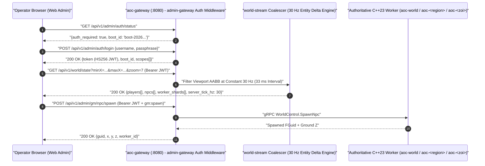

# SandalCore Web Admin & GM Studio Reference (`docs/WEB_ADMIN.md`)

**Primary Diataxis Quadrant**: `Technical Reference` (`DOC-01`)
**Related Guides**: [Root Architecture Overview](../README.md) | [UI Style Guide & Design System](UI_STYLE_GUIDE.md) | [Configuration Reference](CONFIGURATION.md) | [Server Workers & Spatial Authority](SERVER_WORKERS.md) | [Control-Plane Services Reference](SERVICES.md) | [Web Admin SPA Component Reference](../src/clients/web-admin/README.md) | [`cmd/web-admin` Asset Server Reference](../src/server/services/cmd/web-admin/README.md) | [`cmd/admin-gateway` API Reference](../src/server/services/cmd/admin-gateway/README.md) | [`cmd/gateway` Reference](../src/server/services/cmd/gateway/README.md) | [Go Control-Plane Services Reference](../src/server/services/README.md)

This document specifies the architecture, authentication lifecycle, viewport-bounded real-time entity streaming, interactive map selection ergonomics, Game Master (GM) manipulation modals, and 4-zone observability explorer implemented by the SandalCore Web Admin & GM Studio (`https://localhost:8443/admin/` via `aoc-ingress-proxy` or `http://localhost:8090` via `aoc-web-admin`).

---

## 1. Startup Passphrase & Scoped `HS256` JWT Authentication

To protect live world manipulation, SQL hotfix execution, and container lifecycle endpoints without requiring external OAuth providers during local or private-server operation, SandalCore enforces a **Startup Passphrase -> Scoped `HS256` JWT** authentication pipeline (`src/server/services/internal/admin-gateway/router.go`).

### Authentication Lifecycle & `boot_id` Session Invalidation

1. **Startup Passphrase Generation & Console Banner**:
   - On every `start.bat` / `sandal.ps1 up` invocation, `scripts/lib/Env.psm1` (`Ensure-SandalAdminPassphrase`) generates a fresh cryptographic passphrase (`AOC_ADMIN_PASSPHRASE`, e.g., `verra-xxxx-xxxx-xxxx`), a 256-bit signing key (`AOC_ADMIN_JWT_SECRET`), and a unique boot identifier (`AOC_ADMIN_BOOT_ID`).
   - The passphrase is written to `deploy/.admin_passphrase` and printed prominently in the terminal startup banner alongside `Username: admin`.
2. **Passphrase-to-JWT Exchange (`POST /api/v1/admin/auth/login`)**:
   - Submitting `{"username": "admin", "passphrase": "<passphrase>"}` to `POST /api/v1/admin/auth/login` validates the credentials using constant-time comparison (`subtle.ConstantTimeCompare`) and returns a signed `HS256` Bearer JWT (`token`), `expires_at`, `boot_id`, and granted `scopes`.
3. **Extensible Scope Matrix**:
   - Every issued JWT embeds an explicit `scopes` array checked by middleware on `aoc-gateway`:
     - `admin:read` -- Read world state, entity inspector, catalog tables, and map layers.
     - `admin:write` -- Modify server runtime parameters and administrative settings.
     - `gm:commands` -- Execute NPC lifecycle commands (`KillNpc`, `DespawnNpc`, `HealNpc`, `ResetNpc`, `RespawnNpc`, `MoveNpc`).
     - `gm:spawn` -- Spawn dynamic NPCs and monsters (`SpawnNpc`).
     - `gm:teleport` -- Teleport online or offline players across coordinates and workers (`TeleportPlayer`).
     - `gm:node_governance` -- Change CityNode progression stages (`0..6`), tax rates, and node buildings.
     - `gm:sql_hotfix` -- Execute audited SQL hotfix transactions against `aoc-postgres` or `content.db`.
     - `metrics:read` -- Query Prometheus Golden Signals, USE/RED container metrics, and worker shard telemetry.
     - `containers:manage` -- Trigger container restart/recreate actions from the Infrastructure panel.
4. **Automatic `boot_id` Verification & Re-Authentication Modal**:
   - Every JWT carries the server stack's `boot_id` claim (`AOC_ADMIN_BOOT_ID`), and `GET /api/v1/admin/auth/status` returns the live `boot_id`.
   - When the server stack restarts (`stop.bat` -> `start.bat`), `AOC_ADMIN_BOOT_ID` rotates. Any browser tab holding a token from a previous boot receives `401 Unauthorized` / `403 Forbidden` (or detects `status.boot_id != token.boot_id`), automatically purges the stale token from `sessionStorage`/`localStorage`, and opens the glassmorphic **Admin Login Modal** prompting for the new console passphrase.

---

## 2. Viewport-Bounded Entity Streaming & Constant `30 Hz` (`33 ms`) Update Rate

Rendering thousands of continent-wide NPCs and players simultaneously in a browser tab wastes network bandwidth and GPU frame budget. The Web Admin map (`src/clients/web-admin/src/map/VerraMapCanvas.tsx` and `src/state/worldStreamStore.ts`) combines **server-side viewport AABB culling** with a **constant `30 Hz` (`33 ms` interval) update cadence across all zoom levels**:

### Viewport AABB Culling (`minX`, `minY`, `maxX`, `maxY`)

Every entity poll and WebSocket subscription sends the active camera bounding box in Unreal world centimeters (`minX`, `minY`, `maxX`, `maxY`) to `aoc-gateway` (`/api/v1/world/state`, `/api/v1/admin/world/entities`, and `/api/v1/admin/world/stream`). The Go `world-stream` coalescer (`src/server/services/internal/world-stream/coalescer.go`) filters the authoritative entity snapshot in $O(N)$ over cache-hot slices so only entities inside the operator's visible viewport (plus a margin around the screen edges) are serialized over the wire.

### Constant `30 Hz` (`33 ms` Interval) Polling Across All Zoom Levels (`z0..z7+`)

Web Admin polls `/api/v1/world/state` at a constant **`30 Hz`** (`33 ms` interval, `DEFAULT_MAP_POLL_HZ = 30`) across all map zoom levels (`z0` continent overview through `z7+` street-level settlement inspection), matching the server's `30 Hz` simulation cadence for real-time player and NPC movement telemetry:

| Map Zoom Level (`z`) | Stream / Poll Frequency (`Hz`) | Poll / Frame Interval (`ms`) | Operational View Scale |
|:---:|:---:|:---:|:---|
| **`z0..z1`** | **`30 Hz` (constant)** | `33 ms` (`33.3 ms`) | Full Verra continent & multi-region strategic view (`2,150 km^2` macro view) |
| **`z2..z3`** | **`30 Hz` (constant)** | `33 ms` (`33.3 ms`) | Single biome region (`aoc-riverlands`, `aoc-sandsquall`) & multi-ZOI cluster view |
| **`z4..z5`** | **`30 Hz` (constant)** | `33 ms` (`33.3 ms`) | Single Zone of Influence (ZOI) & settlement perimeter view |
| **`z6..z7+`** | **`30 Hz` (constant)** | `33 ms` (`33.3 ms`) | CityNode `1 km x 1 km` OBB plug perimeter & 1:1 street-level combat/NPC pathing parity |

---

## 3. Tile-Clipped Inward ZOI Borders (`27` Settlement & Divine Gate ZOIs)

The Web Admin map renders the exact **27 in-game Zone of Influence (ZOI)** Voronoi territories (`src/clients/web-admin/src/map/verraZoiPolygons.ts`, sourced from `zoi_polygons.tsv` in `content.db` `v41`), covering all 22 Economic/Settlement nodes (`winstead`, `joeva`, `halcyon`, `new_aela`, `miraleth`, `sunhaven`, `azmaran`, etc.) and 5 Divine Gate territories:

- **Tile-Clipped Coastline & World-Edge Geometry**: Outer Voronoi rays are clipped tightly against the playable tile pyramid footprint (`[-1,433,600 .. +716,800]` cm X, `[-1,331,200 .. +819,200]` cm Y) so ZOI borders never bleed into unplayable ocean void.
- **Inward-Offset Double-Stroke Borders**: Adjacent ZOI polygons share exact mathematical edges. To allow operators to distinguish which ZOI owns which side of a border at any zoom level, `VerraMapCanvas.tsx` renders an inward-offset biome-tinted stroke along the interior of each polygon alongside the shared boundary line.
- **Rotated `1 km x 1 km` CityNode OBB Plugs**: Toggling the **Node Plugs (`1 km`)** layer renders the exact rotated `100,000 cm x 100,000 cm` CityNode Oriented Bounding Boxes (`node_plug_bounds.tsv`), showing the boundary between `aoc-<city-name>` Node Plug workers and `aoc-<zoi-name>` ZOI workers.

---

## 4. Strictly Mutually Exclusive Map Selection & Searchable GM Action Modals

### Strictly Mutually Exclusive Map Selection (`4` Selection Modes)

Clicking on the Verra map canvas enforces a **strictly mutually exclusive selection state** (`SelectionState` in `src/clients/web-admin/src/main.tsx`). Selecting any one target atomically clears the other three so the right-hand Inspector drawer never displays ambiguous or overlapping context:

1. **`Entity` Selection (`Player` or `NPC`)**: Clicking an online player marker or live NPC marker selects that actor (`selectedEntity`), highlights its velocity vector and tether/home radius, and opens the **Entity Inspector** (displaying live HP/Mana, 128-bit `FGuid`, owning worker shard `aoc-*`, coordinates, and one-click GM actions: `Heal`, `Kill`, `Reset`, `Respawn`, `Despawn`, `Move Here`, or `Teleport Player`).
2. **`Map Position` Selection (Ground Pin `(x, y, z)`)**: Clicking open terrain drops a high-precision ground pin (`selectedMapPin`), resolves the owning region, ZOI, and CityNode OBB, and presents two primary action buttons in the Inspector: **`Teleport Player Here...`** and **`Spawn NPC / Monster Here...`**.
3. **`CityNode` Selection (`NodeRecord`)**: Clicking one of the 85 settlement markers selects that CityNode (`selectedCityNode`), highlights its parent ZOI polygon and `1 km x 1 km` Node Plug OBB, and opens the **CityNode Governance Inspector** (allowing live `Tier 0..6` progression changes, population inspection, and building slot management).
4. **`POI` Selection (`Point of Interest`)**: Clicking a dungeon, ruin, shrine, or outpost marker selects that POI (`selectedPoi`) and displays its content GUID, biome tags, level range, and associated spawner definitions.

### Searchable `Teleport Player Here...` & `Spawn NPC / Monster Here...` Modals

When an operator clicks a ground pin (`Map Position`) or triggers a GM action from the inspector (`src/clients/web-admin/src/components/NodeGovernanceAndSpawnModals.tsx`):

- **`Teleport Player Here...` Modal**:
  - Displays the target world coordinates `(X, Y, Z)` (with automatic server-side terrain/platform $Z$ snapping when $Z = 0$) and the destination server worker (`aoc-<region>`, `aoc-<zoi>`, or `aoc-<city>`).
  - Provides an instant fuzzy-search filter across all online and registered characters by character name, account email, character GUID, or current zone, plus manual coordinate override fields.
- **`Spawn NPC / Monster Here...` Modal**:
  - Searches the server's `admin-catalog` (`npcs.tsv` / `content.db` `v41`) across `4,200+` authentic NPC and monster definitions by display name, internal tag, level, faction, or `60100001` design GUID.
  - Allows configuring spawn level, faction override, respawn timer, and count before dispatching `POST /api/v1/admin/gm/npc/spawn` to the authoritative worker.

---

## 5. Zero-Redundancy 4-Zone Analytics & Structured Logs Explorer

The **Analytics & Logs** workspace (`src/clients/web-admin/src/components/LogsAndContainersTab.tsx`) consolidates cluster observability into **4 non-overlapping zones** with zero duplicate metric cards:

| Zone | Title & Scope | Key Signals & Operator Controls |
|:---:|:---|:---|
| **Zone 1** | **Google SRE Four Golden Signals Banner** | Top-level KPI strip aggregating cluster-wide **Latency** (tick duration $p50 / p99$ vs. frame budget), **Traffic** (active UDP sessions, packets/sec, gRPC RPS), **Errors** (failed RPCs, dropped frames, auth rejections), and **Saturation** (worker tick budget utilization `%` and SQLite/Postgres pool pressure). |
| **Zone 2** | **Dynamic Server Worker Shards Table** | Live table of all registered `aoc-world` / `aoc-<region>` / `aoc-<zoi>` / `aoc-<city>` workers showing `worker_index`, spatial tier (`world | region | zoi | node_plug | polygon_cutout`), target vs. actual Tick Rate (`10 Hz` / `20 Hz` / `30 Hz`), active player count, spawned NPC count, `.tsv` storage mode (`memory` vs. `disk`), and handover counters. |
| **Zone 3** | **USE / RED Container Matrix** | Per-container row matrix across all active Linux containers (`aoc-postgres`, `aoc-auth`, `aoc-character`, `aoc-citynode`, `aoc-quest`, `aoc-mesh`, `aoc-mesh-gateway`, `aoc-gateway`, `aoc-web-admin`, `aoc-ingress-proxy`, and `aoc-*` world workers) reporting **Utilization** (CPU `%`, RSS memory MB), **Saturation** (run-queue / memory limit `%`), **Errors** (restart count, healthcheck status), and one-click container restart actions (`containers:manage` scope). |
| **Zone 4** | **Structured Logs & GM Audit Trail Explorer** | Real-time filterable log viewer querying structured JSON container logs and the persistent GM Audit Trail (`gm_audit_log`), with instant filtering by container service, severity (`INFO`, `WARN`, `ERROR`), worker shard, correlation/request ID, or free-text search. |
