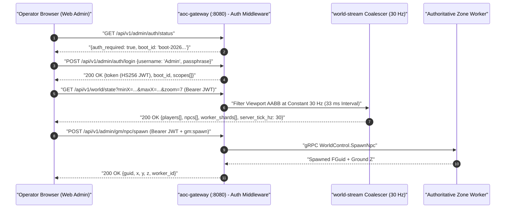

# Web Admin and GM Studio

**Related Guides**: [Root Overview](../README.md) | [Web Admin Architecture](WEB_ADMIN_ARCHITECTURE.md) | [UI Style Guide](UI_STYLE_GUIDE.md) | [Configuration Reference](CONFIGURATION.md) | [Operational Runbook](RUNBOOK.md) | [Server Workers](SERVER_WORKERS.md) | [Web Admin Frontend Source](../src/clients/web-admin/README.md)

This guide explains how to sign in to the SandalCore **Web Admin and GM Studio** (`https://localhost:8443/admin/` or `http://localhost:8090`), navigate the live `30 Hz` world map, inspect and manipulate players, NPCs, City Nodes, and resource nodes, adjust worker tick rates and the Verra calendar, and monitor container health in the **Observability** tab.

---

## Signing In and Session Security

SandalCore protects all Game Master commands, SQL hotfixes, and container controls with a single-boot passphrase exchanged for a scoped `HS256` JWT (`src/server/services/internal/admin-gateway/router.go`).

### How to Sign In

1. **Copy the Startup Passphrase from the Terminal**:
   When you run `.\start.bat` (`.\sandal.ps1 up`), PowerShell generates a fresh single-boot passphrase (`AOC_ADMIN_PASSPHRASE`), saves it to `deploy/.admin_passphrase`, and prints it in the startup banner alongside `Username: Admin`.
2. **Open the Web Admin Studio**:
   Navigate to `https://localhost:8443/admin/` (or `http://localhost:8090`) in your browser. The glassmorphic **Admin Login Modal** appears automatically.
3. **Exchange the Passphrase for a Session Token**:
   Enter username **`Admin`** and paste the passphrase. The gateway verifies the passphrase in constant time (`POST /api/v1/admin/auth/login`) and returns a signed `HS256` Bearer JWT bound to the server's current `boot_id`.
4. **End or Rotate Your Session**:
   Click **`END SESSION`** in the top bar at any time to sign out immediately. If you stop and restart the server stack (`stop.bat` -> `start.bat`), `AOC_ADMIN_BOOT_ID` rotates automatically, invalidating any previously stored browser token and prompting you for the new boot passphrase.

### Permission Scopes

Every issued admin JWT includes explicit permission scopes verified by `aoc-gateway`:

- `admin:read` and `admin:write` for viewing world state, catalogs, and updating runtime parameters.
- `gm:commands`, `gm:spawn`, `gm:teleport`, and `gm:node_governance` for executing NPC lifecycle commands, spawning monsters, teleporting players, and changing City Node stages (`0..6`).
- `gm:sql_hotfix` for previewing, applying, and rolling back audited SQL hotfixes.
- `metrics:read` and `containers:manage` for viewing SRE telemetry and restarting containers from the **Observability** tab.

---

## Real-Time `30 Hz` Map Streaming and Layers

The **Map** workspace (`src/clients/web-admin/src/map/VerraMapCanvas.tsx`) renders an interactive orthographic map of Verra backed by `verra.pmtiles` and real-time entity streaming:

- **Viewport-Bounded Culling**: Every poll sends your camera's visible bounding box in world centimeters (`minX`, `minY`, `maxX`, `maxY`) to `/api/v1/world/state` so only entities inside your view are serialized over the network.
- **Constant `30 Hz` (`33 ms`) Update Rate**: Web Admin polls `/api/v1/world/state` at a constant **`30 Hz`** (`33 ms` interval) across all zoom levels (`z0` continent overview through `z7+` street-level view) without entity downsampling flicker. When you zoom in to `zoom >= 3.0`, the map automatically switches to high-resolution `z=7` minimap tiles (`TUI_s50000`).
- **Strict 3-Tier `VerraMapCanvas` Render Order and `z=9` POI Icons**: `VerraMapCanvas` renders map layers in three tiers so settlements and landmarks stay clear above live entities: (`1`) base tiles, rotated `1024x1024` Node Plug overlays, ZOI borders, and all live world entities first, (`2`) standard POIs second, and (`3`) Node Plug / City Node POIs last on top of all other POI types and entities using real `verra.pmtiles` `z=9` icon texture names (`TUI_Icon_Map_Node_Dock`, `TUI_Icon_Map_Siege`, `TUI_Icon_Map_HomeShrine`, `TUI_Icon_NodeSummary_NodeEmblem_*`, `TUI_Icon_Node_LVL3`). Every POI type and Ember Spring supports click-to-select (`cursor: pointer`, `#d4af37` selection ring, and full `EntityInspector` metadata), paired with a bottom-left vertical entity legend (`data-testid="map-entity-legend"`, `flexDirection: "column"`).
- **Authentic Resource Nodes and Foliage**: Gatherable resource nodes and foliage markers on the map are populated strictly from extracted client data (`region_foliage.tsv` painted `AIntrepidStateIFA` instances modeled by the 2D convex hull polygon or brush circle of the exact definition, and `content.db` dynamic `RandomGatherableSpawnersDefRecordBase` circle spawners served as `AGatherableActor`), using retail packet captures (`pcap_resource_spawners.tsv`) strictly as a last-resort fallback (`+ kAreaEpsilonCm` containment margin) with zero synthetic catalogs.
- **3-Pass ZOI Borders and `1 km x 1 km` City Node Plugs**: Toggling **ZOI Borders** renders all 27 Settlement and Divine Gate Voronoi territories with biome-tinted interior fills and glow strokes. Toggling **Worker Grid** or **City Nodes** overlays the rotated `1 km x 1 km` City Node OBB boundaries and active server worker authority boxes.

| Map Zoom Level | Poll Frequency | Poll Interval | Typical Camera View |
|:---:|:---:|:---:|:---|
| **`z0..z1`** | **`30 Hz` (constant)** | `33 ms` | Full Verra continent and multi-region overview |
| **`z2..z3`** | **`30 Hz` (constant)** | `33 ms` | Single biome region (`aoc-riverlands`, `aoc-sandsquall`) and ZOI cluster (`z=7` tiles at `zoom >= 3.0`) |
| **`z4..z5`** | **`30 Hz` (constant)** | `33 ms` | Single Zone of Influence (ZOI) and settlement perimeter |
| **`z6..z7+`** | **`30 Hz` (constant)** | `33 ms` | `1 km x 1 km` City Node OBB plug and street-level NPC/player movement |

---

## Inspecting Entities, Controlling City Nodes, and Spawning Actors

### Mutually Exclusive Map Selection

Clicking on the map canvas selects one target at a time in the top-right inspector slot (`unified-map-inspector-slot`, `width: 360px`), automatically clearing any previous selection so the inspector never shows overlapping cards:

1. **Player, NPC, Monster, Mount, or Resource Node (`Entity`)**: Clicking any live marker opens the **Entity Inspector**, displaying its live health/mana, 128-bit `FGuid`, owning server worker (`aoc-*`), world coordinates `(X, Y, Z)` cm, and (for resource nodes) its **`Resource Type`** and **`Quality / Rarity`**. For NPCs and monsters, one-click buttons let you **Heal**, **Kill**, **Reset**, **Respawn**, **Despawn**, or **Nudge** the actor.
2. **Ground Coordinate Pin (`Map Position`)**: Clicking open terrain drops a coordinate pin showing `(X, Y, Z)` cm and the owning worker, with buttons to open **`Teleport Player`**, **`Give Currency / Item`**, or **`Spawn NPC`**.
3. **Settlement Marker (`CityNode`)**: Clicking any of the 85 settlements opens the **City Node Governance Card**, where you can set its progression stage (`Stage 0..6`: `Wilderness` to `Metropolis`), add `+1,000` or `+10,000 XP`, update mayor/tax settings via the searchable `Set Mayor` player picker, or teleport players and spawn NPCs directly at that settlement.
4. **Point of Interest or Ember Spring (`POI`)**: Clicking any POI marker (`Harbor / Port`, `Siege Camp`, `Ember Spring / Home Shrine`, dungeon, ruin, or Node Plug) highlights it with a `#d4af37` ring and displays its content GUID, category/subtype tags, world coordinates, and associated spawners in `EntityInspector`.

### Single-Control Teleport, Give Item, Spawn NPC, and Node Governance Modals

All Game Master action modals use a single searchable control per field (`0` duplicate preset chip strips below comboboxes and `0` fabricated catalog items or NPCs):

- **`Teleport Player` Modal**: Supports three explicit destination modes (`"Player -> Named Place"`, `"Player -> Destination Player"`, and `"Player -> Map Location (X, Y, Z)"`), automatically snapping $Z$ to the terrain or town platform when $Z = 0$ and filtering online or offline characters by name, account, or zone.
- **`Give Currency / Item` Modal**: Searches the extracted `items.tsv` / `content.db` (`v41`) item catalog through a single searchable combobox and grants currency or items to the selected character.
- **`Spawn NPC` Modal**: Searches the extracted `npcs.tsv` / `content.db` (`v41`) catalog across `4,200+` authentic NPC and monster definitions by name, tag, faction, or GUID, letting you choose the spawn level before dispatching `POST /api/v1/admin/gm/npc/spawn`.
- **`Node Governance` (`Set Mayor`) Modal**: Provides a single searchable player picker to assign an existing character as settlement mayor alongside stage (`0..6`), XP, and tax controls.

### World Clock, 4-Season Verra Calendar, and Per-Worker Tick Rates

- **Top-Bar Clock and `VerraCalendarPopover`**: Verra time, date, and season control is located solely in the top-bar `VerraCalendarPopover` (`zIndex >= 100`, with no `Set Time / Date` card on the **Observability** tab). Clicking the **`Time HH:MM:SS`** pill or **`Set Time`** button in the top bar opens the popover, where you can jump to time presets (**06:00 Dawn**, **12:00 Noon**, **18:00 Dusk**, **00:00 Night**), enter a custom `HH:MM` time, or adjust the **360-day Verra Calendar** (`Year >= 1 AE`) across the **`4 x 90`-day seasons** (**`Spring`**, **`Summer`**, **`Autumn`**, and **`Winter`**, `360`-day year, `9x` clock speed). All changes are persisted in PostgreSQL (`world_simulation_state`) by `mesh-gateway` and synchronized mesh-wide (`time_of_day_hours`, `calendar_year`, `calendar_day_of_year`) to every server worker.
- **`Visible Server Workers` Panel**: The bottom-right worker panel (`fixed 450px x 208px` with vertical scrolling for `> 6` workers) lists every worker intersecting your viewport. Clicking a worker row zooms the map to its territory. Each row includes a target tick-mode dropdown that defaults to **`Dynamic (30-60 Hz)`** (`target_tick_hz: -1`, `tick_mode: "dynamic"`, `30-60 Hz` (`kMaxDynamicHz = 60`) adaptive range) alongside **`0 Hz (Off)`** (`0 Hz (Pause NPCs)`) and manual **`10, 15, 20, 25, 30, 40, 50, 60 Hz`** rates, paired with a read-only **`Actual Hz` / `Current Hz`** badge (`aria-readonly="true"`) fed by live `aoc_world_tick_hz` telemetry.

---

## Observability Tab

Clicking the **`Observability`** tab in the top navigation bar opens the cluster monitoring and log workspace (`src/clients/web-admin/src/components/LogsAndContainersTab.tsx`) with plain-English headings (`0` `"OTel"`, `"Scrape"`, or `"Series"` jargon and `0` `Set Time / Date` cards):

| Zone | Panel Name | What It Shows and Controls |
|:---:|:---|:---|
| **Zone 1** | **`Simulation`, `World Population`, `Traffic & Cache`, and `Errors & Saturation`** | Four summary KPI cards: - **`Simulation`**: `Tick Hz (p50 / p99)` and `Publish Avg / Max` (`30 Hz`). - **`World Population`**: `Total Entities` equals the exact sum of the **9 mutually-exclusive categories** (`Players`, `NPCs`, `Monsters`, `Huntables`, `Trees`, `Rocks`, `Ore & Gems`, `Plants`, and `Mounts`) with `0` double-counted entities. - **`Traffic & Cache`**: `Gateway Requests`, **`API Cache Hits / Misses`** (with hit percentage), and `UDP Frames Forwarded`. - **`Errors & Saturation`**: `Gateway Errors / Retries` (`<errors> / <retries>`), `Active Containers`, and **`Monitored Metrics`** (`active` metrics and metric groups). |
| **Zone 2** | **`World Workers` Table** | Live table of all registered `aoc-*` workers in `worker_index` order (`#0..#N`), with discrete columns for **`Scope Tier`**, **`Target Tick Mode`** (default **`Dynamic (30-60 Hz)`** with `target_tick_hz: -1`, `tick_mode: "dynamic"`, `30-60 Hz` (`kMaxDynamicHz = 60`) adaptive range, `0 Hz (Pause NPCs)`, or manual `10, 15, 20, 25, 30, 40, 50, 60 Hz`), and read-only **`Current Hz`** (`Actual Hz`, `aria-readonly="true"`, fed by live `aoc_world_tick_hz` telemetry), plus `Tick p50 / p99` and counts for `Total Entities`, `Players`, `NPCs`, `Monsters`, and `Resources`. |
| **Zone 3** | **`Container Metrics & Analytics`, `Service Routing & Connection Health`, and `Telemetry & Metrics`** | - **`Container Metrics & Analytics`**: Per-container table with plain-English headings (`Container`, `Image`, `State / Status`, `CPU %`, `Memory (Used / Limit / %)`, **`Processes`**, `Net RX / TX`, **`Health (Status / Metrics / Latency)`**, and `Logs`). - **`Service Routing & Connection Health`**: Per-route `<Service Name> (<Protocol>)` cards showing total requests, **`2xx` / `3xx` / `4xx` / `5xx`** HTTP status classes per route, timeouts, active connections, and healthy members. - **`Telemetry & Metrics`**: Polls cluster-internal `/metrics` endpoints (`http://mesh-gateway:8082/metrics`, `http://<worker>:8080/metrics`, `http://<service>:18080/metrics`, with `0` `127.0.0.1` or `localhost` addresses) and displays each target's status (`UP` / `DOWN`), **`Monitored Metrics`** count, and response latency (`ms`). |
| **Zone 4** | **`Log Explorer` and `GM Audit Log`** | Real-time viewer for container `stdout`/`stderr` JSON logs and the persistent `gm_audit_log` ledger, featuring container, stream, and severity (`ALL`, `ERROR`, `WARN`, `INFO`, `DEBUG`) filters plus **`Auto Tail`** (pause/resume live polling) and **`Auto Follow`** (pin scroll to bottom) toggles. |
