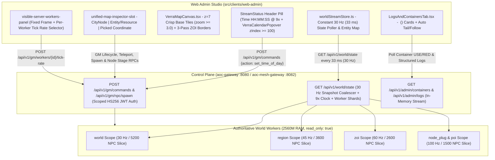

# Web Admin Architecture

**Related Guides**: [Root Overview](../README.md) | [Web Admin Studio](WEB_ADMIN.md) | [UI Style Guide](UI_STYLE_GUIDE.md) | [Operational Runbook](RUNBOOK.md) | [Server Workers](SERVER_WORKERS.md) | [Web Admin Frontend Source](../src/clients/web-admin/README.md)

This document explains the internal architecture of the SandalCore **Web Admin and GM Studio** (`src/clients/web-admin` and `src/server/services/cmd/mesh-gateway`). It covers the constant `30 Hz` (`33 ms`) entity telemetry pipeline, PostgreSQL simulation state persistence (`world_simulation_state` and `city_node_state`), the continuous `9x` world clock and authentic 4-season Verra Calendar, `z=7` map tile rendering, 3-pass ZOI border geometry, authentic resource node provenance, and the **Observability** workspace.

---

## Real-Time `30 Hz` Telemetry Pipeline

### Zero-Flicker `30 Hz` Client Store

1. **Constant `30 Hz` (`33 ms`) Polling Cadence**:
   `worldStreamStore.ts` (`DEFAULT_MAP_POLL_HZ = 30`) polls `/api/v1/world/state` every `33 ms` across all zoom levels (`z0..z7+`). Instead of dropping or downsampling markers when the camera pans or zooms, the store merges incoming entity snapshots into a persistent `Map<string, WorldEntity>` keyed by `guid`, eliminating marker flicker while keeping HTML5 canvas rendering smooth at `60 FPS`.
2. **Scope-Tuned Server Worker Tick Rates and Default `Dynamic` Mode**:
   Authoritative server workers default to **`Dynamic`** tick mode (`target_tick_hz: -1`, `tick_mode: "dynamic"`), automatically scaling between **`30 Hz` and `120 Hz`** around their spatial scope baseline (`30 Hz` for `world`, `45 Hz` for `region`, `60 Hz` for `zoi`, and `100 Hz` for `node_plug` and `poi`) so container CPU usage stays in the `30%--45%` green operating band inside a `2560M` (`2.5 GiB`) RAM limit while reporting their live read-only `Current Hz` (`Actual Hz`) via `aoc_world_tick_hz`.
3. **Read-Only Containers and Zero Disk Log Churn**:
   Every container in `src/deploy/compose.yml` mounts its root filesystem with `read_only: true` and uses RAM-backed `tmpfs` mounts at `/tmp` and `/app/logs`, writing structured JSON logs only to `stdout`/`stderr`.

---

## Simulation State Persistence and the 4-Season Verra Calendar

### PostgreSQL Single Source of Truth in `mesh-gateway`

`aoc-mesh-gateway` (`src/server/services/internal/admin-gateway/sim_persistence.go` and migration `0025_world_simulation_state.sql`) persists cluster-wide simulation settings and settlement governance in PostgreSQL:

- **`world_simulation_state`**: Stores `time_of_day_anchor_hours`, `time_of_day_anchor_at`, `calendar_anchor_year`, `calendar_anchor_day`, `time_scale = 9.0`, `simulate_all_npcs`, `worker_tick_mode`, and per-worker `worker_tick_hz` overrides, and synchronizes `time_of_day_hours`, `calendar_year`, and `calendar_day_of_year` mesh-wide to all `world` workers.
- **`city_node_state`**: Stores each settlement's `node_guid`, `node_id`, progression `level` (`0..6`), `experience`, `mayor_character_id`, `mayor_name`, `tax_rate_pct`, `treasury_gold`, and `buildings`. When a settlement advances to Tier `5` (`City`) or Tier `6` (`Metropolis`), `src/server/world/spawns/node_population.cpp` automatically falls back to the highest authored population layout in `content.db` (Tier `4` `Town`, `kMaxAuthoredNodePopLevel = 4`) so high-tier cities remain fully populated.

### Continuous `9x` Clock and Authentic `content.db` Seasons

- **Continuous `9x` World Clock**: `mesh-gateway` and `aoc-world` advance in-game time of day at `9x` real time (`9` in-game seconds per `1` real-world second, or `2 hours 40 minutes` real time per `24-hour` in-game day).
- **360-Day Verra Calendar and Authentic Seasons**: Completed in-game days roll into a **360-day Verra Calendar** (`Year >= 1 AE`) divided into the **`4 x 90`-day authentic `content.db` seasons** (**`Spring`**, **`Summer`**, **`Autumn`**, and **`Winter`**), where each season spans `3` months of `30` days (`90` days per season, `360` days per year).
- **Top-Bar `VerraCalendarPopover` Only**: Verra time, date, and season control is located solely in the top-bar `VerraCalendarPopover` (`VerraCalendarPopover.tsx`, `zIndex >= 100`, with no `Set Time / Date` card on the **Observability** tab). Clicking the **`Time HH:MM:SS`** pill or **`Set Time`** button in the top bar opens the popover above the map canvas and side panels, where operators can trigger one-click time presets (**06:00 Dawn**, **12:00 Noon**, **18:00 Dusk**, **00:00 Night**), jump to season starts (**Spring D1**, **Summer D91**, **Autumn D181**, **Winter D271**), or set an exact `Year (AE)`, `Month (1-12)`, `Day (1-30)`, and `HH:MM` clock value.

---

## Map Tile Pyramid, ZOI Borders, and Worker Controls

### Crisp `z=7` Base Tiles at `zoom >= 3.0`

`verraTilePyramidRenderer.ts` promotes the minimap tile pyramid to its sharpest **`z=7` (`128 x 128` tile grid, `TUI_s50000`)** resolution as soon as camera zoom reaches **`zoom >= 3.0`**. Unloaded or out-of-bounds areas clear to pure black (`#000000`) so there is never a white or grey flash during fast pans.

### Three-Pass ZOI Border Rendering

`verraTilePyramidRenderer.ts` and `verraZoiPolygons.ts` render all **27 Zone of Influence (ZOI)** territories in three passes:

1. **Interior Biome Fill**: Fills each ZOI polygon at `0.05` alpha using its in-game banner hue (`#E89B32` gold, `#38BDF8` cyan, `#4ADE80` green, `#C084FC` purple, `#F87171` coral).
2. **Outer Glow Stroke**: Strokes the polygon perimeter at `4.0px` width and `0.22` alpha (`lineJoin: "round"`).
3. **Crisp Inner Border and Label**: Draws the `1.6px` (`0.68` alpha) border line and renders `700 11px` `#F6CC7E` uppercase ZOI labels at `zoom >= 1.8`.

### Fixed-Frame `Visible Server Workers` Panel and Tick Rate Selector

The **`Visible Server Workers`** panel on the Main Page and the **`World Workers`** table on the Observability Page share a unified worker tick model (`resolveWorkerTickFields` in `worldStreamStore.ts`). On the map workspace, the panel uses a fixed outer frame (`450px x 208px`) and a fixed `176px` scrollable list (`overflowY: "auto"`, `scrollbarGutter: "stable"`). When more than 6 workers are active, the list scrolls vertically without resizing the panel or shifting nearby HUD cards.

Each worker row provides click-to-zoom navigation, a **`Target Tick Mode`** selector, and a read-only **`Actual Hz` / `Current Hz`** badge (`aria-readonly="true"`):

- **`Dynamic` (`target_tick_hz: -1`, `tick_mode: "dynamic"`, `30..120 Hz` adaptive range)**: The default mode on both the Main Page Server List and the Observability Page. Auto-scales the worker's simulation frequency between `30 Hz` and `120 Hz` in `5 Hz` steps based on a 15-tick EWMA CPU utilization window to stay within the `30%--45%` CPU band.
- **Read-Only `Actual Hz` / `Current Hz` (`aria-readonly="true"`)**: Displays the worker's live actual tick rate (`Hz`) reported by `aoc_world_tick_hz` telemetry.
- **`0 Hz (Pause NPCs)` (`0 Hz (Off)`)**: Pauses ambient NPC AI simulation on **just that worker** while keeping player sessions and GM commands responsive.
- **Manual Rates (`10, 15, 20, 25, 30, 40, 50, 60 Hz`)**: Locks the worker to a fixed manual tick rate (`tick_mode: "manual"`), backed by a `<= 1.0 s` (`>= 1 Hz`) entity service floor so every spawned NPC is stepped at least once per second.

---

## Authentic Resource Node Provenance and World Population

SandalCore enforces strict data provenance for all gatherable resources, foliage, and world population counts:

- **Painted Foliage (`AIntrepidStateIFA`) vs. Dynamic Circle Spawners (`AGatherableActor`)**:
  `aoc-world` serves painted `UIntrepidGatherableFISMC` foliage instances (`588,362` in `region_foliage.tsv`) as per-cell `AIntrepidStateIFA` state actors modeled by the 2D convex hull polygon or brush circle of the exact definition (`+ kAreaEpsilonCm`), and spawns dynamic `RandomGatherableSpawnersDefRecordBase` definitions (`97` in `content.db`, `2,500 cm` to `50,000 cm` circle radius) as `AGatherableActor` actors that rotate across candidate ground coordinates on respawn. Retail packet captures (`pcap_resource_spawners.tsv`) are used strictly as a last-resort fallback (`0` synthetic catalogs and `0` `AOC_WORLD_MAX_*` or `max_gatherables` caps).
- **9 Mutually-Exclusive World Population Categories**:
  `computeMutuallyExclusivePopulation` (`LogsAndContainersTab.tsx`) classifies every live world entity into **9 mutually-exclusive categories** (**`Players`**, **`NPCs`**, **`Monsters`**, **`Huntables`**, **`Trees`**, **`Rocks`**, **`Ore & Gems`**, **`Plants`**, and **`Mounts`**) so **`Total Entities`** always equals their exact sum (`0` double-counted entities).
- **Inspector Metadata (`Resource Type` and `Quality / Rarity`)**:
  Clicking any resource node marker on the map opens the Entity Inspector and displays its **`Resource Type`** (`Ore`, `Wood`, `Herb`, `Stone`, `Fiber`, `Gem`, `Fish`) and **`Quality / Rarity`** (`Common` through `Artifact` with `q1..q200` quality) alongside its `(X, Y, Z)` cm coordinates and owning worker shard.

---

## Observability Workspace and Log Streaming

### Plain-English Summary Cards, Tables, and Cluster-Internal `/metrics` Endpoints

The **`Observability`** tab (`LogsAndContainersTab.tsx`) presents cluster health using plain-English headings (`Health (Status / Metrics / Latency)`, `Monitored Metrics`, `Processes`, with `0` `"OTel"`, `"Scrape"`, or `"Series"` jargon):

- **Top Summary Cards (`Simulation`, `World Population`, `Traffic & Cache`, `Errors & Saturation`)**:
  - **`Simulation`**: Displays `Tick Hz (p50 / p99)` (`>= 30 Hz` floor) and `Publish Avg / Max` (`ms`).
  - **`World Population`**: Displays `Total Entities` alongside the **9 mutually-exclusive categories** (`Players`, `NPCs`, `Monsters`, `Huntables`, `Trees`, `Rocks`, `Ore & Gems`, `Plants`, and `Mounts`).
  - **`Traffic & Cache`**: Displays `Gateway Requests`, **`API Cache Hits / Misses`** (requests served from memory vs. backend queries, with hit percentage), and `UDP Frames Forwarded`.
  - **`Errors & Saturation`**: Displays `Gateway Errors / Retries` (`<errors> / <retries>` composite format), `Active Containers`, and **`Monitored Metrics`** (`active` metrics and metric groups).
- **`World Workers` and `Container Metrics & Analytics` Tables**:
  - **`World Workers`**: Displays discrete columns for `Mesh #`, `Canonical Worker`, **`Scope Tier`**, **`Target Tick Mode`** (default **`Dynamic`** `30..120 Hz`), and read-only **`Current Hz`** (`Actual Hz`, `aria-readonly="true"` from `aoc_world_tick_hz`).
  - **`Container Metrics & Analytics`**: Displays `Container`, `Image`, `State / Status`, `CPU %`, `Memory (Used / Limit / %)`, **`Processes`**, `Net RX / TX`, **`Health (Status / Metrics / Latency)`**, and `Logs`.
- **`Service Routing & Connection Health` (`2xx` / `3xx` / `4xx` / `5xx` Status Classes)**:
  Formats every route card header using the **`<Service Name> (<Protocol>)`** convention (`Auth Service (gRPC)`, `Character Service (gRPC)`, `City Node Service (gRPC)`, `Quest Service (gRPC)`, `Mesh Directory (gRPC)`, `Gateway Service (HTTP)`, `Mesh Gateway (HTTP)`, `World Admin Service (gRPC)`, `Web Admin UI (HTTP)`, `Ingress Proxy (HTTPS/TLS)`) and reports per-route **`Requests`**, **`2xx`**, **`3xx`**, **`4xx`**, and **`5xx`** HTTP status classes, `Timeouts`, `Active Conn`, and `Healthy` members.
- **`Telemetry & Metrics` (Cluster-Internal `/metrics` Endpoints)**:
  Polls cluster-internal container DNS endpoints (`http://mesh-gateway:8082/metrics`, `http://<worker>:8080/metrics`, `http://<service>:18080/metrics`, never `127.0.0.1` or `localhost`) and reports each service's status (`UP` / `DOWN`), **`Monitored Metrics`** count, and response latency (`ms`).

### `Auto Tail` and `Auto Follow` Log Controls

The **`Log Explorer`** (`docker-log-tailer-card`) and **`GM Audit Log`** (`gm-audit-trail-strip`) provide two independent live-streaming controls in the log toolbar:

1. **`Auto Tail` (`logs-auto-tail-toggle`)**: Pauses or resumes background polling of container `stdout`/`stderr` log streams so you can freeze the view while reading a stack trace.
2. **`Auto Follow` (`logs-auto-follow-toggle`)**: Keeps the log scroll viewport pinned to the newest bottom line as logs arrive, automatically disengaging when you scroll up to inspect earlier lines.
