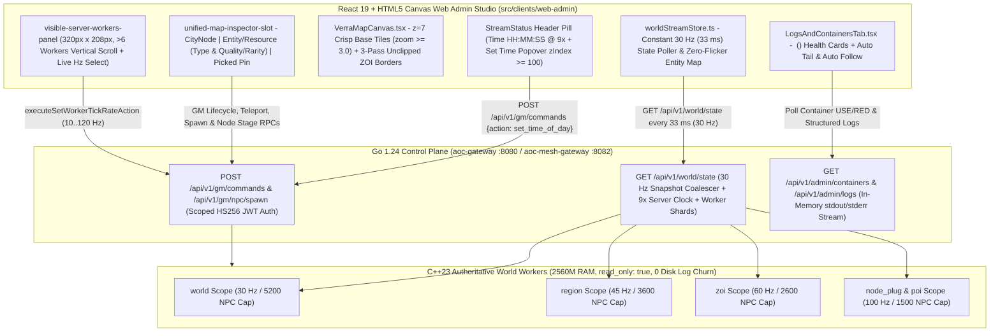

# SandalCore Web Admin & Real-Time Telemetry Architecture (`docs/WEB_ADMIN_ARCHITECTURE.md`)

**Primary Diataxis Quadrant**: `Explanation` & `Technical Reference` (`DOC-01`)
**Related Guides**: [Root Architecture Overview](../README.md) | [Web Admin & GM Studio Reference](WEB_ADMIN.md) | [UI Style Guide & Design System](UI_STYLE_GUIDE.md) | [Operational Runbook & `.env` Topologies](RUNBOOK.md) | [Server Workers & Spatial Authority](SERVER_WORKERS.md) | [Web Admin SPA Source Reference](../src/clients/web-admin/README.md)

This document explains the end-to-end architecture of the SandalCore **Web Admin & GM Studio** (`src/clients/web-admin` and `src/server/services/cmd/mesh-gateway`), detailing the constant `30 Hz` (`33 ms`) entity telemetry pipeline, per-worker tick-rate selector (`Dynamic (30-60 Hz)`, `0 Hz (Pause NPCs)`, and manual `10..60 Hz`) with Little's Law `<= 1.0 s` (`>= 1 Hz`) entity backlog floor, PostgreSQL (`world_simulation_state` + `city_node_state`) Control-Plane SSoT in `mesh-gateway` for continuous `9x` Time of Day + 360-day Verra Calendar (`Year >= 1 AE`, 4 seasons x 3 months x 30 days) and Tier 5/6 City Node population fallback, high-resolution `z=7` minimap tile rendering, 3-pass unclipped ZOI borders, data-driven Resource Node inspection (`Resource Type` & `Quality / Rarity`), and the 4-zone **Observability** workspace.

---

## 1. End-to-End `30 Hz` Telemetry Pipeline & Worker Resource Architecture

### Constant `30 Hz` (`33 ms`) Web Admin Tick Rate Without Entity Downsampling Flicker

1. **Constant `30 Hz` (`33 ms`) Client/Gateway Cadence**:
   - `worldStreamStore.ts` (`DEFAULT_MAP_POLL_HZ = 30`) polls `/api/v1/world/state` at a constant **`30 Hz` (`33 ms` interval)** across all zoom levels (`z0..z7+`).
   - Rather than downsampling or dropping NPC/monster/resource markers during camera pans or zoom transitions, the store merges authoritative snapshots into a stable `Map<string, WorldEntity>` keyed by entity `guid`, eliminating entity flicker while keeping frame rendering locked at `60 FPS`.
2. **Optimal Per-Scope Server Tick Rates (`30--120 Hz`) & Green CPU Band (`30%--45%`)**:
   - Authoritative C++23 workers run at scope-tuned default tick rates and per-step NPC AI caps so CPU utilization stays inside the **`30%--45%` green operational band**:
     - **`world`** (`single_world`): **`30 Hz`** tick rate / **`5200`** NPC step cap.
     - **`region`** (`single_riverlands`, `per_region`): **`45 Hz`** tick rate / **`3600`** NPC step cap.
     - **`zoi`** (`per_zoi`): **`60 Hz`** tick rate / **`2600`** NPC step cap.
     - **`node_plug` & `poi`** (`per_zoi_nodes_and_pois` cut-outs): **`100 Hz`** tick rate (tunable up to `120 Hz`) / **`1500`** NPC step cap.
3. **`2.5 GiB` (`2560M`) Worker Memory & Zero Disk Log Churn**:
   - Every world worker container enforces `AOC_WORLD_WORKER_MEM_LIMIT=2560M` (`2.5 GiB` RAM ceiling) with `content.db` (`:memory:`) and `area_nav.bin` preloaded in RAM.
   - All containers run with `read_only: true` root filesystems and in-memory `tmpfs` mounts at `/tmp` and `/app/logs`, producing **`0` disk log churn**.

---

## 2. PostgreSQL Control-Plane SSoT (`world_simulation_state` + `city_node_state`), `9x` Time of Day & 360-Day Verra Calendar

### Continuous `kGameTimeFactor = 9.0` Verra Clock & 360-Day Verra Calendar (`Year >= 1 AE`)

- **PostgreSQL Control-Plane SSoT in `mesh-gateway`**: `src/server/services/internal/admin-gateway/sim_persistence.go` and `0025_world_simulation_state.sql` persist `world_simulation_state` (`time_of_day_anchor_hours`, `time_of_day_anchor_at`, `calendar_anchor_year`, `calendar_anchor_day`, `time_scale = 9.0`, `simulate_all_npcs`, `worker_tick_mode`, `worker_tick_hz`) and `city_node_state` (`node_guid`, `node_id`, `level` `0..6` with Tier 5/6 population fallback to the last defined populated layout at Tier 4, `mayor_character_id`, `mayor_name`, `tax_rate_pct`, `treasury_gold`, `buildings`).
- **Authoritative Simulation Clock & 360-Day Verra Calendar**: `mesh-gateway` and `aoc-world` advance Verra's in-game time of day continuously at **`kGameTimeFactor = 9.0`** (`9` in-game seconds per `1` real-world second, `2 hours 40 minutes` real time per `24h` in-game day) and roll elapsed days into the **360-day Verra Calendar** (`Year >= 1 AE`, `4` seasons x `3` months x `30` days = `360` days/year).
- **Live `Time HH:MM:SS` Header Pill & `VerraCalendarPopover`**: `StreamStatus.tsx` and `VerraCalendarPopover.tsx` render the tabular monospace **`Time HH:MM:SS`** badge (`world-time-readout-pill`) and season/date controls (`Spring (D1)`, `Summer (D91)`, `Autumn (D181)`, `Winter (D271)`, `Year (AE)`, `Month (1-12)`, `Day (1-30)`, `1..360` slider).

### Interactive `Set Time` Popover Time Picker (`zIndex >= 100`)

- Clicking the `Time HH:MM:SS` / `Set Time` button in the top bar opens the glassmorphic **Popover Time Picker** (`data-testid="world-time-picker-popover"`).
- **Stacking Context Guarantee (`zIndex >= 100`)**: The popover is rendered with `position: absolute; zIndex: 120` (and elevated header stacking context) so it always floats cleanly **above** the HTML5 map canvas tiles, Top-Left zoom cluster, and Top-Right inspector cards without clipping.
- **Preset & Custom Time Controls**: Operators can click one-shot presets (**`Dawn (06:00)`**, **`Noon (12:00)`**, **`Dusk (18:00)`**, **`Midnight (00:00)`**) or enter an exact `HH:MM` value, dispatching `set_time_of_day` (`POST /api/v1/gm/commands` / `worldctl time <HH:MM>`) to update all active workers immediately.

---

## 3. Crisp `z=7` Base Tiles (`zoom >= 3.0`), 3-Pass Unclipped ZOI Borders & `Visible Server Workers` (`> 6` Workers)

### High-Resolution `z=7` Base Tiles at `zoom >= 3.0`

- `verraTilePyramidRenderer.ts` (`selectTileZoomLevel`) promotes the raster minimap pyramid to the maximum **`z=7` (`128 x 128` tile grid, `TUI_s50000`)** resolution as soon as camera zoom reaches **`zoom >= 3.0`**, ensuring settlement streets, roads, and terrain contours remain razor-sharp during tactical GM inspection.
- Unloaded or out-of-bounds canvas regions clear to `PURE_BLACK_TILE_BG` (`#000000`) with zero white/grey background flash.

### 3-Pass Unclipped ZOI Border Pipeline (`27` Land ZOIs)

- `verraTilePyramidRenderer.ts` and `verraZoiPolygons.ts` render all **27 Zone of Influence (ZOI)** territories in a deterministic **3-pass unclipped polygon pipeline**:
  1. **Pass 1 (Interior Biome Fill)**: Fills each ZOI polygon with its authentic `IN_GAME_ZOI_BANNER_COLORS` hue at `0.05` alpha (`#E89B32` gold, `#38BDF8` cyan, `#4ADE80` green, `#C084FC` purple, `#F87171` coral).
  2. **Pass 2 (Outer Glow Stroke)**: Strokes the full unclipped polygon perimeter at `4.0px` width and `0.22` alpha (`lineJoin: "round"`, `lineCap: "round"`).
  3. **Pass 3 (Crisp Inner Territory Stroke & Centroid Label)**: Strokes the crisp `1.6px` (`0.68` alpha) boundary line and renders `700 11px` `#F6CC7E` uppercase ZOI labels at `zoom >= 1.8`, ensuring zero missing coastal or inter-region border segments.

### `Visible Server Workers` Panel Scaling Above `6` Workers

- The **`Visible Server Workers`** panel (`data-testid="visible-server-workers-panel"`) in the bottom-right dock enforces a fixed outer frame (`width: 320px`, `height: 208px`) and a fixed `176px` scrollable list body (`data-testid="visible-server-workers-scroll"`, `overflowY: "scroll"`, `scrollbarGutter: "stable"`).
- When running multi-worker topologies (`per_region` with `5` workers, `per_zoi`, or `per_zoi_nodes_and_pois` with `> 6` active ZOI/Node-Plug/POI workers), the panel lists every worker intersecting the viewport and activates smooth vertical scrolling for `> 6` rows (`26px` per row) without resizing the card or shifting adjacent HUD elements.
- Each row displays the canonical worker name (`aoc-riverlands`, `aoc-winstead`, `aoc-sunhaven`, `aoc-carphin`), region/scope label, click-to-zoom handler (`zoomToWorkerArea`), and an inline `<select>` (`worker-tick-rate-select-<id>`) supporting **`Dynamic (30-60 Hz)`** (`-1`), **`0 Hz (Pause NPCs)`** (`0`, pausing NPC simulation on just that worker), and manual **`10, 15, 20, 25, 30, 40, 50, 60 Hz`** (backed by the Little's Law `<= 1.0 s` / `>= 1 Hz` entity backlog floor).

---

## 4. Data-Driven Resource Nodes (`Resource Type` & `Quality / Rarity`) & Inspector Ergonomics

- **Authoritative `pop.placements` + `pop.areas` Resource Spawning**:
  - `aoc-world` populates gatherable resource nodes (`kind: "resource"` / `"resource_node"`) directly from extracted UE5 `pop.placements` and `pop.areas` tables (`Gatherable_*` definitions), assigning each node its authentic **`resource_type`** (`Ore`, `Wood`, `Herb`, `Stone`, `Fiber`, `Gem`, `Fish`) and **`quality_rarity`** (`Common`, `Uncommon`, `Rare`, `Heroic`, `Epic`, `Legendary`, `Artifact` with `q1..q200` quality rating).
- **`EntityInspector` Resource Metadata Rows**:
  - Clicking any resource node marker on the Verra map (or selecting it from the `Players & Spawner` catalog) opens `EntityInspector.tsx` inside `unified-map-inspector-slot` (`top: 12px, right: 12px, width: 360px`) and renders dedicated **`Resource Type`** (`data-testid="inspector-resource-type"`) and **`Quality / Rarity`** (`data-testid="inspector-resource-quality"`) rows alongside world coordinates `(X, Y, Z)` cm and owning worker shard.

---

## 5. `Observability` Tab: `Service Routing & Connection Health` Cards & `Auto Tail` / `Auto Follow` Log Controls

### Consistent `<Service Name> (<Protocol>)` Health Cards

- In the **Observability** workspace (`LogsAndContainersTab.tsx`), the **Service Routing & Connection Health** strip (`envoy-cluster-red-strip` / `service-routing-health-grid`) formats every upstream service card header with the canonical **`<Service Name> (<Protocol>)`** pattern:
  - `aoc-gateway (HTTP/WS)`
  - `aoc-mesh-gateway (HTTP/gRPC)`
  - `aoc-auth (gRPC)`
  - `aoc-character (ICS TLS/gRPC)`
  - `aoc-citynode (gRPC)`
  - `aoc-quest (gRPC)`
  - `aoc-mesh (gRPC)`
  - `aoc-world (UDP/gRPC)`
  - `aoc-postgres (TCP/SQL)`
- Each card reports live status (`HEALTHY` `#10b981` / `DEGRADED` `#f59e0b` / `DOWN` `#ef4444`), active connections, request rate (`RPS`), error count, and `p50 / p99` latency (`ms`).

### `Auto Tail` + `Auto Follow` Structured Log Controls

- The **Structured Docker Log Explorer** (`docker-log-tailer-card`) provides two independent streaming ergonomics toggles in its header toolbar:
  1. **`Auto Tail` (`log-auto-tail-toggle`)**: Enables or pauses continuous background polling of container `stdout`/`stderr` log buffers so operators can freeze the buffer while inspecting a trace.
  2. **`Auto Follow` (`log-auto-follow-toggle`)**: Pins the scroll container (`docker-log-scroll-viewport`) to the latest bottom log line as new entries arrive, automatically disengaging if the operator scrolls upward to read historical context.
