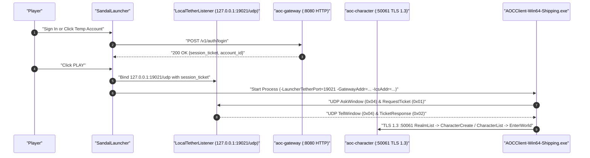

# SandalLauncher

**Related Guides**: [Root Overview](../../../README.md) | [Configuration Reference](../../../docs/CONFIGURATION.md) | [UI Style Guide](../../../docs/UI_STYLE_GUIDE.md) | [Gateway Service](../../server/services/cmd/gateway/README.md) | [Character Service](../../server/services/cmd/character/README.md)

`SandalLauncher` (`src/clients/launcher`) is the desktop game launcher for Windows. It signs in to `aoc-gateway`, runs the local UDP launcher tether on `127.0.0.1:19021`, locates your installed Ashes of Creation client, and launches `AOCClient-Win64-Shipping.exe`.

---

## Key Features

- **Account Sign-In and Registration**: Authenticates with `aoc-gateway` (`:8080`) using `/v1/auth/login` and `/v1/auth/register`.
- **One-Click Temporary Accounts**: Clicking **Temp Account** creates a disposable test account (`TMP <Word1><Word2><Word3>`) and signs in immediately for quick testing.
- **Automatic Client Discovery**: Finds `AOCClient-Win64-Shipping.exe` through `AOC_GAME_PATH` in `.env`, the Windows Registry, Steam's `libraryfolders.vdf` across all local drives, or a manual folder picker.
- **In-Process UDP Tether (`127.0.0.1:19021/udp`)**: `LocalTetherListener` runs inside the launcher process on Windows to answer the UE5 client's local `AskWindow` (`0x04`) and `RequestTicket` (`0x01`) UDP packets.
- **Native In-Game Character Creation**: When an account has no characters yet, the launcher starts the client directly into the native `:50061` ICS TLS 1.3 character creation screen without creating stub characters ahead of time.
- **Wildcard Certificate Host Resolution**: When `dist/certs/server.pem` carries a wildcard SAN (`*.<domain>`), `SandalConfigLoader.cs` maps `localhost` and `127.0.0.1` to `localhost.<domain>` so TLS validation succeeds automatically.
- **Root Shortcut (`SandalLauncher.lnk`)**: Running `.\start.bat` (`.\sandal.ps1 up`) creates a `SandalLauncher.lnk` shortcut in the repository root pointing to `dist/launcher/SandalLauncher.exe`.

---

## Launch Flow



---

## Client Command-Line Arguments

When you click **PLAY**, `GameProcessLauncher.cs` starts `AOCClient-Win64-Shipping.exe` with these arguments:

```text
-LauncherTetherPort=19021 -GatewayAddr=<host:8080> -IcsAddr=<host:50061> -AdjustForServerTime -dx12 -TraceConnect -Environment=Development -UseLocalPaks
```

---

## Source Files

| File | Purpose |
|:---|:---|
| `SandalLauncher.csproj` | Project definition writing build outputs to `build/dotnet/`. |
| `App.axaml` / `Views/MainWindow.axaml` | Glassmorphic desktop layout, gold and obsidian button styles, and sign-in/settings views. |
| `ViewModels/MainWindowViewModel.cs` | View state for sign-in, temporary accounts, server status checks, and game process lifecycle. |
| `Services/LocalTetherListener.cs` | Local UDP `127.0.0.1:19021` ARQ listener (`AskWindow` / `TellWindow` `0x04` and ticket delivery). |
| `Services/ClientDiscoveryService.cs` | Locates the Ashes of Creation client via `.env`, Registry, or Steam `libraryfolders.vdf`. |
| `Services/SandalConfigLoader.cs` | Reads root `.env` settings and resolves wildcard certificate hostnames (`localhost.<domain>`). |
| `Services/GameProcessLauncher.cs` | Starts and monitors `AOCClient-Win64-Shipping.exe`. |

---

## Building and Testing

```powershell
# Build and publish dist/launcher/SandalLauncher.exe
.\sandal.ps1 build

# Run the launcher unit test suite (including headless UI and tether tests)
dotnet test src/clients/launcher.Tests/SandalLauncher.Tests.csproj -c Release
```
