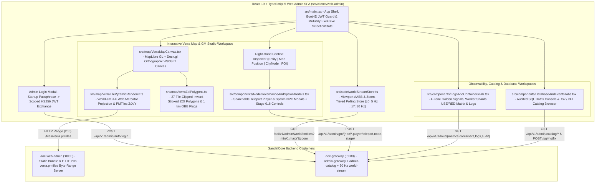
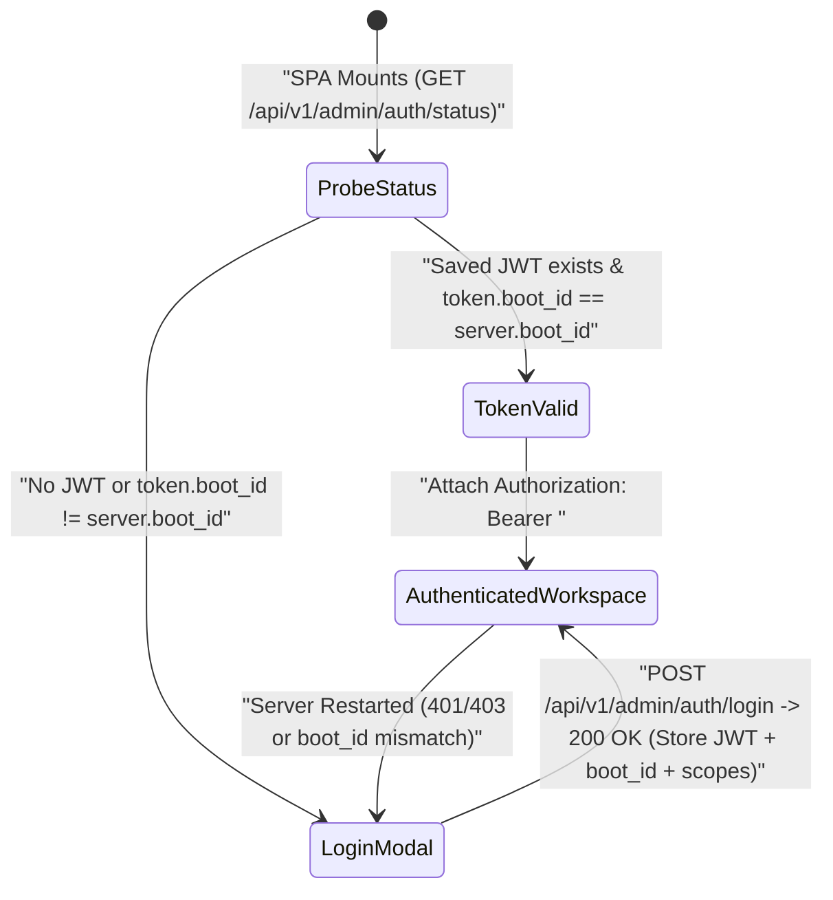

# SandalCore Web Admin & GM Studio Frontend (`src/clients/web-admin`)

**Primary Diataxis Quadrant**: `Technical Reference` & `Explanation` (`DOC-01`)
**Related Guides**: [Web Admin & GM Studio Operational Guide](../../../docs/WEB_ADMIN.md) | [UI Style Guide & Design System](../../../docs/UI_STYLE_GUIDE.md) | [Control-Plane Services Reference](../../../docs/SERVICES.md) | [Server Workers & Spatial Authority](../../../docs/SERVER_WORKERS.md) | [Configuration Reference](../../../docs/CONFIGURATION.md) | [`cmd/web-admin` Asset Server Reference](../../server/services/cmd/web-admin/README.md) | [`cmd/admin-gateway` API Reference](../../server/services/cmd/admin-gateway/README.md)

`src/clients/web-admin` is the React 19, TypeScript 5, Vite, Deck.gl, and MapLibre GL single-page application (SPA) that powers the SandalCore **Web Admin & GM Studio** (`https://localhost:8443/admin/` via `aoc-ingress-proxy` or `http://localhost:8090` via `aoc-web-admin`). It provides operators and Game Masters with a GPU-accelerated `60 FPS` orthographic map of Verra (`verra.pmtiles`), real-time viewport-bounded entity streaming (`5 Hz -> 30 Hz`), strictly mutually exclusive map selection, searchable `Teleport Player Here...` and `Spawn NPC / Monster Here...` modals, live CityNode (`Stage 0..6`) governance, audited SQL hotfix execution, and a zero-redundancy 4-zone SRE observability explorer.

---

## 1. Frontend Architecture & Component Hierarchy

The diagram below illustrates how the React 19 UI components, reactive state stores, WebGL2 rendering layers, and backend `aoc-gateway` / `aoc-web-admin` endpoints interact at runtime:



---

## 2. Source File Inventory & Module Responsibilities

| File Path | Primary Exports / Symbols | Responsibility |
|:---|:---|:---|
| [`src/main.tsx`](src/main.tsx) | `App`, `SelectionState`, `AdminAuthSession` | Top-level application shell, navigation tabs (`World Map & GM Studio`, `Analytics & Logs`, `Catalog & Database`), `boot_id`-aware `HS256` JWT session management, and the strictly mutually exclusive 4-mode map selection state machine. |
| [`src/map/VerraMapCanvas.tsx`](src/map/VerraMapCanvas.tsx) | `VerraMapCanvas` | Hosts the synchronized MapLibre GL (`verra.pmtiles` raster basemap) and Deck.gl overlay layers (`PolygonLayer` for 27 ZOIs and `1 km x 1 km` Node Plugs, `ScatterplotLayer` / `IconLayer` / `TextLayer` for 85 CityNodes, POIs, online players, and live NPCs). |
| [`src/map/verraTilePyramidRenderer.ts`](src/map/verraTilePyramidRenderer.ts) | `worldCmToLngLat`, `lngLatToWorldCm`, `getStreamHzForZoom` | Bijective coordinate transformation between Unreal Engine world centimeters (`[-1,433,600 .. +716,800]` cm X, `[-1,331,200 .. +819,200]` cm Y) and normalized Web Mercator coordinates across zoom levels `z0..z7`. |
| [`src/map/verraZoiPolygons.ts`](src/map/verraZoiPolygons.ts) | `VERRA_ZOI_POLYGONS`, `clipPolygonToPlayableBounds`, `computeInwardOffsetPolygon` | Defines all 27 authentic in-game Zone of Influence Voronoi territories (22 settlement nodes + 5 Divine Gates), clips exterior edges to the playable tile footprint, and computes inward-offset border rings so adjacent ZOIs display distinct interior territory colors. |
| [`src/state/worldStreamStore.ts`](src/state/worldStreamStore.ts) | `useWorldStreamStore` | Manages viewport bounding-box (`minX, minY, maxX, maxY`) synchronization, adaptive zoom-tiered timer scheduling (`5 Hz` at `z0` up to `30 Hz` at `z7`), entity interpolation buffers, and optimistic UI updates after GM mutations. |
| [`src/components/NodeGovernanceAndSpawnModals.tsx`](src/components/NodeGovernanceAndSpawnModals.tsx) | `TeleportPlayerModal`, `SpawnNpcModal`, `NodeStagePanel`, `EntityGmActions` | Implements the searchable **`Teleport Player Here...`** modal, the searchable **`Spawn NPC / Monster Here...`** modal (backed by `4,200+` catalog NPCs), CityNode `Stage 0..6` governance buttons, and full NPC lifecycle controls (`Kill`, `Despawn`, `Heal`, `Reset`, `Respawn`, `Move`). |
| [`src/components/LogsAndContainersTab.tsx`](src/components/LogsAndContainersTab.tsx) | `LogsAndContainersTab` | Renders the zero-redundancy **4-Zone Analytics & Structured Logs Explorer** (`Golden Signals`, `Dynamic Server Worker Shards`, `USE/RED Container Matrix`, and `Structured Logs & GM Audit Trail`). |
| [`src/components/DatabaseAndEventsTabs.tsx`](src/components/DatabaseAndEventsTabs.tsx) | `DatabaseAndEventsTabs` | Provides the read/write audited SQL Hotfix console (`gm:sql_hotfix` scope) and the paginated `.tsv` / `content.db` (`v41`) catalog explorer (`NPCS`, `ITEMS`, `CITY_NODES`, `POIS`, `ZOIS`). |
| [`e2e/gm_studio.spec.ts`](e2e/gm_studio.spec.ts) | Playwright E2E Suite | End-to-end headless Chromium verification covering passphrase login, `boot_id` mismatch recovery, zoom-tiered streaming, mutually exclusive map clicks, GM modals, and the 4-zone analytics tab. |

---

## 3. Core Engineering Contracts

### 1. Startup Passphrase -> Scoped `HS256` JWT & `boot_id` Invalidation

When the server stack boots via `start.bat` or `.\sandal.ps1 up`, `Ensure-SandalAdminPassphrase` (`scripts/lib/Env.psm1`) generates a fresh single-boot passphrase (`AOC_ADMIN_PASSPHRASE`), a random 256-bit HMAC secret (`AOC_ADMIN_JWT_SECRET`), and a unique boot UUID (`AOC_ADMIN_BOOT_ID`), printing `Username: admin` and `Passphrase: <passphrase>` to the console banner.



- **Scoped Claims**: The issued `HS256` JWT grants fine-grained scopes (`admin:read`, `admin:write`, `gm:commands`, `gm:spawn`, `gm:teleport`, `gm:node_governance`, `gm:sql_hotfix`, `metrics:read`, `containers:manage`).
- **Zero Stale Session Bleed Across Restarts**: Because `AOC_ADMIN_BOOT_ID` rotates on every stack restart, any previously cached JWT in the operator's browser is immediately detected as stale and replaced by the **Admin Login Modal**.

### 2. Viewport-Bounded Entity Streaming & Non-Linear Zoom-Tiered Hz (`5 Hz -> 30 Hz`)

`useWorldStreamStore` (`src/state/worldStreamStore.ts`) couples camera viewport bounds (`minX`, `minY`, `maxX`, `maxY` in world cm) with a non-linear zoom-to-frequency lookup (`getStreamHzForZoom`):

| Zoom Tier | Target Stream Rate | Poll Interval | Typical Viewport Coverage |
|:---:|:---:|:---:|:---|
| `z0` | **`5 Hz`** | `200.0 ms` | Full continent (`21.5 km x 21.5 km`) |
| `z1` | **`6 Hz`** | `166.7 ms` | Multi-region quadrant |
| `z2` | **`7 Hz`** | `142.9 ms` | Single biome region (`aoc-riverlands`, `aoc-sandsquall`, etc.) |
| `z3` | **`9 Hz`** | `111.1 ms` | Multi-ZOI cluster |
| `z4` | **`12 Hz`** | `83.3 ms` | Single Zone of Influence (`aoc-<zoi-name>`) |
| `z5` | **`16 Hz`** | `62.5 ms` | Settlement perimeter & adjacent POIs |
| `z6` | **`22 Hz`** | `45.5 ms` | Rotated `1 km x 1 km` CityNode OBB plug (`aoc-<city-name>`) |
| `z7+` | **`30 Hz`** | `33.3 ms` | Street-level inspection matching `30 Hz` ZOI/Node-Plug server tick |

### 3. Tile-Clipped Inward ZOI Borders (`27` Settlement & Divine Gate ZOIs)

`src/map/verraZoiPolygons.ts` renders the 27 Voronoi Zones of Influence extracted from `zoi_polygons.tsv`:

- **Playable Footprint Clipping**: Exterior Voronoi polygons are clipped to the exact `verra.pmtiles` playable world rectangle (`[-1,433,600 .. +716,800]` cm X, `[-1,331,200 .. +819,200]` cm Y).
- **Inward Border Offset**: Each polygon renders both its shared boundary edge and an inward-shrunk interior ring tinted with the region/ZOI color, eliminating visual ambiguity along shared borders.

### 4. Strictly Mutually Exclusive Map Selection & Searchable GM Modals

Map click handlers enforce a single active selection target across **4 mutually exclusive categories**:

1. **`Entity` (`Player` or `NPC`)**: Opens the Entity Inspector with live vitals, owning worker shard (`aoc-*`), and instant GM lifecycle buttons (`SpawnNpc`, `KillNpc`, `DespawnNpc`, `HealNpc`, `ResetNpc`, `RespawnNpc`, `MoveNpc`, `TeleportPlayer`).
2. **`Map Position` (`Ground Pin (X, Y, Z)`)**: Drops a coordinate pin on the terrain and exposes the searchable **`Teleport Player Here...`** modal and searchable **`Spawn NPC / Monster Here...`** modal.
3. **`CityNode` (`85 Settlements`)**: Opens the CityNode Governance Inspector with live **Stage `0..6`** (`Wilderness` -> `Metropolis`) progression controls (`NodePopulations` scaling + `town_platforms.bin` Z-floor rescue).
4. **`POI` (`Points of Interest`)**: Opens the POI Inspector displaying spawner clusters, biome tags, and design GUIDs.

### 5. Zero-Redundancy 4-Zone Analytics & Structured Logs Explorer

`src/components/LogsAndContainersTab.tsx` organizes all operational telemetry into four non-overlapping zones:

- **Zone 1 -- Google SRE Four Golden Signals**: Cluster-wide Latency ($p50/p99$ tick ms), Traffic (active players, UDP pps, gRPC RPS), Errors, and Saturation.
- **Zone 2 -- Dynamic Server Worker Shards**: Live per-worker row table (`worker_index`, `aoc-world` / `aoc-<region>` / `aoc-<zoi>` / `aoc-<city>`, spatial tier, target vs. actual Hz, player/NPC counts, `.tsv` `memory|disk` mode, and handover counters).
- **Zone 3 -- USE / RED Container Matrix**: Per-container Utilization (CPU %, RSS MB), Saturation, Errors, health status, and restart controls across all Linux containers.
- **Zone 4 -- Structured Logs & GM Audit Trail**: Real-time filterable JSON container logs and persistent GM action audit records.

---

## 4. Local Development, Unit Testing & Playwright E2E Verification

During standard stack builds (`.\build.bat` or `.\sandal.ps1 build`), `src/deploy/docker/web-admin.Dockerfile` compiles the TypeScript and Vite production bundle inside Linux. You can also run the unit and E2E suites directly:

```powershell
# Run Vitest unit tests (coordinate projection, ZOI clipping, zoom-tier Hz schedule)
npm --prefix src/clients/web-admin test

# Run TypeScript typecheck and production Vite build
npm --prefix src/clients/web-admin run build

# Run Playwright E2E verification against the running stack
npx --prefix src/clients/web-admin playwright test
```
