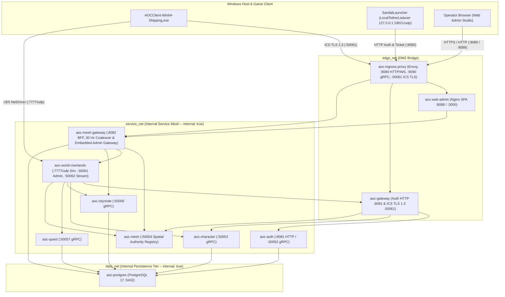
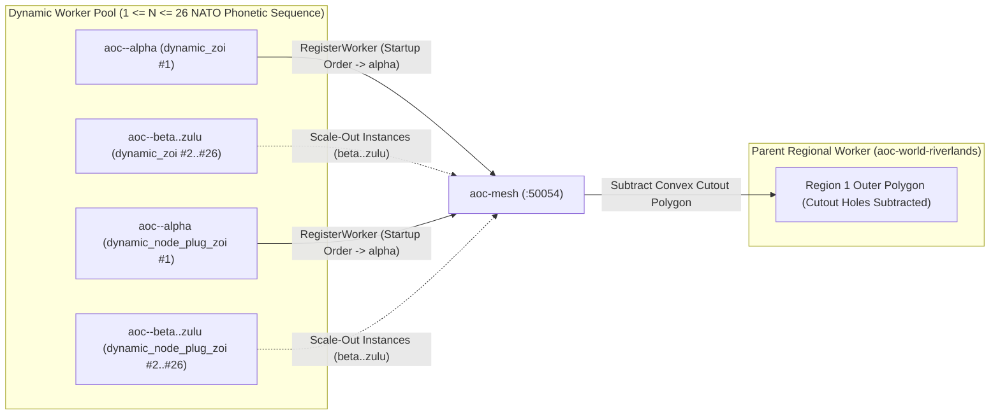

# SandalCore Container, Compose, Envoy, Kubernetes & Systemd Deployment Stack (`src/deploy`)

`src/deploy` contains the declarative container orchestration, multi-stage Dockerfiles, Envoy edge proxy configuration, Kubernetes manifests, and hardened systemd service units that run the SandalCore server stack. All server binaries (`aoc-world` C++23 zone workers and Go control-plane microservices) compile and execute inside hardened Linux containers.

---

## 1. 11-Container Baseline Topology & 3-Zone Network Isolation

The default Docker Compose stack (`src/deploy/compose.yml`) runs the **11-container baseline** (`aoc-postgres`, `aoc-auth`, `aoc-character`, `aoc-citynode`, `aoc-quest`, `aoc-mesh`, `aoc-gateway`, `aoc-mesh-gateway`, `aoc-web-admin`, `aoc-ingress-proxy`, and the primary `aoc-world-riverlands` zone worker), with optional profiles for multi-region and Zone of Influence (`ZOI`) worker topologies.



---

## 2. Baseline Containers & Port Matrix

Every container inherits the `x-hardened` security anchor in `src/deploy/compose.yml`: non-root UID/GID `65532:65532` (`nonroot`), `read_only: true` root filesystem (with bounded `tmpfs` mounts), `cap_drop: [ALL]`, `security_opt: [no-new-privileges:true]`, and explicit memory and PID limits.

| Container Name | Service Key | Image / Dockerfile | Internal Ports | Host-Published Ports | Role |
|:---|:---|:---|:---|:---|:---|
| `aoc-postgres` | `postgres` | `docker/postgres.Dockerfile` | `5432/tcp` | `127.0.0.1:5432` | PostgreSQL 17 relational persistence with SCRAM-SHA-256 auth and checksums enabled. |
| `aoc-auth` | `auth` | `docker/go.Dockerfile` | `8081/tcp`, `50052/tcp`, `9091/tcp` | *(internal)* | Account registration, Argon2id verification, sessions, and `:19021/udp` tether tickets. |
| `aoc-character` | `character` | `docker/go.Dockerfile` | `50053/tcp`, `9091/tcp` | *(internal)* | Character creation validation against `content.db` (`v41`) and inventory/equipment persistence. |
| `aoc-citynode` | `citynode` | `docker/go.Dockerfile` | `50056/tcp`, `9091/tcp` | `127.0.0.1:50055` | 26 levelable settlement nodes (`0..6`), mayoral elections, buildings, and live tier events. |
| `aoc-quest` | `quest` | `docker/go.Dockerfile` | `50057/tcp`, `9091/tcp` | `127.0.0.1:50058` | Per-character quest logs, narrative variables, and asynchronous command inbox. |
| `aoc-mesh` | `mesh` | `docker/go.Dockerfile` | `50054/tcp`, `9091/tcp` | `127.0.0.1:50054` | Spatial worker authority registry, `worker_index` (`0..N`) handout, and handover leases. |
| `aoc-gateway` | `gateway` | `docker/go.Dockerfile` | `8081/tcp`, `50050/tcp`, `50061/tcp`, `9091/tcp` | *(internal via Envoy)* | Public HTTP Auth/Ticket proxy and TLS 1.3 `:50061` Intrepid Client Service (`XClientService`). |
| `aoc-mesh-gateway` | `mesh-gateway` | `docker/go.Dockerfile` | `8082/tcp` | `127.0.0.1:8082` | Unified control-plane BFF, `30 Hz` world-stream coalescer, and embedded `admin-gateway`. |
| `aoc-web-admin` | `web-admin` | `docker/web.Dockerfile` | `3000/tcp` | `127.0.0.1:8088` | Unprivileged Nginx SPA container serving the React 19 Web Admin Studio. |
| `aoc-ingress-proxy` | `ingress-proxy` | `docker/envoy.Dockerfile` | `8080/tcp`, `9090/tcp`, `50061/tcp`, `9901/tcp` | `8080`, `9090`, `50061`, `127.0.0.1:9901` | Envoy edge proxy routing HTTP/WS (`:8080`), gRPC (`:9090`), and TLS passthrough (`:50061`). |
| `aoc-world-riverlands` | `world-riverlands` | `docker/cpp.Dockerfile` | `7777/udp`, `50061/tcp`, `50062/tcp`, `9090/tcp` | `7777/udp`, `127.0.0.1:50062`, `127.0.0.1:9092` | Primary C++23 authoritative zone server (Riverlands or full Verra when `AOC_WORKER_MODE=world`). |

---

## 3. Multi-Worker Compose Profiles & Dynamic NATO Phonetic Naming

`src/deploy/compose.yml` supports three spatial worker partitioning profiles in addition to the single-worker `world` baseline:

1. **Default Regional Workers (`world-riverlands`, `world-sandsquall`, `world-jundark`, `world-anvils`, `world-turquoise-sea`)**:
   - Partition Verra into the 5 macro regions on UDP ports `:7777` through `:7781`.
   - Controlled via `AOC_WORKER_MODE` (`world` vs. `region`) and `AOC_REGION_ID` (`1..5`).
2. **`zoi-sandsquall` Profile (`--profile zoi-sandsquall`)**:
   - Launches 7 dedicated Sandsquall Desert ZOI workers (`aoc-world-zoi-canyon`, `aoc-world-zoi-barrens`, `aoc-world-zoi-crater`, `aoc-world-zoi-oasis`, `aoc-world-zoi-pride`, `aoc-world-zoi-passage`, `aoc-world-zoi-hearth`) on UDP ports `:7790` through `:7796` (`AOC_WORKER_MODE=zoi`).
3. **`mixed` Profile (`--profile mixed`)**:
   - Combines regional workers (`AOC_WORKER_MODE=region`) with dynamically carved ZOI or settlement node-plug child workers. When a child ZOI worker registers with `aoc-mesh`, its convex polygon boundary (`zois.tsv` `footprint_points_json`) is subtracted as a cutout hole from the parent regional worker.

### Dynamic Worker NATO Phonetic Naming Convention (`alpha..zulu`)

Dynamic spatial workers (`AOC_WORKER_MODE=dynamic_zoi` and `AOC_WORKER_MODE=dynamic_node_plug_zoi`) are named deterministically by startup order within the ZOI or CityNode plug they serve using the 26-word NATO phonetic alphabet (`alpha`, `beta`, `charlie`, `delta`, `echo`, `foxtrot`, `golf`, `hotel`, `india`, `juliet`, `kilo`, `lima`, `mike`, `november`, `oscar`, `papa`, `quebec`, `romeo`, `sierra`, `tango`, `uniform`, `victor`, `whiskey`, `xray`, `yankee`, `zulu`):

- **Dynamic ZOI Workers**: `aoc-<zoi-name>-alpha`, `aoc-<zoi-name>-beta`, ..., `aoc-<zoi-name>-zulu` (for example, `aoc-sandsquall-oasis-alpha`, `aoc-sandsquall-oasis-beta`).
- **Dynamic CityNode Plug Workers**: `aoc-<city-name>-alpha`, `aoc-<city-name>-beta`, ..., `aoc-<city-name>-zulu` (for example, `aoc-joeva-alpha`, `aoc-winstead-alpha`).
- **Per-Scope Capacity (`1 <= N <= 26`)**: Each ZOI or CityNode plug supports up to `N = 26` dynamic worker instances (`alpha` through `zulu`), currently stubbed at the initial `-alpha` instance per dynamic scope.



---

## 4. Directory Layout & Deployment Artifacts

| Path | Purpose |
|:---|:---|
| [`compose.yml`](file:///D:/GitHub/SandalCore/src/deploy/compose.yml) | Canonical Docker Compose stack defining the 11-container baseline, regional/ZOI worker profiles, 3-zone networks (`edge_net`, `service_net`, `data_net`), and `x-hardened` security anchor. |
| [`docker/cpp.Dockerfile`](file:///D:/GitHub/SandalCore/src/deploy/docker/cpp.Dockerfile) | Multi-stage Ubuntu 24.04 C++23 build and runtime image for `aoc-world`, compiling `world` and `test_world_live_e2e` with Clang/GCC, CMake, and Ninja. |
| [`docker/go.Dockerfile`](file:///D:/GitHub/SandalCore/src/deploy/docker/go.Dockerfile) | Multi-stage Go 1.24 build and distroless/unprivileged runtime image packaging all Go microservices (`auth`, `character`, `citynode`, `quest`, `mesh`, `gateway`, `mesh-gateway`, `admin-gateway`) and CLIs (`contentc`, `worldctl`, `nodectl`, `questctl`, `charimport`). |
| [`docker/web.Dockerfile`](file:///D:/GitHub/SandalCore/src/deploy/docker/web.Dockerfile) | Multi-stage Node 22 + Vite build and unprivileged Nginx 1.27 (`65532:65532`) runtime image for `aoc-web-admin`. |
| [`docker/envoy.Dockerfile`](file:///D:/GitHub/SandalCore/src/deploy/docker/envoy.Dockerfile) | Hardened Envoy `v1.33.0` edge proxy image running as UID `65532`. |
| [`docker/postgres.Dockerfile`](file:///D:/GitHub/SandalCore/src/deploy/docker/postgres.Dockerfile) | Hardened PostgreSQL 17 Alpine image with initialization scripts. |
| [`envoy/envoy.yaml`](file:///D:/GitHub/SandalCore/src/deploy/envoy/envoy.yaml) | Envoy static configuration routing `:8080` (`/api/v1/auth/*` -> `gateway`, `/api/v1/*` and `/ws/*` -> `mesh-gateway`, `/` -> `web-admin`), `:9090` gRPC, and `:50061` ICS TLS passthrough. |
| [`k8s/world-statefulset.yaml`](file:///D:/GitHub/SandalCore/src/deploy/k8s/world-statefulset.yaml) | Kubernetes `StatefulSet` and headless `Service` for `world` zone workers with `hostPort` UDP `:7777` and `RuntimeDefault` seccomp profile. |
| [`k8s/services-deployment.yaml`](file:///D:/GitHub/SandalCore/src/deploy/k8s/services-deployment.yaml) | Kubernetes `Deployment` and `Service` manifests for the Go control-plane services (`auth`, `character`, `citynode`, `quest`, `mesh`, `gateway`, `mesh-gateway`). |
| [`k8s/network-policies.yaml`](file:///D:/GitHub/SandalCore/src/deploy/k8s/network-policies.yaml) | Zero-trust Kubernetes `NetworkPolicy` definitions isolating ingress, control-plane service mesh, and PostgreSQL persistence tiers. |
| [`systemd/sandal-world@.service`](file:///D:/GitHub/SandalCore/src/deploy/systemd/sandal-world@.service) | Hardened bare-metal Linux systemd template unit (`sandal-world@1.service`) with `ProtectSystem=strict`, `NoNewPrivileges=yes`, `SystemCallFilter=@system-service`, and `MemoryMax=8G`. |

---

## 5. Lifecycle Commands

From the repository root, use `start.bat`, `stop.bat`, `build.bat`, or `./sandal.ps1` to manage the stack:

```powershell
# Build all containers, verify/compile content.db (v41), sync deploy/ runtime state, and start the stack
.\sandal.ps1 up

# Run the live end-to-end functional API & 10-stage fake::Client verification gate
pwsh -NoProfile -File scripts/test_functional_apis.ps1

# Stop all containers cleanly
.\sandal.ps1 down
```

---

## 6. Related Documentation

- [Go Control-Plane Services Overview (`src/server/services/README.md`)](../server/services/README.md)
- [Mesh Service (`src/server/services/cmd/mesh/README.md`)](../server/services/cmd/mesh/README.md)
- [Mesh Gateway Service (`src/server/services/cmd/mesh-gateway/README.md`)](../server/services/cmd/mesh-gateway/README.md)
- [Web Admin Container (`src/server/services/cmd/web-admin/README.md`)](../server/services/cmd/web-admin/README.md)
- [Control-Plane Services Architecture (`docs/SERVICES.md`)](../../docs/SERVICES.md)
- [Server Workers & Spatial Mesh Guide (`docs/SERVER_WORKERS.md`)](../../docs/SERVER_WORKERS.md)
- [Configuration Reference (`docs/CONFIGURATION.md`)](../../docs/CONFIGURATION.md)
- [Web Admin Studio Guide (`docs/WEB_ADMIN.md`)](../../docs/WEB_ADMIN.md)
