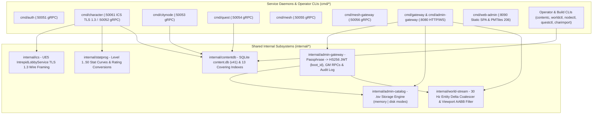

# SandalCore Go 1.24 Control-Plane Services & Operator CLIs (`src/server/services`)

**Primary Diataxis Quadrant**: `Technical Reference` (`DOC-01`)
**Related Guides**: [Control-Plane Services Architecture (`docs/SERVICES.md`)](../../../docs/SERVICES.md) | [Server Workers & Spatial Authority](../../../docs/SERVER_WORKERS.md) | [Web Admin & GM Studio Reference](../../../docs/WEB_ADMIN.md) | [Configuration Reference](../../../docs/CONFIGURATION.md) | [Container & Compose Topology Reference](../../deploy/README.md) | [C++23 `world` Worker Reference](../world/README.md)

`src/server/services` is the Go 1.24 module (`sandal/services`) implementing the 8 containerized control-plane and edge daemons (`auth`, `character`, `citynode`, `quest`, `mesh`, `mesh-gateway`, `gateway`, `web-admin`), shared internal packages (`admin-gateway`, `admin-catalog`, `world-stream`, `statprog`, `contentdb`, `ics`), and 5 operator CLI utilities (`contentc`, `worldctl`, `nodectl`, `questctl`, `charimport`).

---

## 1. Go Module Architecture & Internal Package Graph



---

## 2. Complete Index of `cmd/*` & `internal/*` Component READMEs

### Containerized Control-Plane Daemons

1. **[`cmd/auth`](cmd/auth/README.md)** (`aoc-auth`, `:50051` gRPC): Argon2id credential verification, account registration, disposable `Temp Account` creation/cleanup, and `127.0.0.1:19021/udp` launcher tether ticket validation.
2. **[`cmd/character`](cmd/character/README.md)** (`aoc-character`, `:50061` ICS TLS 1.3 & `:50052` gRPC): Dual-listener daemon terminating external UE5 `IntrepidLobbyService` TLS 1.3 lobby traffic (`RealmList`, native `CharacterCreate`, `CharacterList`, `CharacterEnterWorld`) and internal `lease_epoch`-fenced character state persistence in `aoc-postgres`.
3. **[`cmd/citynode`](cmd/citynode/README.md)** (`aoc-citynode`, `:50053` gRPC): Authoritative state service for all 85 Verra settlements across progression stages `0..6` (`Wilderness` -> `Metropolis`), citizenship, mayoral elections, tax rates, and building slots.
4. **[`cmd/quest`](cmd/quest/README.md)** (`aoc-quest`, `:50054` gRPC): Quest prerequisite graph evaluator, objective progress tracker, and reward distributor backed by `content.db` (`v41`) and `aoc-postgres`.
5. **[`cmd/mesh`](cmd/mesh/README.md)** (`aoc-mesh`, `:50055` gRPC): Cluster spatial registry assigning sequential `worker_index` (`1..N`) IDs to booting `world` workers (`aoc-world`, `aoc-<region-name>`, `aoc-<city-name>[-alpha..zulu]`, `aoc-<zoi-name>[-alpha..zulu]`) and resolving `(x, y)` coordinates across overlapping spatial tiers.
6. **[`cmd/mesh-gateway`](cmd/mesh-gateway/README.md)** (`aoc-mesh-gateway`, `:50056` gRPC): Inter-worker handover coordinator (`InitiateHandover` -> `PrepareHandover` -> `CompleteHandover`) enforcing monotonic `lease_epoch` fencing across `region <-> region`, `region <-> zoi`, `zoi <-> zoi`, and `zoi <-> node_plug` boundaries.
7. **[`cmd/gateway`](cmd/gateway/README.md)** & **[`cmd/admin-gateway`](cmd/admin-gateway/README.md)** (`aoc-gateway`, `:8080` HTTP/WS): Edge HTTP gateway serving `/v1/auth/*`, `/v1/tether/*`, and the `/api/v1/admin/*` surface (startup passphrase -> scoped `HS256` JWT exchange, `30 Hz` `world-stream` entity polling, GM actor/player manipulation, and audited SQL hotfixes).
8. **[`cmd/web-admin`](cmd/web-admin/README.md)** (`aoc-web-admin`, `:8090` HTTP): High-throughput static asset server hosting the compiled [Web Admin & GM Studio SPA](../../clients/web-admin/README.md) and serving `verra.pmtiles` via HTTP `206 Partial Content` byte-range responses.

### Internal Packages & Operator CLI Tools

9. **[`internal/statprog`](internal/statprog/README.md)**: Primary attribute curves and diminishing-returns rating formulas shared across character creation and `libaocstats`.
10. **[`cmd/contentc`](cmd/contentc/README.md)**: Compiles extracted UE5 DesignData JSON into `dist/content/content.db` (**Schema Version `v41`**), builds all 13 covering/partial indexes, runs `ANALYZE`, and generates `roads.bin` (`contentc roads --levels`).
11. **[`cmd/worldctl`](cmd/worldctl/README.md)**: CLI for querying active `world` worker shards, executing GM NPC lifecycle commands (`SpawnNpc`, `KillNpc`, `DespawnNpc`, `HealNpc`, `ResetNpc`, `RespawnNpc`, `MoveNpc`), and teleporting players.
12. **[`cmd/nodectl`](cmd/nodectl/README.md)**: CLI for inspecting and transitioning CityNode progression stages (`0..6`), node XP, and settlement buildings.
13. **[`cmd/questctl`](cmd/questctl/README.md)**: CLI for inspecting and mutating character quest states and objective counters.
14. **[`cmd/charimport`](cmd/charimport/README.md)**: CLI for exporting, importing, and backing up character records in `aoc-postgres`.

---

## 3. Core Runtime Contracts (`30 Hz` Service Tick, `.tsv` Modes & Scoped `HS256` JWT)

1. **`30 Hz` Control-Plane Service Tick (`AOC_SERVICE_TICK_HZ=30`)**:
   - `internal/world-stream/coalescer.go` polls registered `world` workers and coalesces authoritative player and NPC transforms while Web Admin polls `/api/v1/world/state` at a constant **30 Hz** (`33 ms` interval) across all zoom levels, filtering entities by the operator's viewport bounding box (`minX, minY, maxX, maxY`).
2. **Per-Data-Type `.tsv` Storage Modes (`memory` vs. `disk`)**:
   - `internal/admin-catalog/store.go` honors `AOC_DATA_MODE_DEFAULT=memory|disk` and per-table overrides (`AOC_DATA_MODE_ZOIS`, `AOC_DATA_MODE_CITY_NODES`, `AOC_DATA_MODE_POIS`, `AOC_DATA_MODE_NPCS`, `AOC_DATA_MODE_ITEMS`) backed by `deploy/content/*.tsv`.
3. **Startup Passphrase -> Scoped `HS256` JWT Authentication (`internal/admin-gateway`)**:
   - `POST /api/v1/admin/auth/login` exchanges the per-boot console passphrase (`AOC_ADMIN_PASSPHRASE`) for a signed `HS256` JWT embedding `boot_id` (`AOC_ADMIN_BOOT_ID`) and granular scopes (`admin:read`, `admin:write`, `gm:commands`, `gm:spawn`, `gm:teleport`, `gm:node_governance`, `gm:sql_hotfix`, `metrics:read`, `containers:manage`).

---

## 4. Build, Unit Tests & Live Functional Verification

All Go services compile inside `src/deploy/docker/services.Dockerfile` (`golang:1.24-bookworm`) during `.\build.bat`:

```powershell
# Compile all Go control-plane containers and C++23 world workers
.\build.bat

# Run Go unit test suites across all internal packages and cmd/* binaries
.\sandal.ps1 test

# Run the live end-to-end API, ICS TLS 1.3, and 10-stage fake::Client gate
pwsh -NoProfile -File scripts/test_functional_apis.ps1
```

---

## Database Migration Rollback Reference

The following deterministic PostgreSQL rollback blocks reverse individual `internal/db/migrations` schema versions (`0003` through `0024`) and are verified by the `go test ./internal/db` migration rollback suite:

```sql
-- rollback of migration 0003
BEGIN;
UPDATE characters SET race_id = COALESCE(class_id, 0), gender_id = COALESCE(gender, 0) + 1
WHERE race_id = 0 AND gender_id = 0;
ALTER TABLE characters ALTER COLUMN race_id DROP DEFAULT, ALTER COLUMN gender_id DROP DEFAULT;
ALTER TABLE characters DROP COLUMN race, DROP COLUMN gender, DROP COLUMN class_id;
DELETE FROM schema_migrations WHERE version = 3;
COMMIT;
```

```sql
-- rollback of migration 0004
BEGIN;
DROP TABLE character_items;
DELETE FROM schema_migrations WHERE version = 4;
COMMIT;
```

```sql
-- rollback of migration 0005
BEGIN;
DROP TABLE character_experience;
ALTER TABLE characters DROP COLUMN gm_starter_set_granted_at;
DELETE FROM schema_migrations WHERE version = 5;
COMMIT;
```

```sql
-- rollback of migration 0006
BEGIN;
DROP TABLE character_skill_ranks;
DROP TABLE character_action_bar;
DELETE FROM schema_migrations WHERE version = 6;
COMMIT;
```

```sql
-- rollback of migration 0007
BEGIN;
ALTER TABLE character_items
    DROP CONSTRAINT character_items_persisted_health,
    DROP CONSTRAINT character_items_persisted_mana,
    DROP CONSTRAINT character_items_lock_expiration,
    DROP COLUMN persisted_health,
    DROP COLUMN persisted_mana,
    DROP COLUMN lock_expiration;
DELETE FROM schema_migrations WHERE version = 7;
COMMIT;
```

```sql
-- rollback of migration 0008
BEGIN;
ALTER TABLE characters DROP COLUMN gm_starter_mounts_granted_at;
DELETE FROM schema_migrations WHERE version = 8;
COMMIT;
```

```sql
-- rollback of migration 0009
BEGIN;
DROP TABLE city_node_state;
DROP TABLE city_node_clock;
DROP TABLE city_node_seed;
DELETE FROM schema_migrations WHERE version = 9;
COMMIT;
```

```sql
-- rollback of migration 0010
BEGIN;
DROP TABLE character_professions;
DELETE FROM schema_migrations WHERE version = 10;
COMMIT;
```

```sql
-- rollback of migration 0011
BEGIN;
DROP TABLE character_resource_items;
DELETE FROM schema_migrations WHERE version = 11;
COMMIT;
```

```sql
-- rollback of migration 0012
BEGIN;
DROP TABLE character_wallet;
DELETE FROM schema_migrations WHERE version = 12;
COMMIT;
```

```sql
-- rollback of migration 0013
BEGIN;
DROP TABLE character_processing_jobs;
DELETE FROM schema_migrations WHERE version = 13;
COMMIT;
```

```sql
-- rollback of migration 0014
BEGIN;
DROP TABLE character_known_recipes;
DELETE FROM schema_migrations WHERE version = 14;
COMMIT;
```

```sql
-- rollback of migration 0015
BEGIN;
DROP TABLE character_completed_ftues;
DELETE FROM schema_migrations WHERE version = 15;
COMMIT;
```

```sql
-- rollback of migration 0016
BEGIN;
DROP TABLE character_quest_commands;
DROP TABLE character_quest_variables;
DROP TABLE character_quests_completed;
DROP TABLE character_quests;
DELETE FROM schema_migrations WHERE version = 16;
COMMIT;
```

```sql
-- rollback of migration 0017
BEGIN;
DROP TABLE character_warehouse_items;
DELETE FROM schema_migrations WHERE version = 17;
COMMIT;
```

```sql
-- rollback of migration 0018
BEGIN;
DROP TABLE character_home_attunement;
DROP TABLE character_attunements;
DELETE FROM schema_migrations WHERE version = 18;
COMMIT;
```

```sql
-- rollback of migration 0019
BEGIN;
ALTER TABLE character_processing_jobs
    DROP CONSTRAINT character_processing_jobs_rating_xp,
    DROP CONSTRAINT character_processing_jobs_rating_quantity,
    DROP CONSTRAINT character_processing_jobs_rating_rarity,
    DROP COLUMN rating_xp,
    DROP COLUMN rating_quantity,
    DROP COLUMN rating_rarity;
DELETE FROM schema_migrations WHERE version = 19;
COMMIT;
```

```sql
-- rollback of migration 0024
BEGIN;
DROP INDEX IF EXISTS idx_gm_audit_log_command_created;
DROP INDEX IF EXISTS idx_gm_audit_log_created_at;
DROP INDEX IF EXISTS idx_hotfix_audit_log_recorded_at;
DROP INDEX IF EXISTS idx_hotfix_overlays_active_order;
DROP INDEX IF EXISTS idx_character_known_recipes_taught;
DROP INDEX IF EXISTS idx_character_skill_ranks_tree;
DROP INDEX IF EXISTS idx_character_resource_items_char_order_id;
DROP INDEX IF EXISTS idx_character_items_char_order_id;
DROP INDEX IF EXISTS idx_world_servers_heartbeat_server_id;
DROP INDEX IF EXISTS idx_characters_ungranted_starter_mounts;
DROP INDEX IF EXISTS idx_characters_ungranted_starter_set;
DROP INDEX IF EXISTS idx_characters_account_created_id;
ALTER TABLE characters DROP COLUMN IF EXISTS fencing_token;
DELETE FROM schema_migrations WHERE version = 24;
COMMIT;
```
