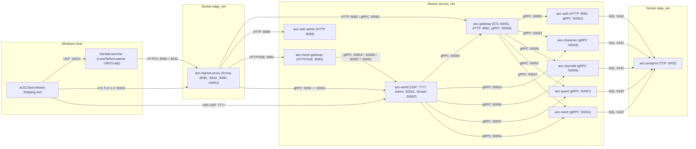

# Go Control-Plane Services, Content Compiler & Operator CLIs (`src/server/services`)

`src/server/services` contains the Go microservice control plane, PostgreSQL persistence layer, design-database compiler (`contentc`), and operator CLI tools (`worldctl`, `nodectl`, `questctl`, `charimport`) for the SandalCore backend.

---

## 1. Service & Binary Matrix

In the 11-container Linux Docker Compose stack ([`src/deploy/compose.yml`](../../deploy/compose.yml)), traffic is segmented across three isolated Docker bridge networks (`edge_net`, `service_net`, and `data_net`):

| Container / Binary | Listen Ports (Docker Compose / `loader.go` Bare-Metal Default) | Role |
|:---|:---|:---|
| **`aoc-ingress-proxy`** (Envoy) | HTTP/2 & Web Admin `127.0.0.1:8080`, HTTPS `:8443`, gRPC `127.0.0.1:9090`, ICS TLS `127.0.0.1:50061`, Admin `:9901` | Edge reverse proxy (`src/deploy/envoy/envoy.yaml`) terminating client TLS and routing HTTP/2, gRPC, and `web-admin` traffic across `edge_net` and `service_net`. |
| **`aoc-gateway`** (`cmd/gateway`) | Compose: ICS TLS `:50061`, HTTP `:8081`, Internal gRPC `:50050` \| Bare-metal default (`loader.go`): ICS `:443`, Internal gRPC `127.0.0.1:50054` | Terminates the game client's ICS gRPC stream (session auth, realm/character screens, `PlayRequest` placement) and serves `GatewayService.RedeemTicket` to `world`. |
| **`aoc-auth`** (`cmd/auth`) | Compose: HTTP `:8081`, gRPC `:50052` \| Bare-metal default (`loader.go`): HTTP `127.0.0.1:8081`, gRPC `127.0.0.1:50051` | Serves launcher registration/login endpoints and `AuthService.ValidateToken` for internal services. |
| **`aoc-character`** (`cmd/character`) | Compose: gRPC `:50053` \| Bare-metal default (`loader.go`): gRPC `127.0.0.1:50052` | Serves `CharacterService`: validates character creation against `content.db`, grants starting kits, and persists inventory, stats, progression, talents, professions, wallet, processing jobs, recipes, tutorials, warehouse tabs, and Emberspring attunements. |
| **`aoc-citynode`** (`cmd/citynode`) | Compose: gRPC `citynode:50056` \| Bare-metal default (`loader.go`): gRPC `127.0.0.1:50055` | Serves `CityNodeService`: maintains live state for all 46 city nodes (level, XP, vassal links, node clock, seed application) and streams ordered state changes via `WatchNodes`. |
| **`aoc-quest`** (`cmd/quest`) | Compose: gRPC `quest:50057` \| Bare-metal default (`loader.go`): gRPC `127.0.0.1:50058` | Serves `QuestService`: persists per-character active/completed quests and quest variables, and queues GM quest commands for `world`. |
| **`aoc-mesh`** (`cmd/mesh`) | Compose: gRPC `mesh:50054` \| Bare-metal default (`loader.go`): gRPC `127.0.0.1:50053` | Serves `MeshService`: tracks registered `world` server instances, heartbeats, and player placement reservations. |
| **`aoc-mesh-gateway`** (`cmd/mesh-gateway`) | Compose & Bare-metal default: HTTP/SSE `:8082` | HTTP and Server-Sent Events (SSE) BFF aggregating live `mesh`, `citynode`, `quest`, and `world` telemetry and admin actions. |
| **`aoc-web-admin`** (`cmd/admin`) | Compose: HTTP `:8088` (`http://127.0.0.1:8080/` via Envoy) | Browser-based operator control plane (Nginx + Admin UI/BFF). |
| **`aoc-postgres`** (PostgreSQL) | Compose & Bare-metal default: TCP `:5432` (`data_net`) | Relational persistence backing `auth`, `character`, `citynode`, `quest`, and `mesh`. |
| **`aoc-world`** (`src/server/world`) | Compose: UDP `127.0.0.1:7777`, `WorldAdmin` `world:50061` (host `127.0.0.1:50055` / Envoy `:9090`), `WorldStream` `world:50062` \| Bare-metal default (`main.cpp`): `WorldAdmin` `127.0.0.1:50056`, `WorldStream` `127.0.0.1:50057` | Authoritative C++23 30 Hz zone server (see [`../world/README.md`](../world/README.md)). |
| **`SandalLauncher`** (`LocalTetherListener`) | UDP `127.0.0.1:19021` (Windows host in-memory) | In-process UDP session tether inside `SandalLauncher` that hands the active login token directly from memory to `AOCClient-Win64-Shipping.exe` without writing plaintext token files to disk. |
| **`contentc`** (`cmd/contentc`) | CLI build tool | Compiles `CacheDB.dbc`, `aoc.usmap`, `DefaultCombat.ini`, and `artisan_curves.tsv` into `dist/content/content.db` (including the compiled `AOSP` v3 `stat_program` bundle). |
| **`worldctl` / `nodectl` / `questctl` / `charimport`** | Operator CLIs (`cmd/*`) | Command-line clients for `WorldAdminService`/`WorldStreamService`, `CityNodeService`, `QuestService`, and offline `characters.json` migration. |

### Service Mesh & Control-Plane Flow



### Internal Service Authentication (`internal/svcauth`)

All internal gRPC servers (`auth`, `character`, `citynode`, `quest`, `mesh`, `gateway` internal port, and `world` admin/stream ports) enforce Bearer token authentication via `internal/svcauth` (`authorization: Bearer <token>` matching `AOC_SERVICE_TOKEN` or `dist/services/service.token`). Unauthenticated requests are rejected with `Unauthenticated`.

---

## 2. Building, Running & Testing

```powershell
# Full one-click pipeline (extract assets if needed, start the 11-container WSL2 Docker stack, launch SandalLauncher)
.\start.bat

# Stop the 11-container WSL2 Docker stack
.\stop.bat

# Build C++, Go, and .NET artifacts via the container / host build pipeline
.\build.bat

# Lifecycle commands via sandal.ps1
pwsh -File sandal.ps1 up       # Start the 11-container stack in WSL2 Docker (src/deploy/compose.yml)
pwsh -File sandal.ps1 down     # Stop the stack (preserves PostgreSQL pgdata volume)
pwsh -File sandal.ps1 build    # Build Go services, C++ world server, and .NET tools
pwsh -File sandal.ps1 deploy   # Rebuild and redeploy updated container images
pwsh -File sandal.ps1 test     # Run C++, Go, and .NET unit/integration test suites

# Run end-to-end functional API verification against the live stack
pwsh -File scripts/test_functional_apis.ps1
```

### TLS & Client Connection Notes

- **`gateway` ICS TLS**: Uses `dist/certs/server.pem` and `dist/certs/server.key` (configurable via `AOC_GATEWAY_TLS_CERT` and `AOC_GATEWAY_TLS_KEY`). The gateway refuses to start if the private key is missing and never falls back to plaintext.
- **ALPN Compatibility**: Because the shipping game client's embedded gRPC C++ client does not negotiate `h2` ALPN by default, `src/deploy/compose.yml` sets `GRPC_ENFORCE_ALPN_ENABLED=false` on `aoc-gateway`.

---

## 3. Gateway & ICS Protocol Semantics (`cmd/gateway`, `internal/ics`)

`aoc-gateway` implements the game client's bidirectional ICS gRPC stream (`src/server/proto/ics_common.proto`, generated Go package `src/server/services/internal/icspb/`) using the client executable's native `IcsStatusCodeEnum` values (verified against `internal/ics/testdata/ics_status_codes_exe.txt`):

- **Result Codes (`0..3`)**: `0` Success, `1` Acknowledged, `2` Pending, `3` Stream Finished.
- **Error Codes (`10..127`)**: `22` Internal Error, `24` Invalid Request, `40` Authentication Failed, `43` Session Check Failed, `47` Existing Name, `48` Character Count Exceeded, `51` Play Reservation No Server, `59` Character Record Not Found, `65` World Offline, `100..105` Session Terminations.
- **`PlayRequest` Flow**: Acknowledged immediately with status `1` (`Acknowledged`), followed 400 ms later by a status report and `PlayReply` containing the `world` UDP address and single-use join ticket (or an error `PlayReply` with `59` for a missing/unowned character, `51` when no world server is registered in `mesh`, or `22` on internal error).
- **`CreateCharacter` Flow**: Returns `24` when payload size exceeds 64 KiB, character name exceeds 64 bytes, or `CharacterService` rejects race/gender/class/customization; `47` when the character name is already taken; `48` when the account already holds the maximum of 16 characters (enforced inside the PostgreSQL creation transaction); or `22` if `content.db` is unavailable.
- **`AuthRefreshRequest`**: Re-validates the login token against `aoc-auth`; expired tokens (24 h TTL) terminate the stream with status `40` (unauthenticated stream requests without an active session return `43`).

---

## 4. Character Service & Persistence (`cmd/character`, `internal/customization`, `internal/kit`)

### Race, Gender, Class & Customization Validation

Character creation maps the client's embedded protobuf enums (`CreateCharacterInfo` and `CharacterInformation` in `internal/chardef` and `internal/aocchar`):

| Enum | Valid Values |
|:---|:---|
| **`ECharacterRace`** | `0` Kaelar, `1` Vaelune, `2` Vek, `3` Renkai, `4` Empyrean, `5` Pyrai, `6` Dunir, `7` Nikua (`8` Tulnar is rejected) |
| **`ECharacterGender`** | `0` Male, `1` Female |
| **`ECharacterClass`** | `1` Ranger, `2` Bard, `3` Cleric, `4` Fighter, `5` Rogue, `6` Summoner, `7` Tank, `8` Mage |

On every `CreateCharacter` call, `internal/customization.Check` and `Normalize` validate the client's customization JSON against `RaceGenderAppearanceMap` -> `RaceGenderAppearance` -> `RaceGenderCustomizationDef` in `dist/content/content.db`:

1. Confirms the JSON's `race`, `gender`, and `class` strings match the protobuf fields (`race_id`, `gender_id`, `class_id`).
2. Verifies hair, facial hair, brows, horns (`0x9F65000082A14F49` = none), eye shape, sclera, eye/hair/nail colors, `skinSet`, and `presetGuid` against the race/gender option tables, and checks that face morph weights lie in `[-1, 1]` and body sections lie in `[0, 1]`.
3. Enforces `world`'s `customization_from_json` wire constraints: 32-bit integer `randomSeed` and `skinSet`, finite `float32`-representable numbers, non-null fields, valid 30-entry body section names, case-folded unique morph names, `<= 64 KiB` serialized `jsonb` length, and `<= 256` morphs/sections. Creator presets (`presetGuid != 0`) are normalized to `"presetGuid": "0"` since the JSON already carries the expanded morphs.

### Starting Kits & GM Starter Set (`internal/kit`)

- **Class Starting Kits**: Every new character receives its class's `StartingEquipmentRecord` (`EquippedItems` placed in `Equipment` slots and `StoredItems` placed in `Backpack` from slot `0`, with fresh instance GUIDs and `MaxDurability` rounded half-up at default quality) inside the creation transaction. On startup, `GrantMissingKits` idempotently backfills any existing character that has zero items.
- **GM Starter Set (`AOC_GM_STARTER_SET=1` / `true`)**: Grants `GM_Scroll_MakeMeLevel10/15/20/25`, all 8 `GM_Scroll_PrimaryArchetype<Class>` scrolls, the class-appropriate level-band gear scroll (`GM_Scroll_Gear NN ...`), a starting purse of `210,000` copper (21 gold), and tops up the 8 test mount items (`kit.StarterMountNames`: two PTR Eagle Gryphons, four aquatic mounts, terror bird, and skinwalker via `GrantMissingStarterMounts`).
- **Offline Legacy Import (`cmd/charimport`)**: Imports characters from a legacy `characters.json` file (`charimport -account <username> [-file path]`), validating customization consistency and clamping levels to `character.MaxLevel = 25`.

### Character Persistence Domains (`SaveInventory`, `SaveProgress`)

`aoc-character` persists all character state in PostgreSQL under per-character row locks:

- **Inventory, Equipment, Quest & Resource Bags (`character_items`, `character_resource_items`)**: `Backpack` (`0..69`), `Equipment` (`0..82`, `EEquipSlot`), `Quest` (`0..99`), and `Resource0..2` (`0..255`, resource bags worn in `Equipment` slots `23..25`). Tracks `item_record_id`, `instance_guid` (unique across both tables), `quantity`, `quality` (`1..200`), `durability`, and mount persisted state (`persisted_health`, `persisted_mana`, `lock_expiration`).
- **Experience, Talents & Action Bar (`character_experience`, `character_skill_ranks`, `character_action_bar`)**: Stores Adventuring and 21 weapon-line XP/debt rows, purchased skill tree ranks (`replace_skill_ranks`), and action bar slots across banks `0..19` and slots `0..15` (`replace_action_bar`).
- **Professions (`character_professions`)**: Tracks `certification_tier` (`0` Novice .. `4` GrandMaster), `level` (`1..50`), and `xp` across all 22 `CharacterProfessions` (initialized to Novice level 1 at creation).
- **Wallet, Processing Jobs, Recipes, Tutorials, Warehouse & Attunements**:
  - `character_wallet`: Currency balances in base units (copper).
  - `character_processing_jobs`: Active/queued station processing batches with wall-clock `started_at`, `duration`, paid `resources` JSON, and snapshotted crafter artisan ratings (`rating_xp`, `rating_quantity`, `rating_rarity`).
  - `character_known_recipes`: GM-taught or learned crafting recipe GUIDs (`replace_known_recipes`).
  - `character_completed_ftues`: Completed tutorial record GUIDs (`replace_completed_ftues`).
  - `character_warehouse_items`: Stored items across city-node warehouse item chunks, material tabs, and cargo tabs (`replace_warehouse`).
  - `character_attunements` & `character_home_attunement`: Discovered Embersprings and active home respawn point (`replace_attunements`).

---

## 5. City Node Service & `nodectl` (`cmd/citynode`, `cmd/nodectl`)

`aoc-citynode` manages the live state of all 46 settlement nodes (`internal/citynode/roster.json`) over `CityNodeService` (`src/server/proto/internal/aoc/citynode/v1/citynode.proto`):

- **Node State & Levels**: Each node tracks its level (`0` Wilderness, `1` Crossroads, `2` Encampment, `3` Village, `4` Town = `MaxNodeLevel`), cumulative XP (`CityNodeExpToLevel`), and vassal parent (`parent_guid`). `AddNodeExperience` accumulates XP toward the next threshold without auto-leveling; `SetNodeLevel` transitions node level explicitly.
- **Node Clock (`city_node_clock`)**: Computes `real_time * speed + offset`. `AdvanceClock` (`1 s .. 100 y`) and `SetClockSpeed` (`0.001 .. 100,000`) adjust virtual settlement time without discontinuities.
- **Initial Seed (`src/config/seeds/citynode_seed.json`)**: Applied once on first startup (`Joeva` as Town level 4, `Halcyon` as Village level 3 vassal of Joeva, all other nodes Wilderness level 0).
- **Change Stream (`WatchNodes`)**: Emits a full snapshot at `seq` followed by strictly sequential change events (`seq + 1`, `seq + 2`, ...); slow subscribers lagging by `> 1,024` events are terminated with `Aborted` so they reconnect for a fresh snapshot.

```powershell
nodectl list                        # List all 46 nodes, levels, XP, vassal links, and node clock
nodectl get Joeva                   # Inspect a single node by GUID, record name, or display name
nodectl set-level Winstead 2        # Set node level (0..4); supports --disable-vassalship
nodectl add-xp Winstead 1000000     # Add node XP
nodectl clock                       # Inspect clock, "clock advance <sec>", or "clock speed <factor>"
nodectl seed --force                # Re-apply citynode_seed.json across all 46 nodes
nodectl watch                       # Stream live node changes until Ctrl+C
```

---

## 6. Quest Service & `questctl` (`cmd/quest`, `cmd/questctl`)

`aoc-quest` serves `QuestService` (`src/server/proto/internal/aoc/quest/v1/quest.proto`):

- **`LoadLog` / `SaveLog`**: Loads or atomically replaces a character's active quests (`character_quests`, including client instance GUID and objective progress JSON), completed quests (`character_quests_completed`), and quest variables (`character_quest_variables`).
- **`QueueCommand` / `TakeCommands`**: Queues GM quest mutations in `character_quest_commands`; `world` drains and applies commands immediately for online characters or on next login for offline characters.

```powershell
questctl give <character> <quest>
questctl finish|fail|abandon <character> <quest>
questctl clear <character> [quest]
questctl set-var <character> <name> <value>
questctl log <character>
```

---

## 7. World Admin, World Stream & `worldctl` (`cmd/worldctl`)

`world` exposes two gRPC services defined in `src/server/proto/internal/aoc/worldadmin/v1/worldadmin.proto` and `src/server/proto/internal/aoc/worldstream/v1/worldstream.proto`:

1. **`WorldAdminService` (Compose `world:50061`, host `127.0.0.1:50055` / Envoy `:9090`; bare-metal default `127.0.0.1:50056` / `AOC_WORLD_ADMIN_ADDR`)**: Enqueues administrative commands onto `world`'s network thread between simulation ticks (5 s timeout):
   - Player inspection and travel: `ListPlayers`, `ListPlaces`, `Teleport` (dismounts riders, rebases `MoveChecker`, sends `ClientAdjustPosition`, and persists position), and `SetMoveSpeed` (`0.5..10x` scaling pawn and mount `MoveSpeedMult` and `MoveChecker` limits).
   - Town & crafting management: `PlaceStation`, `RemoveStation`, `FinishProcessingJobs`, `TeachRecipe`, `ForgetRecipe`, `ListTaughtRecipes`, and `ResetTutorials`.
   - Live NPC control: `NpcKill`, `NpcRespawn`, `NpcReset`, `NpcHeal`, `NpcDespawn`, and `NpcMove`.
2. **`WorldStreamService` (Compose `world:50062`; bare-metal default `127.0.0.1:50057` / `AOC_WORLD_STREAM_ADDR`)**: Dedicated read-only observation server (up to 8 concurrent streams):
   - `Subscribe(area, detail, density_cell_cm, layers)`: Streams up to 5 Hz entity snapshots/deltas (players, NPCs, resource nodes, mounts, loot piles) or 200/500/1,000 m cell density grids alongside `StreamStats`.
   - `Inspect(id)`, `Search(query, limit)`, and `GetStatus`.

```powershell
worldctl players                                  # List online players, coordinates, mount state, and speed
worldctl places                                   # List named teleport destinations
worldctl tp cyb joeva                             # Teleport player to a named city node, login, or x y [z]
worldctl speed cyb 5                              # Set player/mount MoveSpeedMult multiplier (1 resets)
worldctl place-station joeva Plot_17_Service CraftingStation_Weaponsmithing_T3
worldctl remove-station joeva Plot_17_Service
worldctl craft finish cyb                         # Complete active/queued processing jobs immediately
worldctl craft teach|forget|taught cyb [recipe]   # Manage taught crafting recipes
worldctl tutorials reset cyb                      # Clear completed FTUE tutorials
worldctl npc kill|respawn|reset|heal|despawn|move <actor_id> [x y [z]]
worldctl watch [--area minx,miny,maxx,maxy] [--layers players,npcs] [--density --cell 100000]
```

---

## 8. Design Database Compiler (`cmd/contentc` & `dist/content/content.db`)

`cmd/contentc` decodes the client's binary `CacheDB.dbc` (369 tables, 205,882 records) using `src/config/layouts/aoc.usmap` (`internal/usmap` and `internal/designdb`), evaluates design formulas (`internal/aocexpr` and [`internal/statprog`](internal/statprog/README.md)), and writes the deterministic SQLite database `dist/content/content.db` (`internal/content/schema.go`).

```powershell
# Run via the extraction pipeline
pwsh -File sandal.ps1 extract

# Or invoke contentc directly
$env:AOC_DESIGN_DB = '<client>\Game\AOC\Plugins\DesignDataPlugin\Generated\Client\CacheDB.dbc'
$env:AOC_USMAP = 'src\config\layouts\aoc.usmap'
$env:AOC_CLIENT_CONFIG = 'dist\content\client_config'
cd src\server\services
go run ./cmd/contentc --out ..\..\..\dist\content\content.db
go run ./cmd/contentc roads --levels --content ..\..\..\dist\content\content.db --raw ..\..\..\dist\content\roads_raw.tsv --out ..\..\..\dist\content\roads_levels.tsv
```

### Primary `content.db` Table Domains

| Domain | Tables | Summary |
|:---|:---|:---|
| **Raw Design Records & Metadata** | `meta`, `record_table`, `record` | Input SHA-256 digests, schema/contentc version stamps, and all 369 decoded `.dbc` tables (`205,882` rows stored as deterministic `gzip+json`). |
| **Stats, Curves & Bytecode Bundle** | `stat_def`, `stat_curve_def`, `stat_curve`, `stat_init`, `class`, `class_stat_base`, `stat_program` | Stat definitions, curve keys (including `artisan_curves.tsv`), 2,400 primary attribute baselines, and the compiled `AOSP` v3 bytecode bundle (`stat_program`). |
| **Items, Gear & Starting Kits** | `equip_slot`, `item`, `item_equip_slot`, `starting_equipment`, `quality_curve`, `stat_block_stat`, `item_set`, `set_bonus`, `item_tag`, `resource_bag`, `resource_bag_cell` | 10,568 `ItemRecord`s (with display names, inventory dimensions `inv_w`/`inv_h`, and resource tags), 83 `EEquipSlot`s, 8 class starting kits, 3,679 `ItemStatBlock`s interpolated across 7 rarities, set bonuses, and 70 resource bag grid matrices (`BagMatrixOverride`). |
| **Progression, Talents & Weapons** | `leveling_type`, `leveling_curve`, `leveling_point`, `skill_point_type`, `skill_tree`, `skill_node`, `skill_node_require`, `skill_node_exclusive`, `skill_rank`, `skill_rank_cost`, `skill_rank_stat_mod`, `skill_auto_grant`, `item_weapon`, `item_use`, `item_action`, `action_response`, `action_reward` | Adventuring and 21 weapon-line XP curves, skill trees (including 128 multi-option `SkillTreeSlot` choice nodes), rank costs, passive modifiers, weapon combo links, and scroll/consumable action chains. |
| **Abilities, Combat & Loot** | `ab_ability`, `ab_cost`, `ab_effect_cost`, `ab_montage`, `ab_ability_hit`, `ab_ability_effect`, `ab_targeting`, `ab_hit*`, `ab_projectile*`, `ab_zone*`, `ab_effect*`, `ab_mod`, `ab_expr`, `ability_runtime`, `effect_runtime`, `effect_stat_runtime`, `combat_profile`, `combat_element`, `relationship`, `alignment_relation`, `combat_config`, `loot_table`, `xp_rule` | 789 player and NPC abilities, 389 montages (`net_guid`), 1,296 hits, 195 projectiles, 58 lingering zones, 1,145 effects, 1,845 compiled `ab_expr` formulas, `DefaultCombat.ini` `DamageProfile` and alignment matrices, and 8,197 `RewardTable` definitions. |
| **NPC Population & Mounts** | `npc_asset*`, `npc_instance*`, `npc_set*`, `npc_world_spawn`, `npc_placement`, `npc_area*`, `npc_route`, `mount`, `mount_stat`, `mount_ability`, `mount_effect` | 4,576 NPC assets, 16,902 instances, 15,179 world spawn placements (74,778 spawn points), 608 circular spawn areas, 1,346 spline/waypoint patrol routes, and 101 ground/flying/aquatic mounts with `Mount_Base` curves and road speed tier effects (`Road_T0..T4_Speed_Mount`). |
| **City Nodes, ZOI & Buildings** | `city_node*`, `city_zoi*`, `node_level_details*`, `node_modification*`, `node_size*`, `child_node_rule`, `vassalship_*`, `node_tax_*`, `node_reputation_tier`, `citizenship_*`, `property_tax_def`, `election_def`, `node_constant`, `node_layout*`, `node_asset_*`, `service_plot*`, `building*` | 81 `CityNodeRecordBase` entries (sorted `0..80` rank), 78 Zones of Influence with biomes, 78-tag tax tables, 70 node layouts (preserving `-0.0` transform signs), 192 service plots, and 71 buildings. |
| **Gathering, Foliage, Vendors, Crafting, Quests & Warehouse** | `gather_def`, `gather_dynamic`, `gather_tool`, `item_variation`, `profession`, `certification_level`, `action_certification`, `foliage_def`, `foliage_state`, `gather_interaction*`, `vendor_*`, `npc_vendor_link`, `item_vendor`, `item_sell_value`, `craft_*`, `quest*`, `npc_offered_quest`, `dialogue_accept`, `warehouse_*` | 22 professions, 5 certification tiers, 339 placed resource node defs, 402 painted foliage defs (`743` states), 87 tools, 95 vendor definitions with pre-computed buy/sell prices, 130 crafting stations and 4,274 recipes, quest/dialogue graphs, and city-node warehouse chunk/tab definitions. |

---

## 9. PostgreSQL Migrations & Protobuf Codegen

### Embedded SQL Migrations (`src/server/services/sql/migrations/`)

Each service runs `internal/db` migrations automatically on startup inside an advisory-locked transaction (`lock_timeout = 10s`):

- **`0001_init.sql` – `0002_mesh_sessions.sql`**: Accounts, sessions, characters, and `mesh` world server registry/tickets.
- **`0003_character_race_class.sql` – `0008_gm_starter_mounts.sql`**: Character `race`/`gender`/`class_id`, `character_items`, `character_experience`, `character_skill_ranks`, `character_action_bar`, mount `persisted_health`/`persisted_mana`/`lock_expiration`, and starter mount tracking.
- **`0009_city_nodes.sql`**: `city_node_state`, `city_node_clock`, and `city_node_seed`.
- **`0010_character_professions.sql` – `0019_character_processing_job_ratings.sql`**: `character_professions`, `character_resource_items`, `character_wallet`, `character_processing_jobs` (plus `rating_xp`, `rating_quantity`, `rating_rarity`), `character_known_recipes`, `character_completed_ftues`, `character_quests*`, `character_warehouse_items`, and `character_attunements` / `character_home_attunement`.
- **`0020_hotfix_overlays.sql` – `0024_query_covering_indexes_and_fencing.sql`**: Runtime hotfix overlays, 3-schema separation, differential save stored procedures, RBAC audit/idempotency tables, character fencing token column, and covering/partial query indexes.

### Protobuf Code Generation (`src/server/proto/internal/aoc/...`)

```bash
go install github.com/bufbuild/buf/cmd/buf@v1.73.0
go install google.golang.org/protobuf/cmd/protoc-gen-go@v1.36.12
go install google.golang.org/grpc/cmd/protoc-gen-go-grpc@v1.6.2

cd src/server/services && buf lint ../proto/internal && buf generate
```

Generated Go stubs under `src/server/services/internal/proto/aoc/` and `src/server/services/internal/icspb/` are committed to version control and verified against `src/server/proto/` during `pwsh -File sandal.ps1 test`.

---

## SQL Migration Rollback Runbook

Each SQL block below rolls back its corresponding schema migration inside a single transaction and removes its version entry from `schema_migrations`:

```sql
-- rollback of migration 0003
BEGIN;
UPDATE characters SET race_id = COALESCE(class_id, 0), gender_id = COALESCE(gender, 0) + 1
WHERE race_id = 0 AND gender_id = 0;
ALTER TABLE characters ALTER COLUMN race_id DROP DEFAULT, ALTER COLUMN gender_id DROP DEFAULT;
ALTER TABLE characters DROP COLUMN race, DROP COLUMN gender, DROP COLUMN class_id;
DELETE FROM schema_migrations WHERE version = 3;
COMMIT;
```

```sql
-- rollback of migration 0004
BEGIN;
DROP TABLE character_items;
DELETE FROM schema_migrations WHERE version = 4;
COMMIT;
```

```sql
-- rollback of migration 0005
BEGIN;
DROP TABLE character_experience;
ALTER TABLE characters DROP COLUMN gm_starter_set_granted_at;
DELETE FROM schema_migrations WHERE version = 5;
COMMIT;
```

```sql
-- rollback of migration 0006
BEGIN;
DROP TABLE character_skill_ranks;
DROP TABLE character_action_bar;
DELETE FROM schema_migrations WHERE version = 6;
COMMIT;
```

```sql
-- rollback of migration 0007
BEGIN;
ALTER TABLE character_items
    DROP CONSTRAINT character_items_persisted_health,
    DROP CONSTRAINT character_items_persisted_mana,
    DROP CONSTRAINT character_items_lock_expiration,
    DROP COLUMN persisted_health,
    DROP COLUMN persisted_mana,
    DROP COLUMN lock_expiration;
DELETE FROM schema_migrations WHERE version = 7;
COMMIT;
```

```sql
-- rollback of migration 0008
BEGIN;
ALTER TABLE characters DROP COLUMN gm_starter_mounts_granted_at;
DELETE FROM schema_migrations WHERE version = 8;
COMMIT;
```

```sql
-- rollback of migration 0009
BEGIN;
DROP TABLE city_node_state;
DROP TABLE city_node_clock;
DROP TABLE city_node_seed;
DELETE FROM schema_migrations WHERE version = 9;
COMMIT;
```

```sql
-- rollback of migration 0010
BEGIN;
DROP TABLE character_professions;
DELETE FROM schema_migrations WHERE version = 10;
COMMIT;
```

```sql
-- rollback of migration 0011
BEGIN;
DROP TABLE character_resource_items;
DELETE FROM schema_migrations WHERE version = 11;
COMMIT;
```

```sql
-- rollback of migration 0012
BEGIN;
DROP TABLE character_wallet;
DELETE FROM schema_migrations WHERE version = 12;
COMMIT;
```

```sql
-- rollback of migration 0013
BEGIN;
DROP TABLE character_processing_jobs;
DELETE FROM schema_migrations WHERE version = 13;
COMMIT;
```

```sql
-- rollback of migration 0014
BEGIN;
DROP TABLE character_known_recipes;
DELETE FROM schema_migrations WHERE version = 14;
COMMIT;
```

```sql
-- rollback of migration 0015
BEGIN;
DROP TABLE character_completed_ftues;
DELETE FROM schema_migrations WHERE version = 15;
COMMIT;
```

```sql
-- rollback of migration 0016
BEGIN;
DROP TABLE character_quest_commands;
DROP TABLE character_quest_variables;
DROP TABLE character_quests_completed;
DROP TABLE character_quests;
DELETE FROM schema_migrations WHERE version = 16;
COMMIT;
```

```sql
-- rollback of migration 0017
BEGIN;
DROP TABLE character_warehouse_items;
DELETE FROM schema_migrations WHERE version = 17;
COMMIT;
```

```sql
-- rollback of migration 0018
BEGIN;
DROP TABLE character_home_attunement;
DROP TABLE character_attunements;
DELETE FROM schema_migrations WHERE version = 18;
COMMIT;
```

```sql
-- rollback of migration 0019
BEGIN;
ALTER TABLE character_processing_jobs
    DROP CONSTRAINT character_processing_jobs_rating_xp,
    DROP CONSTRAINT character_processing_jobs_rating_quantity,
    DROP CONSTRAINT character_processing_jobs_rating_rarity,
    DROP COLUMN rating_xp,
    DROP COLUMN rating_quantity,
    DROP COLUMN rating_rarity;
DELETE FROM schema_migrations WHERE version = 19;
COMMIT;
```

```sql
-- rollback of migration 0024
BEGIN;
DROP INDEX IF EXISTS idx_gm_audit_log_command_created;
DROP INDEX IF EXISTS idx_gm_audit_log_created_at;
DROP INDEX IF EXISTS idx_hotfix_audit_log_recorded_at;
DROP INDEX IF EXISTS idx_hotfix_overlays_active_order;
DROP INDEX IF EXISTS idx_character_known_recipes_taught;
DROP INDEX IF EXISTS idx_character_skill_ranks_tree;
DROP INDEX IF EXISTS idx_character_resource_items_char_order_id;
DROP INDEX IF EXISTS idx_character_items_char_order_id;
DROP INDEX IF EXISTS idx_world_servers_heartbeat_server_id;
DROP INDEX IF EXISTS idx_characters_ungranted_starter_mounts;
DROP INDEX IF EXISTS idx_characters_ungranted_starter_set;
DROP INDEX IF EXISTS idx_characters_account_created_id;
ALTER TABLE characters DROP COLUMN IF EXISTS fencing_token;
DELETE FROM schema_migrations WHERE version = 24;
COMMIT;
```
