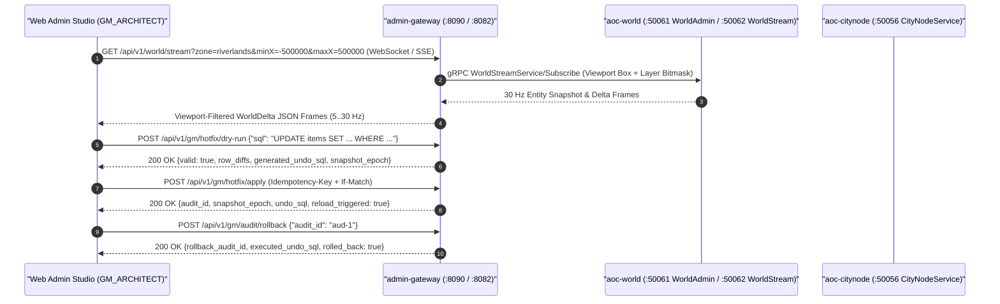

# Admin Gateway Service (`admin-gateway`)

The `admin-gateway` service (`src/server/services/cmd/admin-gateway` and `src/server/services/internal/admin-gateway`) is the Game Master (`GM`), live telemetry, spatial entity streaming, and transactional SQL hotfix API router for SandalCore. It runs either embedded inside [`mesh-gateway`](../mesh-gateway/README.md) (`aoc-mesh-gateway` on `:8082/tcp` in the standard 11-container Compose stack) or as a standalone HTTP/WebSocket daemon on `:8090/tcp`.

---

## 1. Architecture, RBAC & Session Security

`admin-gateway` enforces role-based access control (`RBAC`), optimistic concurrency (`ETag` / `If-Match`), and cryptographic idempotency across all GM and studio operations:

- **3-Tier Role Hierarchy (`RoleObserver < RoleOperator < RoleArchitect`)**:
  - `GM_OBSERVER` (Rank `1`): Read-only access to catalog search, live world entity streams (`GET /api/v1/world/stream`), worker health, container telemetry, and the audit log (`GET /api/v1/gm/audit`).
  - `GM_OPERATOR` (Rank `2`): Executes live entity and player commands (`spawn_npc`, `despawn_entity`, `teleport_player`, `grant_item`, `give_money`) and civic governance actions (`mayor` assignment and `election` triggers).
  - `GM_ARCHITECT` (Rank `3`): Executes cluster-wide structural mutations (`set_node_level`, `world_broadcast`, `reset_encounter`, `shutdown_zone`) and SQL hotfix overlays (`POST /api/v1/gm/hotfix/dry-run`, `POST /api/v1/gm/hotfix/apply`, `POST /api/v1/gm/audit/rollback`).
- **Constant-Time Token & Scoped `HS256` JWT Verification**: Validates bearer tokens via `subtle.ConstantTimeCompare` (`resolveRole`) and supports exchanging the startup passphrase (`deploy/.env`) for a scoped `HS256` JWT bound to the server's ephemeral `boot_id` so server restarts automatically invalidate prior browser sessions.
- **RFC 9457 Problem Details & Strong `ETag` Preconditions**: Every error response emits `application/problem+json` with `type`, `title`, `status`, `detail`, `code`, and `X-Correlation-ID`. Mutating requests (`POST`, `PUT`, `PATCH`, `DELETE`) validate `If-Match` against the current representation `ETag` (`412 Precondition Failed` on mismatch) and deduplicate retries via `Idempotency-Key` / `X-Idempotency-Key` SHA-256 payload hashing.



---

## 2. REST, Streaming & Hotfix API Reference

### Health, Metrics & OpenAPI Discovery

| Method | Path | Minimum Role | Description |
|:---|:---|:---:|:---|
| `GET` | `/livez`, `/readyz`, `/healthz` | Public | Liveness, readiness (`catalogEntries`), and health (`uptimeMs`, `worldEntities`, `activeSubscribers`) probes. |
| `GET`, `HEAD` | `/metrics`, `/api/v1/metrics`, `/api/v1/gm/metrics` | Public / `GM_OBSERVER` | OpenMetrics / Prometheus metrics (`requestsTotal`, `errorsTotal`, `cacheHits`, `cacheMisses`, `snapshotEpoch`). |
| `GET` | `/api/v1/gm/openapi.json`, `/api/v1/world/openapi.json` | `GM_OBSERVER` | OpenAPI 3.1 specification document for all Admin Gateway endpoints. |

### Catalog, World Streaming & Map Tiles

| Method | Path | Minimum Role | Description |
|:---|:---|:---:|:---|
| `GET` | `/api/v1/catalog/search?q=<str>&kind=<kind>&limit=<1..100>` | `GM_OBSERVER` | Unified prefix/substring search across items, NPCs, and places. |
| `GET` | `/api/v1/catalog/{items,npcs,places}` | `GM_OBSERVER` | Filtered, sorted, field-projected (`?fields=`), paginated catalog queries with `X-Pagination` and `ETag`. |
| `GET` | `/api/v1/world/entities?zone=<z>&minX=&minY=&maxX=&maxY=` | `GM_OBSERVER` | Point-in-time entity snapshot within the requested viewport bounding box. |
| `GET` | `/api/v1/world/stream` | `GM_OBSERVER` | Dual-protocol (`WebSocket` upgrade or `text/event-stream` SSE) viewport-bounded entity stream (`5..30 Hz`). |
| `GET` | `/api/v1/world/{state,players,workers,map-meta}` | `GM_OBSERVER` | Aggregated world state, online/offline player roster, multi-worker status, and tile metadata. |
| `GET` | `/api/v1/world/pmtiles`, `/api/v1/world/tiles/{z}/{x}/{y}`, `/icons/{icon}` | `GM_OBSERVER` | Serves `verra.pmtiles` map tiles and SVG/PNG entity markers. |

### GM Command Dispatch, Node Governance & SQL Hotfix Audit Ledger

| Method | Path | Minimum Role | Description |
|:---|:---|:---:|:---|
| `GET`, `POST` | `/api/v1/gm/commands`, `/api/v1/gm/command` | `GM_OBSERVER` / `GM_OPERATOR`+ | Lists supported GM commands or dispatches an idempotent command (`CommandReceipt`) to `world` / `citynode`. |
| `PUT` | `/api/v1/world/nodes/{node}` | `GM_ARCHITECT` | Sets a settlement node's progression tier (`0..6`) via `CityNodeService/SetNodeLevel`. |
| `POST` | `/api/v1/world/nodes/{node}/mayor`, `/election` | `GM_OPERATOR` | Assigns a settlement node's mayor or triggers a civic election cycle. |
| `POST` | `/api/v1/gm/hotfix/dry-run` | `GM_ARCHITECT` | Parses and validates single-statement DML (`UPDATE`/`INSERT`/`REPLACE`) against allowlisted tables (`world_hotfix_overlays`, `spawns`, `loot_tables`, `abilities`, `items`, `npcs`), rejecting DDL (`DROP`, `ALTER`, `TRUNCATE`, `ATTACH`, `PRAGMA`) and returning `row_diffs` + `generated_undo_sql`. |
| `POST` | `/api/v1/gm/hotfix/apply` | `GM_ARCHITECT` | Applies a validated SQL hotfix overlay, increments `snapshot_epoch`, records an immutable `AuditEntry`, and triggers hot-reload. |
| `GET` | `/api/v1/gm/audit` | `GM_OBSERVER` | Returns the ordered audit ledger (`snapshot_epoch`, `entries`) with `undo_sql` and rollback status. |
| `POST` | `/api/v1/gm/audit/rollback` | `GM_ARCHITECT` | Executes the recorded `undo_sql` for an `audit_id`, restores previous overlay state, and appends a rollback audit receipt. |

---

## 3. Configuration, Environment Variables & Data Modes

| Variable / Flag | Default | Description |
|:---|:---|:---|
| `AOC_ADMIN_HTTP_BIND_ADDR` / `AOC_ADMIN_ADDR` | `:8090` (Standalone) / `:8082` (Embedded) | TCP bind address for the standalone `admin-gateway` binary (`-http` flag). |
| `AOC_CONTENT_DB` / `SANDAL_CONTENT_DB` | `dist/content/content.db` | Path to the SQLite `content.db` (`v41`) catalog database. |
| `AOC_PMTILES_PATH` / `SANDAL_PMTILES_PATH` | `dist/content/verra.pmtiles` | Path to the Verra PMTiles archive. |
| `AOC_WORLD_ADMIN_ADDR` | `world:50061` (`127.0.0.1:50055`) | Target `WorldAdminService` gRPC address. |
| `AOC_WORLD_STREAM_ADDR` | `world:50062` (`127.0.0.1:50057`) | Target `WorldStreamService` gRPC address. |
| `AOC_CITYNODE_GRPC_ADDR` | `citynode:50056` (`127.0.0.1:50055`) | Target `CityNodeService` gRPC address. |
| `AOC_WORLD_WORKERS` | Multi-worker spec | Pipe-delimited list of regional/ZOI `world` worker endpoints for fan-out queries and streaming. |
| `AOC_SERVICE_TICK_HZ` | `30` (`30 Hz`) | Tick frequency for the `worldstream.Coalescer` (`33.33 ms` default interval). |
| `AOC_GM_OBSERVER_TOKEN` | `gm-observer-dev-token` | Bearer token mapped to `GM_OBSERVER` (`AOC_ADMIN_GATEWAY_OBSERVER_TOKEN` alias). |
| `AOC_GM_OPERATOR_TOKEN` | `gm-operator-dev-token` | Bearer token mapped to `GM_OPERATOR` (`AOC_ADMIN_GATEWAY_OPERATOR_TOKEN` alias). |
| `AOC_GM_ARCHITECT_TOKEN` | `gm-architect-dev-token` | Bearer token mapped to `GM_ARCHITECT` (`AOC_ADMIN_GATEWAY_ARCHITECT_TOKEN` alias). |

- **Catalog Data Modes (`memory|disk`)**: `internal/admin-catalog` supports loading catalog tables (`items`, `npcs`, `places`, `zois`, `city_nodes`, `pois`) from `content.db` (`v41`) and extracted `.tsv` files into memory (`memory` mode for sub-millisecond search and autocomplete) or querying disk-backed stores (`disk` mode), paired with an in-memory TTL response cache (`30s` for items/NPCs, `5s` for places, invalidated immediately on any mutating GM command or hotfix).

---

## 4. Local Development, Container Operations & Verification

```powershell
# Run standalone admin-gateway and internal router/hotfix/RBAC test suites
Push-Location src/server/services
go test -v ./cmd/admin-gateway/... ./internal/admin-gateway/... ./internal/admin-catalog/...
Pop-Location
```

---

## 5. Related Documentation

- [Go Control-Plane Services Overview (`src/server/services/README.md`)](../../README.md)
- [Mesh Gateway & Admin BFF (`src/server/services/cmd/mesh-gateway/README.md`)](../mesh-gateway/README.md)
- [Web Admin Container (`src/server/services/cmd/web-admin/README.md`)](../web-admin/README.md)
- [Web Admin Studio SPA (`src/clients/web-admin/README.md`)](../../../clients/web-admin/README.md)
- [World Operator CLI (`src/server/services/cmd/worldctl/README.md`)](../worldctl/README.md)
- [Container & Deployment Topology (`src/deploy/README.md`)](../../../deploy/README.md)
- [Web Admin Studio Guide (`docs/WEB_ADMIN.md`)](../../../../docs/WEB_ADMIN.md)
- [Control-Plane Services Reference (`docs/SERVICES.md`)](../../../../docs/SERVICES.md)
- [Environment & Configuration Reference (`docs/CONFIGURATION.md`)](../../../../docs/CONFIGURATION.md)
- [Server Workers & Spatial Sharding (`docs/SERVER_WORKERS.md`)](../../../../docs/SERVER_WORKERS.md)
- [SandalCore Root Documentation (`README.md`)](../../../../README.md)
