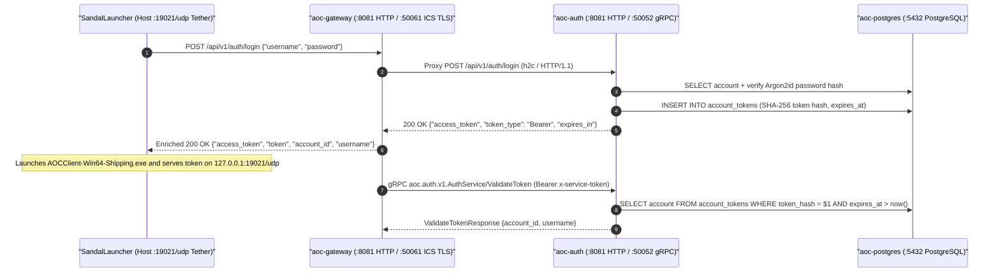

# Authentication Service (`auth` / `aoc-auth`)

The `auth` service (`src/server/services/cmd/auth`, container `aoc-auth`) is the authoritative identity, credential verification, and session token issuer for the SandalCore control plane. It exposes an HTTP/1.1 + HTTP/2 (`h2c`) REST API for account registration, login, and deletion alongside an internal gRPC `aoc.auth.v1.AuthService` endpoint consumed by [`gateway`](../gateway/README.md) during Intrepid Client Service (`ICS`) session establishment and `:19021/udp` `LocalTetherListener` ticket exchange.

---

## 1. Architecture & Authentication Flow

`auth` separates external launcher credential workflows from internal control-plane token verification:

- **Launcher HTTP API (`:8081/tcp`)**: Accepts JSON registration (`POST /api/v1/auth/register`), login (`POST /api/v1/auth/login`), and account removal (`DELETE /api/v1/auth/account`) requests proxied through [`ingress-proxy`](../../../deploy/README.md) and [`gateway`](../gateway/README.md).
- **Password Hashing & Verification**: Stores credentials in PostgreSQL (`accounts` table) using memory-hard Argon2id hashing and constant-time comparison (`internal/account`).
- **Session & Tether Ticket Lifecycle**: Issues opaque cryptographic bearer tokens persisted in `account_tokens` with a configurable TTL (`AOC_TOKEN_TTL`, default `24h`). When `SandalLauncher` launches `AOCClient-Win64-Shipping.exe`, the issued session token is served over the Windows host `127.0.0.1:19021/udp` `LocalTetherListener` ARQ handshake and redeemed by `gateway` via gRPC `ValidateToken`.
- **Automatic Ephemeral Cleanup**: Purges stale temporary launcher accounts (`temp_*`) on startup and runs an hourly background ticker (`purgeTokens`) to delete expired session tokens.



---

## 2. HTTP & gRPC API Surface

### HTTP Endpoints (`AOC_AUTH_HTTP_BIND_ADDR`, default `:8081`)

| Method | Path | Request Body / Headers | Response Summary |
|:---|:---|:---|:---|
| `POST` | `/api/v1/auth/register` (`/v1/register`) | `{"username": "<name>", "password": "<secret>"}` | `201 Created` or `200 OK` with `{"access_token", "token_type": "Bearer", "expires_in"}`; `409 Conflict` (`username_taken`) if registered. |
| `POST` | `/api/v1/auth/login` (`/v1/login`) | `{"username": "<name>", "password": "<secret>"}` | `200 OK` with `{"access_token", "token_type": "Bearer", "expires_in"}`; `401 Unauthorized` (`invalid_credentials`) on mismatch. |
| `DELETE` | `/api/v1/auth/account` (`/v1/account`) | `Authorization: Bearer <token>` or `{"username", "password"}` | `200 OK` `{"status": "deleted"}`; cascades deletion of owned characters and tokens. |
| `POST` | `/api/v1/auth/account/delete` (`/v1/account/delete`) | `Authorization: Bearer <token>` or `{"username", "password"}` | `200 OK` `{"status": "deleted"}`; POST alias for clients restricting `DELETE` bodies. |
| `GET` | `/livez`, `/readyz`, `/healthz`, `/health` | None | `200 OK` readiness and liveness status JSON payload with strong `ETag`. |
| `GET` | `/metrics` | None | OpenMetrics / Prometheus text-format service counters and readiness gauge (`1`). |

### gRPC Service (`AOC_AUTH_GRPC_BIND_ADDR`, container `:50052` / local `:50051`)

All gRPC calls require the shared control-plane service token in the `x-service-token` metadata header (`internal/svcauth`).

| Service | RPC Method | Request Type | Response Type | Behavior |
|:---|:---|:---|:---|:---|
| `aoc.auth.v1.AuthService` | `ValidateToken` | `ValidateTokenRequest{token}` | `ValidateTokenResponse{account_id, username}` | Validates a bearer session token against PostgreSQL; returns `Unauthenticated` when unknown or expired. |

---

## 3. Configuration & Environment Reference

`auth` reads configuration from flags (`-http`, `-grpc`, `-healthcheck`) and environment variables (`internal/config`):

| Variable / Flag | Default (Compose / Host) | Description |
|:---|:---|:---|
| `-http` / `AOC_AUTH_HTTP_BIND_ADDR` | `:8081` (`127.0.0.1:8081`) | TCP bind address for the cleartext HTTP/1.1 + `h2c` login and probe server. |
| `-grpc` / `AOC_AUTH_GRPC_BIND_ADDR` | `:50052` (`127.0.0.1:50051`) | TCP bind address for `aoc.auth.v1.AuthService`. |
| `AOC_DATABASE_URL` / `DATABASE_URL` | `postgres://aoc:<pass>@postgres:5432/aoc` | PostgreSQL connection string; runs forward-only SQL migrations (`internal/db`) on startup. |
| `AOC_DB_MAX_CONNS` / `AOC_DB_MIN_CONNS` | `16` / `2` | `pgxpool` connection pool bounds. |
| `AOC_SERVICE_TOKEN` / `AOC_SERVICE_TOKEN_FILE` | `dist/services/service.token` | Shared secret authenticating internal gRPC requests between control-plane services. |
| `AOC_TOKEN_TTL` | `24h` | Lifetime of issued account session tokens before hourly expiration purge. |
| `AOC_SERVICE_TICK_HZ` | `30` (`30 Hz`) | Default control-plane service loop cadence (`33.33 ms` tick interval). |
| `-healthcheck` | Flag | Executes a self-contained HTTP health probe against `/livez` and exits `0` when healthy. |

> [!NOTE]
> `auth` operates exclusively against PostgreSQL relational tables (`accounts`, `account_tokens`) and does not load `content.db` or `.tsv` game-data catalogs (`memory|disk` data modes are N/A for `auth`).

---

## 4. Local Development, Container Operations & Verification

Build and run `auth` within the 11-container Linux Compose topology or invoke its unit and integration test suites directly:

```powershell
# Run the auth unit and HTTP/gRPC handler test suites
Push-Location src/server/services
go test -v ./cmd/auth/... ./internal/account/... ./internal/authhttp/... ./internal/authgrpc/...
Pop-Location

# Check container health and Prometheus metrics inside the Compose stack
docker exec aoc-auth /usr/local/bin/service -healthcheck
```

---

## 5. Related Documentation

- [Go Control-Plane Services Overview (`src/server/services/README.md`)](../../README.md)
- [Gateway Service (`src/server/services/cmd/gateway/README.md`)](../gateway/README.md)
- [Character Service (`src/server/services/cmd/character/README.md`)](../character/README.md)
- [Container & Deployment Topology (`src/deploy/README.md`)](../../../deploy/README.md)
- [Control-Plane Services Reference (`docs/SERVICES.md`)](../../../../docs/SERVICES.md)
- [Environment & Configuration Reference (`docs/CONFIGURATION.md`)](../../../../docs/CONFIGURATION.md)
- [Server Workers & Spatial Sharding (`docs/SERVER_WORKERS.md`)](../../../../docs/SERVER_WORKERS.md)
- [Web Admin Studio Guide (`docs/WEB_ADMIN.md`)](../../../../docs/WEB_ADMIN.md)
- [SandalCore Root Documentation (`README.md`)](../../../../README.md)
