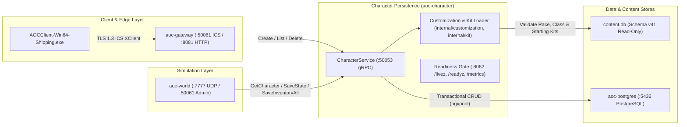

# Character Service (`character` / `aoc-character`)

The `character` service (`src/server/services/cmd/character`, container `aoc-character`) implements `aoc.character.v1.CharacterService`, the authoritative persistence and validation engine for player characters, appearance customization, starting equipment kits, inventories, currency wallets, artisan professions, crafting jobs, skill trees, action bars, warehouses, and Emberspring attunements.

---

## 1. Architecture & Persistence Model

`character` sits between [`gateway`](../gateway/README.md) (which handles character list, creation, and deletion on the Intrepid Client Service TLS stream) and [`world`](../../../world/README.md) (which loads full character state on zone entry and commits transactional state, inventory, wallet, and progression snapshots during play and logout).

- **Design-Data Creation Validation (`internal/customization`)**: Validates every new character's race, gender, archetype/class, and appearance customization choices against the compiled SQLite design database (`content.db`, schema `v41`) built by [`contentc`](../contentc/README.md). If `content.db` is missing or fails schema version validation, `character` continues serving existing characters while rejecting unchecked character creation with `FailedPrecondition`/`Unavailable`.
- **Class Kit & GM Starter Set Provisioning (`internal/kit`)**: Populates newly created characters with their archetype's starting equipment kit (`starting_equipment` table in `content.db`) and, when `AOC_GM_STARTER_SET=true`, grants the GM testing scroll bundle (level scrolls, class scrolls, gear scroll, test mounts, and a `21` gold / `210,000` copper starting purse). On startup, `character` idempotently backfills missing class kits (`GrantMissingKits`) and GM starter sets (`GrantMissingStarterSets`, `GrantMissingStarterMounts`) in per-character PostgreSQL transactions.
- **Native In-Game Character Creation**: `SandalLauncher` never pre-creates stub characters; accounts with zero characters enter the native UE5 character creator inside `AOCClient-Win64-Shipping.exe`, which submits `CreateCharacter` over ICS `:50061` through `gateway` to `character`.



---

## 2. gRPC API & Persisted Subsystems

All RPCs on `aoc.character.v1.CharacterService` (`:50053` in Compose, `:50052` host default) require `x-service-token` authentication:

| RPC Group | Methods / Store Interfaces | PostgreSQL & Content Scope |
|:---|:---|:---|
| **Lifecycle & Identity** | `CreateCharacter`, `ListCharacters`, `GetCharacter`, `DeleteCharacter` | Validates customization against `content.db`; stores character identity, race, gender, class, and initial spawn coordinates in `characters`. |
| **Spatial & Vitals State** | `SaveState` (`character.State`) | Persists world position (`x`, `y`, `z`, `yaw`), region/zone, current health/mana/stamina, and active flags. |
| **Inventory, Wallet & Warehouse** | `Inventory`, `SaveInventory`, `SaveInventoryAndWallet`, `SaveInventoryEverything` (`WalletStore`, `WarehouseStore`) | Atomically replaces equipped items, bag contents, copper/Glint currency balances, and node warehouse storage rows. |
| **Progression & Skills** | `Experience`, `SaveProgress`, `SkillRanks`, `ActionBar` | Tracks XP across leveling curves, purchased talent ranks per skill tree, and hotbar slot assignments. |
| **Artisan, Crafting & FTUE** | `Professions`, `ProcessingJobs`, `KnownRecipes`, `CompletedFTUEs`, `Attunements` (`JobStore`, `FTUEStore`, `AttunementStore`) | Persists all `22` artisan professions, active crafting/processing station timers, taught recipes, completed tutorial flags, and discovered Embersprings. |

### HTTP Probe & Metrics Endpoints (`:8082/tcp`)

- `GET /livez`, `GET /readyz`, `GET /healthz`: Returns JSON readiness state managed by `pkg/telemetry.ReadinessGate`.
- `GET /metrics`: Exposes OpenMetrics / Prometheus process and readiness gauges.

---

## 3. Configuration, Flags & Data Modes

| Variable / Flag | Default (Compose / Host) | Description |
|:---|:---|:---|
| `-addr` / `AOC_CHARACTER_GRPC_BIND_ADDR` | `:50053` (`127.0.0.1:50052`) | TCP bind address for the `CharacterService` gRPC server (`AOC_CHAR_GRPC_ADDR` alias). |
| `--content-db` / `AOC_CONTENT_DB` | `/app/dist/content/content.db` (`dist/content/content.db`) | Path to the compiled SQLite `content.db` (`v41`) used to validate character creation and build starting kits. |
| `--no-kit-backfill` | `false` | Disables the startup pass that grants class starting kits to existing characters with empty inventories. |
| `AOC_GM_STARTER_SET` | `true` (Compose) / `false` (Host) | Grants new and un-granted characters the GM testing scroll set, test mounts, and `21` gold starting purse. |
| `AOC_DATABASE_URL` / `DATABASE_URL` | `postgres://aoc:<pass>@postgres:5432/aoc` | PostgreSQL connection URL; applies forward-only migrations on startup. |
| `AOC_DB_MAX_CONNS` / `AOC_DB_MIN_CONNS` | `16` / `2` | `pgxpool` connection pool sizing. |
| `AOC_SERVICE_TOKEN` / `AOC_SERVICE_TOKEN_FILE` | `dist/services/service.token` | Shared control-plane token required on all gRPC calls. |
| `AOC_SERVICE_TICK_HZ` | `30` (`30 Hz`) | Default service runtime cadence (`33.33 ms` tick interval). |
| `-healthcheck` | Flag | Probes `:8082/livez` (and gRPC port readiness) for container health checks. |

- **Data Modes (`content.db` vs. `.tsv`)**: `character` opens `content.db` directly from disk in read-only mode at startup, loads `customization.Rules`, `kit.Maker`, and `kit.StarterMaker` into memory for zero-disk-I/O character creation checks, and writes runtime state exclusively to PostgreSQL. For offline bulk imports from legacy `characters.json` snapshots, use [`charimport`](../charimport/README.md).

---

## 4. Local Development, Container Operations & Verification

```powershell
# Run character service, gRPC, customization, and kit unit/integration tests
Push-Location src/server/services
go test -v ./cmd/character/... ./internal/character/... ./internal/charactergrpc/... ./internal/customization/... ./internal/kit/...
Pop-Location

# Verify container health inside Docker Compose
docker exec aoc-character /usr/local/bin/service -healthcheck
```

---

## 5. Related Documentation

- [Go Control-Plane Services Overview (`src/server/services/README.md`)](../../README.md)
- [Character Import Utility (`src/server/services/cmd/charimport/README.md`)](../charimport/README.md)
- [Content Compiler (`src/server/services/cmd/contentc/README.md`)](../contentc/README.md)
- [Gateway Service (`src/server/services/cmd/gateway/README.md`)](../gateway/README.md)
- [Authoritative World Server (`src/server/world/README.md`)](../../../world/README.md)
- [Container & Deployment Topology (`src/deploy/README.md`)](../../../deploy/README.md)
- [Control-Plane Services Reference (`docs/SERVICES.md`)](../../../../docs/SERVICES.md)
- [Environment & Configuration Reference (`docs/CONFIGURATION.md`)](../../../../docs/CONFIGURATION.md)
- [Server Workers & Spatial Sharding (`docs/SERVER_WORKERS.md`)](../../../../docs/SERVER_WORKERS.md)
- [Web Admin Studio Guide (`docs/WEB_ADMIN.md`)](../../../../docs/WEB_ADMIN.md)
- [SandalCore Root Documentation (`README.md`)](../../../../README.md)
