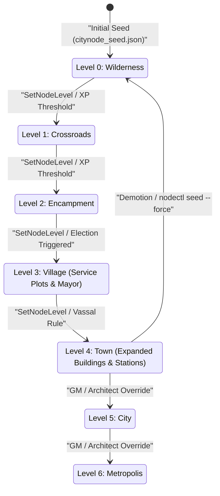
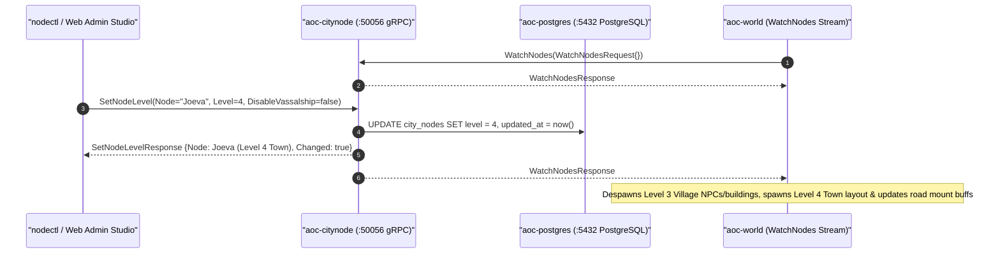

# CityNode Service (`citynode` / `aoc-citynode`)

The `citynode` service (`src/server/services/cmd/citynode`, container `aoc-citynode`) implements `aoc.citynode.v1.CityNodeService`, the authoritative control-plane state machine for Verra's Settlement Nodes (`0..6` progression from `Wilderness` to `Metropolis`), node experience accumulation, parent/vassal hierarchies, the adjustable node simulation clock, and real-time change streaming to [`world`](../../../world/README.md), [`nodectl`](../nodectl/README.md), and [`mesh-gateway`](../mesh-gateway/README.md).

---

## 1. Architecture, Settlement Progression & Live World Streaming

Verra contains `81` typed node records across `78` Zones of Influence (`ZOI`), including the `26` levelable settlement nodes seeded by `config/seeds/citynode_seed.json`. `citynode` persists every node's progression in PostgreSQL and broadcasts monotonic sequence updates (`WatchNodes`) to connected zone servers:

- **7-Stage Node Level Progression (`0..6`)**:
  - `0` -- `Wilderness`
  - `1` -- `Crossroads`
  - `2` -- `Encampment`
  - `3` -- `Village` (unlocks service plots, artisan stations, and mayoral governance)
  - `4` -- `Town` (`MaxNodeLevel` in standard Nodes 1 progression rules)
  - `5` -- `City`
  - `6` -- `Metropolis`
- **Live `world` Tier-Change Synchronization**: Every [`world`](../../../world/README.md) worker subscribes to `CityNodeService/WatchNodes`. When a settlement node's level changes via GM command, [`nodectl`](../nodectl/README.md), or Web Admin Studio (`PUT /api/v1/world/nodes/{node}`), `citynode` emits a `NodeChanged` event (`CHANGE_CAUSE_GM`, `CHANGE_CAUSE_SEED`, or `CHANGE_CAUSE_XP`). The authoritative `world` worker immediately transitions the node's layout, despawns prior-tier NPCs and building actors, respawns the new tier's population and service plots, and updates road mount-speed tiers (`roads_levels.tsv`).
- **Mayoral Elections, Governance & Tax Policies**: Coordinates with [`admin-gateway`](../admin-gateway/README.md) (`POST /api/v1/world/nodes/{node}/mayor`, `POST /api/v1/world/nodes/{node}/election`) and `world` to manage civic leadership, service buildings, and ZOI tax policies.
- **One-Time transactional Seed Application**: On first startup, `citynode` applies `citynode_seed.json` in a single atomic PostgreSQL transaction (`city_node_seed.applied_at`). Subsequent startups preserve live database progression unless explicitly overwritten via `nodectl seed --force`.





---

## 2. gRPC & HTTP API Surface

### gRPC Service (`aoc.citynode.v1.CityNodeService`, default `:50056` in Compose / `:50055` on Host)

All gRPC methods require the control-plane `x-service-token` credential:

| RPC Method | Request | Response / Stream | Description |
|:---|:---|:---|:---|
| `ListNodes` | `ListNodesRequest{}` | `ListNodesResponse{nodes, clock, seq, max_node_level}` | Returns a full point-in-time snapshot of all nodes, vassal links, sequence number, and node clock. |
| `GetNode` | `GetNodeRequest{node: {guid \| name}}` | `GetNodeResponse{node}` | Resolves a node by GUID, record name (`Verra_RVR_Joeva`), short name (`RVR_Joeva`), or display name (`Joeva`). |
| `SetNodeLevel` | `SetNodeLevelRequest{node, level, disable_vassalship}` | `SetNodeLevelResponse{node, changed}` | Transitions a node's level, records the mutation in PostgreSQL, and broadcasts `NodeChanged` to all watchers. |
| `AddNodeExperience` | `AddNodeExperienceRequest{node, amount}` | `AddNodeExperienceResponse{node}` | Adds XP to a node and computes progress percentage toward the next tier. |
| `GetClock` | `GetClockRequest{}` | `GetClockResponse{clock}` | Returns current virtual node time, speed multiplier (`factor`), and offset seconds. |
| `AdvanceClock` | `AdvanceClockRequest{seconds}` | `AdvanceClockResponse{clock}` | Skips the virtual node clock forward by `seconds` and notifies watchers. |
| `SetClockSpeed` | `SetClockSpeedRequest{factor}` | `SetClockSpeedResponse{clock}` | Adjusts the simulation clock rate (`1.0` = real-time) and broadcasts `ClockChanged`. |
| `ApplySeed` | `ApplySeedRequest{force, seed_json}` | `ApplySeedResponse{applied, forced, nodes_changed, applied_at_ms}` | Applies the default or caller-supplied seed JSON; `--force` resets every node's level and parent link while keeping XP. |
| `WatchNodes` | `WatchNodesRequest{}` | `stream WatchNodesResponse` | Emits an initial `Snapshot` followed by ordered `NodeChanged` and `ClockChanged` deltas (`ErrLagged` -> `Aborted` if a slow reader falls behind). |

### HTTP Probe & Metrics Endpoints (`:8083/tcp`)

- `GET /livez`, `GET /readyz`, `GET /healthz`: Readiness gate status (`200 OK`).
- `GET /metrics`: Prometheus / OpenMetrics telemetry endpoint.

---

## 3. Configuration, Flags & Data Modes

| Variable / Flag | Default (Compose / Host) | Description |
|:---|:---|:---|
| `-addr` / `AOC_CITYNODE_GRPC_BIND_ADDR` | `:50056` (`127.0.0.1:50055`) | TCP bind address for `CityNodeService` (`AOC_CITYNODE_GRPC_ADDR` alias). |
| `-seed` / `AOC_CITYNODE_SEED` | `/app/config/seeds/citynode_seed.json` | Path to the JSON seed file applied atomically on first database initialization. |
| `AOC_DATABASE_URL` / `DATABASE_URL` | `postgres://aoc:<pass>@postgres:5432/aoc` | PostgreSQL connection string (`0009`+ migrations create `city_nodes` and `city_node_seed`). |
| `AOC_DB_MAX_CONNS` / `AOC_DB_MIN_CONNS` | `16` / `2` | `pgxpool` connection pool bounds. |
| `AOC_SERVICE_TOKEN` / `AOC_SERVICE_TOKEN_FILE` | `dist/services/service.token` | Shared token authenticating gRPC callers (`world`, `nodectl`, `mesh-gateway`). |
| `AOC_SERVICE_TICK_HZ` | `30` (`30 Hz`) | Default control-plane service loop frequency. |
| `-healthcheck` | Flag | Probes `:8083/livez` and exits `0` when healthy. |

- **Data Modes (`memory|disk` & Seed Roster)**: `citynode` loads its static 81-node roster (`citynode.DefaultRoster()`) into memory, reads `citynode_seed.json` from disk on first boot, and maintains an in-memory state cache backed by PostgreSQL write-through transactions so `ListNodes`, `GetNode`, and `WatchNodes` snapshots execute with zero disk latency. Static node layout and building definitions are compiled into `content.db` (`city_node`, `city_zoi`, `node_layout*`, `building*`, `service_plot*`) and `city_nodes.tsv` by [`contentc`](../contentc/README.md).

---

## 4. Local Development, Container Operations & Verification

```powershell
# Run citynode unit and gRPC streaming test suites
Push-Location src/server/services
go test -v ./cmd/citynode/... ./internal/citynode/... ./internal/citynodegrpc/...
Pop-Location

# Inspect live node progression using nodectl
./dist/services/nodectl.exe list --addr 127.0.0.1:50056
```

---

## 5. Related Documentation

- [Go Control-Plane Services Overview (`src/server/services/README.md`)](../../README.md)
- [Node Operator CLI (`src/server/services/cmd/nodectl/README.md`)](../nodectl/README.md)
- [Authoritative World Server (`src/server/world/README.md`)](../../../world/README.md)
- [Mesh Gateway & Admin BFF (`src/server/services/cmd/mesh-gateway/README.md`)](../mesh-gateway/README.md)
- [Content Compiler (`src/server/services/cmd/contentc/README.md`)](../contentc/README.md)
- [Container & Deployment Topology (`src/deploy/README.md`)](../../../deploy/README.md)
- [Control-Plane Services Reference (`docs/SERVICES.md`)](../../../../docs/SERVICES.md)
- [Environment & Configuration Reference (`docs/CONFIGURATION.md`)](../../../../docs/CONFIGURATION.md)
- [Server Workers & Spatial Sharding (`docs/SERVER_WORKERS.md`)](../../../../docs/SERVER_WORKERS.md)
- [Web Admin Studio Guide (`docs/WEB_ADMIN.md`)](../../../../docs/WEB_ADMIN.md)
- [SandalCore Root Documentation (`README.md`)](../../../../README.md)
