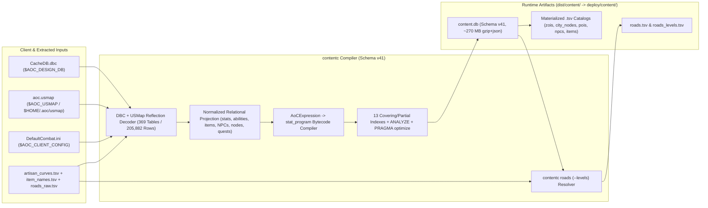

# Content Compiler & Road Tier Resolver (`contentc`)

`contentc` (`src/server/services/cmd/contentc`) is the deterministic game-data compiler that decodes the Ashes of Creation client design database (`CacheDB.dbc`), Unreal reflection mappings (`aoc.usmap`), client combat configuration (`DefaultCombat.ini`), and extracted `.tsv` tables into `dist/content/content.db` (schema version `v41`), the single authoritative SQLite design database consumed by [`world`](../../../world/README.md), [`character`](../character/README.md), [`citynode`](../citynode/README.md), and [`mesh-gateway`](../mesh-gateway/README.md).

---

## 1. Architecture & Compilation Pipeline

`contentc` transforms raw binary client assets into strongly typed relational tables, pre-compiled stat bytecode programs (`stat_program`), and spatial `.tsv` catalogs:

1. **Design Database Decoding (`internal/designdb` + `aoc.usmap`)**: Decodes all `369` tables (`205,882` rows) of `CacheDB.dbc` against the active `.usmap` reflection schema (`$HOME/.aoc/usmap/aoc.usmap` override or `src/config/layouts/aoc.usmap`), recording SHA-256 input digests, row counts, and `contentc.version = 41` in the `meta` table.
2. **Typed Subsystem Materialization (`internal/content/schema.go`)**: Populates normalized relational tables for character classes and base stats (`class`, `class_stat_base`, `stat_def`, `stat_curve`), combat abilities and montages (`ab_*`, `ability_runtime`, `effect_runtime`), equipment and starting kits (`item`, `equip_slot`, `starting_equipment`, `quality_curve`), talent trees (`skill_tree`, `skill_node`, `skill_rank`), NPC populations and vendor inventories (`npc_*`, `vendor_*`), settlement nodes (`city_node`, `city_zoi`, `node_layout*`, `building*`, `service_plot*`), gathering/professions (`gather_def`, `profession`), crafting/processing, quests, and Glint currencies (`currency_tier`, `currency_def`).
3. **Bytecode Expression Compilation (`internal/aocexpr` & `internal/statprog`)**: Compiles `AoCExpression` formulas into verified `stat_program` bytecode (`format version 2`), decoding and re-encoding the compiled graph before atomic rename so `world` evaluates combat and stat formulas with zero runtime text parsing.
4. **Road Mount-Speed Tier Resolution (`contentc roads`)**: Joins `roads_raw.tsv` (`BP_RoadActor_C` splines sampled every `200 cm`) with `RoadPresetRecordBase`, `RoadAppearanceRecordBase`, and `mount_effect` in `content.db` to emit `dist/content/roads.tsv` (single node level) and `dist/content/roads_levels.tsv` (all 7 node levels `0..6` with owner `zoi_guid`).



---

## 2. CLI Usage & Flags Reference

### Primary Build Command (`contentc`)

```powershell
Push-Location src/server/services
go run ./cmd/contentc `
    --dbc "<GameRoot>\AOC\Plugins\DesignDataPlugin\Generated\Client\CacheDB.dbc" `
    --usmap "..\..\dist\content\aoc.usmap" `
    --config "..\..\dist\content\client_config" `
    --artisan-curves "..\..\dist\content\artisan_curves.tsv" `
    --item-names "..\..\dist\content\item_names.tsv" `
    --record-encoding "gzip+json" `
    --out "..\..\dist\content\content.db"
Pop-Location
```

| Flag | Environment Variable | Default | Description |
|:---|:---|:---|:---|
| `--dbc` | `AOC_DESIGN_DB` | Required | Path to the client's `CacheDB.dbc` design database. |
| `--usmap` | `AOC_USMAP` | Required | Path to the Unreal `.usmap` mappings file (`$HOME/.aoc/usmap/aoc.usmap` takes automatic precedence via `Resolve-SandalUsmapPath`). |
| `--config` | `AOC_CLIENT_CONFIG` | `1 s` regen fallback | Path to the extracted client `AOC\Config` directory containing `DefaultCombat.ini`. |
| `--artisan-curves` | `AOC_ARTISAN_CURVES` | `dist/content/artisan_curves.tsv` | Profession level-up curves extracted from pak assets. |
| `--item-names` | `AOC_ITEM_NAMES` | `dist/content/item_names.tsv` | String-table display names for Glint currencies and quest items. |
| `--record-encoding` | N/A | `gzip+json` | Encoding for `record.data` blobs: `gzip+json` (`~270 MB` total DB) or `json` (`~573 MB`, directly queryable with SQLite `json_extract`). |
| `--out` | N/A | `dist/content/content.db` | Destination SQLite file path (written to a temporary sibling file and atomically renamed on completion). |

### Road Spline Subcommand (`contentc roads`)

```powershell
Push-Location src/server/services
# Single node level (roads.tsv)
go run ./cmd/contentc roads --content ..\..\dist\content\content.db --raw ..\..\dist\content\roads_raw.tsv --out ..\..\dist\content\roads.tsv --node-level Wilderness

# All 7 node levels 0..6 with owner ZOI GUIDs (roads_levels.tsv)
go run ./cmd/contentc roads --levels --content ..\..\dist\content\content.db --raw ..\..\dist\content\roads_raw.tsv --out ..\..\dist\content\roads_levels.tsv
Pop-Location
```

| Flag (`contentc roads`) | Default | Description |
|:---|:---|:---|
| `--content` | `dist/content/content.db` | Source `content.db` containing `RoadPresetRecordBase`, `RoadAppearanceRecordBase`, and `mount_effect`. |
| `--raw` | `dist/content/roads_raw.tsv` | Raw road actor splines (`200 cm` sample step) produced by `aoc-extractor` / `mapc roads`. |
| `--out` | `dist/content/roads.tsv` (`roads_levels.tsv` with `--levels`) | Output TSV consumed by `world` for mount speed buffs (`max(RoadWidth, 1000) / 2` cm half-width). |
| `--node-level` | `Wilderness` (`0`) | Settlement node tier (`Wilderness`..`Metropolis` or `0..6`) when generating a single-tier `roads.tsv`. |
| `--levels` | `false` | Emits `roads_levels.tsv` (`roadn <TAB> zoi_guid <TAB> t0..t6 <TAB> h0..h6 <TAB> x,y...`) across all 7 node levels. |
| `--check` | `false` | Read-only verification mode; exits `0` if `--out` matches a fresh build byte-for-byte, `1` otherwise. |

---

## 3. Schema `v41` Ratchet, 13 Covering Indexes & `memory|disk` Data Modes

### Automatic Schema Version Ratchet (`Ensure-SandalContentDbCurrent`)
`scripts/lib/Env.psm1` inspects `src/server/services/cmd/contentc/build.go` (`const Version = "41"`) and verifies binary markers (`contentc.version41` and `cast_ability_guid`) inside `dist/content/content.db`. Whenever `content.db` is missing, older than `cmd/contentc/*.go`, or stamped with a prior version, `Ensure-SandalContentDbCurrent` automatically triggers a fast `contentc` rebuild, applies all covering indexes, hardlinks/syncs the updated database into `deploy/content/content.db`, and restarts running consumer containers (`aoc-world-riverlands`, `aoc-character`, `aoc-citynode`).

### 13 Mandatory SQLite Covering & Partial Indexes + `ANALYZE`
`contentc` and `Ensure-SandalContentDbIndexes` enforce `13` covering and partial indexes followed by `ANALYZE; PRAGMA optimize;` so hot-path lookups execute as index-only scans (`0` table heap page fetches):

| # | Index Name | Target Table & Columns | Predicate / Purpose |
|:---:|:---|:---|:---|
| `1` | `record_by_guid` | `record (guid, schema, name)` | Covers GUID-to-schema/name resolution across all `205,882` records. |
| `2` | `record_by_schema_guid` | `record (schema, guid, name)` | Accelerates per-table record iteration in `contentc` and `world`. |
| `3` | `stat_def_display_pct` | `stat_def (guid) WHERE display_pct = 1` | Partial index for percentage-formatted combat stats. |
| `4` | `stat_curve_by_name_ord` | `stat_curve (name, ord, level, value)` | Covering index for `EvalCurve` interpolation without row fetches. |
| `5` | `stat_init_by_name_ord` | `stat_init (list_name, ord)` | Orders stat initializer formulas during character/NPC spawning. |
| `6` | `class_stat_base_by_name_level` | `class_stat_base (class_name, level)` | Covers primary attribute lookups for all 8 archetypes across levels `1..50`. |
| `7` | `item_by_name_nocase` | `item (name COLLATE NOCASE, guid)` | Case-insensitive item resolution for `worldctl give-item` and GM catalog search. |
| `8` | `leveling_type_by_exp_guid` | `leveling_type (experience_type, guid, name)` | Maps experience categories to leveling curves. |
| `9` | `skill_auto_grant_by_leveling` | `skill_auto_grant (leveling_type_guid, level_requirement, node_guid)` | Covers automatic skill rank grants on level-up. |
| `10` | `skill_tree_by_class` | `skill_tree (class_guid)` | Resolves archetype talent trees. |
| `11` | `skill_tree_by_name` | `skill_tree (name)` | Resolves weapon and class trees by symbol name (`worldctl weapon-xp`). |
| `12` | `skill_node_auto_granted` | `skill_node (tree_guid, skill_guid, level_requirement) WHERE auto_granted = 1` | Partial covering index for auto-granted talent nodes. |
| `13` | `vendor_def_by_name` | `vendor_def (name, guid)` | Covers vendor definition lookups during NPC population spawning. |

### Runtime Data Modes (`memory|disk`)
- **`world` In-Memory Preload (`AOC_WORLD_CACHE_ALL_CONTENT_IN_MEMORY=true`)**: Preloads `content.db` and `area_nav.bin` into RAM at worker startup so `30 Hz` simulation ticks never block on disk I/O.
- **Control-Plane `.tsv` & `content.db` Catalog (`mesh-gateway` / `admin-gateway`)**: Supports `memory` mode (preloading `zois.tsv`, `city_nodes.tsv`, `pois.tsv`, `npcs.tsv`, and `items.tsv` / `content.db` tables into memory) and `disk` mode (on-demand SQLite queries).

---

## 4. Verification & Testing

```powershell
# Run contentc compiler, road resolver, and content schema unit tests
Push-Location src/server/services
go test -v ./cmd/contentc/... ./internal/content/... ./internal/designdb/... ./internal/aocexpr/... ./internal/statprog/...
Pop-Location
```

---

## 5. Related Documentation

- [Go Control-Plane Services Overview (`src/server/services/README.md`)](../../README.md)
- [Game Data Extractor (`src/tools/aoc-extractor/README.md`)](../../../tools/aoc-extractor/README.md)
- [Authoritative World Server (`src/server/world/README.md`)](../../../world/README.md)
- [Character Service (`src/server/services/cmd/character/README.md`)](../character/README.md)
- [CityNode Service (`src/server/services/cmd/citynode/README.md`)](../citynode/README.md)
- [Container & Deployment Topology (`src/deploy/README.md`)](../../../deploy/README.md)
- [Control-Plane Services Reference (`docs/SERVICES.md`)](../../../../docs/SERVICES.md)
- [Environment & Configuration Reference (`docs/CONFIGURATION.md`)](../../../../docs/CONFIGURATION.md)
- [Server Workers & Spatial Sharding (`docs/SERVER_WORKERS.md`)](../../../../docs/SERVER_WORKERS.md)
- [Web Admin Studio Guide (`docs/WEB_ADMIN.md`)](../../../../docs/WEB_ADMIN.md)
- [SandalCore Root Documentation (`README.md`)](../../../../README.md)
