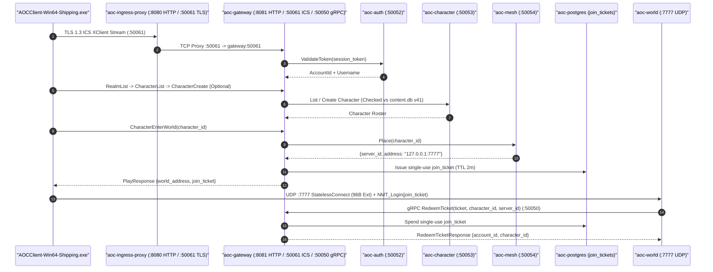

# Client & Edge Gateway Service (`gateway` / `aoc-gateway`)

The `gateway` service (`src/server/services/cmd/gateway`, container `aoc-gateway`) is the unified edge broker between external game clients (`AOCClient-Win64-Shipping.exe` and `SandalLauncher`), internal control-plane microservices ([`auth`](../auth/README.md), [`character`](../character/README.md), [`citynode`](../citynode/README.md), [`quest`](../quest/README.md), [`mesh`](../mesh/README.md)), and the authoritative [`world`](../../../world/README.md) simulation servers.

---

## 1. Architecture & Three-Plane Listener Topology

`gateway` binds three distinct network listeners inside a single process (`serveGateway` in `src/server/services/cmd/gateway/main.go`):

1. **Intrepid Client Service (`ICS`) TLS 1.3 gRPC Stream (`:50061/tcp`, `AOC_GATEWAY_ICS_ADDR`)**:
   - Terminates TLS (`dist/certs/server.pem` + `server.key`, with automatic fallback to an ephemeral ECDSA P-256 self-signed certificate if disk certs are absent) and serves `ics.xclient.XClientService` over HTTP/2 (`h2`).
   - Enforces relaxed gRPC keepalive policies (`MinTime: 5s`, `PermitWithoutStream: true`) tailored for `grpc-c++` inside `AOCClient-Win64-Shipping.exe`.
   - Multiplexes session login (`ValidateToken` via [`auth`](../auth/README.md)), realm discovery (`RealmList`), character roster operations (`CharacterList`, `CharacterCreate`, `CharacterDelete` via [`character`](../character/README.md)), and world entry (`CharacterEnterWorld` / `Play` via [`mesh`](../mesh/README.md) + one-time join ticket issuance in PostgreSQL `join_tickets`).
2. **Launcher & REST Bridge HTTP Server (`:8081/tcp`, routed via Envoy `:8080/tcp`)**:
   - Proxies `/api/v1/auth/*` and `/v1/*` credential requests to [`auth`](../auth/README.md) over `h2c` (with HTTP/1.1 fallback), normalizing username-only payloads (`<username>@sandalcore.local`) and enriching responses with `token`, `account_id`, and `username`.
   - Exposes REST character CRUD endpoints (`/api/v1/characters*`), `/api/v1/catalog/realms`, and `/api/v1/world/enter` protected by a non-strict UUIDv7 idempotency ledger (`telemetry.NewIdempotencyMiddleware`).
3. **Internal Zone-Server gRPC Listener (`:50050/tcp`, `AOC_GATEWAY_GRPC_ADDR`)**:
   - Serves `aoc.gateway.v1.GatewayService/RedeemTicket` exclusively to [`world`](../../../world/README.md) workers.
   - When a client connects to `world` over UDP `:7777` and transmits its join ticket in the `StatelessConnect` / `NMT_Login` handshake, `world` calls `RedeemTicket` with the `x-service-token` header to atomically spend the single-use ticket and bind the UDP session to `(account_id, character_id, server_id)`.



---

## 2. HTTP, ICS TLS & Internal gRPC API Surface

### HTTP Endpoints (`AOC_GATEWAY_HTTP_BIND_ADDR`, default `:8081`, ingress `:8080`)

| Method | Path | Upstream / Handler | Description |
|:---|:---|:---|:---|
| `POST` | `/api/v1/auth/register`, `/v1/register` | Proxied to `auth:8081` | Registers a new account and records the issued bearer token in the HTTP bridge. |
| `POST` | `/api/v1/auth/login`, `/v1/login` | Proxied to `auth:8081` | Authenticates credentials and returns enriched `access_token` / `token` JSON. |
| `DELETE`, `POST` | `/api/v1/auth/account`, `/api/v1/auth/account/delete` | Proxied to `auth:8081` | Deletes the account and revokes cached bridge tokens. |
| `GET`, `POST`, `DELETE` | `/api/v1/characters`, `/api/v1/characters/{id}` | `characterHTTPBridge` | Lists, creates, or deletes characters over HTTP REST on behalf of REST/admin clients. |
| `GET` | `/api/v1/catalog/realms` | Built-in handler | Returns active realm descriptors (`verra-alpha`) and `world_endpoint`. |
| `POST` | `/api/v1/world/enter` | `handleGatewayWorldEnter` | Validates bearer/join ticket and returns `{"status": "ALLOW", "world_endpoint", "zone_key": "verra-01"}`. |
| `GET` | `/livez`, `/readyz`, `/healthz` | Built-in probe | Returns `200 OK` `{"status": "ok"}` with strong `ETag`. |
| `GET` | `/metrics` | `ReadinessGate` | Exposes Prometheus / OpenMetrics scrape metrics. |

### gRPC Services

| Listener | Port | Protobuf Service | Authentication | Purpose |
|:---|:---:|:---|:---|:---|
| **ICS Client Stream** | `:50061` | `ics.xclient.XClientService` | TLS 1.3 + Launcher Session Token | Bi-directional game client stream (`RealmList`, `CharacterCreate`, `CharacterList`, `CharacterEnterWorld`). |
| **Internal Gateway** | `:50050` | `aoc.gateway.v1.GatewayService` | `x-service-token` + UUIDv7 Idempotency | Single-use `RedeemTicket` verification called by `world` on player UDP join. |

---

## 3. Configuration, Flags & Certificate Handling

| Variable / Flag | Default (Compose / Host) | Description |
|:---|:---|:---|
| `-http` / `AOC_GATEWAY_HTTP_BIND_ADDR` | `:8081` (`127.0.0.1:8080`) | Bind address for the cleartext HTTP/1.1 + `h2c` REST and health server. |
| `AOC_GATEWAY_ICS_ADDR` / `AOC_GATEWAY_TLS_ADDR` | `:50061` | Bind address for the TLS-terminated `XClientService` gRPC server. |
| `-grpc` / `AOC_GATEWAY_GRPC_BIND_ADDR` | `:50050` (`127.0.0.1:50050`) | Bind address for internal `GatewayService/RedeemTicket`. |
| `AOC_GATEWAY_GRPC_PUBLIC` | `1` (Compose) / `0` (Host) | Permits binding `:50050` on non-loopback container interfaces (`service_net`). |
| `AOC_GATEWAY_TLS_CERT` / `AOC_GATEWAY_TLS_KEY` | `/app/certs/server.pem` / `server.key` | X.509 certificate and private key for `:50061`; preserves user/wildcard certs in `dist/certs/` and `$HOME/.aoc/certs/`. |
| `-auth` / `AOC_AUTH_GRPC_ADDR` | `auth:50052` | Upstream `auth` gRPC address (`AOC_AUTH_HTTP_ADDR=http://auth:8081` for HTTP proxy). |
| `-char` / `AOC_CHARACTER_GRPC_ADDR` | `character:50053` | Upstream `character` gRPC address. |
| `-citynode` / `AOC_CITYNODE_GRPC_ADDR` | `citynode:50056` | Upstream `citynode` gRPC address. |
| `-quest` / `AOC_QUEST_GRPC_ADDR` | `quest:50057` | Upstream `quest` gRPC address. |
| `-mesh` / `AOC_MESH_GRPC_ADDR` | `mesh:50054` | Upstream `mesh` gRPC address. |
| `-world-host` / `-world-port` (`WORLD_HOST` / `WORLD_PORT`) | `127.0.0.1` / `7777` | Publicly dialable host and UDP port advertised to the game client on world entry. |
| `-content-db` / `AOC_CONTENT_DB` | `/app/dist/content/content.db` | Mounted `content.db` (`v41`) path. |
| `AOC_TICKET_TTL` | `2m` | Expiration window for single-use `join_tickets` before hourly background purge. |
| `AOC_SERVICE_TICK_HZ` | `30` (`30 Hz`) | Default control-plane service loop cadence (`33.33 ms` tick interval). |

---

## 4. Local Development, Container Operations & Verification

```powershell
# Run gateway unit, ICS stream, and ticket redemption tests
Push-Location src/server/services
go test -v ./cmd/gateway/... ./internal/ics/... ./internal/gatewaygrpc/... ./internal/tickets/...
Pop-Location

# Verify container health inside Docker Compose
docker exec aoc-gateway /usr/local/bin/service -healthcheck
```

---

## 5. Related Documentation

- [Go Control-Plane Services Overview (`src/server/services/README.md`)](../../README.md)
- [Authentication Service (`src/server/services/cmd/auth/README.md`)](../auth/README.md)
- [Character Service (`src/server/services/cmd/character/README.md`)](../character/README.md)
- [Mesh Service (`src/server/services/cmd/mesh/README.md`)](../mesh/README.md)
- [Mesh Gateway & Admin BFF (`src/server/services/cmd/mesh-gateway/README.md`)](../mesh-gateway/README.md)
- [Container & Deployment Topology (`src/deploy/README.md`)](../../../deploy/README.md)
- [Control-Plane Services Reference (`docs/SERVICES.md`)](../../../../docs/SERVICES.md)
- [Environment & Configuration Reference (`docs/CONFIGURATION.md`)](../../../../docs/CONFIGURATION.md)
- [Server Workers & Spatial Sharding (`docs/SERVER_WORKERS.md`)](../../../../docs/SERVER_WORKERS.md)
- [Web Admin Studio Guide (`docs/WEB_ADMIN.md`)](../../../../docs/WEB_ADMIN.md)
- [SandalCore Root Documentation (`README.md`)](../../../../README.md)
