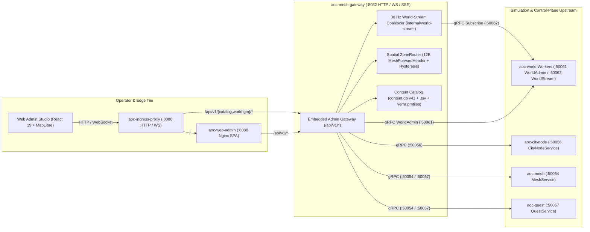

# Mesh Gateway & Control-Plane BFF (`mesh-gateway` / `aoc-mesh-gateway`)

The `mesh-gateway` service (`src/server/services/cmd/mesh-gateway`, container `aoc-mesh-gateway`) is the unified Backend-for-Frontend (`BFF`), `30 Hz` world-stream coalescer, multi-worker spatial router, and Prometheus/OpenTelemetry target aggregator for the [Web Admin Studio](../../../clients/web-admin/README.md). It embeds the full [`admin-gateway`](../admin-gateway/README.md) HTTP/WebSocket/SSE router under `/api/` and serves traffic routed by [`ingress-proxy`](../../../deploy/README.md) (`:8080/tcp`) and [`web-admin`](../web-admin/README.md) (`:8088/tcp`).

---

## 1. Architecture & Multi-Worker Aggregation

`mesh-gateway` bridges the stateless Go control plane and the multi-worker C++23 [`world`](../../../world/README.md) simulation mesh:

- **Embedded Admin Gateway Router (`internal/admin-gateway`)**: Mounts all `/api/v1/catalog/*`, `/api/v1/world/*`, and `/api/v1/gm/*` routes directly on its HTTP listener (`:8082/tcp` in Compose, `127.0.0.1:19082` host fallback) while exposing `/livez`, `/readyz`, `/healthz`, and `/metrics` through a 60-sample sliding-window `ReadinessGate`.
- **`30 Hz` World-Stream Coalescer (`internal/world-stream`)**: Runs a background `worldstream.Coalescer` loop at `AOC_SERVICE_TICK_HZ` (default `30 Hz` / `33.33 ms` tick interval). It subscribes to `WorldStreamService` (`:50062/tcp`) across all configured `world` workers (`AOC_WORLD_WORKERS`), merges entity additions, movements, and removals into viewport-filtered `WorldDelta` frames, and fans them out over WebSocket and Server-Sent Events (`GET /api/v1/world/stream`).
- **Spatial Packet Forwarding & Hysteresis Validation**: Exposes `RouteForwardPacket`, which unpacks the 12-byte `MeshForwardHeader`, verifies the monotonic `AuthorityEpoch` fence via `mesh.ZoneRouter` (`20,000 cm` default router hysteresis), and resolves the authoritative target worker for cross-zone entity handovers.
- **Container & Telemetry Inspection**: Mounts `/var/run/docker.sock` (read-only) and queries Prometheus/OpenMetrics endpoints across the 11-container stack to power the Web Admin Studio's live container topology, worker status (`/api/v1/world/workers`), and log viewer (`/api/v1/gm/logs`).



---

## 2. HTTP, WebSocket & Telemetry Endpoints (`:8082/tcp`)

| Method | Path | Role / Auth | Description |
|:---|:---|:---|:---|
| `GET` | `/livez`, `/readyz`, `/healthz` | Public | 3-tier health and readiness probes; immediately switches `/readyz` to `503 Service Unavailable` on `SIGINT`/`SIGTERM` before draining active connections (`5s` grace budget). |
| `GET` | `/metrics`, `/api/v1/metrics`, `/api/v1/gm/metrics` | Public / `GM_OBSERVER` | Prometheus / OpenMetrics scrape endpoint exposing request counters, cache hits/misses, and worker gauges. |
| `GET` | `/api/v1/catalog/{search,items,npcs,places}` | `GM_OBSERVER` | Paginated search (`X-Pagination`, `ETag`, `Cache-Control`) over items, NPCs, and places from `content.db` (`v41`) merged with live `world` places and `citynode` levels. |
| `GET` | `/api/v1/world/stream` | `GM_OBSERVER` | Real-time WebSocket or SSE delta stream of entities inside `minX,minY,maxX,maxY` and `zone`. |
| `GET` | `/api/v1/world/{state,players,entities,workers,map-meta}` | `GM_OBSERVER` | Live multi-worker entity snapshots, player rosters, worker topology descriptors, and map bounds. |
| `GET` | `/api/v1/world/pmtiles`, `/api/v1/world/tiles/{z}/{x}/{y}` | `GM_OBSERVER` | Serves the `verra.pmtiles` vector/raster map archive with HTTP Range support. |
| `PUT`, `POST` | `/api/v1/world/nodes/{node}`, `/mayor`, `/election` | `GM_OPERATOR` / `GM_ARCHITECT` | Updates settlement node levels, assigns mayors, or triggers civic elections via `citynode`. |
| `GET`, `POST` | `/api/v1/gm/commands`, `/api/v1/gm/command` | `GM_OPERATOR` / `GM_ARCHITECT` | Dispatches idempotent GM commands (`spawn_npc`, `teleport_player`, `grant_item`, `give_money`, `set_node_level`) to `world` and `citynode`. |
| `POST`, `GET` | `/api/v1/gm/hotfix/{dry-run,apply}`, `/api/v1/gm/audit`, `/rollback` | `GM_ARCHITECT` / `GM_OBSERVER` | Validates, previews, applies, and rolls back single-statement SQL hotfix overlays with automatic undo SQL generation. |

---

## 3. Configuration, Worker Topology & Data Modes

| Variable / Flag | Default (Compose / Host) | Description |
|:---|:---|:---|
| `-http` / `AOC_MESH_GATEWAY_HTTP_BIND_ADDR` | `:8082` (`127.0.0.1:19082`) | TCP bind address for the HTTP/WebSocket/SSE server (`AOC_MESH_GATEWAY_ADDR` alias). |
| `-catalog-db` / `AOC_CONTENT_DB` | `/content/content.db` (`dist/content/content.db`) | Path to the compiled SQLite `content.db` (`v41`) loaded by `internal/admin-catalog`. |
| `AOC_PMTILES_PATH` | `/content/verra.pmtiles` (`dist/content/verra.pmtiles`) | Path to the PMTiles map archive served to the MapLibre GL Web Admin Studio. |
| `-world-admin` / `AOC_WORLD_ADMIN_ADDR` | `world:50061` (`127.0.0.1:50055`) | Primary `world` worker `WorldAdminService` gRPC endpoint. |
| `AOC_WORLD_STREAM_ADDR` | `world:50062` (`127.0.0.1:50057`) | Primary `world` worker `WorldStreamService` gRPC endpoint. |
| `-mesh` / `AOC_MESH_GRPC_ADDR` | `mesh:50054` | Upstream `mesh` gRPC endpoint. |
| `-citynode` / `AOC_CITYNODE_GRPC_ADDR` | `citynode:50056` | Upstream `citynode` gRPC endpoint. |
| `-quest` / `AOC_QUEST_GRPC_ADDR` | `quest:50057` | Upstream `quest` gRPC endpoint. |
| `AOC_WORLD_SHARD_MODE` | `regional` | Active spatial sharding topology (`world`, `regional`, `zoi`, `mixed`). |
| `AOC_WORLD_WORKERS` | 5-region pipe-delimited spec | Pipe-separated worker descriptors: `<worker_id>\|<region>\|<mode>\|<admin_addr>\|<stream_addr>\|<container_name>`. |
| `AOC_SERVICE_TICK_HZ` | `30` (`30 Hz`) | Tick frequency for the `worldstream.Coalescer` delta publisher (`1..240 Hz`). |
| `AOC_SERVICE_TOKEN` / `AOC_JWT_SECRET` | Set in `deploy/.env` | Control-plane gRPC service token and HMAC-SHA256 secret for admin JWT sessions. |
| `AOC_GM_{OBSERVER,OPERATOR,ARCHITECT}_TOKEN` | Role bearer tokens | Custom bearer tokens mapped to `GM_OBSERVER`, `GM_OPERATOR`, and `GM_ARCHITECT`. |

- **Data Modes (`content.db` & `.tsv` `memory|disk`)**: On startup, `mesh-gateway` loads item, NPC, and place records from `content.db` (`v41`) and extracted `.tsv` catalogs (`zois.tsv`, `city_nodes.tsv`, `pois.tsv`, `npcs.tsv`, `items.tsv`) into an indexed in-memory catalog (`admincatalog.Catalog`) fronted by a `30s` TTL response cache (`5s` for live places) while streaming `verra.pmtiles` tiles directly from disk via memory-mapped/pread range reads.

---

## 4. Local Development, Container Operations & Verification

```powershell
# Run mesh-gateway, world-stream coalescer, and admin-catalog unit tests
Push-Location src/server/services
go test -v ./cmd/mesh-gateway/... ./internal/world-stream/... ./internal/admin-catalog/... ./internal/admin-gateway/...
Pop-Location

# Verify container health inside Docker Compose
docker exec aoc-mesh-gateway /usr/local/bin/service -healthcheck
```

---

## 5. Related Documentation

- [Go Control-Plane Services Overview (`src/server/services/README.md`)](../../README.md)
- [Admin Gateway Service (`src/server/services/cmd/admin-gateway/README.md`)](../admin-gateway/README.md)
- [Web Admin Container (`src/server/services/cmd/web-admin/README.md`)](../web-admin/README.md)
- [Web Admin Studio SPA (`src/clients/web-admin/README.md`)](../../../clients/web-admin/README.md)
- [Mesh Service (`src/server/services/cmd/mesh/README.md`)](../mesh/README.md)
- [Container & Deployment Topology (`src/deploy/README.md`)](../../../deploy/README.md)
- [Web Admin Studio Guide (`docs/WEB_ADMIN.md`)](../../../../docs/WEB_ADMIN.md)
- [Server Workers & Spatial Sharding (`docs/SERVER_WORKERS.md`)](../../../../docs/SERVER_WORKERS.md)
- [Control-Plane Services Reference (`docs/SERVICES.md`)](../../../../docs/SERVICES.md)
- [Environment & Configuration Reference (`docs/CONFIGURATION.md`)](../../../../docs/CONFIGURATION.md)
- [SandalCore Root Documentation (`README.md`)](../../../../README.md)
