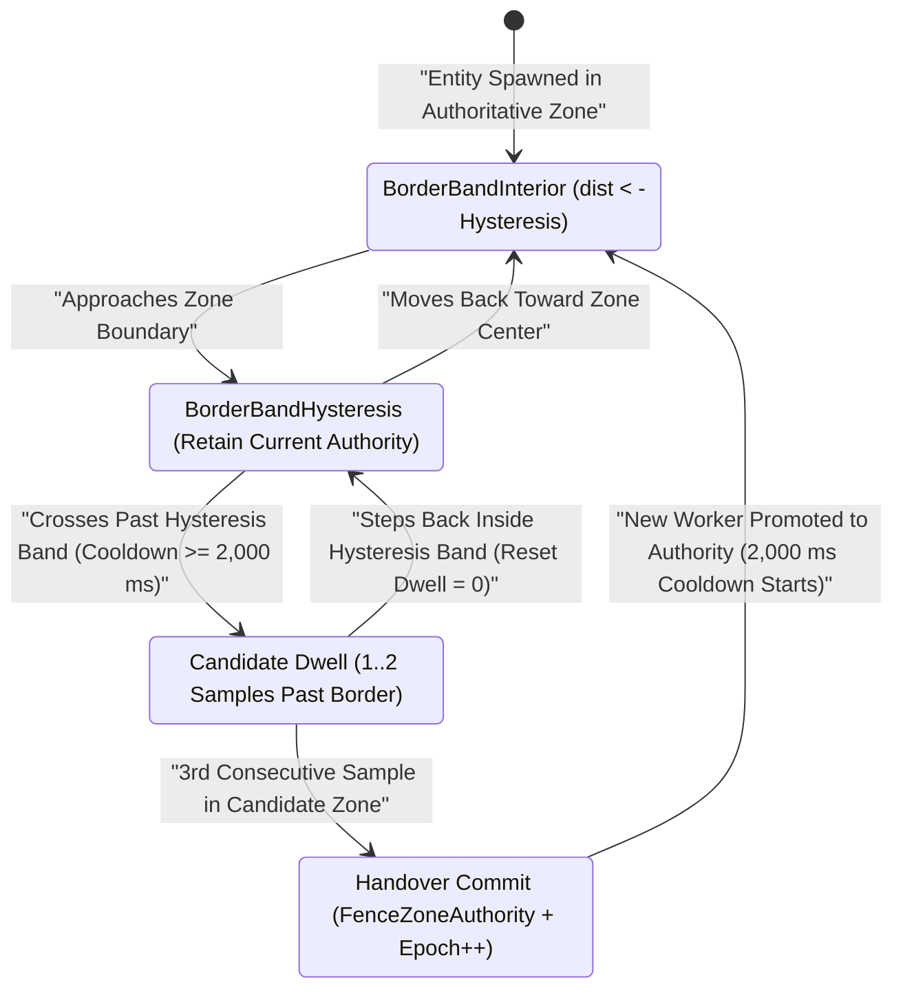

# Mesh Service (`mesh` / `aoc-mesh`)

The `mesh` service (`src/server/services/cmd/mesh`, container `aoc-mesh`) implements `aoc.mesh.v1.MeshService`, the spatial worker authority registry, heartbeat lease monitor, character placement coordinator, and cross-zone border handover arbiter for the [`world`](../../../world/README.md) simulation cluster.

---

## 1. Architecture, 6 Worker Topology Modes & Spatial Authority

`mesh` maintains the authoritative registry of active `world` servers (`world_servers` table in PostgreSQL plus in-memory epoch lease maps in `internal/mesh`) and coordinates spatial partitioning across Verra:

### Worker Index Handout (`0..N`) & Heartbeat Leases
- When a `world` server starts, it calls `MeshService/Register` with its dialable `address` (`host:port`) and owned `regions`. `mesh` inserts or updates the registration, assigns a monotonically increasing `server_id` (`1..N`; `StaticServerID = 0` is reserved for `AOC_MESH_STATIC_WORLD`), and returns `heartbeat_interval_ms = HeartbeatTTL / 3` (`5,000 ms` for the default `15s` TTL) so a single dropped packet never evicts a healthy worker.
- During character login (`CharacterEnterWorld`), [`gateway`](../gateway/README.md) calls `MeshService/Place`, which selects the live `world` worker with an active heartbeat lease inside `AOC_MESH_HEARTBEAT_TTL` (or falls back to `AOC_MESH_STATIC_WORLD` if configured, otherwise returning gRPC `Unavailable` with `google.rpc.ErrorInfo{Reason: "NO_WORLD_SERVER", Domain: "mesh.aoc"}`).

### 6 Spatial Worker Topology Modes & Convex Polygon Cutouts
SandalCore workers (`world` and `internal/mesh`) partition Verra using six composable spatial authority modes (configured via `--area`, `AOC_WORLD_SHARD_MODE`, and `AOC_WORLD_WORKERS`; see [`docs/SERVER_WORKERS.md`](../../../../docs/SERVER_WORKERS.md)):
1. **`world`**: Single monolithic worker authoritative over the entire Verra world map.
2. **`region`**: Coarse regional authority over one of the 5 macro regions (`riverlands`, `sandsquall`, `jundark`, `anvils`, `turquoise_sea`).
3. **`zoi`**: Zone-of-Influence authority bounded by the exact 2D convex/concave polygon geometry of a specific ZOI (`zois.tsv` / `content.db`).
4. **`node_plug_zoi`**: Dedicates a child worker to a high-density settlement node's ZOI while carving a matching convex polygon cutout ("plug") from the surrounding parent `region` worker.
5. **`dynamic_node_plug_zoi`**: Dynamically promotes a settlement node's ZOI into an isolated worker plug when the node reaches `Village` (`Level 3+`) or player density exceeds threshold, returning authority to the parent region when demoted.
6. **`dynamic_zoi`**: Elastic split/merge authority over arbitrary ZOI polygons driven by real-time entity and subscriber load.

### Dynamic Worker Phonetic Naming (`alpha..zulu`, `1 <= N <= 26`)

Dynamic server workers (`dynamic_zoi` and `dynamic_node_plug_zoi`) are named deterministically in the order they start within the spatial scope they serve, using the 26-word NATO phonetic alphabet (`alpha`, `beta`, `charlie`, `delta`, ..., `zulu`):

- **Dynamic ZOI Workers (`dynamic_zoi`)**: `aoc-<zoi-name>-alpha`, `aoc-<zoi-name>-beta`, ..., `aoc-<zoi-name>-zulu` (for example, `aoc-sandsquall-alpha`, `aoc-sandsquall-beta`).
- **Dynamic CityNode Plug Workers (`dynamic_node_plug_zoi`)**: `aoc-<city-name>-alpha`, `aoc-<city-name>-beta`, ..., `aoc-<city-name>-zulu` (for example, `aoc-winstead-alpha`, `aoc-joeva-alpha`).
- **Per-Scope Capacity (`1 <= N <= 26`)**: Each ZOI or CityNode plug supports up to `N = 26` concurrent dynamic worker instances indexed by their NATO phonetic suffix (`0 -> alpha` through `25 -> zulu`), currently stubbed at the initial `-alpha` instance per scope.

```mermaid
flowchart TB
    subgraph Control["Control Plane & Placement"]
        GW["aoc-gateway (:50061 ICS)"]
        Mesh["aoc-mesh (:50054 MeshService)"]
        PG["aoc-postgres (world_servers)"]
    end

    subgraph Shards["5-Region + Plug Worker Mesh (Edge UDP :7777-:7781)"]
        W1["aoc-world-riverlands (Region 1 / :7777 UDP)"]
        W2["aoc-world-sandsquall (Region 2 / :7778 UDP)"]
        W3["aoc-world-jundark (Region 3 / :7779 UDP)"]
        W4["aoc-world-anvils (Region 4 / :7780 UDP)"]
        W5["aoc-world-turquoise-sea (Region 5 / :7781 UDP)"]
    end

    W1 & W2 & W3 & W4 & W5 -->|"1. Register(address, regions) + Heartbeat(server_id)"| Mesh
    Mesh -->|"Persist Lease"| PG
    GW -->|"2. Place(character_id)"| Mesh
    Mesh-->>GW: "PlaceResponse {server_id, address}"
    W1 <-->|"3. 12-Byte MeshForwardHeader + Epoch Fence"| W2
```

---

## 2. 12-Byte `MeshForwardHeader` & Border Handover Lease Fencing

When an entity approaches or crosses a spatial boundary between two workers, `internal/mesh` (`zone_router.go` and `registry.go`) prevents authority split-brain and border-jitter flapping through a three-layer fencing contract:

### Wire Layout: 12-Byte `MeshForwardHeader` (Little-Endian)

Cross-worker forwarded packets prepend a fixed 12-byte header validated against the target zone's monotonic `AuthorityEpoch`:

| Byte Offset | Field | Type | Description |
|:---:|:---|:---:|:---|
| `0..3` | `SourceZoneID` | `uint32` (LE) | Originating zone or previous owner `server_id` (`> 0`). |
| `4..7` | `TargetZoneID` | `uint32` (LE) | Destination authoritative zone ID (`> 0`). |
| `8..11` | `AuthorityEpoch` | `uint32` (LE) | Monotonically increasing fencing token; packets with `AuthorityEpoch < target.AuthorityEpoch` are rejected with `ErrStaleAuthorityEpoch`. |

### Border Hysteresis, 3-Sample Dwell & 2,000 ms Cooldown

`ZoneRouter` (`internal/mesh/zone_router.go`) classifies entity positions into `BorderBandInterior`, `BorderBandHysteresis`, and `BorderBandHandover` and enforces:
- **Spatial Hysteresis Deadband**: `5,000 cm` (`50 m`) world-worker border overlap buffer up to `20,000 cm` (`200 m`, `DefaultBoundaryHysteresisCm`) router deadband so minor movement oscillations along a border never trigger authority churn.
- **3-Sample Consecutive Dwell (`DefaultHandoverDwellSamples = 3`)**: An entity must record `3` consecutive position samples past the hysteresis boundary inside the same candidate target zone before authority transfers.
- **2,000 ms Handover Cooldown (`DefaultHandoverCooldown = 2s`)**: Suppresses back-to-back handovers for `2,000 ms` after a completed authority transition.
- **4-State Handover Lifecycle (`HandoverState`)**: `Authority (0) -> Demoting (3) / Promoting (2) -> Mirror (1)` gated by `FenceZoneAuthority` and active heartbeat leases (`IsLeaseActive`).



---

## 3. gRPC & HTTP API Surface

### gRPC Service (`aoc.mesh.v1.MeshService`, default `:50054`)

All RPCs require the shared `x-service-token` credential:

| RPC Method | Request | Response | Description |
|:---|:---|:---|:---|
| `Register` | `RegisterRequest{address, regions}` | `RegisterResponse{server_id, heartbeat_interval_ms}` | Registers a `world` worker endpoint and owned region slugs; counts as its initial heartbeat. |
| `Heartbeat` | `HeartbeatRequest{server_id}` | `HeartbeatResponse{}` | Refreshes `last_heartbeat` in PostgreSQL and in-memory lease maps; returns `NotFound` (`ErrUnknownServer`) if expired or unknown. |
| `Place` | `PlaceRequest{character_id}` | `PlaceResponse{server_id, address}` | Selects the authoritative live `world` server for a character entering Verra. |

### HTTP Probe & Metrics Endpoints (`:8085/tcp`)

- `GET /livez`, `GET /readyz`, `GET /healthz`: Readiness gate status (`200 OK`).
- `GET /metrics`: OpenMetrics / Prometheus scrape endpoint.

---

## 4. Configuration, Flags & Data Modes

| Variable / Flag | Default (Compose / Host) | Description |
|:---|:---|:---|
| `-addr` / `AOC_MESH_GRPC_BIND_ADDR` | `:50054` (`127.0.0.1:50054`) | TCP bind address for `MeshService` (`AOC_MESH_GRPC_ADDR` alias). |
| `AOC_MESH_HEARTBEAT_TTL` | `15s` | Maximum silence duration before a registered `world` server lease expires (`heartbeat_interval_ms = TTL / 3`). |
| `AOC_MESH_STATIC_WORLD` | `""` (empty) | Optional fallback `host:port` dialable by the game client when no dynamic `world` worker is registered. |
| `AOC_DATABASE_URL` / `DATABASE_URL` | `postgres://aoc:<pass>@postgres:5432/aoc` | PostgreSQL connection string (`world_servers` registry table). |
| `AOC_SERVICE_TOKEN` / `AOC_SERVICE_TOKEN_FILE` | `dist/services/service.token` | Shared token authenticating `world` and `gateway` gRPC calls. |
| `AOC_SERVICE_TICK_HZ` | `30` (`30 Hz`) | Default control-plane service loop cadence (`33.33 ms` tick interval). |
| `-healthcheck` | Flag | Probes `:8085/livez` and exits `0` when healthy. |

- **Data Modes**: `mesh` combines PostgreSQL persistence (`world_servers` table) with in-memory `sync.RWMutex` lease/epoch maps (`zoneEpoch`, `zoneOwner`, `zoneState`, `serverLease`) for sub-millisecond placement and epoch fencing. Spatial ZOI polygon definitions (`zois.tsv` and `city_nodes.tsv`) are generated by [`contentc`](../contentc/README.md) and loaded by `world` workers and [`mesh-gateway`](../mesh-gateway/README.md).

---

## 5. Local Development, Container Operations & Verification

```powershell
# Run mesh registry, zone router, and handover fencing tests
Push-Location src/server/services
go test -v ./cmd/mesh/... ./internal/mesh/... ./internal/meshgrpc/...
Pop-Location

# Verify container health inside Docker Compose
docker exec aoc-mesh /usr/local/bin/service -healthcheck
```

---

## 6. Related Documentation

- [Go Control-Plane Services Overview (`src/server/services/README.md`)](../../README.md)
- [Mesh Gateway & Admin BFF (`src/server/services/cmd/mesh-gateway/README.md`)](../mesh-gateway/README.md)
- [Gateway Service (`src/server/services/cmd/gateway/README.md`)](../gateway/README.md)
- [Authoritative World Server (`src/server/world/README.md`)](../../../world/README.md)
- [Container & Deployment Topology (`src/deploy/README.md`)](../../../deploy/README.md)
- [Server Workers & Spatial Sharding (`docs/SERVER_WORKERS.md`)](../../../../docs/SERVER_WORKERS.md)
- [Control-Plane Services Reference (`docs/SERVICES.md`)](../../../../docs/SERVICES.md)
- [Environment & Configuration Reference (`docs/CONFIGURATION.md`)](../../../../docs/CONFIGURATION.md)
- [Web Admin Studio Guide (`docs/WEB_ADMIN.md`)](../../../../docs/WEB_ADMIN.md)
- [SandalCore Root Documentation (`README.md`)](../../../../README.md)
