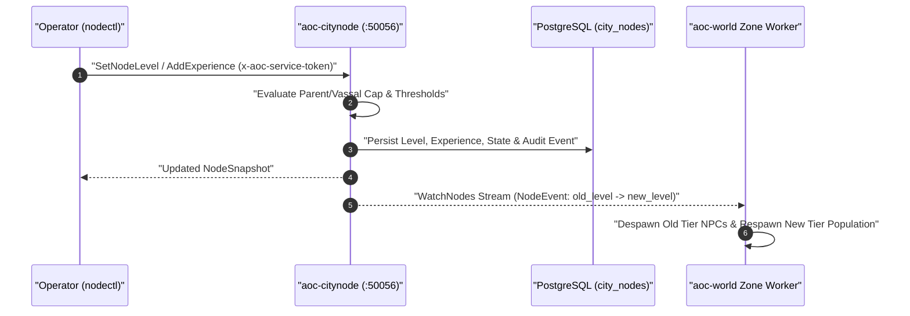

# `nodectl` -- Settlement Node Progression & Clock Operator CLI

`nodectl` (`src/server/services/cmd/nodectl`) is the operator CLI for inspecting and managing the 26 levelable settlement nodes (`0..6` progression from `Wilderness` to `Metropolis`), vassalship rules, simulated progression clocks, and live tier-change event streams served by [`aoc-citynode`](../citynode/README.md) (`aoc.citynode.v1.CityNodeService`).

---

## 1. Architecture & Live Tier-Change Propagation

When `nodectl` alters a settlement node level or XP total on `aoc-citynode`, `aoc-citynode` persists the state transition in PostgreSQL (`city_nodes` and `city_node_events`) and broadcasts a `NodeEvent` over `WatchNodes` to connected `aoc-world` zone servers so settlement NPCs despawn and respawn immediately.



---

## 2. Subcommand Reference

Node identifiers (`<node>`) accept full canonical tags (`Verra_RVR_Joeva`), region-prefixed names (`RVR_Joeva`), short names (`Joeva`, case-insensitive), or raw `int64` design GUIDs (`106658749576309`).

| Subcommand | Arguments | RPC Method | Description |
|:---|:---|:---|:---|
| `list` | *(none)* | `ListNodes` | Prints a formatted table of all 26 settlement nodes with level (`0..6`), stage name, state (`Developing`, `Established`, `Sieged`, `Atrophied`), XP progress, parent node, and tax rate. |
| `get` | `<node>` | `GetNode` | Displays detailed settlement telemetry for a single node, including centroid coordinates, ZOI GUID, mayor character ID, treasury balance, and active buildings. |
| `set-level` | `[--disable-vassalship] <node> <level>` | `SetNodeLevel` | Forces a settlement node to an explicit level (`0=Wilderness`, `1=Expedition`, `2=Encampment`, `3=Village`, `4=Town`, `5=City`, `6=Metropolis`), optionally bypassing regional vassalship exclusion. |
| `add-xp` | `<node> <amount>` | `AddExperience` | Grants (or deducts) settlement progression experience and triggers automatic level-ups or demotions when thresholds are crossed. |
| `clock` | *(none)* | `ControlClock` (`CLOCK_GET`) | Displays the current simulated settlement time, time-scale factor, and pause status. |
| `clock advance` | `<seconds>` | `ControlClock` (`CLOCK_ADVANCE`) | Advances the settlement simulation clock by `<seconds>` to test mayoral election windows, tax cycles, or siege timers. |
| `clock speed` | `<factor>` | `ControlClock` (`CLOCK_SET_SPEED`) | Sets the clock acceleration factor (`0` pauses the simulation clock; `1` runs at real time). |
| `seed` | `[--force] [--file seed.json]` | `ApplySeed` | Applies a declarative JSON seed of initial node levels and building layouts (`--force` overwrites nodes that have already progressed). |
| `watch` | *(none)* | `WatchNodes` | Streams live `NodeEvent` notifications (`LEVEL_CHANGE`, `XP_ADDED`, `MAYOR_CHANGED`, `BUILDING_COMPLETED`, `SEED_APPLIED`) until interrupted. |

---

## 3. Global Flags & Environment Variables

| Flag / Variable | Default | Description |
|:---|:---|:---|
| `--addr` / `AOC_CITYNODE_GRPC_ADDR` | `127.0.0.1:50055` (host) / `citynode:50056` (container) | Target `aoc-citynode` gRPC endpoint. |
| `--token-file` / `AOC_SERVICE_TOKEN_FILE` | `service.token` / `dist/services/service.token` | Shared service token file passed in `x-aoc-service-token`. |

---

## 4. Operational Examples

```bash
# List all 26 settlement nodes across Verra
docker compose -f src/deploy/compose.yml exec -T citynode \
  nodectl --addr 127.0.0.1:50056 list

# Advance Joeva to Stage 3 (Village) and watch live tier events
docker compose -f src/deploy/compose.yml exec -T citynode \
  nodectl --addr 127.0.0.1:50056 set-level Joeva 3

# Grant 25,000 XP to Winstead
docker compose -f src/deploy/compose.yml exec -T citynode \
  nodectl --addr 127.0.0.1:50056 add-xp Winstead 25000
```

---

## 5. Related Documentation

- [CityNode Service (`src/server/services/cmd/citynode/README.md`)](../citynode/README.md)
- [Go Control-Plane Services Overview (`src/server/services/README.md`)](../../README.md)
- [Control-Plane Services Architecture (`docs/SERVICES.md`)](../../../../docs/SERVICES.md)
- [Server Workers & Spatial Mesh Guide (`docs/SERVER_WORKERS.md`)](../../../../docs/SERVER_WORKERS.md)
- [Configuration Reference (`docs/CONFIGURATION.md`)](../../../../docs/CONFIGURATION.md)
- [Web Admin Studio Guide (`docs/WEB_ADMIN.md`)](../../../../docs/WEB_ADMIN.md)
