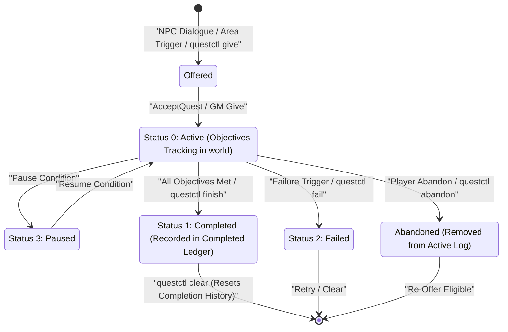
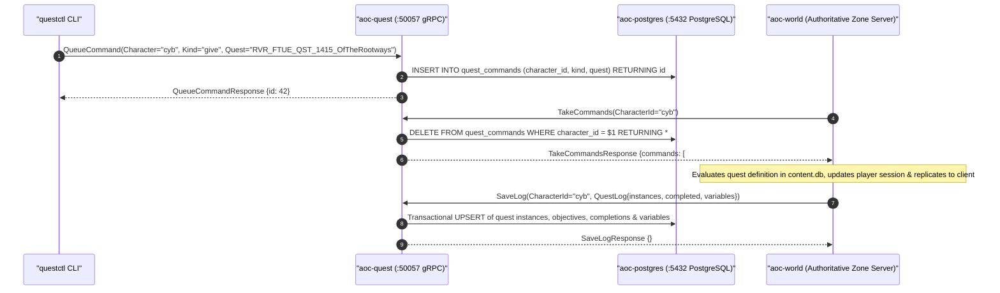

# Quest Service (`quest` / `aoc-quest`)

The `quest` service (`src/server/services/cmd/quest`, container `aoc-quest`) implements `aoc.quest.v1.QuestService`, the persistent journal and asynchronous GM command inbox for character quest state machines, active objectives, completion counts, and chain quest variables.

---

## 1. Architecture & Quest State Machine

While authoritative quest evaluation (objective counters, dialogue triggers, prerequisite expressions, and item/XP reward grants from `content.db`) executes inside the `30 Hz` simulation loop of [`world`](../../../world/README.md), `quest` provides durable PostgreSQL persistence and an transactional command queue (`quest_commands`) so operators and GMs can inspect or mutate a character's quest log whether the character is online or offline.

- **Quest Journal Persistence (`LoadLog` / `SaveLog`)**: Stores three relational collections per character in PostgreSQL (`internal/quest`):
  1. **Active & Historical Instances (`Instances`)**: `record_id`, `instance_guid`, `status` (`0 = active`, `1 = completed`, `2 = failed`, `3 = paused`), and per-objective progress counters.
  2. **Completed Quest Ledger (`Completed`)**: Cumulative completion counts per `record_id` used to enforce repeatable vs. one-time prerequisite gates.
  3. **Chain Quest Variables (`Variables`)**: Named `int64` key-value flags (such as branching narrative choices like `PickedSamias = 1`) evaluated by `content.db` quest prerequisite expressions.
- **Asynchronous Inbox Queue (`QueueCommand` / `TakeCommands`)**: Operator commands issued via [`questctl`](../questctl/README.md) (`give`, `finish`, `fail`, `abandon`, `clear`, `set-var`) are enqueued into the character's durable inbox in PostgreSQL. If the character is currently playing on a `world` worker, `world` drains and applies the queued commands on its next poll (`TakeCommands`); if the character is offline, `world` applies them automatically upon the character's next login.





---

## 2. gRPC & HTTP API Surface

### gRPC Service (`aoc.quest.v1.QuestService`, default `:50057` in Compose / `:50058` on Host)

All gRPC endpoints require the control-plane `x-service-token` credential (`internal/svcauth`):

| RPC Method | Request | Response | Description |
|:---|:---|:---|:---|
| `LoadLog` | `LoadLogRequest{character_id}` | `LoadLogResponse{log}` | Loads a character's complete `QuestLog` (active instances, objectives, completion counts, and variables) by character GUID or name. |
| `SaveLog` | `SaveLogRequest{character_id, log}` | `SaveLogResponse{}` | Atomically replaces the character's persisted quest journal in PostgreSQL. |
| `QueueCommand` | `QueueCommandRequest{character_id, kind, quest, name, value}` | `QueueCommandResponse{id}` | Enqueues a GM quest mutation (`give`, `finish`, `fail`, `abandon`, `clear`, `set-var`) into the character's inbox. |
| `TakeCommands` | `TakeCommandsRequest{character_id}` | `TakeCommandsResponse{commands}` | Atomically dequeues and returns all pending inbox commands for an active character session on `world`. |

### HTTP Probe & Metrics Endpoints (`:8084/tcp`)

- `GET /livez`, `GET /readyz`, `GET /healthz`: Readiness gate health probes (`200 OK`).
- `GET /metrics`: OpenMetrics / Prometheus scrape endpoint.

---

## 3. Configuration, Flags & Data Modes

| Variable / Flag | Default (Compose / Host) | Description |
|:---|:---|:---|
| `-addr` / `AOC_QUEST_GRPC_BIND_ADDR` | `:50057` (`127.0.0.1:50058`) | TCP bind address for `QuestService` (`AOC_QUESTS_GRPC_ADDR` and `AOC_QUEST_GRPC_ADDR` aliases). |
| `AOC_DATABASE_URL` / `DATABASE_URL` | `postgres://aoc:<pass>@postgres:5432/aoc` | PostgreSQL connection URL; runs forward-only schema migrations on startup. |
| `AOC_DB_MAX_CONNS` / `AOC_DB_MIN_CONNS` | `16` / `2` | `pgxpool` connection pool bounds. |
| `AOC_SERVICE_TOKEN` / `AOC_SERVICE_TOKEN_FILE` | `dist/services/service.token` | Shared token authenticating `world` and `questctl` gRPC clients. |
| `AOC_SERVICE_TICK_HZ` | `30` (`30 Hz`) | Default control-plane service loop frequency (`33.33 ms` tick interval). |
| `-healthcheck` | Flag | Probes `:8084/livez` and exits `0` when healthy. |

- **Data Modes (`content.db` & `.tsv` vs. PostgreSQL)**: Static quest definitions, objective graphs, dialogue trees, and reward tables are compiled by [`contentc`](../contentc/README.md) into `content.db` (`v41`, plus localized quest item display names from `item_names.tsv`) and loaded into memory by [`world`](../../../world/README.md) (`AOC_WORLD_CACHE_ALL_CONTENT_IN_MEMORY=true`). The `quest` service itself remains a lean, stateless PostgreSQL persistence and command-queue microservice.

---

## 4. Local Development, Container Operations & Verification

```powershell
# Run quest service unit and gRPC integration tests
Push-Location src/server/services
go test -v ./cmd/quest/... ./internal/quest/... ./internal/questsgrpc/...
Pop-Location

# Inspect a character's quest log via questctl
./dist/services/questctl.exe log <character_name> --addr 127.0.0.1:50057
```

---

## 5. Related Documentation

- [Go Control-Plane Services Overview (`src/server/services/README.md`)](../../README.md)
- [Quest Operator CLI (`src/server/services/cmd/questctl/README.md`)](../questctl/README.md)
- [Authoritative World Server (`src/server/world/README.md`)](../../../world/README.md)
- [Content Compiler (`src/server/services/cmd/contentc/README.md`)](../contentc/README.md)
- [Container & Deployment Topology (`src/deploy/README.md`)](../../../deploy/README.md)
- [Control-Plane Services Reference (`docs/SERVICES.md`)](../../../../docs/SERVICES.md)
- [Environment & Configuration Reference (`docs/CONFIGURATION.md`)](../../../../docs/CONFIGURATION.md)
- [Server Workers & Spatial Sharding (`docs/SERVER_WORKERS.md`)](../../../../docs/SERVER_WORKERS.md)
- [Web Admin Studio Guide (`docs/WEB_ADMIN.md`)](../../../../docs/WEB_ADMIN.md)
- [SandalCore Root Documentation (`README.md`)](../../../../README.md)
