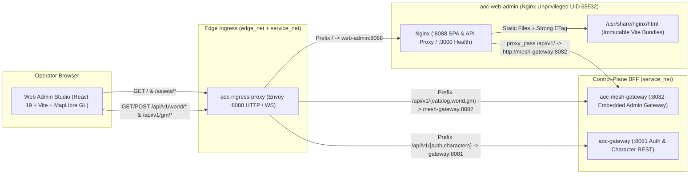

# Web Admin Container Service (`web-admin` / `aoc-web-admin`)

The `web-admin` service (`aoc-web-admin`, built via [`src/deploy/docker/web.Dockerfile`](../../../deploy/docker/web.Dockerfile) from the React 19 + TypeScript + MapLibre GL SPA in [`src/clients/web-admin`](../../../clients/web-admin/README.md)) is the hardened, unprivileged static asset server and `/api/v1/` reverse-proxy container for the SandalCore Web Admin Studio.

---

## 1. Architecture & Request Routing

In the 11-container Linux Compose stack (`src/deploy/compose.yml`), `aoc-web-admin` runs `nginxinc/nginx-unprivileged:1.27-alpine` as UID/GID `65532:65532` with a read-only root filesystem and `ALL` Linux capabilities dropped. It serves two traffic paths:

1. **Unified Ingress Path (`http://127.0.0.1:8080/`)**: [`aoc-ingress-proxy`](../../../deploy/README.md) (Envoy) routes `/api/v1/{catalog,world,gm}/*` directly to [`aoc-mesh-gateway:8082`](../mesh-gateway/README.md), `/api/v1/{auth,characters}/*` to [`aoc-gateway:8081`](../gateway/README.md), and all SPA document and static asset requests (`/`, `/assets/*`) to `aoc-web-admin:8088`.
2. **Direct Container / Reverse-Proxy Path (`:8088/tcp` & `:3000/tcp`)**: When accessed directly on port `8088` (or internal healthcheck port `3000`), `aoc-web-admin` serves immutable fingerprinted bundles from `/usr/share/nginx/html/assets/`, falls back unknown client-side routes to `/index.html` (`try_files $uri $uri/ /index.html`), and reverse-proxies `/api/v1/` requests to `http://mesh-gateway:8082` while preserving `ETag`, `If-None-Match`, `If-Modified-Since`, and `Accept-Encoding` headers.



---

## 2. Container Endpoints & Caching Policy

| Port | Path | Upstream / Behavior | Cache & Header Policy |
|:---:|:---|:---|:---|
| `:3000`, `:8088` | `GET /healthz` | Built-in Nginx health responder | `200 OK` (`"ok\n"`), `access_log off` (probed every `5s` by Docker `HEALTHCHECK`). |
| `:8088` | `GET /assets/*` | `/usr/share/nginx/html/assets/` | `etag on`, `Cache-Control: public, max-age=31536000, immutable`, `gzip_comp_level 6`. |
| `:8088` | `ANY /api/v1/*` | `http://mesh-gateway:8082` | HTTP/1.1 reverse proxy forwarding `Host`, `If-None-Match`, `If-Modified-Since`, and `Accept-Encoding`. |
| `:8088` | `GET /*` (SPA Fallback) | `/usr/share/nginx/html/index.html` | `etag on`, `Cache-Control: no-cache, must-revalidate` so browser tab reloads always pick up new builds. |

---

## 3. Configuration & Multi-Stage Build Reference

`aoc-web-admin` is compiled and packaged by [`src/deploy/docker/web.Dockerfile`](../../../deploy/docker/web.Dockerfile) using a two-stage build (`node:22-alpine` builder -> `nginxinc/nginx-unprivileged:1.27-alpine` runtime):

| Variable / Build Arg | Default | Description |
|:---|:---|:---|
| `WEB_ADMIN_PORT` / `WEB_PORT` | `8088` | Container HTTP listener port for SPA and reverse-proxied API traffic (`AOC_ADMIN_HTTP_BIND_ADDR=[::]:8088`). |
| `WEB_BIND_ADDR` | `0.0.0.0` | Bind address inside the `aoc-web-admin` network namespace. |
| `AOC_ADMIN_HTTP_ADVERTISE_ADDR` | `web-admin:8088` | Internal Docker DNS address targeted by `aoc-ingress-proxy` (`envoy.yaml` cluster `web_admin_http`). |
| `AOC_ADMIN_HTTPS_BIND_ADDR` | `[::]:8443` | Optional TLS bind address for standalone HTTPS deployments. |
| `AOC_ADMIN_METRICS_BIND_ADDR` | `[::]:9099` | Optional dedicated metrics bind address. |
| `AOC_SERVICE_TICK_HZ` | `30` (`30 Hz`) | Upstream `mesh-gateway` world-stream coalescer tick rate consumed by the Web Admin Studio canvas. |

- **Catalog & Map Data Modes (`memory|disk`)**: Static UI bundles are served from container memory/tmpfs-backed Nginx caches, while `/api/v1/catalog/*` and `/api/v1/world/tiles/*` stream from [`mesh-gateway`](../mesh-gateway/README.md)'s in-memory `content.db` (`v41`) / `.tsv` catalog and disk-backed `verra.pmtiles` archive.

---

## 4. Local Development, Container Operations & Verification

```powershell
# Run the Web Admin Studio TypeScript/React test suite and production Vite build
Push-Location src/clients/web-admin
npm test
npm run build
Pop-Location

# Verify container health inside the running Docker Compose stack
docker exec aoc-web-admin wget -q -O - http://127.0.0.1:3000/healthz
```

---

## 5. Related Documentation

- [Web Admin Studio Frontend Architecture (`src/clients/web-admin/README.md`)](../../../clients/web-admin/README.md)
- [Web Admin Studio Operator Guide (`docs/WEB_ADMIN.md`)](../../../../docs/WEB_ADMIN.md)
- [Mesh Gateway & Control-Plane BFF (`src/server/services/cmd/mesh-gateway/README.md`)](../mesh-gateway/README.md)
- [Admin Gateway Service (`src/server/services/cmd/admin-gateway/README.md`)](../admin-gateway/README.md)
- [Go Control-Plane Services Overview (`src/server/services/README.md`)](../../README.md)
- [Container & Deployment Topology (`src/deploy/README.md`)](../../../deploy/README.md)
- [Control-Plane Services Reference (`docs/SERVICES.md`)](../../../../docs/SERVICES.md)
- [Environment & Configuration Reference (`docs/CONFIGURATION.md`)](../../../../docs/CONFIGURATION.md)
- [Server Workers & Spatial Sharding (`docs/SERVER_WORKERS.md`)](../../../../docs/SERVER_WORKERS.md)
- [SandalCore Root Documentation (`README.md`)](../../../../README.md)
