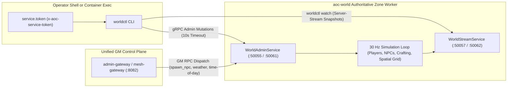

# `worldctl` -- World Admin & Entity Stream Operator CLI

`worldctl` (`src/server/services/cmd/worldctl`) is the command-line administrative tool for inspecting and mutating live `aoc-world` C++23 authoritative zone server state over the internal `aoc.worldadmin.v1.WorldAdminService` (`:50055` host / `:50061` container) and `aoc.worldstream.v1.WorldStreamService` (`:50057` host / `:50062` container) gRPC APIs.

---

## 1. Architecture & Command Dispatch Flow

`worldctl` authenticates every gRPC request with an `x-aoc-service-token` metadata header loaded from `--token-file` (or `AOC_SERVICE_TOKEN_FILE`), executing synchronous point mutations against `WorldAdminService` or opening a continuous 1-second/30 Hz snapshot stream from `WorldStreamService`.



---

## 2. Subcommand Reference

| Subcommand | Arguments | RPC Method | Description |
|:---|:---|:---|:---|
| `players` | *(none)* | `ListOnlineCharacters` | Lists all online players on the targeted worker with character GUID, session ID, level, and `(X, Y, Z)` coordinates. |
| `places` | *(none)* | *(built-in table)* | Prints named Verra teleport landmarks (`lionhold`, `crossroads`, `samias-hope`, `ursine-caves`, `highwaymen-hills`, `minotaur-village`, `keep`, `bandit-camp`). |
| `tp` | `<character> <place> \| <x> <y> [<z>]` | `TeleportCharacter` | Teleports an online player by character name or integer GUID to a named landmark or explicit world coordinates (in centimeters). |
| `speed` | `<character> <multiplier>` | `SetCharacterSpeed` | Sets a character movement speed multiplier within the `[0.5, 10.0]` range (`1.0` restores baseline speed). |
| `give-money` | `<character> <copper>` | `GiveCurrency` | Grants or deducts copper currency (`int64` delta) for an online character. |
| `give-item` | `<character> <item> [<count>] [<rarity>\|q<NN>]` | `GiveItem` | Grants an item by GUID, `Item_...` record name, or display substring, with optional stack count (`1..10000`), rarity (`Common..Artifact`), and quality (`q1..q200`). |
| `place-station` | `<node> <plot> <station>` | `PlaceServiceBuilding` | Places a crafting or service station (`carpentry`, `forge`, `arcane`, `cooking`, `laboratory`, `loom`, `masonry`, `miller`, `inn`, `reagent`, `smelter`, `tanning`) on plot `0..15`. |
| `remove-station` | `<node> <plot>` | `PlaceServiceBuilding` | Clears the service building occupying plot `0..15` (`building_def_guid = 0`). |
| `craft finish` | `<character> [<station>]` | `CompleteCraftingJobs` | Immediately completes ready time-gated crafting jobs for an online player. |
| `craft teach` | `<character> <recipe>` | `ModifyRecipeKnowledge` | Teaches a crafting recipe (or `all` recipes) to an online character. |
| `craft forget` | `<character> <recipe>` | `ModifyRecipeKnowledge` | Removes a known crafting recipe (or `all` recipes) from an online character. |
| `craft taught` | `<character>` | `ModifyRecipeKnowledge` | Lists all recipe GUIDs currently learned by the character (`LIST_ONLY`). |
| `tutorials reset` | `<character>` | `ResetTutorials` | Clears completed tutorial flags so first-time popups fire again. |
| `weapon-xp` | `<character> <line> <level\|xp=N>` | `SetWeaponMasteryXP` | Sets weapon mastery level (`1..25`) or exact XP (`xp=0..5718160`) for a weapon skill-tree line (`sword_2h`, `bow`, `wand`, `tome`, etc.). |
| `npc kill` | `<id>` | `ControlNpc` (`NPC_KILL`) | Applies lethal damage to a live NPC (`id` accepts decimal `600001` or hex `0x927c1`) to trigger loot generation and death state. |
| `npc respawn` | `<id>` | `ControlNpc` (`NPC_RESPAWN`) | Immediately respawns a dead or despawned NPC at its home anchor. |
| `npc reset` | `<id>` | `ControlNpc` (`NPC_RESET`) | Clears the NPC threat table, heals to full health, and returns the entity to its spawn point. |
| `npc heal` | `<id>` | `ControlNpc` (`NPC_HEAL`) | Restores a live NPC to maximum health without clearing combat state. |
| `npc despawn` | `<id>` | `ControlNpc` (`NPC_DESPAWN`) | Removes the NPC from the world until its respawn timer expires or `npc respawn` is called. |
| `npc move` | `<id> <x> <y> [<z>]` | `ControlNpc` (`NPC_MOVE`) | Teleports a live NPC to `(x, y, z)` and sets a temporary hold so it does not immediately leash back. |
| `npc spawn` | `<def_or_name> <x> <y> [<z>] [--level N]` | `SpawnNpc` | Spawns an NPC or monster by record name, display name, or GUID at `(x, y[, z])` with optional level `1..100`. |
| `tick-rate` | `[<hz>] [--metrics-url URL]` | `GET /healthz` \| `GET /admin/tick_hz` | Queries (when `<hz>` is omitted) or updates (`1..120` Hz) the live worker simulation tick rate. |
| `simulate-npcs` | `[on\|off] [--metrics-url URL]` | `GET /healthz` \| `GET /admin/simulate_all_npcs` | Queries or toggles full-world NPC simulation vs. player-proximity culling on the target worker. |
| `watch` | `[--area minx,miny,maxx,maxy] [--density] [--cell N] [--layers ...] [--seconds N]` | `SubscribeWorldState` | Streams live world snapshots or spatial density grids across `players`, `npcs`, `nodes`, `mounts`, and `loot` layers. |
| `help` / `--help` | `[<subcommand>]` | *(built-in CLI help)* | Prints full command and flag usage to stdout (`exit 0` for `worldctl --help`, `-h`, `help`, and `<subcommand> --help`). |

> [!NOTE]
> High-level GM operations such as dynamic NPC spawning (`spawn_npc`), runtime worker tick-rate tuning (`set_tick_rate`), full-world NPC simulation toggling (`set_simulate_all_npcs`), weather transitions, time-of-day overrides, and multi-worker topology inspection are exposed both through `worldctl` and through the HTTP/JSON GM endpoints on [`admin-gateway`](../admin-gateway/README.md) (`/api/v1/gm/commands`, `/api/v1/gm/npc/spawn`, `/api/v1/workers`) and the [Web Admin Studio](../../../../docs/WEB_ADMIN.md).

---

## 3. Global Flags & Environment Variables

| Flag / Variable | Default | Description |
|:---|:---|:---|
| `--addr` / `AOC_WORLD_ADMIN_ADDR` | `127.0.0.1:50055` (host) / `world:50061` (container) | Target `aoc-world` `WorldAdminService` gRPC endpoint. |
| `AOC_WORLD_STREAM_ADDR` | `127.0.0.1:50057` (host) / `world:50062` (container) | Target `aoc-world` `WorldStreamService` gRPC endpoint used by `worldctl watch`. |
| `--metrics-url` / `AOC_WORLD_METRICS_URL` | `http://127.0.0.1:18081` | Target `aoc-world` HTTP probe/admin endpoint used by `worldctl tick-rate` and `worldctl simulate-npcs`. |
| `--token-file` / `AOC_SERVICE_TOKEN_FILE` | `service.token` / `dist/services/service.token` | Shared secret token file sent via `x-aoc-service-token`. |

---

## 4. Operational Examples

```bash
# List online players on the primary Riverlands worker
docker compose -f src/deploy/compose.yml exec -T world-riverlands \
  worldctl --addr 127.0.0.1:50061 players

# Teleport a character to Lionhold and grant a Legendary weapon
docker compose -f src/deploy/compose.yml exec -T world-riverlands \
  worldctl --addr 127.0.0.1:50061 tp Aventus lionhold
docker compose -f src/deploy/compose.yml exec -T world-riverlands \
  worldctl --addr 127.0.0.1:50061 give-item Aventus "Radiant Greatsword" 1 Legendary q150

# Inspect live entity density for 5 seconds
docker compose -f src/deploy/compose.yml exec -T world-riverlands \
  worldctl --addr 127.0.0.1:50061 watch --density --cell 50000 --seconds 5
```

---

## 5. Related Documentation

- [Go Control-Plane Services Overview (`src/server/services/README.md`)](../../README.md)
- [Admin Gateway Service (`src/server/services/cmd/admin-gateway/README.md`)](../admin-gateway/README.md)
- [Control-Plane Services Architecture (`docs/SERVICES.md`)](../../../../docs/SERVICES.md)
- [Server Workers & Spatial Mesh Guide (`docs/SERVER_WORKERS.md`)](../../../../docs/SERVER_WORKERS.md)
- [Configuration Reference (`docs/CONFIGURATION.md`)](../../../../docs/CONFIGURATION.md)
- [Web Admin Studio Guide (`docs/WEB_ADMIN.md`)](../../../../docs/WEB_ADMIN.md)
