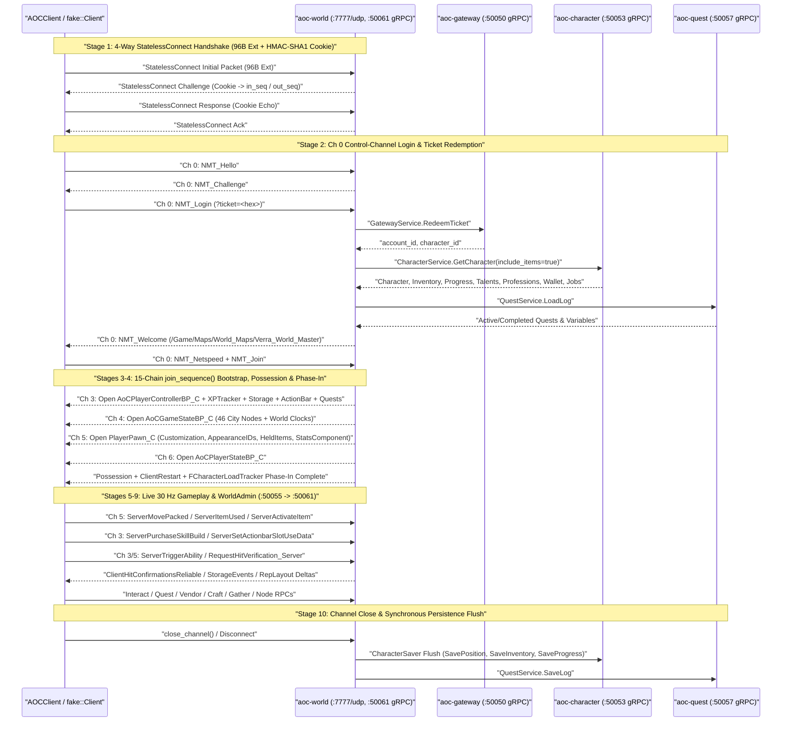

# `world` (`aoc-world`) — Authoritative C++23 30 Hz Zone Server

`world` (`src/server/world`, container `aoc-world`) is the authoritative C++23 30 Hz zone server for SandalCore. It terminates the Unreal Engine 5.6 / IntrepidNet UDP game protocol on `:7777/udp`, drives real-time player, NPC, combat, mount, gathering, foliage, city-node, crafting, vendor, quest, and warehouse simulation, and exposes gRPC administration and telemetry endpoints:

- **Docker Compose (`src/deploy/compose.yml`)**: UDP `127.0.0.1:7777:7777/udp`, `WorldAdminService` on container `:50061` (published on host `127.0.0.1:50055` and routed via Envoy `:9090`), and `WorldStreamService` on container `:50062`.
- **Bare-Metal CLI Defaults (`src/server/world/main.cpp:78`)**: `--bind 127.0.0.1:7777`, `--world-admin 127.0.0.1:50056`, and `--world-stream 127.0.0.1:50057`.

---

## 1. Architecture, Module Layout & Entrypoints

### Subsystem Directory Map (`src/server/world/`)

| Directory / Library | Responsibility |
|:---|:---|
| [`src/libs/aocnet`](../../libs/aocnet/README.md) | UE5 / IntrepidNet UDP wire framing, `StatelessConnect` handshake, generated `RepLayout` class schemas, `NetSerialize` codecs, `FFastArraySerializer`, and `SendLedger` NAK recovery. |
| [`src/libs/aocstats`](../../libs/aocstats/README.md) | Bytecode verifier and interpreter (`parse_bundle`, `run_stats`, `ExprEvaluator`) for the `AOSP` v3 stat and ability expression bundle, `gear_inputs`, `CharacterStats`, and `DamageProfile`. |
| `net/` | UDP socket loop, per-client `Connection` state machine, 14-bit sequence/ack tracking, channel table, reliable/unreliable `Chain` queueing, and partial-bunch fragmentation (`kMaxSingleBunchBits = 7621`, `kMaxPartialBunchBits = 7616`). |
| `login/` | `Ch 0` control-channel state machine (`NMT_Hello`, `NMT_Challenge`, `NMT_Login`, `NMT_Welcome`, `NMT_Netspeed`, `NMT_Join`) and ticket extraction (`?ticket=<hex>`). |
| `svc/` | gRPC client/server adapters for `GatewayService` (`RedeemTicket`), `CharacterService` (`GetCharacter`, `SavePosition`, `SaveInventory`, `SaveProgress`), `CityNodeService` (`WatchNodes`), `QuestService` (`LoadLog`, `SaveLog`, `TakeCommands`), `MeshService` (`RegisterWorld`, `Heartbeat`), `WorldAdminService`, and `WorldStreamService`. |
| `bootstrap/` | `join_sequence()` 15-chain login builder opening `PlayerController` (`Ch 3`), `GameState` (`Ch 4`), `PlayerPawn` (`Ch 5`), and `PlayerState` (`Ch 6`), plus possession, `FCharacterLoadTracker`, and initial storage/talent/quest payloads. |
| `content/` | SQLite readers for `dist/content/content.db` (`ContentDb`, `AbilityContent`, `ContentGearCatalog`, item/talent/mount/gather/foliage/vendor/crafting/quest/warehouse tables). |
| `session/` | Per-player `Session` orchestration, `MoveChecker` movement validation, `CharacterSaver` background persistence, `AbilityPipeline`, `MountController`, `Book` skill tree manager, and `ActorView` spatial interest management. |
| `world/` | Shared world state: `PlayerWorld`, `CityNodes` registry, `zoi_at` Zone of Influence surface lookup, `ANodeLayoutReplicator` town scenery, `NodePopulations`, `roads.h` dynamic road speed tiers, and `town_platforms.bin` floor rescue net. |
| `items/` | Player inventory containers (`Backpack`, `Equipment`, `Quest`, `Resource0..2`), multi-cell grid placement (`BagMatrixOverride`), equip/unequip/move/split/destroy handlers, scroll/consumable activation, and `acquired.h` harvest callouts. |
| `effects/` | Active buff, debuff, DoT, HoT, passive, and shield (`TempHealth`) lifecycle, stack management, tick timers, and `AAoCAbilityLingeringEffect` zone actors. |
| `combat/` | `CombatWorld`, `HitResolver`, `Aftermath` XP and `RewardTable` loot roll engine (`rewards.h`), alignment relationship checks, and combat timers. |
| `npc/` | `NpcWorld` 15 Hz AI loop, Recast/Detour tiled navmesh pathfinding (`area_nav.bin`), sight/aggro/threat tables, leash return, patrol spline/waypoint following, NPC ability casting, and Summoner pets. |
| `spawns/` | World population placement resolver (`population.h`, `area_spawns.h`), circular spawn areas, and dynamic town building spawns. |
| `respawn/` | Player death, corpse `ULootComponent` and `APlayerLootPile` material drop actors, Emberspring discovery/attunement, and respawn teleportation. |
| `gather/` | `NodeBoard` placed `AGatherableActor` resource nodes, `FChannelingData` replication, tool/certification validation, artisan duration/wear/quality/rarity/quantity/XP rolls, and standing huntable creatures. |
| `foliage/` | Painted foliage (`AIntrepidStateIFA`) cell state replication and `Infancy -> Juvenile -> Adult <- Empty` regrowth lifecycle. |
| `vendor/` | Town shopkeepers and PTR GM vendors (`gm_vendor.h`), buy/sell/buyback/repair transactions, copper and Glint currency deduction, and `FNodeTaxDetails` node tax tables. |
| `crafting/` | Crafting and processing stations (`ClientOpenCraftingStationUI`), recipe predicate validation, wall-clock processing job queues, and collection rewards. |
| `dialogue/` | NPC conversation tree evaluation, condition predicates, and dialogue action responses (quest offers, vendor/station/warehouse openers). |
| `quest/` | Runtime quest log state, objective progress counters (kill, gather, interact, visit, talk), map markers, and GM command execution. |
| `warehouse/` | City-node storage clerk warehouse (`OpenPlayerWarehouse`) managing item chunks, material tabs, and cargo tabs. |
| `telemetry/` | Health probes (`/livez`, `/readyz`), structured logging, and `WorldStreamService` snapshot/delta publishing. |

### Entrypoints

```powershell
# Start the full 11-container stack in WSL2 Docker and launch SandalLauncher
.\start.bat

# Stop the 11-container stack
.\stop.bat

# Build C++ world server, Go services, and .NET tools
.\build.bat

# Lifecycle & test commands via sandal.ps1
pwsh -File sandal.ps1 up
pwsh -File sandal.ps1 build
pwsh -File sandal.ps1 deploy
pwsh -File sandal.ps1 test

# Run live end-to-end functional API checks
pwsh -File scripts/test_functional_apis.ps1
```

---

## 2. Design Database & Extracted World Assets

On startup, `world` verifies and loads the extracted game data from `dist/content/` (mounted in the container at `/app/content/` and `/app/dist/content/`, built automatically by `start.bat` or `pwsh -File sandal.ps1 extract`):

- **`dist/content/content.db`** (and optional `dist/content/catalog.db`): SQLite design database compiled by `cmd/contentc` from `CacheDB.dbc`, `src/config/layouts/aoc.usmap` (or `$HOME/.aoc/usmap/*` local override when present), `DefaultCombat.ini`, and `artisan_curves.tsv` with 13 covering/partial indexes (`record_by_guid`, `record_by_schema_guid`, `item_by_name_nocase`, etc.) and `ANALYZE` (`sqlite_stat1`). `world` verifies the schema version (`kMinContentcVersion`), copies `content.db` (`~314 MB`) into an in-memory SQLite instance (`:memory:` via `sqlite3_backup_init`, controlled by `AOC_WORLD_CACHE_CONTENT_DB_IN_MEMORY=true`; falls back to read-only file mode with `PRAGMA mmap_size = 536870912`, `PRAGMA cache_size = -65536`, and `PRAGMA temp_store = MEMORY` when disabled), memoizes `ItemRecord` and `GearPiece` queries in `ContentDb` and `(profile, level, shape)` `CharacterStats` prototypes in `NpcStatBook`, parses the `AOSP` v3 `stat_program` bytecode bundle (`kBundleVersion = 3`), and executes a startup self-check across all 8 player classes before accepting logins.
- **Navigation, Terrain & Spatial Files**:
  - `dist/content/area_nav.bin` (container `/app/content/area_nav.bin`) & `dist/content/area_geom.bin`: Tiled Recast/Detour navigation mesh and embedded `TerrainGrid` heightfield used by `NpcWorld` for 15 Hz pathfinding, line-of-sight raycasts, and ground height resolution. When `AOC_WORLD_CACHE_AREA_NAV_IN_MEMORY=true` (default), `area_nav.bin` (`~1.0 GB`) is preloaded into RAM at startup so background navmesh chunk streaming never touches disk or WSL2 9P mounts (see [`docs/CONFIGURATION.md`](../../../docs/CONFIGURATION.md#23-world-server-in-memory-file-caching-aoc_world_cache_)).
  - `dist/content/town_platforms.bin`: Town building platform surfaces used for spawn height resolution and the town floor rescue net.
  - `dist/content/roads_levels.tsv`, `dist/content/roads.tsv`, `dist/content/mount_speeds.tsv`, & `dist/content/mount_riders.tsv`: Sampled road splines across all 7 node levels and mount Blueprint movement speeds/rider AnimBPs (`mapc roads`, `contentc roads --levels`, `mapc mount-speeds`).
  - `dist/content/npc_motion.tsv`, `dist/content/npc_abilities.tsv`, `dist/content/npc_targeting.tsv`, `dist/content/npc_montages.tsv`, `dist/content/npc_senses.tsv`, `dist/content/npc_aggro_curves.tsv`, & `dist/content/region_foliage.tsv`: NPC capsule/movement/ability/sense tables and painted foliage cell instances (`84,218` Riverlands foliage instances).
  - Generated C++ tables: `build/gen/world/world/zoi_surface_table.h`, `build/gen/world/world/node_constants.h`, `build/gen/world/spawns/region_data.h`, `build/gen/world/spawns/garden_defs.h`, and `src/server/world/spawns/area_spawns.h`.

---

## 3. UDP `:7777` Session Lifecycle, Channels & Replication Framing

### 4-Way `StatelessConnect` Handshake & Packet Framing

1. **Stateless Handshake (`protocol/conn/handshake.h`)**: When the UE5 client connects to `:7777/udp`, `world` exchanges the 4-way `StatelessConnect` handshake carrying Intrepid's 96-byte extension block and an HMAC-SHA1 cookie. The cookie seeds the initial 14-bit packet sequence numbers (`out_seq = cookie[0..1] & 0x3FFF`, `in_seq = cookie[2..3] & 0x3FFF`).
2. **Packet Header & `FNetPacketNotify`**: Every data packet carries a `FNetPacketNotify` header tracking 14-bit `OutSeq`, `InSeq`, and ack bitvectors. Reliable bunches are retransmitted until acknowledged; unreliable actor channels use `SendLedger` (`protocol/repl/send_ledger.h`) to roll back unacknowledged property shadows on packet loss (`FRepLayout::ReceivedNak`).
3. **Control Channel (`Ch 0`) Login Handshake**:
   - Client sends `NMT_Hello` -> Server replies `NMT_Challenge` -> Client sends `NMT_Login` containing `?ticket=<64-hex-chars>` in the URL.
   - `world` calls `GatewayService.RedeemTicket` to verify the single-use ticket and obtain `(account_id, character_id)`, then loads the character via `CharacterService.GetCharacter(include_items = true)` and `QuestService.LoadLog`, and parses the customization JSON via `customization_from_json`.
   - Server sends `NMT_Welcome` (`/Game/Maps/World_Maps/Verra_World_Master`) -> Client sends `NMT_Netspeed` and `NMT_Join`.

### 15-Chain `join_sequence()` Bootstrap (`bootstrap/join_builder.h`)

Upon receiving `NMT_Join`, `world` emits the 15-chain bootstrap sequence across four core actor channels:

- **Channel 3 (`AoCPlayerControllerBP_C`)**: Opens the player controller and its subobjects (`XPTracker` / `ULevelingComponent`, `AbilityComponent`, `StatsComponent`), sends `ClientReceiveStoragePayload` for `Backpack`, `Equipment`, `Quest`, and `Resource0..2`, populates `ClientReceiveActionbarSlotPayload`, replicates known recipes, completed FTUE tutorials, discovered Embersprings, and active quest log entries.
- **Channel 4 (`AoCGameStateBP_C`)**: Opens the game state actor, replicating all 46 city nodes (keyed by their `0..80` sorted `CityNodeRecordBase` rank), node levels, and world clocks.
- **Channel 5 (`PlayerPawn_C`)**: Opens the player pawn at its saved coordinates (or default spawn), replicating `BaseCharacterInfo`, `InteractInfo`, `FCharacterCustomizationSaveData`, `AppearanceIDs`, `HeldItems`, and `StatsComponent` fast arrays partitioned by audience mask (`Owner`, `OwnerProxy`, `EveryoneProxy`, plus `StatRepFloatArrayEveryoneProxy` for `TempHealth`).
- **Channel 6 (`AoCPlayerStateBP_C`)**: Opens the player state actor.
- **Possession & Phase-In**: Sends controller possession, `ClientRestart`, and `FCharacterLoadTracker` completion so the client transitions from the loading screen into active simulation.

### 10-Stage UDP `:7777` Session Lifecycle Sequence



---

## 4. Gameplay Subsystems

### Movement, `MoveChecker` & `CharacterSaver`

- **`MoveChecker`**: Decodes `ServerMovePacked` (`FCharacterServerMovePackedBits`) on the player pawn (or possessed mount), enforcing horizontal speed bounds (scaled by `MoveSpeedMult`, Sprint, dash, road buffs, and GM speed multipliers with a 1 s step-down grace window), vertical jump/fall envelopes, water/flight mode checks, and 120 s `time_stamp_reset_gap` clock-reset handling. Out-of-bounds moves trigger `ClientAdjustPosition` corrections.
- **`CharacterSaver`**: Asynchronously persists dirty positions (`SavePosition`), inventory/wallet/processing-jobs/recipes/warehouse (`SaveInventory`), and level/XP/talents/action-bar/professions/tutorials/attunements (`SaveProgress`) to `aoc-character`, flushing all pending state on session disconnect.

### Inventory, Equipment, Resource Bags & Stats

- **Storage Containers**: Manages `Backpack` (`70` slots), `Equipment` (`83` `EEquipSlot` slots), `Quest` (`100` slots), and `Resource0..2` (`up to 256` slots per bag for resource bags equipped in `Equipment` slots `23..25`). Resource bags enforce 2D grid packing (`columns x rows`, item `inv_w x inv_h`, and `BagMatrixOverride` blocked cells) and restrict storage to items carrying an `Item.Resource.*` gameplay tag.
- **Item Operations & Stat Recalculation**: Handles `ServerItemUsed`, `ServerActivateItem`, and `ServerRequestStorageEvent` (equip/unequip, bag-to-bag transfers, stack splitting/merging, item destruction, and scroll/potion consumption). Every equipment or effect change re-evaluates `CharacterStats` (`libaocstats`) and transmits only changed `float32` stat handles and updated pawn `HeldItems` / `AppearanceIDs`.

### Progression, Talents & Action Bar

- **Experience & Leveling (`XPTracker`)**: Tracks Adventuring XP and debt (`LevelingTypeDef` `108651085518458`), 21 weapon skill lines (`Weapon_1H_Axe`..`Weapon_Ranged_Wand`), and 22 professions across the five fast maps of `ULevelingComponent`. Leveling up grants Archetype, Stamina, and Weapon skill points (`leveling_point`) and unlocks auto-granted ranks (`skill_node.auto_granted`).
- **Skill Trees & Action Bar (`Book`)**: Validates `ServerPurchaseSkillBuild` (rank purchases, refunds, and full tree respecs across class, universal, weapon, and profession trees, including the 128 multi-option `SkillTreeSlot` choice nodes), updates `KnownAbilities`, `ReplicatedRecordsToLoad`, and passive `CurrentEffects`, and persists `ServerSetActionbarSlotUseData` (`20` banks x `16` slots) and `ServerSetUseRangedWeapon`.

### Combat, Abilities, Projectiles, NPCs, Death & Loot

- **`AbilityRuntime` & `AbilityPipeline`**: Executes player and NPC abilities (`ServerTriggerAbility`, `ServerNotifyHeldAbilityCancelled`, `RequestHitVerification_Server`), supporting instant casts, timed/channeled casts, multi-stage weapon combos, looped casts (Bard songs), charged casts (`GetAbilityProgressRatio`), cooldown groups, charge pools, stat/effect-stack costs (`ab_cost`, `ab_effect_cost`), projectiles (`ab_projectile`), server-flown Ball Lightning projectiles (`launch_ball` / `ball_step` / `Cast::Missile::Kind::Ball`, flying a 500 cm radius sphere at 350 cm/s for up to 3,000 cm along `ball_heading_degrees` through `CombatWorld::enemies_touching`, damaging touching enemies on contact and every 0.5 s with Volatile, and continuing after caster death via `AbilityPipeline::set_dead`), and lingering zone actors (`AAoCAbilityLingeringEffect`). Ranged weapon swings (Wand, Shortbow, Longbow, Book) enforce sequential combo step progression (`swing_montage`, accepting only step 1 or the next step in the combo so a modified client cannot repeat multi-arrow volley steps out of order), fire each swing's arrows/bolts/pages (`plan_shot`, `plan_notes`) only while that swing remains active (suppressing unlaunched arrows once the next swing's item appears or when the swing is ended early), cap root shot flight time at `kMaxShotFlight` (`5.0 s`), and expose client hit-request slots only for melee swings and the Wand's beam steps (capped per step via `kBeamHits`: `4` on the first beam step, `14` on the second, and `2` on beam end/audio hits, with `0` client hit-request slots on ranged proc hits).
- **`HitResolver`, `EffectBook` & `CombatWorld`**: Evaluates compiled `ab_expr` formulas and native float32 `DamageProfile` functions (`CalculateDamage*`, host functions `20..29`), checks `CombatPermissions` alignment relations, applies buffs, DoTs (`Burning`, `Bleeding`, `Hemorrhage`, `Poison`), stat debuffs (`Shaken`, `Volatile`, `Demoralized`, `Blinded`, `Weakened`, `Dazed`), slows/snares (`MoveSpeed`, `Slow`, `Snare`, `Chilled`, Tank Grapple, mud, and webs reducing mob walk speed by `1 - max_snare` across chase, wander, and leash return while leaving attack leaps at full speed; hard CC such as roots, stuns, knockbacks, and sleeps remains unapplied to mob AI movement), HoTs, and shields (`TempHealth`), and sends `ClientHitConfirmationsReliable` / `ClientHitConfirmations` (including `extra_exports` for target NPC `CollisionCylinder` components).
- **`NpcWorld` (15 Hz AI & Navmesh)**: Simulates spawned NPCs across 74,778 world placements, circular spawn areas, and 1,346 spline/waypoint patrol routes over `area_nav.bin`. Manages sight/aggro perception, threat tables, combat positioning, all-family creature attack animations (`429` abilities across beast, humanoid, monster, and cultist families, falling back to a plain swing while animated tasks wait on fight timers or health thresholds), preset NPC faces (`CustomizeCharacterAppearanceDataId`), leash return with full health reset, and Summoner pets.
- **Aftermath, Corpses & Loot**: On NPC death, `Aftermath` computes Adventuring and weapon XP (applying `Experience_LevelDiff` decay and XP debt recovery; if a post-death or same-tick kill levels up a dead player, `finish_level_up` preserves `0` Health/Mana/Stamina so the player stays dead until respawn grants the new level's maximum pools) and evaluates hierarchical `RewardTable` loot (`loot_table` predicates, weights, and `ItemVariation` quality/durability formulas, host functions `30..31` and `160..161`). Corpses expose `ULootComponent` containers (`ClientReceiveLootStoragePayload`, `ServerRequestLootStorageEvents`); player death spawns an `APlayerLootPile` for dropped materials and offers respawn at the nearest or home Emberspring.

### Mounts & Road Speed Tiers

- **`MountController` & `MountBook`**: Supports all 101 ground, flying, and aquatic mounts (`SummonMount` item use and `Summon_Mount` cast), replicating `ANPCCharacter` + `UMountComponent` (`GroundMountComponent`, `FlyingMountComponent`, `AquaticMountComponent`) with summon/desummon dissolve timers, rider possession (`ClientRestart`), `MountAbility_Sprint` dash, water/submersion and 500 m distance auto-dismount, and persisted per-item mount `Health`, `Mana`, and death `LockExpiration`.
- **Dynamic Road Tiers (`src/server/world/world/roads.h`)**: Evaluates player/mount proximity to the 145 road splines in `dist/content/roads_levels.tsv`, applying the owner city node's current level (`Wilderness`..`Metropolis`) to grant `Road_T0..T4_Speed_Mount` (`+10%` to `+30%` `MoveSpeedMult`).

### Gathering, Foliage, Hunting & Professions

- **22 Professions & 5 Certification Tiers**: Tracks `Novice` (`0`), `Apprentice` (`1`, max 5), `Journeyman` (`2`, max 4), `Master` (`3`, max 3), and `GrandMaster` (`4`, max 2) certifications, promotion scrolls, and `ServerDemoteCertification`.
- **Resource Nodes, Painted Foliage & Hunting**:
  - `NodeBoard` manages 339 placed `AGatherableActor` resource nodes (Mining, Lumberjacking, Herbalism).
  - `foliage/` manages 402 painted foliage definitions (`743` `GatheringFoliageState`s) across `AIntrepidStateIFA` cell state arrays (`Infancy 0 -> Juvenile 1 -> Adult 2 -> Empty 3 -> paint_state`).
  - Standing huntable creatures and hunting corpses use the same `gather_interaction` pipeline.
  - Harvesting replicates `FChannelingData` on `InteractInfo`, evaluates artisan speed, tool durability wear, rolled quality (`ItemVariation`), rarity, quantity, and XP formulas via `gather_host_fn` (`180..184`), deposits items into `Resource0..2` or `Backpack`, and emits localized `FCalloutQueueInfo` acquisition popups.

### Quests, Dialogue, Vendors, Crafting, Processing & Warehouse

- **Dialogue & Quests (`dialogue/`, `quest/`)**: Evaluates NPC dialogue trees (`ServerInteractWithInteractableComponent`), triggers window-open and quest actions, tracks active quest objectives and map pins, executes queued GM commands from `aoc-quest`, and persists changes via `QuestService.SaveLog`.
- **Vendors & Taxes (`vendor/`)**: Serves 95 town and PTR GM vendor definitions (`ClientOpenVendor`, `FVendorPurchaseCart`, `FVendorTransactionCart`) and the 78-tag node tax table (`ServerGetNodeTaxTable` / `ClientSetNodeTaxTable`), handling copper and Glint purchases, sales, buyback, and item repair.
- **Crafting & Processing (`crafting/`)**: Opens crafting and processing stations (`ClientOpenCraftingStationUI`), checks recipe predicates (`craft_pred` node level, biome, and building modifications plus `character_known_recipes`), deducts input materials, currency, and station tax, runs wall-clock processing jobs (`character_processing_jobs` with snapshotted crafter artisan ratings `rating_xp`, `rating_quantity`, `rating_rarity`), and delivers crafted outputs and profession XP.
- **Warehouse (`warehouse/`)**: Serves city-node storage clerks (`OpenPlayerWarehouse`), supporting item transfers across warehouse item chunks, material tabs, and cargo tabs (`character_warehouse_items`).

### City Nodes, ZOI, Town Layout & Embersprings

- **`CityNodes` & ZOI Surface (`src/server/world/world/city_nodes.h`)**: Subscribes to `aoc-citynode`'s `WatchNodes` stream, replicates live node levels and XP on `AoCGameStateBP_C`, resolves world coordinates to Zones of Influence via `zoi_at(x, y)` (`build/gen/world/world/zoi_surface_table.h`), and answers expression host functions `170..177` (`node_host_fn`).
- **Town Scenery & Populations (`ANodeLayoutReplicator`, `NodePopulations`)**: Replicates level-appropriate town layout props (preserving `-0.0` transform signs), service building plots (`UAoCNodePlotComponent`), GM-placed crafting stations (`PlaceStation` / `RemoveStation`), and node-level NPC populations, backed by `town_platforms.bin` and a floor rescue net during layout transitions.
- **Embersprings (`respawn/`)**: Handles Emberspring proximity discovery, home attunement, and death/recall respawn points (`character_attunements`, `character_home_attunement`).

---

## 5. `worldctl` Admin CLI, `WorldAdminService` / `WorldStreamService` & CLI Reference

`world` hosts two Bearer-authenticated (`AOC_SERVICE_TOKEN`) gRPC servers defined in `src/server/proto/internal/aoc/worldadmin/v1/worldadmin.proto` and `src/server/proto/internal/aoc/worldstream/v1/worldstream.proto`:

- **`WorldAdminService` (Compose `world:50061`, host `127.0.0.1:50055` / Envoy `:9090`; bare-metal default `127.0.0.1:50056` via `--world-admin` / `AOC_WORLD_ADMIN_ADDR`)**: Queues commands onto `world`'s network thread between ticks (`ListPlayers`, `ListPlaces`, `Teleport`, `SetMoveSpeed`, `PlaceStation`, `RemoveStation`, `FinishProcessingJobs`, `TeachRecipe`, `ForgetRecipe`, `ListTaughtRecipes`, `ResetTutorials`, `NpcKill`, `NpcRespawn`, `NpcReset`, `NpcHeal`, `NpcDespawn`, `NpcMove`). Client-originated GM teleport RPCs (`ServerTeleportXYZ`, `ServerTeleport`, `ServerTeleportPlayer`) are gated behind `--gm-commands` (`AOC_GM_COMMANDS=1`).
- **`WorldStreamService` (Compose `world:50062`; bare-metal default `127.0.0.1:50057` via `--world-stream` / `AOC_WORLD_STREAM_ADDR`)**: Streams up to 5 Hz area entity snapshots/deltas and 200/500/1,000 m cell density grids (`Subscribe`, `Inspect`, `Search`, `GetStatus`) for `worldctl watch`, `aoc-mesh-gateway`, and `aoc-web-admin`.

See [`src/server/services/README.md`](../services/README.md#7-world-admin-world-stream--worldctl-cmdworldctl) for `worldctl` command examples.

### Complete `world` CLI Flag & Environment Variable Reference (`src/server/world/main.cpp`)

| CLI Flag(s) | Environment Variable(s) | Default | Description |
|:---|:---|:---|:---|
| `--bind`, `--port` | `AOC_WORLD_BIND_ADDR`, `AOC_WORLD_BIND`, `WORLD_UDP_PORT`, `AOC_WORLD_UDP_PORT` | `127.0.0.1:7777` | UDP bind address and port shorthand (`0.0.0.0:<port>`). |
| `--public-address`, `--advertise-addr` | `AOC_WORLD_ADVERTISE_ADDR` | `--bind` | Public UDP `ip:port` registered with `aoc-mesh` for client `PlayReply` routing. |
| `--server-id`, `--zone` | `AOC_WORLD_SERVER_ID`, `AOC_WORLD_ZONE` | Assigned by `mesh` | Server ID and zone identifier metadata. |
| `--world-admin`, `--admin-port` | `AOC_WORLD_ADMIN_ADDR`, `AOC_WORLD_ADMIN_BIND`, `WORLD_ADMIN_PORT` | `127.0.0.1:50056` (`:50061` in Compose, host `:50055`) | `WorldAdminService` gRPC bind address (`--no-world-admin` / `AOC_NO_WORLD_ADMIN` disables). |
| `--world-stream` | `AOC_WORLD_STREAM_ADDR`, `AOC_WORLD_STREAM_BIND` | `127.0.0.1:50057` (`:50062` in Compose) | `WorldStreamService` gRPC bind address (`--no-world-stream` / `AOC_NO_WORLD_STREAM` disables). |
| `--mesh`, `--director-grpc` | `AOC_MESH_GRPC_ADDR`, `AOC_DIRECTOR_GRPC_ADDR` | `127.0.0.1:50053` (`mesh:50054` in Compose) | Upstream `MeshService` gRPC address. |
| `--gateway` | `AOC_GATEWAY_GRPC_ADDR` | `127.0.0.1:50054` (`gateway:50050` in Compose) | Upstream `GatewayService` internal gRPC address (`RedeemTicket`). |
| `--character`, `--char-grpc` | `AOC_CHAR_GRPC_ADDR` | `127.0.0.1:50052` (`character:50053` in Compose) | Upstream `CharacterService` gRPC address. |
| `--citynode`, `--citynode-grpc` | `AOC_CITYNODE_GRPC_ADDR` | `127.0.0.1:50055` (`citynode:50056` in Compose) | Upstream `CityNodeService` gRPC address (`--no-citynode` / `AOC_NO_CITYNODE` disables). |
| `--citynode-seed` | `AOC_CITYNODE_SEED` | `config/seeds/citynode_seed.json` | Fallback settlement node level seed file used until `aoc-citynode` connects. |
| `--quest-grpc` | `AOC_QUESTS_GRPC_ADDR`, `AOC_QUEST_GRPC_ADDR` | `127.0.0.1:50058` (`quest:50057` in Compose) | Upstream `QuestService` gRPC address (`LoadLog`, `SaveLog`, `TakeCommands`). |
| `--service-token-file`, `--service-token` | `AOC_SERVICE_TOKEN_FILE`, `AOC_SERVICE_TOKEN` | `dist/services/service.token` | Shared internal gRPC Bearer token file or literal value. |
| `--content-db`, `--content-dir` | `AOC_CONTENT_DB`, `AOC_CONTENT_DIR` | `dist/content/content.db` | Compiled SQLite design database (`contentc`) and content directory root. |
| `--catalog-db` | `AOC_CATALOG_DB` | `dist/content/catalog.db` | Optional `AOCDB01` runtime design-data catalog (`schema v16`). |
| `--area-nav`, `--nav-mesh` | `AOC_AREA_NAV`, `AOC_NAV_MESH` | `dist/content/area_nav.bin` | Tiled Recast/Detour navmesh and embedded `TerrainGrid` heightfield (`mapc build`). |
| `--foliage-map` | `AOC_FOLIAGE_MAP` | `dist/content/region_foliage.tsv` | Painted Riverlands foliage instances (`84,218` instances from `mapc extract`). |
| `--roads-levels`, `--roads`, `--roads-map` | `AOC_ROADS_LEVELS`, `AOC_ROADS`, `AOC_ROADS_MAP` | `dist/content/roads_levels.tsv` / `dist/content/roads.tsv` | Multi-level and single-level road spline speed buff tables (`contentc roads --levels`). |
| `--mount-speeds`, `--mount-riders` | `AOC_MOUNT_SPEEDS`, `AOC_MOUNT_RIDERS` | `dist/content/mount_speeds.tsv` / `dist/content/mount_riders.tsv` | Mount Blueprint speeds and rider AnimBP mappings (`mapc mount-speeds`). |
| `--town-platforms`, `--town-layouts` | `AOC_TOWN_PLATFORMS`, `AOC_TOWN_LAYOUTS` | `dist/content/town_platforms.bin` | City node building platform surfaces (`mapc town-floors`) and layout tables. |
| `--npc-motion` | `AOC_NPC_MOTION` | `dist/content/npc_motion.tsv` | NPC archetype capsule dimensions, speeds, stat lists, and reward links. |
| `--npc-abilities`, `--npc-montages`, `--npc-targeting` | `AOC_NPC_ABILITIES`, `AOC_NPC_MONTAGES`, `AOC_NPC_TARGETING` | `dist/content/npc_abilities.tsv`, `npc_montages.tsv`, `npc_targeting.tsv` | Creature ability tasks, montage lengths/notifies, and hit targeting shapes (`src/tools/npcabilities`). |
| `--npc-senses`, `--npc-aggro-curves` | `AOC_NPC_SENSES`, `AOC_NPC_AGGRO_CURVES` | `dist/content/npc_senses.tsv`, `npc_aggro_curves.tsv` | Creature perception radii, leash distances, and level-scaling aggro curves. |
| `--npc-appearances`, `--npc-names`, `--npc-acl`, `--npc-params`, `--npc-conditions` | `AOC_NPC_APPEARANCES`, `AOC_NPC_NAMES`, `AOC_NPC_ACL`, `AOC_NPC_PARAMS`, `AOC_NPC_CONDITIONS` | `dist/content/npc_*.tsv` | Auxiliary NPC appearance, display name, ACL, parameter, and spawn condition tables. |
| `--artisan-curves`, `--item-names` | `AOC_ARTISAN_CURVES`, `AOC_ITEM_NAMES` | `dist/content/artisan_curves.tsv` | Profession XP curves (`mapc artisan-curves`) and localized item display names (`src/tools/itemnames`). |
| `--tick-hz` | `AOC_TICK_HZ`, `AOC_WORLD_TICK_HZ` | `30` | Server simulation tick rate in Hz (`10..120`, or `0` for datagram-driven loop). |
| — | `AOC_WORLD_CACHE_ALL_CONTENT_IN_MEMORY`, `AOC_WORLD_CACHE_CONTENT_DB_IN_MEMORY`, `AOC_WORLD_CACHE_AREA_NAV_IN_MEMORY`, `AOC_WORLD_CACHE_FILES` | `true`, `true`, `true`, `content.db,area_nav.bin` | Preloads `content.db` (`:memory:` via `sqlite3_backup_init`, or `512 MiB` `PRAGMA mmap_size` fallback) and `area_nav.bin` into RAM at startup so zero disk reads occur during gameplay (see [`docs/CONFIGURATION.md`](../../../docs/CONFIGURATION.md#23-world-server-in-memory-file-caching-aoc_world_cache_)). |
| — | `AOC_WORLD_NAV_PUMP_BUDGET_MS`, `AOC_WORLD_NPC_GROUND_PER_TICK`, `AOC_WORLD_NPC_GROUND_BUDGET_MS`, `AOC_WORLD_NPC_STATS_PER_TICK`, `AOC_WORLD_NPC_PATHFINDS_PER_STEP` | `4.0` ms, `32`, `2.0` ms, `24`, `24` | Per-tick navmesh tile integration budget (`0.5..50.0` ms), NPC grounding count (`1..4096`) and budget (`0.25..50.0` ms), lazy `NpcStatBook` builds (`1..1024`, with prototype cloning), and Detour sliced A* pathfinds per step (`1..512`). |
| — | `AOC_WORLD_ACTOR_OPEN_PER_TICK`, `AOC_WORLD_ACTOR_WAKE_PER_TICK`, `AOC_WORLD_ACTOR_UPDATE_PER_TICK`, `AOC_WORLD_NODE_SUMMARIES_PER_TICK`, `AOC_WORLD_FOLIAGE_CELLS_PER_TICK` | `24`, `24`, `64`, `4`, `2` | Per-player per-tick bounds for new actor channels (`1..512`), woken dormant channels (`1..512`), actor state updates (`1..1024`), node/siege summary packets (`1..128`), and foliage cells (`1..64`) (see [`docs/CONFIGURATION.md`](../../../docs/CONFIGURATION.md#24-world-server-per-tick-entity--spatial-streaming-budgets-aoc_world_)). |
| `--view-threads`, `--no-view-spread`, `--share-updates` | `AOC_VIEW_THREADS`, `AOC_NO_VIEW_SPREAD`, `AOC_SHARE_UPDATES` | `4`, `false`, `on` | Parallel `ActorView` worker count (`0..8`), phase-spread toggle, and shared mob delta caching (`on\|off\|verify`). |
| `--move-ack-gap-ms`, `--max-move-speed` | `AOC_MOVE_ACK_GAP_MS`, `AOC_MAX_MOVE_SPEED` | `100`, `1.5x capture max` | Minimum interval (ms) between movement acks and ground speed plausibility ceiling (cm/s). |
| `--loop-stats` | `AOC_LOOP_STATS_SECONDS`, `AOC_LOOP_STATS` | `0` (off) | Periodic `[loop]` and `[tick]` latency/bandwidth telemetry interval in seconds. |
| `--gamestate-mode` | `AOC_GAMESTATE_MODE` | `tier3` | `AoCGameStateBP_C` replication profile (`tier1`, `tier2`, `tier3`, or `captured`). |
| `--area-radius`, `--area-radius-m` | `AOC_AREA_RADIUS_M` | `-1` (full Riverlands) | Living-area spawn radius in meters (`-1` = all 12 Riverlands ZOIs, `0` = no non-player actors, `> 0` = circle radius). |
| `--no-zone-filter`, `--no-node-scenery`, `--no-node-people`, `--node-origin`, `--scenery-radius` | `AOC_NO_ZONE_FILTER`, `AOC_NO_NODE_SCENERY`, `AOC_NO_NODE_PEOPLE`, `AOC_NODE_ORIGIN`, `AOC_SCENERY_RADIUS_M` | `false`, `false`, `false`, `captured`, `1450.0` | ZOI filter toggle, town scenery/population toggles, replicator origin mode (`captured\|record`), and scenery streaming radius (m). |
| `--no-npc-movement`, `--no-generic-npcs`, `--npc-exclude`, `--no-spawn-filter`, `--spawn-humanoids`, `--spawn-hour`, `--spawn-node-level` | `AOC_NO_GENERIC_NPCS`, `AOC_NPC_EXCLUDE`, `AOC_NO_SPAWN_FILTER`, `AOC_SPAWN_HUMANOIDS`, `AOC_SPAWN_HOUR`, `AOC_SPAWN_NODE_LEVEL` | `false`, `false`, `""`, `false`, `false`, `-1`, `Wilderness` | NPC movement, archetype exclusion, spawn condition filter, humanoid filter, time-of-day (`0..24`), and fallback node level. |
| `--no-combat`, `--no-reactions`, `--npc-aggro-cm`, `--npc-leash-cm`, `--npc-damage-mult`, `--combat-seed` | `AOC_NO_COMBAT`, `AOC_NO_REACTIONS`, `AOC_NPC_AGGRO_CM`, `AOC_NPC_LEASH_CM`, `AOC_NPC_DAMAGE_MULT`, `AOC_COMBAT_SEED` | `false`, `false`, `800.0`, `3000.0`, `1.0`, `0` | Combat/reaction toggles, fallback aggro/leash distances (cm), NPC damage multiplier, and deterministic PRNG seed. |
| `--no-loot`, `--no-death-loss`, `--no-respawn`, `--corpse-seconds`, `--loot-corpse-seconds`, `--loot-chance-mult`, `--loot-rarity-boost`, `--loot-seed` | `AOC_NO_LOOT`, `AOC_NO_DEATH_LOSS`, `AOC_NO_RESPAWN`, `AOC_CORPSE_SECONDS`, `AOC_LOOT_CORPSE_SECONDS`, `AOC_LOOT_CHANCE_MULT`, `AOC_LOOT_RARITY_BOOST`, `AOC_LOOT_SEED` | `false`, `false`, `false`, `15.0`, `120.0`, `1.0`, `1.0`, `0` | Kill aftermath/loot/material-drop/respawn toggles, corpse lifetimes (s), drop-rate/rarity multipliers, and loot PRNG seed. |
| `--no-gathering`, `--gather-respawn-mult`, `--gather-quality-literal`, `--gather-seed`, `--foliage-regrow-mult` | `AOC_NO_GATHERING`, `AOC_GATHER_RESPAWN_MULT`, `AOC_GATHER_QUALITY_LITERAL`, `AOC_GATHER_SEED`, `AOC_FOLIAGE_REGROW_MULT` | `false`, `1.0`, `false`, `0`, `1.0` | Gathering toggle, node respawn and foliage regrowth multipliers, literal quality mode, and harvest PRNG seed. |
| `--gm-commands`, `--gm-garden`, `--gm-starter-set` | `AOC_GM_COMMANDS`, `AOC_GM_GARDEN`, `AOC_GM_STARTER_SET` | `false`, `false`, `true` (Compose) | Enables client GM teleport RPCs, spawns the 15-node GM gathering garden, and configures GM starter kit grants. |
| `--max-sessions`, `--log-file`, `--healthcheck`, `--dump-hex`, `--stateless`, `--echo` | — | `0` (unlimited), `""` | Session cap, file log sink, container health probe (`--healthcheck`), and packet diagnostic flags. |

---

## 6. Verification & Testing

```powershell
# Run all C++, Go, and .NET unit and integration tests
pwsh -File sandal.ps1 test

# Run live end-to-end functional API verification against the running stack
pwsh -File scripts/test_functional_apis.ps1
```

- **Unit & Integration Test Suite (`src/server/world/tests/test_world_*.cpp` and `src/tests/cpp/world/`)**: C++ test executables cover every `world` subsystem (`test_world_session`, `test_world_channels`, `test_world_repl_acks`, `test_world_actor_nak`, `test_world_character_setup`, `test_world_content_db`, `test_world_stats`, `test_world_effects`, `test_world_ability_content`, `test_world_abilities`, `test_world_ability_session`, `test_world_items_session`, `test_world_leveling`, `test_world_npc`, `test_world_combat`, `test_world_mounts`, `test_world_city_nodes`, `test_world_node_layout`, `test_world_gather`, `test_world_foliage`, `test_world_vendor`, `test_world_crafting`, `test_world_quests`, `test_world_warehouse`, `test_world_embersprings`, `test_world_admin`, and `test_world_stream`).
- **10-Stage Live Fake-Client E2E Gate (`/app/test_world_live_e2e`)**: Invoked inside the `aoc-world` container by `pwsh -File scripts/test_functional_apis.ps1`, driving a full `fake::Client` session over UDP `:7777` through all 10 stages (`StatelessConnect` 96B `Ext` -> `Ch 0` `NMT_{Hello,Login,Welcome,Join}` -> 15-chain `join_sequence()` -> Possession/Phase-In -> Move/Teleport -> Inventory/Equip/XP -> Talents/ActionBar -> Combat/Pets -> Interact/Quest/Vendor/Craft/Node -> `worldctl` `:50055` -> PostgreSQL persistence verification).
