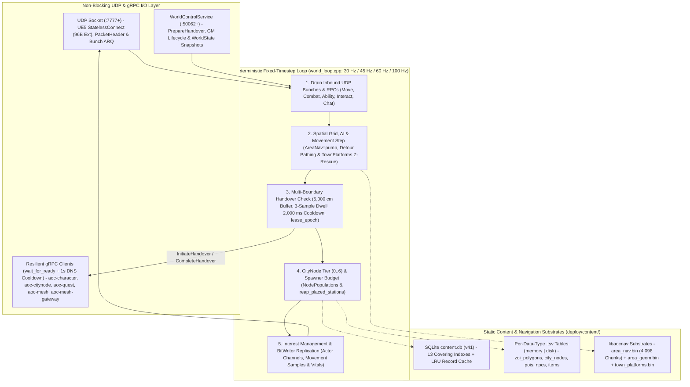

# SandalCore Authoritative C++23 Zone Server Worker (`src/server/world`)

**Primary Diataxis Quadrant**: `Technical Reference` (`DOC-01`)
**Related Guides**: [Server Workers & Spatial Authority Guide](../../../docs/SERVER_WORKERS.md) | [Configuration Reference](../../../docs/CONFIGURATION.md) | [Control-Plane Services Reference](../../../docs/SERVICES.md) | [Web Admin & GM Studio Reference](../../../docs/WEB_ADMIN.md) | [Wire Protocol Specifications](../../../docs/reference/wire-specs/README.md) | [`libaocnav` Navigation Reference](../../libs/aocnav/README.md) | [`libaocnet` Wire Protocol Reference](../../libs/aocnet/README.md) | [`libaocstats` Combat & Stat Reference](../../libs/aocstats/README.md)

`src/server/world` compiles the authoritative C++23 Linux zone server binary (`world`). Depending on the configured [`AOC_WORLD_PARTITION_MODE`](../../../docs/SERVER_WORKERS.md), one or more `world` worker containers simulate the continent of Verra (`Verra_01`), terminating the Unreal Engine 5.6 UDP bit-stream protocol (`:7777+`), stepping movement and combat on a deterministic fixed-timestep loop (`30 Hz` world / `45 Hz` region / `60 Hz` ZOI / `100 Hz` CityNode & POI), streaming tiled Recast/Detour navigation meshes (`libaocnav`), and coordinating cross-boundary player handovers via `aoc-mesh` (`:50055`) and `aoc-mesh-gateway` (`:50056`).

---

## 1. Server Worker Topologies, Canonical Naming & Mesh Index (`worker_index`)

A single `world` binary supports all **6 spatial topology presets**, additive **Convex Polygon / POI Cutout** workers, and **Mix-and-Match** deployments configured via CLI flags (`--area-tier`, `--area-id`, `--area-polygon`, `--area-exclude-node-plug`, `--tick-hz`) or root `.env` variables:

| Spatial Tier (`--area-tier`) | Canonical Worker Naming | Dynamic Scaling & Capacity | Default Tick Rate & NPC Cap | Spatial Authority Rule |
|:---|:---|:---|:---:|:---|
| **`world`** (`single_world` / `world_only`) | `aoc-world` (or single-region default `aoc-riverlands` / `aoc-world-riverlands`) | `1` worker (`11` containers total in default Riverlands setup) | `30 Hz` (`AOC_WORLD_TICK_HZ_WORLD=30`, `5200` cap via `AOC_WORLD_NPC_SIM_STEP_CAP_WORLD=5200`) | Simulates the full continent (or `riverlands` only at `45 Hz` / `3600` cap when `AOC_WORLD_PARTITION_MODE=single_riverlands` is active out of the box). |
| **`region`** (`single_riverlands` / `per_region`) | `aoc-<region-name>` (`aoc-riverlands`, `aoc-sandsquall`, `aoc-jundark`, `aoc-anvils`, `aoc-turquoise-sea`) | `1` worker per biome region (`5` regions) | `45 Hz` (`AOC_WORLD_TICK_HZ_REGION=45`, `3600` cap via `AOC_WORLD_NPC_SIM_STEP_CAP_REGION=3600`) | Simulates a single biome region polygon. |
| **`zoi`** (`per_zoi` / `dynamic_zoi`) | Static: `aoc-<zoi-name>`<br/>Dynamic stub: `aoc-<zoi-name>-alpha` .. `aoc-<zoi-name>-zulu` | Static: `1` per ZOI (`27` ZOIs)<br/>Dynamic stub: `1..26` per ZOI (NATO alphabet startup order, `min = 1` `-alpha`, never `0`; currently a stub) | `60 Hz` (`AOC_WORLD_TICK_HZ_ZOI=60`, `2600` cap via `AOC_WORLD_NPC_SIM_STEP_CAP_ZOI=2600`) | Simulates a single Voronoi Zone of Influence polygon (`zoi_polygons.tsv`). When paired with a Node Plug worker, passes `--area-exclude-node-plug=Verra_SAN_Node_Sunhaven,Verra_SAN_Node_Azmaran`. |
| **`node_plug`** (`per_zoi_nodes_and_pois` / `dynamic_node_plug_zoi`) | Static: `aoc-<city-name>`<br/>Dynamic stub: `aoc-<city-name>-alpha` .. `aoc-<city-name>-zulu` | Static: `1` per city plug<br/>Dynamic stub: `1..26` per city plug (NATO alphabet startup order, `min = 1` `-alpha`, never `0`; currently a stub) | `100 Hz` (`AOC_WORLD_TICK_HZ_NODE=100`, `1500` cap via `AOC_WORLD_NPC_SIM_STEP_CAP_NODE=1500`) | Simulates the rotated `1 km x 1 km` (`100,000 cm x 100,000 cm`) CityNode Oriented Bounding Box (`node_plug_bounds.tsv`). |
| **`polygon_cutout` / `poi`** (`AOC_WORLD_POI_CUTOUT`) | `aoc-<cutout-name>` (e.g., `aoc-carphin`) | `1+` additive workers | `100 Hz` (`AOC_WORLD_TICK_HZ_POI=100`, `1500` cap via `AOC_WORLD_NPC_SIM_STEP_CAP_POI=1500`) | Simulates an arbitrary counter-clockwise convex polygon (`--area-polygon="x1,y1;x2,y2;..."`) carved out of the surrounding ZOI or region. |

### Mesh Worker Index (`worker_index`) & Collision-Free `FGuid` Allocation

On startup, `main.cpp` invokes `MeshClient::RegisterWorld` against [`aoc-mesh`](../services/cmd/mesh/README.md) (`:50055`):

1. `aoc-mesh` assigns a unique sequential `worker_index` (`uint16_t` `server_id`, `1..N`) to the worker and records its bounding polygon and tick rate in the cluster spatial directory.
2. The worker initializes `ServerGuidAllocator(worker_index, randomizer)` (`src/server/world/session.h`), embedding `worker_index` into the upper bits of `FGuid.D` for every spawned actor (`0x60100001` NPCs, loot bags, projectiles) so dynamic GUIDs never collide across shards.

---

## 2. Internal C++23 Architecture & Simulation Loop



---

## 3. Source Module Map (`src/server/world/`)

| File / Subsystem | Responsibility |
|:---|:---|
| [`main.cpp`](main.cpp) | CLI flag and environment parser (`AreaFilter`, `--area-tier`, `--area-polygon`, `--tick-hz`, `.tsv` `memory|disk` modes), SQLite `content.db` (`v41`) startup validation, `aoc-mesh` registration (`worker_index`), and signal handling. |
| [`world_loop.h`](world_loop.h) / [`world_loop.cpp`](world_loop.cpp) & [`net/tick_loop.h`](net/tick_loop.h) | Fixed-timestep simulation loop (`30 Hz` world / `45 Hz` region / `60 Hz` ZOI / `100 Hz` CityNode & POI), per-worker runtime tick mode (`Dynamic (30-60 Hz)`, `0 Hz (Pause NPCs)`, and manual `10, 15, 20, 25, 30, 40, 50, 60 Hz`), spatial hash grid, multi-boundary player handover evaluation (`kBoundaryBufferCm = 5000.0f`, `kHandoverDwellSamples = 3`, `kHandoverCooldownMs = 2000`), and periodic character persistence. |
| [`session.h`](session.h) / [`session.cpp`](session.cpp) | Per-connection UE5 `IpNetDriver` state machine (`StatelessConnect` 96-byte `Ext`, `NMT_Hello`, `NMT_Login`, `NMT_Welcome`, `NMT_Join`), reliable bunch reassembly, channel table, and `ServerGuidAllocator(worker_index)`. |
| [`spawns/node_population.h`](spawns/node_population.h) / [`spawns/node_population.cpp`](spawns/node_population.cpp) | Live CityNode progression stage (`0..6`: `Wilderness` -> `Metropolis`) population scaling backed by PostgreSQL `city_node_state` in `mesh-gateway`, **Tier 5/6 population fallback** (`kMaxAuthoredNodePopLevel = 4`) to the last defined populated layout so Tier 5 (`City`) and Tier 6 (`Metropolis`) nodes remain fully populated, obsolete station reaping (`reap_placed_stations`), and `TownPlatforms` (`AOCTPF01`) vertical $Z$-floor rescue. |
| [`npc/npc_world.h`](npc/npc_world.h) / [`npc/npc_world.cpp`](npc/npc_world.cpp) | Ambient and active NPC AI state machine (`Stand`, `Idle`, `Wander`, `Patrol`, `Ordered`), Little's Law `<= 1.0 s` (`>= 1 Hz`) entity backlog floor (`min_for_1s_backlog = (total + eff_hz - 1) / eff_hz`), per-worker `0 Hz (Pause NPCs)` toggle (`simulate_all_npcs`), `AreaNav` grounding, and GM lifecycle handlers (`SpawnNpc`, `KillNpc`, `DespawnNpc`, `HealNpc`, `ResetNpc`, `RespawnNpc`, `MoveNpc`). |
| [`combat.h`](combat.h) / [`combat.cpp`](combat.cpp) | Ability execution, cooldowns, projectile/cone hit-registration, `libaocstats` mitigation curves, status effect ticks, and loot/XP distribution. |
| [`control_service.h`](control_service.h) / [`control_service.cpp`](control_service.cpp) | Internal gRPC `WorldControlService` (`:50062+`) servicing `PrepareHandover`, `GetWorldState` (consumed by `world-stream`), `SetNodeStage`, and synchronous GM actor/player manipulation RPCs. |

---

## 4. Seamless Multi-Boundary Handover, CityNode (`0..6`) Scaling & GM Lifecycle

1. **Multi-Boundary Handover & Spatial Anti-Hysteresis**:
   - Supports live transitions across `region <-> region`, `region <-> zoi`, `zoi <-> zoi`, `zoi <-> node_plug`, and `any <-> polygon_cutout` boundaries.
   - Enforces a **`5,000 cm` (`50 m`)** inward border buffer, **`3` consecutive dwell samples**, a **`2,000 ms`** post-handover cooldown, and monotonic **`lease_epoch`** fencing via [`aoc-mesh-gateway`](../services/cmd/mesh-gateway/README.md).
2. **Live CityNode Stage (`0..6`) Population Scaling, Tier 5/6 Fallback & PostgreSQL Control-Plane SSoT**:
   - Coordinates with `mesh-gateway` PostgreSQL tables **`world_simulation_state`** (persisting the continuous `9x` Time of Day + 360-day Verra Calendar `Year >= 1 AE`, 4 seasons x 3 months x 30 days, and per-worker tick-rate overrides) and **`city_node_state`** (persisting settlement stage `0..6` and governance).
   - Transitions any of the 85 settlements across stages `0..6` at runtime without restarting the worker, falling back to the last defined populated layout (`kMaxAuthoredNodePopLevel = 4`) for Tier `5` (`City`) and Tier `6` (`Metropolis`), reaping outdated crafting stations (`reap_placed_stations`), spawning new tier NPCs/guards, and resolving multi-story deck heights via `town_platforms.bin` ([`src/libs/aocnav/README.md`](../../libs/aocnav/README.md)).
3. **Per-Worker Tick-Rate Selector (`0 Hz` NPC Pause) & Little's Law `<= 1.0 s` (`>= 1 Hz`) Entity Backlog Floor**:
   - Each worker supports runtime tick-rate selection (`Dynamic (30-60 Hz)`, `0 Hz (Pause NPCs)` pausing NPC simulation on just that worker, and manual `10, 15, 20, 25, 30, 40, 50, 60 Hz`) and enforces a Little's Law `<= 1.0 s` (`>= 1 Hz`) entity service-time backlog floor (`min_for_1s_backlog = (total + eff_hz - 1) / eff_hz` in `NpcWorld::step_all_ambient`).
4. **End-to-End GM Actor Lifecycle**:
   - Exposes `SpawnNpc`, `KillNpc`, `DespawnNpc`, `HealNpc`, `ResetNpc`, `RespawnNpc`, `MoveNpc`, and `TeleportPlayer` over gRPC (`WorldControlService`), immediately replicating state deltas to connected UE5 clients and the [Web Admin & GM Studio](../../../docs/WEB_ADMIN.md).

---

## 5. Modular C++23 `fake::Client` Player-Bot Architecture (`9` Class Headers x `26` Pattern-of-Life Plans)

`src/server/world/tests/test_world_live_e2e.cpp` implements a modular C++23 `fake::Client` player-bot verification suite organized into **`9` bot class/type headers** and **`26` single-concern pattern-of-life plan headers**:

1. **`9` Bot Class & Type Headers (`src/server/world/tests/bots/`)**:
   - [`tests/bots/bot_types.h`](tests/bots/bot_types.h) (core `PlayerBot` state, `BotTestEnv` (`NormalLand`, `AcrossBoundary`, `InWater`), `run_all_64_archetype_combinations_all_envs`, and `assert_partner_visible_and_updating` AOI replication verifier) plus the 8 `Lv 50` class archetype headers (`tests/bots/bot_class_*.h`):
   - [`bot_class_fighter.h`](tests/bots/bot_class_fighter.h), [`bot_class_tank.h`](tests/bots/bot_class_tank.h), [`bot_class_rogue.h`](tests/bots/bot_class_rogue.h), [`bot_class_ranger.h`](tests/bots/bot_class_ranger.h), [`bot_class_mage.h`](tests/bots/bot_class_mage.h), [`bot_class_summoner.h`](tests/bots/bot_class_summoner.h), [`bot_class_cleric.h`](tests/bots/bot_class_cleric.h), and [`bot_class_bard.h`](tests/bots/bot_class_bard.h).
2. **`26` Single-Concern Pattern-of-Life Headers (`src/server/world/tests/plans/plan_*.h`)**:
   - `plan_abilities.h`, `plan_border_crossing.h`, `plan_buddy_pairs.h`, `plan_caravans.h`, `plan_combat.h`, `plan_crafting.h`, `plan_death.h`, `plan_drowning.h`, `plan_enchanting.h`, `plan_equipment.h`, `plan_fall_damage.h`, `plan_harvest.h`, `plan_item_usage_and_scrolls.h`, `plan_locomotion_walk_run.h`, `plan_loot.h`, `plan_mounts.h`, `plan_npc_dialogue.h`, `plan_pack_mules.h`, `plan_pets.h`, `plan_pvp.h`, `plan_quests.h`, `plan_skills.h`, `plan_storage.h`, `plan_swimming.h`, `plan_vendors.h`, and `plan_weapons.h`.
3. **`8 x 8 = 64` Bidirectional `(Actor <-> Observer)` Archetype Matrix Across `3` Spatial Environments**:
   - Every pattern-of-life plan executes across all **`8 x 8 = 64` bidirectional `(Actor <-> Observer)` archetype combinations** (`Fighter`, `Tank`, `Rogue`, `Ranger`, `Mage`, `Summoner`, `Cleric`, `Bard`) across **`NormalLand`**, **`AcrossBoundary`** (`aoc-world-riverlands <-> aoc-world-sandsquall` cross-worker AOI halo), and **`InWater`** (`Swimming` / aquatic border).

---

## 6. Build, Unit Tests & Live 10-Stage E2E Verification

`src/server/world` compiles exclusively inside the Linux container toolchain (`src/deploy/docker/world.Dockerfile`, CMake + Ninja + Clang 18 / GCC 14):

```powershell
# Compile the world worker image and all services
.\build.bat

# Run C++23 ctest unit suites (bitstream, session, handover hysteresis, node populations, navmesh)
.\sandal.ps1 test

# Run the live 10-stage fake::Client UDP :7777 play-flow & functional API gate
pwsh -NoProfile -File scripts/test_functional_apis.ps1
```
